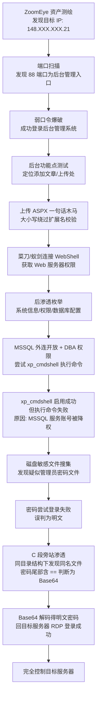

## 概述

本页面沉淀自 0w1Club 微信公众号归档文章《保护宅男——拒绝黄赌毒》，记录了一次针对境外赌博网站的完整渗透测试攻击链复现。攻击流程涵盖 **资产测绘**、**端口探测**、**弱口令爆破**、**WebShell 上传绕过**、**数据库交互与命令执行尝试**、**权限维持与提权受挫**、**敏感文件搜集与编码识别**、**C 段旁站辅助验证** 至 **最终拿下服务器权限** 的全阶段实战技术细节。

该案例典型展示了 **"信息收集 -> 初始访问 -> 权限提升受阻 -> 凭证窃取与解码 -> 横向验证 -> 最终沦陷"** 的实战攻防节奏，尤其体现了 **Base64 编码密码文件的识别与 C 段旁站对比验证** 在实战中的关键作用。

> ⚠️ **法律合规声明**：本页面仅供安全研究、教学复盘与红队演练授权场景参考。未经授权对目标系统进行扫描、漏洞利用、数据窃取或权限获取均违反《中华人民共和国网络安全法》等法律法规，严禁用于非法用途。

## 攻击链全景图



## 详细攻击复现

### 资产发现与侦察

#### ZoomEye 空间测绘定位目标
攻击者使用 **ZoomEye**（文中代称 "zxxxxxx"）进行资产测绘，直接定位到目标 IP：`148.XXX.XXX.21`。这体现了空间搜索引擎在 **攻击面管理 (ASM)** 和 **红队侦察** 阶段的核心价值。

> 关联阅读：[[info-gathering-tools-collection]] 中的 `ZoomEye`/`FOFA`/`Quake` 资产测绘引擎使用指南；[[vulnerability-mining-recon-aiqicha-fofa]] 中的实战侦察方法论。

#### 端口扫描与服务识别
对目标 IP 进行全端口扫描（工具未指定，推测为 Nmap/Masscan），发现 **88 端口** 开放，且为 Web 管理后台入口。

```text
PORT   STATE SERVICE
88/tcp open  kerberos-sec (实为 HTTP 管理后台)
```
> 关联阅读：[[network-fundamentals-penetration-testing]] 端口扫描基础；[[xd-security-pentest-basic-stage-notes]] 信息收集阶段端口服务识别。

### 初始访问：弱口令与 WebShell 植入

#### 后台弱口令登录
针对 88 端口后台登录界面，尝试常见弱口令（如 `admin/admin`、`admin/123456` 等）直接登录成功。这反映了目标资产 **身份认证策略薄弱**，且未启用 MFA、IP 白名单或账号锁定策略。

> 关联阅读：[[xd-security-logic-vulnerability-notes-day33-36]] 弱口令与验证码绕过；[[card-game-platform-penetration-test-case-study]] 棋牌平台后台弱口令 `admin/admin` 实战。

#### 后台上传功能点挖掘
登录后遍历后台功能，定位至 **"添加文章"** 模块的图片/附件上传处。

#### 文件上传绕过：大小写变形突破扩展名黑名单
- **拦截机制**：后台前端/后端校验禁止 `.aspx` 等可执行脚本后缀。
- **绕过手法**：将文件名修改为 `.Aspx` 或 `.aSpX` 等大小写混合形式，绕过 **大小写敏感的字符串匹配黑名单**。
- **结果**：上传成功，返回可访问的 WebShell 路径。

> 关联阅读：[[upload-labs-file-upload-bypass-writeup]] 文件上传绕过技术全景（黑名单绕过、大小写绕过、解析漏洞等）；[[php-file-inclusion-vulnerability]] 文件上传后的包含利用；[[xd-security-waf-bypass-techniques-day46-49]] WAF/上传绕过综合策略。

#### WebShell 连接与流量对抗
- 使用 **中国菜刀 / 蚁剑** 连接 WebShell。
- 遭遇拦截（疑为主机防护软件或 WAF 拦截默认 User-Agent / 流量特征）。
- **对抗**：修改客户端 User-Agent、启用流量编码/加密插件（蚁剑编码器）绕过拦截，成功建立交互会话。

> 关联阅读：[[php-webshell-fundamentals-chopper-analysis]] 一句话木马原理、菜刀/蚁剑/哥斯拉流量特征与对抗；[[php-webshell-obfuscation-av-evasion]] WebShell 混淆免杀技术；[[cobalt-strike-ssl-keystore-evasion]] C2 流量证书伪装。

### 后渗透枚举与数据库攻击

#### 系统信息与权限收集
通过 WebShell 执行系统命令（`whoami`, `systeminfo`, `net user` 等），确认：
- 当前权限：`NETWORK SERVICE` 或 `IIS APPPOOL\DefaultAppPool` 等 Web 服务低权账号。
- 操作系统：Windows Server 2008/2012 系列（推测）。
- 网络拓扑：目标处于 DMZ 或内网边界，具备出网条件。

#### 数据库配置文件泄露与外连利用
- 在 Web 目录下发现数据库连接配置文件（`web.config` / `conn.asp` 等），提取 MSSQL 连接字符串：**SA 账号、弱口令、开放远程连接 (TCP 1433)**。
- 使用本地 SSMS / Navicat / sqlcmd 直连数据库成功，**拥有 sysadmin (DBA) 权限**。

> 关联阅读：[[sqlmap-comprehensive-guide]] SQLMap 自动化注入与数据库枚举；[[card-game-platform-penetration-test-case-study]] MSSQL 弱口令直连实战；[[xd-security-src-vulnerability-hunting-notes-day86-88]] MSSQL 写 Shell 编码问题。

#### `xp_cmdshell` 启用与命令执行受阻
利用 MSSQL 扩展存储过程 `xp_cmdshell` 尝试执行系统命令反弹 Shell 或添加用户：

```sql
-- 启用 xp_cmdshell
EXEC sp_configure 'show advanced options', 1; RECONFIGURE;
EXEC sp_configure 'xp_cmdshell', 1; RECONFIGURE;

-- 尝试执行命令
EXEC master..xp_cmdshell 'whoami';
EXEC master..xp_cmdshell 'net user test Test@123 /add';
EXEC master..xp_cmdshell 'net localgroup administrators test /add';
```

- **现象**：`xp_cmdshell` 配置开启成功，但命令执行**无回显、无效果**。
- **根因分析**：MSSQL 服务运行账号被降权为 `Local Service` / `Network Service` 或受限域账号，**缺乏 `SeAssignPrimaryTokenPrivilege`、`SeImpersonatePrivilege` 等关键特权**，无法创建进程执行命令。这是典型的 **数据库服务账号最小化权限配置** 阻断了 `xp_cmdshell` 利用链。

> 关联阅读：[[listed-company-penetration-test-case-study]] MSSQL `xp_cmdshell` 利用与受阻分析；[[xd-security-privilege-escalation-notes-day58-64]] Windows 提权之数据库提权、令牌窃取（烂土豆/Juicy Potato）绕过服务账号限制；[[cobalt-strike-external-c2-smb-beacon]] 数据库命令执行失败后的替代 C2 上线思路。

### 凭证窃取与编码识别：转折点

#### 敏感文件搜集
在无法通过数据库提权的情况下，攻击者转为 **本地磁盘敏感文件搜集**（`dir /s /b *.txt`, `*.config`, `*.bak`, `*.log` 等），在某目录下发现疑似管理员密码文件（如 `pass.txt`, `admin.bak`, `config.ini`）。

#### 误判与失败
文件内容为一串字符串（如 `YWRtaW5AMTIzNDU2`），攻击者**误判为明文密码**，直接用于 RDP (3389) 登录，**失败**。

#### C 段旁站渗透辅助验证
- **思路转换**：对目标所在 **C 段 (148.XXX.XXX.0/24)** 进行扫描/旁站查询，发现同网段其他资产。
- **旁站突破**：成功拿下一台旁站服务器（手法可能相同：弱口令/漏洞/上传）。
- **对比验证**：在旁站**相同相对路径**下发现同名密码文件，内容尾部包含 **`==`**，强特征判断为 **Base64 编码**。
- **恍然大悟**：目标服务器该文件亦为 Base64 编码，非明文。

> 关联阅读：[[xd-security-internal-network-penetration-notes-day65-66]] 内网横向移动与旁站/C段扫描；[[frp内网渗透应用]] 内网穿透代理访问内网段资产；[[shiro-internal-penetration-case-study]] 实战中通过旁站/横向移动辅助主目标攻击。

#### 解码与最终登录
- **解码**：`Base64Decode("YWRtaW5AMTIzNDU2")` -> `admin@123456` (示例)。
- **验证**：使用解码后的明文密码，配合 Administrator 账号，通过 **RDP (3389)** 成功登录目标服务器。
- **结果**：获得目标服务器 **SYSTEM / Administrator 最高权限**，完成沦陷。

## 核心技术复盘与工具链

| 阶段 | 核心技术/动作 | 关键工具/命令 | 成败关键点 |
| :--- | :--- | :--- | :--- |
| **侦察** | 空间测绘、端口扫描 | ZoomEye, Nmap/Masscan | 精准定位高价值资产 (88 端口后台) |
| **初始访问** | 弱口令爆破、上传绕过 | Burp Suite/Hydra, 大小写绕过 | 黑名单校验缺陷、无 WAF 有效拦截 |
| **持久化/控制** | WebShell 部署与抗拦截 | 中国菜刀/蚁剑/哥斯拉, 编码器 | 客户端流量特征对抗主机防护 |
| **后渗透** | 信息收集、数据库直连 | `systeminfo`, `web.config`, SSMS | 配置文件明文凭证、数据库外连开放、SA 弱口令 |
| **提权尝试** | `xp_cmdshell` 命令执行 | SQL `sp_configure`, `xp_cmdshell` | **MSSQL 服务账号降权导致利用链断裂** |
| **凭证获取** | 敏感文件搜集、编码识别 | `dir /s`, Base64 解码工具 | **C 段旁站对比验证编码格式** (关键转折) |
| **最终沦陷** | RDP 远程桌面登录 | `mstsc` / `rdesktop` | 明文凭证复用、3389 对公网/跳板机开放 |

## 经验总结与防御建议

### 红队视角：实战技巧沉淀
1.  **资产测绘是起点**：ZoomEye/FOFA/Quake 语法积累决定侦察效率，建议建立专属资产指纹库。
2.  **弱口令永远是最高性价比入口**：后台、数据库、RDP、SSH、VPN 等所有认证接口均需纳入弱口令巡检清单。
3.  **上传绕过要理解校验逻辑**：大小写绕过针对不区分大小写的文件系统 (Windows) 配合区分大小写的校验代码；还需掌握 `.htaccess`/`.user.ini`/解析漏洞/条件竞争等多维绕过。
4.  **数据库命令执行受阻是常态**：`xp_cmdshell` 依赖服务账号权限。备选方案：CLR 组件、沙箱逃逸、启动存储过程、SQL Agent Job、甚至通过 WebShell 结合 `certutil`/`bitsadmin`/`powershell` 下载上线 CS/MSF。
5.  **敏感文件搜集要有“解码意识”**：遇到疑似凭证字符串，**优先判断编码** > 直接尝试。常见：Base64 (尾部 `=`/`==`)、Hex、URL Encode、AES/DES (定长)、Hash (定长十六进制)。
6.  **C 段/旁站横向是破局利器**：目标加固较好时，旁站往往共享同运维规范、同密码策略、同目录结构，是低成本获取关键情报（编码格式、密码规律、内网拓扑）的最佳路径。

### 蓝队视角：加固检测清单
| 防御层面 | 加固措施 | 检测规则/日志审计 |
| :--- | :--- | :--- |
| **资产暴露面** | 禁止管理后台、数据库、RDP/SSH 直面公网；强制 VPN/零信任网关访问；CDN/WAF 隐藏真实 IP。 | 资产测绘平台定期巡检暴露面；云厂商安全组/防火墙策略审计。 |
| **身份认证** | 强制复杂密码策略 + MFA + 账号锁定 + 登录 IP 白名单 + 禁用默认账号。 | 登录失败日志 (Event ID 4625) 告警；异地/异常时间登录关联分析。 |
| **Web 应用** | 上传目录禁用脚本执行权限；文件类型校验采用**白名单 + Magic Bytes + 重命名存储**；部署 WAF/RASP。 | Web 访问日志异常 POST (上传接口)；WebShell 特征流量 (菜刀/蚁剑/哥斯拉默认特征) 检测；文件完整性监控 (FIM) 监控 Web 目录新增/变更。 |
| **数据库** | 禁止公网访问；SA 重命名+强密码；禁用 `xp_cmdshell`/`sp_OACreate` 等危险扩展；服务账号最小权限 (普通域用户)；审计登录/执行操作。 | SQL Server 审计 / 扩展事件 监控 `xp_cmdshell` 调用、`sp_configure` 修改、异常登录源 IP。 |
| **主机防护** | 部署 EDR/主机防护 (微步/火绒/360/安天等)；开启 PowerShell Script Block Logging (Event ID 4104)；命令行审计 (Event ID 4688)；AMSI 集成。 | 进程树异常 (w3wp.exe/cmd.exe/powershell.exe 父子链)；可疑命令行 (whoami, net user, certutil, bitsadmin, powershell -enc)；WebShell 文件落地查杀。 |
| **凭证管理** | 严禁明文/弱编码存储密码；使用密管/密保箱/LAPS 管理本地管理员密码；定期轮换。 | 磁盘敏感文件扫描 (正则匹配 Base64/Hex/密码关键字)；内存凭证窃取检测 (LSAss 访问异常)。 |
| **横向移动** | 网络微隔离 (东西向流量控制)；禁止工作站/服务器间非必要 445/135/3389/5985 通信；SMB 签名/加密强制；限制 NTLM 认证。 | SMB 会话异常 (Event ID 5145)；Pass-the-Hash/PTT 特征 (Event ID 4624 Logon Type 9 / 4624 with NTLM)；横向扫描流量 (ARP/TCP SYN 扫描内网段)。 |

## 关联知识库页面

### 同类实战案例
- [[card-game-platform-penetration-test-case-study]]：棋牌平台渗透，FOFA 资产收集 + 后台弱口令 + SQLMap 注入 + MSSQL `xp_cmdshell` 拿 Shell，高度相似的赌博/棋牌行业资产攻击面。
- [[listed-company-penetration-test-case-study]]：上市公司内网渗透，文件上传 + 哥斯拉 + MSF/CS 会话传递 + Socks 代理 + MSSQL `xp_cmdshell` + IoT/OT 设备失陷。
- [[loan-company-penetration-test-case-study]]：贷款公司渗透，堡垒机任意用户登录 + 会话审计提权 + 横向管控 906 台服务器。
- [[medical-system-internal-penetration-case-study]]：医疗系统内网渗透，越权上传 + 凭证导出 + 横向移动 + 敏感数据泄露。
- [[edu-src-penetration-test-case-study]]：教育行业 SRC 渗透，FOFA 资产 + 弱口令 + 存储型 XSS + 文件上传 Getshell + 蚁剑连接。
- [[shiro-internal-penetration-case-study]]：Shiro RCE 初始访问 + 火绒免杀上线 CS + NTLM 导出 + FTP 横向 + 威胁溯源发现前置攻击者。
- [[0x6270-penetration-test-case-study-2023]]：安服项目实战，登录口 SQLi 拿 DBA + `xp_cmdshell` 上线 CS + 提权 + 影子用户 + SOCKS 代理 + fscan 内网扫描 + RDP/IPC$/WMI/FTP 横向移动拿下 40+ 主机。

### 核心技术深度解析
- **资产侦察**：[[info-gathering-tools-collection]]、[[vulnerability-mining-recon-aiqicha-fofa]]、[[iot-reconnaissance-information-gathering]]
- **WebShell 攻防**：[[php-webshell-fundamentals-chopper-analysis]]、[[php-webshell-obfuscation-av-evasion]]、[[backdoor-persistence-techniques]]、[[upload-labs-file-upload-bypass-writeup]]
- **数据库攻击**：[[sqlmap-comprehensive-guide]]、[[mysql-dnslog-injection-loadfile-unc]]、[[redis-unauthorized-access-rce]]、[[xd-security-src-vulnerability-hunting-notes-day86-88]]
- **Windows 提权/横向**：[[xd-security-privilege-escalation-notes-day58-64]]、[[xd-security-internal-network-penetration-notes-day65-66]]、[[xd-security-internal-network-penetration-notes-day67-68]]、[[xd-security-internal-network-penetration-notes-day69-70]]、[[jumbo-internal-penetration-cheatsheet]]、[[windows-scheduled-task-persistence-techniques]]
- **C2 基建与流量隐匿**：[[cobalt-strike-external-c2-smb-beacon]]、[[c2-redirectors-malleable-c2-profiles]]、[[cobalt-strike-ssl-keystore-evasion]]、[[frp内网渗透应用]]、[[http-proxy-tunneling-goproxy-netsh]]、[[pystinger-socks4-proxy-webshell-pivoting]]
- **威胁溯源与应急**：[[threat-attribution-tracing-techniques]]、[[xd-security-incident-response-notes]]、[[firekylin-firedog-emergency-response-tool]]

## 更新日志
- `2024-05-15`：初始版本创建，结构化沉淀归档文章内容，建立攻击链全景图、分阶段技术复盘、红蓝队视角总结及交叉引用索引。

## 来源

- [226安全团队-201805-202103_22](../sources/226安全团队-201805-202103_22.md)
