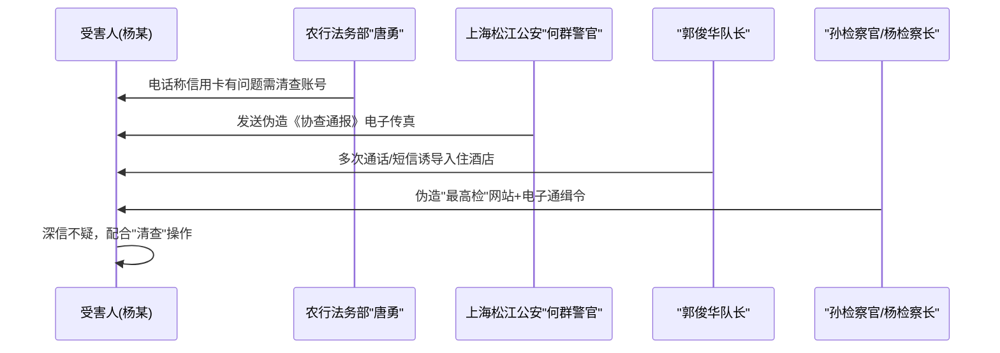

## 案件概况

**贵州「12.29」特大电信诈骗案** 是中国公安部2016年第3起部督案件，也是中国近年来单笔涉案金额最大的一起电信诈骗案。

| 项目 | 详情 |
|------|------|
| **发案时间** | 2015年12月29日 10时许 |
| **报案单位** | 贵州省黔南州都匀市经济开发区建设局 |
| **被骗金额** | 1.17亿元人民币（单位对公账户资金） |
| **核心受害人** | 杨某（财务主管兼出纳） |
| **破案时间** | 2016年1月13日启动集中收网 |
| **抓捕嫌疑人** | 62名（含台湾地区嫌疑人10名） |
| **冻结涉案资金** | 上亿元 |
| **关联破案** | 打掉其他诈骗团伙1个，破获跨26省份案件184起 |

## 完整攻击链复现

### 第一阶段：多角色冒充与信任建立（社会工程学）

攻击者采用 **「公检法」多角色接力冒充** 策略，逐步击破受害人心理防线：



**关键攻击载荷**：
- **伪造电子传真《协查通报》** —— 伪造公文格式，利用权威性压制质疑
- **虚假「最高人民检察院」网站** —— 域名伪造、页面克隆、SSL证书欺骗
- **伪造「电子通缉令」** —— 含受害人真实姓名、身份证号、照片，极具迷惑性

> 此类多角色协作冒充属于高级社会工程学攻击，参考 [[social-engineering-attack-techniques]] 中的钓鱼邮件话术分析、钓鱼页面技术特征及溯源细节。

### 第二阶段：远控软件植入与U盾劫持（技术渗透）

受害人在酒店按指示操作：
1. **登录虚假检察院网站** → 下载「远程协助/清查软件」（实为远控木马）
2. **插入单位资金U盾**（农行K宝/UKey）
3. **配合「清查程序」** —— 实为攻击者远程接管电脑，调用U盾签名权限完成大额转账

**技术要点解析**：

| 技术环节 | 攻击手法 | 防御盲区 |
|----------|----------|----------|
| **远控投递** | 伪造官方网站诱导下载，利用受害人信任绕过杀毒软件 | 网站真实性验证缺失、下载执行无策略限制 |
| **U盾劫持** | 远控层面Hook U盾驱动/中间件，劫持交易签名流程 | U盾硬件隔离被软件层远控突破、无人工复核机制 |
| **大额转账** | 单笔1.17亿分批次转出，利用对公账户大额支付常态化掩盖 | 单日/单笔限额策略缺失、异地登录/新设备无二次验证 |

> U盾/USB Key劫持属于端点安全失陷的典型场景，可关注 [[credential-stuffing-password-hygiene]] 中凭证窃取与复用链条、[[qq-sso-local-endpoint-credential-theft]] 本地端点凭证泄露技术细节。

### 第三阶段：分级洗钱网络（资金流向切割）

资金流转拓扑（五级分账体系）：

```
一级账户 (67个) 
    ↓ 拆分
二级账户 (204个)
    ↓ 拆分
三级账户 (6,573个)
    ↓ 拆分
四级账户 (2,163个)
    ↓ 拆分
五级账户 (127个)
    ↓ 台湾地区取现/地下钱庄出金
```

**核心数据**：
- **涉案银行卡总计：9,942张**（专案组冻结）
- **资金流向覆盖**：26个省份
- **洗钱模式**：公司化运作、「水房组」专职指挥提现、资金拆分、支付犯罪成本

> 此类分级洗钱模型与 [[internal-network-pivoting-techniques]] 中横向移动、代理隧道、凭证复用的网络拓扑切割思路同构，均采用「跳板-切割-匿名」三层架构对抗溯源。

### 第四阶段：跨境犯罪产业链（组织架构与协作）

**组织架构图谱**：

```
台湾「金主」集中控制
    │
    ├── 水房组：指挥提现、资金拆分、支付费用
    ├── 话务组：招募话务员、实施电话诈骗、统一培训/工号/工资提成
    └── 车卡组：提供公民个人信息、拆分资金银行卡
```

**跨境运营链条**：
1. **招募/培训**：国内统一招募 → 办理出国手续 → 统一出境
2. **窝点建设**：乌干达、印尼等非洲国家搭建话务中心
3. **技术支撑**：国际透传线路、改号软件（伪造来电显示）、远程操控平台
4. **数据来源**：非法渠道获取国内公民个人信息（15.5万条）

**人员画像**：
- 62名嫌疑人均供认受雇于台湾地区嫌疑人
- 在境外窝点从事诈骗，案发后分赃回国

> 跨境协作模式可对照 [[competitor-cyber-espionage-kumi-case]] 商业间谍案中「雇佣黑客-窃取数据-变现」的地下产业链分工模型。

## 关键证据与溯源突破口

### 三流并进侦查模型

专案组采用 **「信息流、技术流、资金流」三流并进** 侦查策略：

| 溯源维度 | 切入点 | 关键产出 |
|----------|--------|----------|
| **信息流** | 电子传真、伪造网站、通缉令 | 锁定境外窝点IP、域名注册信息、服务器托管商 |
| **技术流** | 远控软件样本、改号软件、透传线路 | 逆向分析C2架构、通信协议、关联历史攻击活动 |
| **资金流** | 9,942张涉案银行卡、五级分账 | 追踪取现网点、地下钱庄、锁定台湾「金主」身份 |

### 个人信息泄露产业链打击

- **查获证物**：居民身份证189张、银行卡43张、含15.5万条公民信息的U盘
- **信息类型**：金融机构负责人、公务员信息、交管数据等高价值定向数据
- **中间商**：及时发现并打击非法买卖公民个人信息的「中间商」环节

> 大规模公民信息泄露是精准诈骗的前置条件，参考 [[medical-data-security-breaches]] 中医疗数据泄露导致定向诈骗的黑产变现链条、[[credential-stuffing-password-hygiene]] 撞库产业链上游数据源头分析。

## 历史关联与预警信号

### 同类案件早期预警（2015年8月）

> **遵义案例**：刘某假冒建设局工作人员，以「低价购房」为饵，诈骗7人100余万元。经守候7天抓获，嫌疑人供认「做梦想发财，根本不是建设局工作人员」。

**共性特征对比**：

| 维度 | 遵义案(2015.08) | 12.29案(2015.12) |
|------|-----------------|------------------|
| **冒充身份** | 建设局工作人员 | 农行法务/公安/检察院多角色 |
| **诈骗话术** | 低价购房/内部指标 | 信用卡涉案/协助清查/通缉令恐吓 |
| **目标对象** | 个人购房者(7人) | 企业财务主管(单人操作对公账户) |
| **涉案金额** | 100万级 | 1.17亿级(单笔历史之最) |
| **技术手段** | 纯话术/无技术手段 | 伪造网站/电子通缉令/远控/U盾劫持 |
| **组织程度** | 个人作案 | 跨境公司化团伙/分工明确 |

**演进趋势**：从「个人低技术含量诈骗」→「团伙化、技术化、跨境化、产业化」精准打击企业财务高权限账户。

## 安全启示与防御体系构建

### 企业级防御盲区复盘

| 防御层面 | 失效环节 | 加固建议 |
|----------|----------|----------|
| **人员意识** | 财务核心岗位缺乏反诈培训、不敢质疑「公检法」权威 | 定期实战演练、建立「多因子核验+事后复盘」机制、引入 [[security-study-group-methodology]] 零基础安全学习小组模式 |
| **流程控制** | 大额转账无双人复核、无异地/新设备强认证、无延时到账缓冲 | 实施「大额支付双授权+人工回访+T+1到账」三重防线 |
| **技术防护** | U盾使用环境无准入控制、远控软件拦截缺失、钓鱼网站访问无阻断 | 部署EDR/EDR、应用管控白名单、DNS过滤威胁情报联动、参考 [[redteam-hw-opsec-guidelines]] 环境隔离与工具指纹清洗思路反向构建防御 |
| **数据安全** | 员工个人信息泄露未纳入风险模型、供应链数据流向不可视 | 建立数据分级分类、供应链安全评估、泄露监测预警机制 |
| **应急响应** | 发现异常无快速止付渠道、跨行/跨区资金冻结协同滞后 | 接入公安「止付平台」、建立与银行、监管的联动应急预案 |

### 红蓝对抗视角的攻击面收敛

| 攻击面 | 红队利用手法 | 蓝队检测/缓解策略 |
|--------|--------------|-------------------|
| **社会工程学** | 多角色冒充、伪造公文、心理施压 | 反钓鱼演练、邮件/来电源头验证、权威核实SOP |
| **钓鱼网站** | 克隆官方站点、域名欺骗、SSL证书申请 | 域名监测(同形异义/子域名)、证书透明度日志监控、浏览器隔离 |
| **远控投递** | 伪装官方工具、免杀绕过、U盾中间件Hook | 应用管控、行为基线(进程树/网络连接/文件写入)、内存扫描对抗UDRL参考 [[memory-scanning-tools-evasion-techniques]] |
| **凭证窃取** | U盾签名劫持、Cookie/Token窃取、本地存储枚举 | 硬件隔离签名、无密认证(FIDO2)、凭证防泄露(DLP) |
| **资金洗钱** | 分级拆分、跨境取现、地下钱庄、虚拟币兑换 | 反洗钱模型(图谱分析/社区发现)、大额/可疑交易报告(STR)、跨境资金流向关联分析 |

## 交叉引用知识图谱

本案例关联的核心技术专题页面：

| 领域 | 关联页面 | 关联说明 |
|------|----------|----------|
| **社会工程学/钓鱼** | [[social-engineering-attack-techniques]] | 实战案例：iCloud钓鱼+SQL注入反制溯源全链路 |
|  | [[phishing-website-creation-tutorial]] | 钓鱼网站制作三种入门路径(SET/手工PHP/Docker) |
|  | [[qrljacking-qr-code-login-hijacking]] | 二维码登录劫持原理与OWASP资源 |
| **凭证窃取/账户接管** | [[credential-stuffing-password-hygiene]] | 撞库产业链、弱口令模式、2FA普及障碍、iCloud勒索案复盘 |
|  | [[qq-sso-local-endpoint-credential-theft]] | QQ SSO本地端点凭证泄露漏洞复现与免杀利用链 |
| **内网渗透/横向移动** | [[internal-network-pivoting-techniques]] | 0x727 Aggressor Script工具包：atexec/PrintSpooler/FRP/SpawnReflectiveC2 |
|  | [[ppl-injection-createprocess-bof-fix]] | PPL进程注入CreateProcess句柄继承绕过与BOF文件落地输出 |
| **威胁溯源/情报分析** | [[threat-attribution-tracing-techniques]] | IP定位、钓鱼邮件反查、VPS渗透溯源、恶意样本沙箱、CIA Vault 7反溯源对抗 |
| **红队OPSEC/基建隐匿** | [[redteam-hw-opsec-guidelines]] | HW演练全流程作战守则：环境隔离/工具指纹清洗/C2上线隐匿/日志反取证 |
|  | [[c2-redirectors-malleable-c2-profiles]] | C2重定向器拓扑、Malleable C2 Profile流量混淆、域名前置/CDN隐匿 |
| **数据泄露/黑产链条** | [[medical-data-security-breaches]] | 2016-2017医疗数据泄露案例、黑产精准诈骗变现链条、个人防护清单 |
|  | [[competitor-cyber-espionage-kumi-case]] | 竞品雇佣黑客窃取大数据、攻击溯源、地下产业链变现 |
| **逻辑漏洞/业务风控** | [[logic-vulnerability-password-reset-audit]] | 密码重置六大逻辑缺陷模式、rand()低熵破解、加密密钥未初始化实战复现 |

## 时间线摘要

```mermaid
timeline
    title 12.29特大电信诈骗案关键时间节点
    2015-08 : 遵义假冒建设局工作人员诈骗案(预警信号)
    2015-12-20 : 受害人接到首个冒充农行法务电话
    2015-12-20至29 : 多角色冒充、伪造通缉令、远控植入、U盾劫持
    2015-12-29 10:00 : 单位报案，1.17亿资金已转走
    2015-12-22至26 : 资金五级分账流转至9942张银行卡
    2016-01-13 : 专案组集中收网，抓获62名嫌疑人(含10名台湾嫌疑人)
    2016-04-23 : 贵州省公安厅新闻发布会通报破案详情
```

## 结语

「12.29」案件揭示了 **电信诈骗已从「广撒网」进化为「精准鱼叉攻击+产业化运作+跨境协作」的高级持续威胁(APT)形态**。其攻击链完整覆盖了 **社会工程学初始访问 → 远控植入与凭证窃取 → 业务系统操纵 → 多级资金洗白 → 跨境赃款转移** 全杀伤链条。

防御侧需构建 **「人-流程-技术-数据-协同」五维一体化防御体系**，重点解决：
1. **核心岗位人员的认知对抗能力建设**（而非单纯合规培训）
2. **关键业务流程的技术强制约束**（双授权、延时、异常熔断）
3. **端点与网络层面的主动检测与响应能力**（EDR/NDR/威胁狩猎）
4. **跨组织、跨境的情报共享与联动打击机制**

> 本页面基于「301在路上」微信公众号归档文章《企业级诈骗|财务主管接诈骗电话 单位被骗一个亿》结构化沉淀，旨在为安全从业者、企业决策者、财务管理者提供可落地的案例复盘与防御参考。原文链接见文首引用。

## 来源

- [301在路上-201508-202208_164](../sources/301在路上-201508-202208_164.md)
