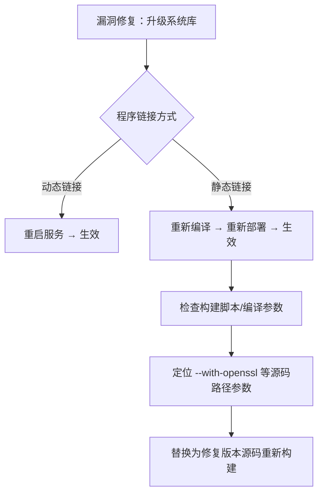

## 案例背景

### 事件时间线
- **触发时间**：某日傍晚 18:00 左右，监控平台告警客户 X 集团新接入系统存在 Heartbleed 漏洞
- **初步响应**：X 集团技术人员执行 `yum update openssl` 升级至 1.0.1t（当时最新版），并重启服务器
- **复测结果**：外部检测工具（360 在线检测、filippo.io、ssltest.py）均显示漏洞**依然存在**
- **现场状态**：X 集团全办公室人员等待修复方案，厂商开发人员、安服人员、远程技术支持均处于加班状态

### 受影响组件
- **漏洞编号**：CVE-2014-0160（Heartbleed，心脏出血）
- **受影响 OpenSSL 版本**：1.0.1 ~ 1.0.1f
- **修复版本**：1.0.1g 及以上
- **Web 服务器**：nginx（作为负载均衡入口）
- **编译参数关键点**：`--with-openssl=/root/openssl-1.0.1` 指定旧版 OpenSSL **源码路径** 而非安装路径

## 根因分析

### 静态链接导致的库版本固化
nginx 在编译阶段通过 `--with-openssl=<source_path>` 参数引入 OpenSSL 源码，**将 OpenSSL 静态链接进 nginx 二进制文件**。这意味着：
- nginx 运行时**不依赖**系统动态库 `/usr/lib/libssl.so`、`/usr/lib/libcrypto.so`
- 系统层面执行 `yum update openssl` 仅替换动态库文件，**无法影响**已编译进 nginx 的旧版 OpenSSL 代码
- 漏洞代码（`memcpy` 缺失边界检查）仍驻留在 nginx 进程内存镜像中

### 对比验证：内网其他系统无漏洞
- **同版本 OpenSSL 升级**的内网其他 Web 系统：**未使用 nginx 负载均衡**，直接调用系统动态库，**升级生效**
- **唯独对外开放的重要系统**：使用 nginx 做负载均衡，**静态链接旧版 OpenSSL**，**升级失效**
- **差异点**精准定位：nginx 编译时的静态链接行为

### 关键证据链
| 检查项 | 结果 | 推论 |
|--------|------|------|
| `yum update openssl` 后 `openssl version` | 1.0.1t | 系统动态库已升级 |
| 外部漏洞扫描 | 仍报 Heartbleed | nginx 进程仍含漏洞代码 |
| 内网同版本非 nginx 系统扫描 | 无漏洞 | 动态链接场景升级有效 |
| nginx 编译参数 `--with-openssl=/root/openssl-1.0.1` | 指向旧版源码目录 | 编译期静态链接旧版 OpenSSL |

## 排查思路沉淀

### 核心排查模型：编译期依赖 vs 运行期依赖


### 通用排查清单
1. **确认漏洞库链接方式**
   - `ldd $(which nginx) | grep ssl` → 若无输出，疑似静态链接
   - `strings $(which nginx) | grep "OpenSSL 1.0.1"` → 直接可见编译进二进制的版本字符串
2. **检查构建记录**
   - `nginx -V` 查看编译参数（若保留）
   - CI/CD 构建日志、Dockerfile、打包脚本、Ansible Playbook 等
3. **对比同环境其他组件**
   - 同版本库升级后，哪些服务生效、哪些不生效
   - 差异点即为静态链接或容器镜像未重建等原因
4. **验证修复**
   - 使用多种检测工具（在线/离线）交叉验证
   - **内网扫描**排除 WAF/防火墙拦截导致的误判

### 易混淆陷阱
| 陷阱现象 | 真相 | 识别方法 |
|----------|------|----------|
| `openssl version` 显示新版 | 仅反映系统动态库版本 | `strings` 二进制或 `ldd` 检查链接方式 |
| 重启服务后漏洞仍在 | 进程加载的仍是旧代码 | `cat /proc/<pid>/maps | grep ssl` 观察加载库路径 |
| 容器环境 `yum update` 无效 | 容器镜像层未重建 | 检查 Dockerfile `RUN` 层缓存，需 `--no-cache` 重建 |

## 修复方案

### 标准修复流程
1. **获取修复版 OpenSSL 源码**（≥ 1.0.1g，建议 1.0.2 系列或 1.1.1 LTS）
2. **重新编译 nginx**
   ```bash
   ./configure \
     --user=www --group=www \
     --prefix=/data/nginx1.6.2 \
     --with-http_stub_status_module \
     --with-http_gzip_static_module \
     --with-http_ssl_module \
     --with-openssl=/path/to/openssl-1.0.2x  # 指向修复版源码目录
   make && make install
   ```
3. **平滑替换二进制并重载**
   ```bash
   # 备份旧二进制
   mv /data/nginx1.6.2/sbin/nginx /data/nginx1.6.2/sbin/nginx.bak
   # 复制新二进制
   cp objs/nginx /data/nginx1.6.2/sbin/nginx
   # 平滑重载
   /data/nginx1.6.2/sbin/nginx -t && /data/nginx1.6.2/sbin/nginx -s reload
   ```
4. **全维度验证**
   - 内网 `ssltest.py` / `openssl s_client -tlsextdebug -msg -connect host:443 < /dev/null 2>&1 | grep -i "heartbeat"`
   - 外部在线扫描器复测
   - 业务功能冒烟测试

### 长期防范措施
| 维度 | 措施 | 说明 |
|------|------|------|
| **构建规范** | 统一使用动态链接系统 OpenSSL | `--with-openssl` 仅用于指定源码编译静态链接场景，生产环境优先动态链接 |
| **依赖管理** | 引入 SBOM（软件物料清单） | 记录每个制品包含的库版本、链接方式、构建参数 |
| **漏洞响应** | 建立“静态链接组件”资产清单 | 漏洞爆发时优先排查清单内组件，而非仅依赖系统包管理器 |
| **CI/CD 管控** | 编译参数审计 + 制品扫描 | 阻断含已知漏洞库版本的构建产物入库 |
| **文档沉淀** | 运维手册记录“非常规链接组件” | 标注 nginx、OpenResty、Tenngine 等自编译组件的重建步骤 |

## 关联知识体系

### 交叉引用页面
- [[nginx-security-hardening-guide]] —— Nginx 安全加固配置清单，涵盖版本隐藏、模块精简、SSL/TLS 参数调优等，可结合本案例中的编译参数审计一并落地
- [[apache-security-hardening-guide]] —— Apache 同类加固参考，对比不同 Web 服务器的静态/动态链接构建差异
- [[docker-container-security-fundamentals]] —— 容器镜像层缓存导致的类似“升级失效”问题，构建时需显式 `--no-cache` 或版本锁定
- [[vulnerability-mining-recon-aiqicha-fofa]] —— 资产测绘视角发现暴露面组件，结合本案例“对外开放系统优先排查”原则
- [[threat-attribution-tracing-techniques]] —— 应急响应中“漏洞修复验证”环节的取证思路，避免因误判修复成功而遗留风险

### 扩展阅读
- **Knownsec 博客「心脏出血漏洞一周年全球普查」**：全球残留 Heartbleed 资产统计，印证“时隔两年仍存活”并非个例
- **阿里云「OpenSSL 心脏滴血漏洞」修复指南**：标准修复建议（升级+重启），需补充“静态链接场景重新编译”补充说明
- **OpenSSL 官方 Security Advisory (CVE-2014-0160)**：漏洞技术细节、受影响版本、补丁代码对比

## 结语

> **“问题不在于升级没做，而在于升级没到。”**

本案例揭示了**编译期决策对运行期安全态势的决定性影响**。静态链接虽简化部署、规避动态库兼容性问题，却切断了系统级补丁管理的传导路径。在漏洞应急响应、供应链安全、SBOM 建设等现代安全工程实践中，**“识别链接方式、建立构建溯源、构建制品级漏洞响应能力”**已成为不可或缺的基础设施。

---
*页面维护建议：每季度核查一次 nginx/OpenResty/Tengine 等自编译组件的构建参数与依赖版本，同步更新资产清单。*

## 来源

- [301在路上-201508-202208_098](../sources/301在路上-201508-202208_098.md)
