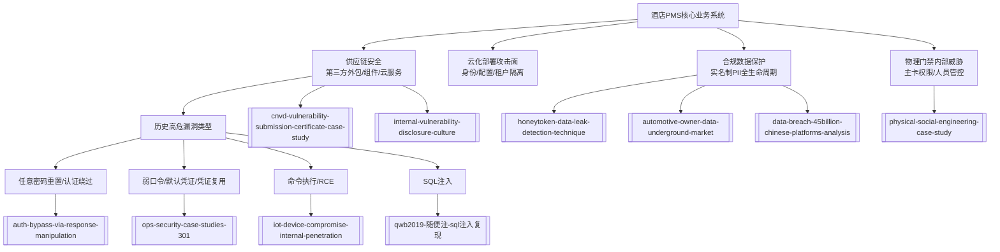

## 概述

酒店行业作为典型的"重资产+重服务+重数据"行业，其核心业务系统 **PMS（Property Management System，物业管理系统）** 承载了预订、入住、结账、客史、门禁、财务等全链路业务数据。随着互联网预订渗透率提升、实名制登记落地、云化部署普及，PMS 系统的安全威胁面显著扩大。

本页面基于 2016 年情人节「301在路上」微信公众号原创文章《情人节，我们聊聊酒店信息安全那些事》，结合乌云漏洞平台历史案例，系统梳理酒店 PMS 安全威胁的四大核心维度：**第三方外包供应链风险**、**云化部署攻击面扩大**、**实名制数据合规压力**、**物理门禁管理缺失**，并复盘典型高危漏洞类型与防御建议。

## 一、 核心威胁维度

### 第三方开发外包与供应链风险

> **核心矛盾**：国内酒店 PMS 系统绝大多数由第三方外包开发商开发并提供技术服务，开发商技术水平远高于酒店自身技术团队，但一旦产品出现安全缺陷，将以**供应链投毒**形式波及大量酒店集团，且酒店方缺乏自主修复能力，易陷入"失控状态"。

**典型案例复盘**：

| 乌云编号 | 漏洞标题 | 厂商/组件 | 漏洞类型 | 危害等级 | 影响范围 |
|----------|----------|-----------|----------|----------|----------|
| WooYun-2014-77249 | 一个漏洞沦陷至少全国各地170家酒店及酒店集团（可查开房信息） | 通用PMS系统 | **命令执行** | 高 | 170+ 酒店 |
| WooYun-2015-124632 | 好*莱上网管理系统存在SQL注入（可查看酒店注册信息、用户上网记录） | 好*莱上网管理系统 | **SQL注入** | 中 | 多家酒店 |
| WooYun-2015-129888 | 某WIFI无线运营商服务器弱口令导致沦陷（涉及银行/企业/餐饮/酒店等行业） | WiFi运营商管理后台 | **弱口令** | 高 | 跨行业 |

**风险特征**：
- **单点放大**：一个通用组件漏洞 → 批量沦陷下游客户
- **责任模糊**：酒店方无源码、无权限、无能力修复，厂商响应滞后甚至忽略（如 WooYun-2015-121256 厂商忽略漏洞）
- **资产盲区**：酒店 IT 资产台账常不包含第三方 SaaS 系统，导致攻击面未纳入管理

> **关联洞察**：此类供应链风险与[[ops-security-case-studies-301]]中记录的"某狐 Zabbix 默认口令内网渗透""某度 .git 泄露 Getshell"同属**第三方组件/运维组件失陷导致内网横向移动**的典型模式。

### 云化部署扩大攻击面

> **背景**：近两年"酒店云"兴起，大量低端/中端酒店为降低运维成本迁移至公有云或厂商托管云，PMS 从内网物理隔离环境暴露至互联网访问入口。

**攻击面变化对比**：

| 维度 | 传统部署（本地化） | 云化部署（SaaS/托管） |
|------|-------------------|----------------------|
| 网络边界 | 物理内网、VPN 专线 | 公网 API、Web 门户、管理后台 |
| 访问控制 | 物理门禁+域账号 | 单因子认证、弱口令、Session 固定 |
| 数据存储 | 本地数据库文件 | 多租户共享数据库、对象存储 |
| 运维权限 | 酒店自管/厂商驻场 | 厂商超管、云厂商运维、API Key |
| 典型风险 | 内网横向移动、物理介质丢失 | **凭证填充、API 滥用、租户隔离绕过、配置错误** |

**实战启示**：云化并未消除漏洞，仅将漏洞利用门槛从"物理接近/内网立足点"降低为"公网弱口令/逻辑缺陷"。参考[[iot-device-compromise-internal-penetration]]中 IoT 设备暴露公网导致的弱口令/未授权访问批量利用模式。

### 实名制数据合规压力

> **监管要求**：公安部"旅馆业治安管理信息系统"强制要求实名登记、身份证核验、数据实时上传。PMS 因此集中存储 **姓名、身份证号、手机号、住宿轨迹、支付卡信息** 等高敏感 PII。

**合规痛点**：
- **数据全生命周期失控**：采集→传输→存储→使用→共享→销毁 各环节缺乏加密、脱敏、审计、最小化授权
- **下游黑产链条成熟**：开房记录已形成"查档库→社工库→精准诈骗/敲诈"完整变现链，参考[[automotive-owner-data-underground-market]]"车牌号→全维度PII→违章记录→精准社工诈骗"链条同构
- **法律空白期**：文章发布时（2016年）尚无《个人信息保护法》《数据安全法》，仅有《网络安全法》（草案）、刑法修正案（九）第253条，追责取证难、处罚轻

**检测对策参考**：可借鉴[[honeytoken-data-leak-detection-technique]]"蜜签/金丝雀令牌"技术，在各渠道 PMS 数据导出/接口调用中植入唯一假身份证号/手机号，监控黑市出现即可定位泄露源头。

### 物理门禁管理缺失（保洁主卡权限过大）

> **核心发现**：酒店门禁系统最高权限卡（Master Key/Total Card）往往掌握在**保洁阿姨**手中——因每日需打扫全层/全楼客房，持卡开启所有房门。

**攻击链还原**（文章脱敏描述）：
1.  **目标识别**：锁定持有主卡的保洁人员
2.  **社会工程学**：通过"花言巧语"诱导/欺骗/收买保洁人员借用/复制主卡
3.  **物理入侵**：持主卡任意开启客房门锁，实施窃盗、偷拍、植入设备等
4.  **痕迹抹除**：归还主卡，门禁日志显示正常保洁开门，极难追溯

**管理缺陷根因**：
- **权限最小化原则缺位**：保洁角色仅需"当前楼层/当前时段/指定房间"权限，实则拥有"全楼/全天/全房"权限
- **人员流动性高、背景核查弱**：保洁多为外包小时工，入职无背调、离职无收卡、轮岗无交接
- **门禁系统与 PMS 未联动**：门禁授权独立于 PMS 房态，无法实现"退房即失效""入住即生效"的动态权限

> **关联实战**：[[physical-social-engineering-case-study]]完整复盘了"宾馆监控侦察门禁规律→早高峰尾随混入→利用无人工位 U 盘破解登录→绕过 USB 限制通过企业邮箱窃取源代码"的物理社工渗透链，酒店保洁主卡滥用属于**内部人员权限滥用+社会工程学**的变体。

## 二、 历史高危漏洞类型复盘（基于乌云平台案例）

### 任意密码重置 / 认证绕过

**典型案例**：**WooYun-2015-121256 青**酒店云 PMS 任意用户密码重置及 1900 个商家弱口令
- **漏洞类型**：设计缺陷/逻辑错误
- **利用方式**：重置流程未校验用户身份所有权，可重置任意商家/用户密码
- **影响**：1900+ 商家后台账号接管，可查看/导出全量开房记录
- **厂商响应**：忽略漏洞

**同类模式参考**：
- [[auth-bypass-via-response-manipulation]]：通过拦截登录响应包将 `false` 篡改为 `true` 实现认证绕过
- [[cnvd-vulnerability-submission-certificate-case-study]]：逻辑越权+默认口令组合挖掘 CNVD 原创漏洞全流程

### 弱口令 / 默认凭证 / 凭证复用

**典型案例**：WooYun-2015-129888 某 WiFi 运营商服务器弱口令（跨行业影响酒店）
**泛化风险**：
- PMS 后台默认账号 `admin/123456`、`admin/admin`、厂商统一售后账号
- 门禁系统、弱电箱管理口、数据库、Redis、Zabbix 等基础设施弱口令
- 员工跨系统复用密码（PMS/邮箱/微信/外卖平台同密）

**关联案例库**：[[ops-security-case-studies-301]]系统沉淀了"弱口令键盘模式分类""Redis 未授权写 SSH Key""Zabbix 默认口令内网渗透"等实战模式。

### 命令执行 / 远程代码执行 (RCE)

**典型案例**：WooYun-2014-77249 通用 PMS 系统命令执行 → 170+ 酒店沦陷
**成因分析**：
- 文件上传功能未校验文件类型/内容，可上传 WebShell
- 导入/导出功能调用系统命令拼接用户输入未过滤
- 老旧框架（Struts2、ThinkPHP、FastJSON 等）未及时修补已知 RCE

### SQL 注入

**典型案例**：WooYun-2015-124632 好*莱上网管理系统 SQL 注入 → 查看注册信息、上网记录
**利用链路**：
1.  注入点多为报错注入/布尔盲注/时间盲注
2.  获取库表结构 → 导出 `guest_info`、`checkin_log`、`id_card` 等核心表
3.  配合联合查询/堆叠查询实现数据窃取、写 Shell

**实战技巧参考**：[[qwb2019-随便注-sql注入复现]]详细记录了 MariaDB 环境下报错注入、WAF 绕过、堆叠查询、预编译绕过、表重命名等进阶利用技巧。

## 三、 防御体系建设建议

### 供应链安全管理

| 措施 | 关键动作 | 落地工具/规范 |
|------|----------|---------------|
| **厂商准入安全评估** | 要求厂商提供 SDL 实践证明、渗透测试报告、组件清单 (SBOM) | ISO 27001、CSA STAR、中国信通院可信云认证 |
| **合同安全条款** | 明确漏洞响应 SLA（高危 24h/中危 72h/低危 15d）、源码托管/逃逸条款、赔偿条款 | 参考《网络安全标准实践指南—供应链安全》 |
| **运行期监控** | 接入厂商 SaaS API 审计日志、定期开展黑盒扫描、订阅厂商安全公告 | 自建/购买 ASM（攻击面管理）平台 |
| **应急预案联演** | 每半年与核心 PMS 厂商联合演练"供应链投毒→批量沦陷→数据泄露→通报溯源"全链路 | 参照 [[hvv-blue-team-recruitment-standards]] 蓝军实战标准组织演练 |

### 云化部署安全加固

- **身份为新边界**：强制 MFA（硬件 Key/FIDO2）、条件访问（设备指纹+地理位置+行为基线）、零信任网关代理所有管理端口
- **租户强隔离**：数据库行级安全策略 (RLS)、K8s NetworkPolicy 微隔离、API 网关租户级限流熔断
- **配置即代码审计**：Terraform/Helm Charts 纳入 CI/CD 安全扫描（Checkov、Kics、Trivy），禁止手工控制台变更
- **密钥全生命周期管理**：API Key、数据库凭证、证书统一纳入 Vault/KMS，定期轮换、最小权限、审计留痕

### 实名制数据合规落地

| 生命周期阶段 | 核心控制措施 | 技术实现参考 |
|--------------|--------------|--------------|
| **采集** | 最小必要原则、明确告知同意、OCR 识别不落地存图 | 移动端 SDK 加固、隐私合规扫描 |
| **传输** | 国密 TLS 1.3、API 签名防篡改、字段级加密（身份证号/手机号） | SM2/SM4 算法、密钥分级管理 |
| **存储** | 静态加密（TDE/列加密）、分库分表隔离、定期密钥轮换 | 云厂商 KMS+自建 HSM、分布式数据库透明加密 |
| **使用** | 动态脱敏（按角色/场景）、水印溯源、查询审计全留存 | 数据库代理、零信任数据访问网关 |
| **共享** | 数据出境评估、接收方资质审核、脱敏/聚合后提供、水印嵌入 | [[honeytoken-data-leak-detection-technique]]蜜签植入溯源 |
| **销毁** | 保留期满自动清洗、物理介质消磁/粉碎、销毁记录留痕 | 纳入记录管理系统、定期抽查 |

### 物理门禁与内部威胁管控

- **门禁权限模型重构**：
  - **RBAC+ABAC**：角色（保洁/前台/安保/工程）× 属性（楼层/时段/房态）动态计算权限
  - **即时授权/即时回收**：PMS 房态变更（入住/退房/换房）实时下发门禁控制器，退房即失效
  - **主卡分级**：总主卡（总经理/保安部长双人管控）→ 楼层主卡（保洁领班/楼层主管双人管控）→ 单房卡（客人/保洁临时借用）
- **关键岗位人员管控**：
  - 保洁/安保/工程等高权限岗位入职背调、定期复查、离职即时收卡注销
  - 引入[[internal-vulnerability-disclosure-culture]]"心理契约"理念，建立内部威胁上报免责/奖励机制
- **技术检测手段**：
  - 门禁日志实时流式接入 SIEM，关联 PMS 房态、人脸抓拍、电梯刷卡，异常模型：非保洁时段开门、单卡短时高频跨楼层、离职卡仍在使用
  - 定期红队演练：物理尾随、主卡复制、社会工程学诱导保洁借卡，验证检测规则有效性

## 四、 行业生态与监管演进参考

| 时间节点 | 事件/法规 | 对酒店 PMS 安全的影响 |
|----------|-----------|----------------------|
| 2013年底 | "酒店泄密门"事件曝光 | 行业首次大规模关注开房数据泄露，公安部加强旅馆业治安管理信息系统建设 |
| 2015年 | 《网络安全法》（草案征求意见） | 确立网络运营者安全保护义务、关键信息基础设施保护制度、个人信息保护原则 |
| 2016年2月 | 本文发布（情人节） | 系统梳理 PMS 威胁面，呼吁行业重视供应链、云化、合规、物理四大风险 |
| 2017年6月 | 《网络安全法》正式施行 | 明确个人信息保护法律地位，违规最高罚款 100 万元/吊照/刑事责任 |
| 2021年11月 | 《个人信息保护法》施行 | 引入单独同意、撤回同意、可携带权、自动化决策拒绝权，跨境传输安全评估 |
| 2021年9月 | 《数据安全法》施行 | 数据分级分类、重要数据目录、出境安全评估、数据安全事件分级上报 |
| 2023年 | 45亿条用户隐私数据泄露事件曝光 | 涉及京东、淘宝、美团等主流平台，倒逼各行业含酒店业加强数据全生命周期治理 |

> **数据泄露事件深度分析**：参考[[data-breach-45billion-chinese-platforms-analysis]]对 2023 年 45 亿条泄露事件的来源溯源、验证真实性、攻击链路分析及个人缓解措施。

## 五、 交叉引用知识图谱

## 六、 结语

酒店 PMS 安全本质是**供应链安全、云原生安全、数据合规安全、物理安全**四大领域在垂直行业的交叉投影。单一技术手段无法解决系统性风险，需推进：

1.  **标准先行**：推动制定《酒店 PMS 系统安全技术规范》《旅馆业治安管理信息系统安全测评指南》
2.  **生态共治**：建立酒店-厂商-云厂商-公安-监管多方联动的漏洞应急响应与威胁情报共享机制
3.  **最小权限贯穿始终**：从代码开发（SDL）、基础设施配置（IaC 扫描）、运行时访问控制（零信任）、物理门禁授权（RBAC+ABAC）全链路落地最小权限
4.  **数据价值导向防御**：以"开房记录+身份证+支付卡"核心数据资产为中心，构建"知资产、控流向、可溯源、能追责"的数据安全治理闭环

> **原文链接**：http://mp.weixin.qq.com/s?__biz=MzIwMTQ2NzY4NA==&mid=403054474&idx=1&sn=dd4c2a5be57e3fa71aaecb7b56551d6f
> **发布账号**：301在路上
> **发布日期**：2016-02-14 (情人节)
> **归档标签**：#酒店信息安全 #PMS系统 #供应链安全 #乌云漏洞平台 #物理安全 #数据合规

## 来源

- [301在路上-201508-202208_200](../sources/301在路上-201508-202208_200.md)
