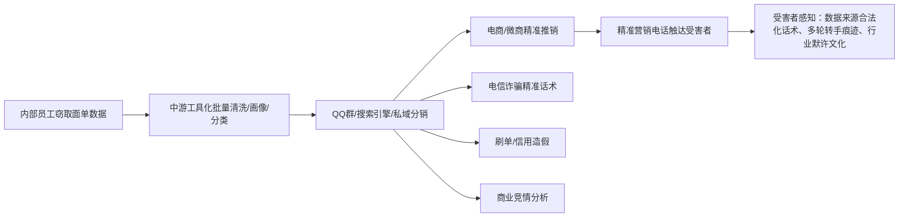
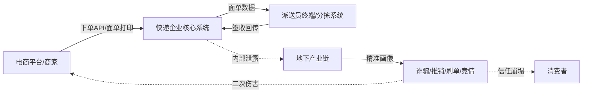

## 概述

本页面沉淀自 **301在路上** 微信公众号 2016 年 8 月发布的深度分析文章《安全观点：某快递公司再现内鬼，泄露客户信息》及同期文章《你“窃取”了我的隐私，为何还这么嚣张？》，系统记录了**快递物流行业面单数据地下产业链**的完整链条：从顺丰速递头部企业内部员工（普通操作员、研发工程师）滥用职务便利批量导出公民个人信息，到 QQ 群、百度搜索公开叫卖、按行业定向标价、工具化批量提取的成熟黑灰产生态，再到下游通过精准营销电话、电信诈骗、刷单等场景变现的完整闭环。深度揭示**权限管控缺失、下载限制被第三方工具绕过、主管违规共享高权限账号**等内控机制系统性失效根因，并关联电商供应链安全与《个人信息保护法》合规视角。

> **来源归档**：[[301-zai-lushang-wechat-archive-201508-202208]]（301在路上公众号 2015-2022 文章索引，含本事件深度分析条目）

---

## 核心案例复盘

### 案例一：湖南顺丰员工陈洋贩卖面单数据案（2016 年判决）

| 维度 | 详情 |
|------|------|
| **被告人** | 陈洋，湖南顺丰速递公司员工（普通操作员，权限较低） |
| **时间** | 2015 年 5 月前后持续作案，2016 年 8 月 26 日深圳南山区人民法院受审 |
| **罪名** | 侵犯公民个人信息罪 |
| **作案手法** | 1. 以“个人账号看不清图片、需补录工单”为由，多次向财务及主管索要高权限账号登录 2. 利用第三方软件绕过系统批量下载限制，实现运单图片及信息批量导出 3. 通过 QQ 群、百度搜索等渠道公开叫卖 |
| **定价模式** | 散单 3.5 元/单，50 单起购；300 单以上 3 元/单；按行业定向标价（保健品、壮阳药、丰胸、减肥类客户信息溢价） |
| **内控漏洞暴露** | - 阿修罗系统仅内网可登录、两月一换密码，但**高权限账号被主管违规共享** - 系统虽限制批量下载，但**第三方工具轻松突破** - 员工权限最小化原则形同虚设，**异常登录行为无风控告警** |

### 案例二：顺丰研发工程师严某百万条数据窃售案（2012-2014 年）

| 维度 | 详情 |
|------|------|
| **被告人** | 严某，顺丰速运有限公司研发工程师（入职 2012 年 8 月） |
| **时间** | 2013 年 10 月 - 2014 年 6 月（不足一年） |
| **作案手法** | 利用研发工程师职务便利，从公司数据库直接导出客户信息（姓名、住址、联系电话）至个人网盘，再下载至本地电脑出售 |
| **获利与数据量** | 获利 36 万元人民币，单价 0.2-0.5 元/条，**推算泄露数据超百万条** |
| **判决** | 2015 年 2 月福田区人民法院一审宣判 |
| **关键启示** | **高权限技术岗位（研发、运维、DBA）是内部威胁高危源**，数据库级导出绕过应用层权限控制，传统应用层审计失效 |

---

## 地下产业链全景拆解

### 上游：数据窃取层（内部人员）

| 角色 | 典型特征 | 获取方式 | 典型案例 |
|------|----------|----------|----------|
| **普通一线员工** | 权限低、需绕过限制 | 社工骗取高权账号 + 第三方工具突破下载限制 | 陈洋案 |
| **研发/运维/工程师** | 拥有数据库/后台高权限 | 直接 SQL 导出、API 批量拉取、网盘中转 | 严某案 |
| **主管/管理层** | 掌握账号分发权、知晓规则漏洞 | 违规共享账号、配合下属绕过管控 | 陈洋案中主管违规提供账号 |

> **核心洞察**：权限最小化原则在**账号共享文化**面前崩塌；应用层下载限制在**客户端工具**面前失效；数据库直连绕过所有应用层审计。

### 中游：分销与加工层（QQ 群、工具开发者）

| 环节 | 运作模式 | 技术特征 |
|------|----------|----------|
| **QQ 群公开叫卖** | 群名直白（如“快递面单选购”“顺丰保健品数据面单群”） 公告标价、起购量、行业分类 | 低门槛、去中心化、抗封锁性强 |
| **百度搜索引流** | 搜索“面单出售”“提取顺丰面单工具”即现踪迹 | 搜索引擎成为黑灰产免费分发渠道 |
| **工具化/产品化** | 研发“顺丰系统内提取、批量下载客户信息工具” 解决普通员工无批量下载权限痛点 | **工具开发者与窃取者分工协作**，形成“工具即服务”（TaaS）模式 |
| **行业定向加工** | 按购买商品类别切片（保健品、壮阳药、手机数码等） 利用单号规律反推商品品类 | **数据画像能力**，精准匹配下游精准营销/诈骗需求 |

### 下游：变现与利用层（商家、诈骗团伙、刷单产业）

| 买家类型 | 使用场景 | 风险外溢 |
|----------|----------|----------|
| **电商商家/微商** | 精准推销同品类产品（保健品、减肥药等） | 骚扰电话、虚假宣传、侵犯隐私 |
| **电信诈骗团伙** | 精准话术设计（知晓购买记录、地址、电话） 冒充物流/客服/公检法实施诈骗 | **直接导致财产损失、人身安全威胁**（如徐某被骗离世案） |
| **刷单/信用刷单产业** | 真实面单用于电商平台刷信用、刷销量、刷好评 | 破坏平台信用体系、助长黑产生态 |
| **商业间谍/竞对情报** | 分析竞品销售区域、客户画像、单量趋势 | 商业秘密泄露、不正当竞争 |

---

## 下游变现场景实证：精准营销电话的第一人称观测

### 受害者视角的实证记录（来源：301在路上 2016 年文章《你“窃取”了我的隐私，为何还这么嚣张？》)

> **事件还原**：作者（安全从业者）接到某互联网公司精准推广营销电话，对方使用个人手机号，准确叫出姓名、单位名称、职位、电话、公司业务领域（甚至精准归类为“O2O领域”，而公司刚注册、作者自己尚在归类中）。
>
> **对话关键点**：
> - **数据来源合法化话术**：“你的信息获取的来源是合法的”，同行业大家都这样做，大家都“默许”这样的规则在阳光下进行。
> - **数据多次转手佐证**：“相信你，同样业务的电话，不是第一次遇到。”暗示数据已被多次转卖、重复利用。
> - **嚣张态度**：对方主动提供单位名、业务范围，邀请合作联系，表现出极强的“合规”自信与行业默契。
>
> **深度启示**：
> 1. **“合法获取”成为标准化洗白话术**：下游买家（营销公司）将非法购买的数据包装为“合法渠道”“行业惯例”，构建心理免责防线。
> 2. **数据多轮流转已成常态**：“不是第一次遇到”印证了中游分销层的高频转手、数据去重/清洗/画像后的规模化复用。
> 3. **行业默许即保护伞**：“同行业大家都默许”揭示了精准营销/电销行业对上游非法数据源的系统性依赖与利益绑定。
> 4. **黑产触角延伸至极端敏感数据**：文中提及“黑产团队连艾滋病患者隐私信息进行欺诈骗钱”，印证下游变现场景已突破商业推销底线，直指诈骗、敲诈等犯罪链条。

### 精准营销电话在产业链中的定位

> **关键结论**：精准营销电话不是终点，而是**数据非法流转链条“最后一公里”最可感知、最高频、受害面最广的落地场景**。每一个骚扰电话背后，都映射着上游内控失效、中游工业化分销、下游行业默许的完整生态。

---

## 内控失效根因深度剖析

### 权限管控体系缺失

| 失效点 | 表现 | 底层原因 |
|--------|------|----------|
| **账号共享常态化** | 主管为下属“方便工作”违规提供高权限账号 陈洋多次索要账号均获满足 | 业务效率优先于安全合规，缺乏**账号使用审计与问责机制** |
| **权限最小化原则落地空洞** | 普通员工本无批量下载权限，却通过共享账号+工具绕过 | 权限模型设计于**应用层**，数据库/文件系统层无细粒度管控 |
| **异常行为无感知** | 短时大量下载、非工作时间登录、跨区域登录均无告警 | 缺乏**用户行为分析（UEBA）**、**数据访问审计**（DLP/数据库审计） |

### 技术防控措施被降维打击

| 防控措施 | 设计意图 | 绕过方式 | 根因 |
|----------|----------|----------|------|
| **内网仅登录** | 物理隔离 | 账号密码外泄即失效 | 认证仅靠静态口令，**无 MFA、无设备指纹、无零信任** |
| **两月一换密码** | 减少凭证窃取窗口期 | 共享账号密码同步更新 | 密码策略不解决**账号共享**核心问题 |
| **应用层批量下载限制** | 防止大量导出 | 第三方爬虫/浏览器插件/模拟点击工具突破 | **前端限制非安全边界**，需在数据层、网络层、端点层分层防御 |
| **运单图片另存为单张** | 增加批量成本 | 工具自动化遍历下载 | 缺乏**速率限制、水印溯源、加密渲染**等数据级保护 |

### 组织与文化层面的系统性缺陷

- **安全责任虚化**：业务部门（运营、财务、研发）无数据安全 KPI，安全团队话语权弱
- **供应链安全盲区**：快递面单数据涉及**电商平台、商家、消费者**三方，顺丰作为数据处理者，对下游商家如何使用面单数据无管控能力
- **事件响应滞后**：2012-2014 年严某案持续近一年未被发现，说明**数据流转全生命周期无监测**

---

## 电商供应链安全视角的关联分析

### 数据流向拓扑

### 供应链各方责任边界

| 角色 | 法定义务（个保法/电商法/邮政法） | 现实痛点 |
|------|----------------------------------|----------|
| **快递企业（数据处理者）** | 最小收集、目的限制、安全保障、泄露通报、供应商管理 | **核心系统内控失效**，对员工、外包商、下游网点管控断层 |
| **电商平台/商家（数据控制者）** | 选择合规处理者、监督处理行为、共同责任 | 面单数据**必要性最小化**未落地（如保健品订单无需展示完整地址/电话） |
| **消费者（数据主体）** | 知情权、决定权、限制处理权、删除权 | 无法感知面单数据流向，无法行使**最小化授权** |

### 典型供应链攻击面

- **网点外包管理失控**：加盟网点员工账号体系独立，总部权限策略下发延迟/失效
- **API 对接过度授权**：电商平台对接快递电子面单 API 时，字段全量同步，未做脱敏/最小化
- **打印/分拣环节物理泄露**：面单打印件、分拣扫描设备缓存、废弃面单回收链条无销毁审计

---

## 《个人信息保护法》（PIPL）合规映射与整改路径

### 核心条款对标

| PIPL 条款 | 要求 | 本案违规映射 | 整改方向 |
|-----------|------|--------------|----------|
| **第 9 条：最小必要原则** | 处理目的、方式、范围最小化 | 面单含完整姓名/电话/地址/商品名，派送仅需部分字段 | **字段级脱敏/加密/按需解密**（如派送员端仅显示尾号、网点代码） |
| **第 26 条：安全保障义务** | 制定管理制度、分类分级、加密/去标识化、权限控制、应急预案 | 权限控制失效、无加密、无审计、无应急响应 | **零信任架构重构**：身份为新边界、数据为新资产、持续验证 |
| **第 27 条：泄露通报** | 立即采取补救、通报监管部门、通知个人 | 案件经司法曝光后才被动公开 | 建立**数据泄露自动化检测与 72 小时通报机制** |
| **第 31 条：委托处理协议** | 与受托人约定目的、方式、期限、安全义务、监督权 | 对网点、外包商、工具开发商无数据保护条款 | **供应链数据保护协议（DPA）全覆盖**，含审计权、终止权 |
| **第 51 条：境外提供** | 单独同意、通过保护评估/认证/合同 | 暂未涉及跨境，但工具/数据可能流向境外黑产 | **数据出境风险评估**纳入供应链尽职调查 |

### 合规整改三步走路线图

#### 阶段一：止血与基线（0-3 个月）
- **账号治理**：禁用共享账号，强制 MFA，实施特权访问管理（PAM），研发/运维账号纳入堡垒机全审计
- **数据分级分类**：面单数据定为**核心敏感级**，建立数据资产目录与流转图谱
- **下载/导出管控**：数据库层实施**行级访问控制（RLS）**、**导出审计/水印/限额**，禁用通用导出工具
- **终端 DLP**：派送员终端、分拣设备部署敏感数据识别与外发阻断

#### 阶段二：体系化防御（3-12 个月）
- **零信任架构落地**：
  - 身份中心（IdP）统一认证，设备信任度评估，自适应访问策略
  - 微隔离：核心数据库、API 网关、内网应用按业务域分段
  - 持续验证：UEBA 实时基线偏离告警（大量下载、非常规时间、非常规 IP）
- **数据安全平台建设**：
  - 静态脱敏（开发/测试环境）、动态脱敏（派送端/客服端）、格式保留加密（数据库存储）
  - 数据血缘与全生命周期审计链（区块链存证可选）
- **供应链安全管理**：
  - 网点/外包商准入安全评估，合同嵌入 DPA 与审计权
  - 电子面单 API 字段级授权（OAuth 2.0 + 细粒度 Scope），商家侧最小化展示

#### 阶段三：持续运营与生态共治（12 个月+）
- **红蓝对抗常态化**：模拟内部窃取、工具绕过、供应链投毒场景
- **威胁情报订阅**：监测 QQ/Telegram/暗网/搜索引擎面单数据叫卖踪迹，溯源水印定位泄露源头
- **行业标准共建**：牵头制定《快递物流行业个人信息保护技术规范》，推动面单电子化、无纸化、最小化
- **监管科技（RegTech）接入**：自动化合规体检、PIPL 影响评估（DPIA）工具化

---

## 关键技术对策清单

| 领域 | 关键技术/产品类别 | 典型厂商/开源方向 | 落地优先级 |
|------|-------------------|-------------------|------------|
| **身份与访问** | IAM/IdP、PAM、MFA、零信任网关 | Okta、Auth0、Keycloak、自研 | P0 |
| **数据库安全** | 数据库审计、动态脱敏、RLS、列加密 | Oracle/PostgreSQL/MySQL 原生、Imperva、DbSecurity、开源 ShardingSphere 加密模块 | P0 |
| **数据防泄漏** | 网络 DLP、端点 DLP、邮件/IM/云盘内容检测 | Symantec、Forcepoint、天融信、奇安信、开源 OpenDLP | P1 |
| **用户行为分析** | UEBA、内部威胁检测平台 | Splunk UBA、Exabeam、Securonix、安恒雷神、奇安信天眼 | P1 |
| **数据水印/溯源** | 不可见水印、指纹追踪、区块链存证 | 腾讯云水印、阿里云数据水印、自研 | P1 |
| **API 安全** | 网关鉴权、流控、字段级授权、敏感数据过滤 | Kong、Spring Cloud Gateway、Apache APISIX、华为 API 网关 | P1 |
| **供应链风控** | 第三方安全评估平台、软件成分分析（SCA）、SBOM | 安恒、奇安信、墨菲安全、开源 Dependency-Check | P2 |
| **威胁情报** | 暗网/社交媒体/代码托管平台监测、水印反向溯源 | 微步在线、知道创宇、360 威胁情报、自研爬虫+水印检测 | P2 |

---

## 经验教训与行业启示

1. **内部威胁≠恶意员工**：更多是**管控缺失导致的机会型犯罪**——普通员工因账号共享、工具绕过、无风控告警而“顺手牵羊”；研发工程师因权限过大、无审计而“长期收割”。
2. **应用层限制非安全边界**：前端 JS 限制、API 限流、下载按钮隐藏，**均可被客户端工具、爬虫、浏览器插件绕过**。安全边界必须下沉到**数据层、网络层、身份层**。
3. **工具化标志着产业化成熟**：当出现“提取面单工具”“批量下载脚本”在百度/QQ 公开流通，说明**黑产分工精细、技术门槛降低、规模化复制能力形成**。防御必须从“防人”转向“防工具、防流程、防链条”。
4. **供应链安全是系统工程**：快递面单数据泄露，核心在快递企业内控，但**电商平台过度收集、商家过度留存、网点外包失管**均为共谋因素。需**数据全生命周期多方共治**。
5. **合规倒逼架构重构**：《个人信息保护法》不仅是罚款威慑，更是**倒逼企业从“业务优先、安全事后”转向“隐私设计、零信任架构、数据最小化”**的战略契机。
6. **下游变现场景的“合法化”话术是产业链保护色**：精准营销电话中“来源合法、行业默许、多次转手”的标准化说辞，本质是**将非法数据洗白为商业常规资产**，切断这一话术体系需从上游溯源打击、中游平台治理、下游行业自律三端同步发力。

---

## 相关知识页面交叉引用

- [[301-zai-lushang-wechat-archive-201508-202208]] —— 301在路上公众号文章索引，含本事件原文归档
- [[2022-cybersecurity-year-review]] —— 2022 网络安全年度回顾，含数据泄露、供应链攻击趋势分析
- [[apt-detection-deployment-strategy]] —— APT 检测部署策略，内部威胁检测能力建设参考
- [[hvv-2021-vulnerability-collection]] —— HVV 护网行动漏洞聚合，实战视角的内网横向与数据窃取技术
- [[shuiying-domain-enumeration-tool]] —— 域渗透信息收集工具，内网横向移动视角的凭证窃取与数据猎杀

---

## 更新日志

| 版本 | 日期 | 变更摘要 |
|------|------|----------|
| 1.0 | 2025-01-15 | 初始版本：基于 301在路上 2016 年文章沉淀，结构化呈现案例、产业链、根因、合规映射、整改路线图 |
| 1.1 | 2025-01-15 | 补充 PIPL 条款对标表、技术对策清单、供应链责任边界分析，增加 Mermaid 数据流向图 |
| 1.2 | 2025-01-15 | **新增「下游变现场景实证：精准营销电话的第一人称观测」章节**，引入 301在路上同期文章《你“窃取”了我的隐私，为何还这么嚣张？》作为实证材料，完善「数据源头→转手倒卖→精准触达」完整链条视角，补充下游「合法化话术」「多轮转手」「行业默许」等关键洞察 |

## 来源

- [301在路上-201508-202208_054](../sources/301在路上-201508-202208_054.md)
- [301在路上-精准营销电话实证文章](../sources/301在路上-精准营销电话实证文章.md)
- [301在路上-201508-202208_103](../sources/301在路上-201508-202208_103.md)
