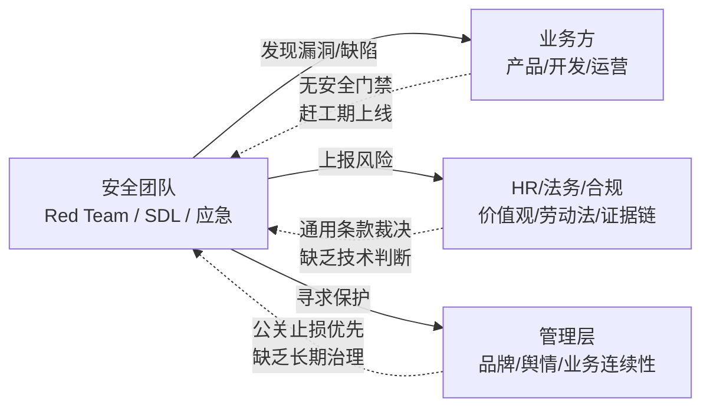
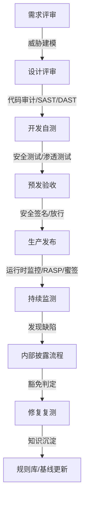

## 核心观点

互联网大厂内部漏洞/逻辑缺陷披露的核心困境不在于技术本身，而在于 **组织文化与协作机制的错位**。当安全工程师发现内部系统缺陷时，面临「上报=自首」「利用=获利」「沉默=安全」的三重困境。[[mooncake-gate-security-ethics-analysis|「月饼门」事件]] 正是这种文化失灵的典型样本：四名安全工程师编写脚本抢购内部福利月饼，本可通过负责任披露流程修复逻辑漏洞，却因「零容忍」文化被开除，导致安全团队心理契约破裂，形成「谁提问题、干掉谁」的寒蝉效应。

## 事件溯源：月饼门的深层隐喻

### 事件回顾
2018 年 9 月 12 日，阿里巴巴内部福利月饼秒杀系统存在逻辑缺陷（可通过脚本绕过验证码、无限下单、无需支付即锁定库存）。四名安全工程师编写自动化脚本抢购 124 盒月饼，事后主动联系行政退货。公司以「价值观不符、诚信缺失、不当获利」为由开除四人，引爆行业讨论。

### 当事人视角的关键细节
- **动机**：仅为自用 1 盒，非牟利（当事人称「我赚了一分钱了？」）
- **行为**：脚本类同 12306 抢票插件，属「技术压制」而非传统攻击
- **事后**：发现异常立即联系行政退货，主动询问是否需交接工作
- **处理**：16:30 约谈 → 17:30 解约合同备好 → 18:00 走人，全程 1.5 小时

### 行业反响的核心分歧
| 维度 | 公司视角 | 安全从业者视角 |
|------|----------|----------------|
| **性质定义** | 价值观/诚信问题，零容忍 | 逻辑漏洞利用，处罚过重 |
| **责任归属** | 员工主观恶意 | 系统未做安全测试、缺乏负责任披露渠道 |
| **文化信号** | 守护价值观底线 | 「谁提问题干掉谁」，安全团队沦为「背锅侠」 |

> **关键洞察**：此事件暴露的不是个别员工的道德缺失，而是 **「安全团队作为内部红队/守护者的角色定位」与「业务/HR/法务的合规惩罚逻辑」之间的结构性冲突**。

## 典型反模式图谱

### 「谁提出问题，就干掉谁」—— 杀鸡儆猴式治理
- **表现**：安全人员主动上报内部漏洞/逻辑缺陷，反被追责「未授权测试」「越权访问」「价值观不符」
- **后果**：安全团队转入地下，发现漏洞选择沉默、私自修复、甚至离职后匿名提交 CNVD/厂商平台
- **关联案例**：[[cnvd-vulnerability-submission-certificate-case-study|CNVD 原创漏洞提交实战]] 中，多数白帽子选择外部渠道而非内部上报，根因即此

### 「业务上线前无安全介入，出事后找安全背锅」—— 职责边界模糊
- **表现**：月饼秒杀系统未经安全测试/威胁建模直接上线；漏洞被利用后，追责使用者而非开发者/测试者/上线审批者
- **根因**：安全左移 未落地，SDLC 缺乏安全门禁；安全团队无「叫停上线」否决权

### 「技术手段即原罪」—— 工具化行为被道德化审判
- **表现**：编写脚本自动化操作 = 「作弊」「黑产手段」，忽略技术人员解决效率问题的本能
- **悖论**：同一公司鼓励「自动化运维」「RPA 效率提升」，内部福利系统却禁止脚本

### 「HR/法务单向度裁决」—— 缺乏安全专业判断的介入
- **表现**：HR 依据《员工手册》通用条款（诚信/价值观）直接裁决，未引入安全技术委员会/专家组评估「是否构成攻击」「影响范围」「主观意图」
- **缺失**：无「安全视角的公正调查程序」，无「分级分类处置标准」

### 「零容忍 = 零沟通」—— 公关优先于治理
- **表现**：事件发酵后，公司选择极速开除平舆论，而非建立「内部漏洞披露豁免/减责机制」
- **长尾伤害**：安全招聘品牌受损，存量员工信任崩塌，行业形成「大厂安全岗 = 高风险」认知

## 组织协作断层：四方视角的错位

### 安全团队视角
- **角色认知**：内部红队、守护者、SDL 推动者
- **痛点**：无授权测试法律风险（[[security-practitioner-legal-compliance|法律合规红线]]）、上报无正向激励、被业务视为「阻碍者」

### 业务方视角
- **核心 KPI**：上线速度、GMV/DAU、成本控制
- **认知偏差**：安全 = 成本中心、测试 = 延期风险、漏洞 = 概率事件「不一定被利用」

### HR/法务视角
- **决策依据**：《员工手册》、劳动合同法、证据链完整性、舆情风控
- **盲区**：不懂技术细节（脚本 ≠ 攻击、逻辑缺陷 ≠ 代码漏洞）、缺乏「安全行为分级」量表

### 管理层视角
- **权衡变量**：品牌声誉、监管合规、业务连续性、人才留存
- **常见误判**：用「零容忍」展示态度，实则破坏「心理安全感」，导致高阶安全人才流失

## 健康机制建设路径

### 制度层：建立「内部负责任披露政策」—— 核心基石

| 要素 | 设计要点 | 反模式对比 |
|------|----------|------------|
| **豁免/减责条款** | 内部员工善意发现、主动上报、未扩散、未牟利、配合修复 → 免除/减轻行政处分 | 月饼门：主动退货仍被开除 |
| **授权测试范围** | 明确「内部系统授权测试边界」（如：预发环境全量、生产环境只读/特定接口）、提供沙箱/靶标 | 无授权 → 任何测试均违规 |
| **分级分类标准** | P0（核心资产/数据泄露）/ P1（业务逻辑/越权）/ P2（信息泄露/低风险） → 对应不同处置流程 | 一刀切「价值观问题」 |
| **匿名上报渠道** | 设立独立安全邮箱/平台，支持匿名、加密提交，承诺不溯源 | 实名上报 = 自首 |
| **正向激励** | 漏洞积分兑换奖金/期权/晋升加分/公开致谢、纳入 OKR/绩效 | 无激励，仅有惩罚 |

> **参考标准**：Google VRP 内部版、Microsoft SDL Bug Bar、阿里巴巴后续整改的「白帽子激励计划」（事后补救）、《网络安全漏洞管理规定》第 14 条「鼓励网络运营者建立漏洞激励机制」

### 流程层：嵌入 SDLC 的「安全左移」与「应急联动」

- **关键节点**：预发环境**必须**通过安全测试（含逻辑漏洞扫描、业务流程梳理），无安全签名不得上线
- **蜜签/金丝雀令牌**：[[honeytoken-data-leak-detection-technique|内部系统植入蜜签]]，验证检测能力，倒逼业务重视
- **应急响应 SLA**：内部漏洞 P0 2h 响应/24h 修复，P1 8h/72h，P2 24h/1 周

### 组织层：构建「安全治理委员会」与「专业裁决机制」

| 机制 | 组成 | 职权 | 解决痛点 |
|------|------|------|----------|
| **安全技术委员会** | CISO、资深安全专家、业务技术负责人、法务代表 | 漏洞定性、影响研判、处置建议、豁免审批 | HR 单向度裁决、缺乏技术判断 |
| **内部漏洞裁决小组** | 安全专家 3-5 人轮值、HRBP 1 人、法务 1 人 | 48h 内完成「是否构成攻击/主观恶意/影响范围」认定 | 1.5h 极速开除、无申诉渠道 |
| **安全大使/嵌入式安全员** | 各业务线技术骨干兼任，向虚线汇报 CISO | 需求期介入、代码审查、上线把关、事件一线响应 | 安全团队人力不足、业务对抗情绪 |

### 文化层：重塑「心理安全感」与「技术荣誉感」

- **公开透明化**：定期发布「内部漏洞榜单」（脱敏）、表彰「年度最佳披露者」、分享「漏洞复盘/最佳实践」
- **叙事重构**：将「内部漏洞披露」从「告密/越权」重构为「护航业务/技术担当/价值创造」
- **容错空间**：设立「创新容错额度」，允许安全团队在授权范围内进行对抗演练、红蓝对抗、混沌工程
- **职业发展双通道**：安全专家序列对标 P9/P10，打通「红队→架构师→CTO」路径，消除「安全岗 = 死胡同」焦虑

### 法务/合规层：授权测试法律护盾

- **内部授权书模板**：明确测试范围、手段、时间、数据处理规则、免责条款，双方签署生效
- **证据保全规范**：引入 [[security-practitioner-legal-compliance|电子数据取证规范]]，确保漏洞复现链路可验证、不可抵赖
- **劳动法衔接**：在《员工手册》增设「网络安全合规行为规范」专章，细化「授权测试、善意披露、恶意攻击」三类行为的界定与处置依据，替代通用「价值观」条款

## 成熟度评估模型（参考 CMMI/BSIMM）

| 等级 | 特征 | 关键指标 |
|------|------|----------|
| **L0 混乱** | 无政策、无流程、靠人治、月饼门式处置 | 内部漏洞零上报、安全团队高流失 |
| **L1 初始** | 有邮箱收漏洞、但无豁免、无 SLA、HR 裁决 | 上报量 < 5 个/年、平均处置 > 30 天 |
| **L2 受控** | 发布政策、有豁免条款、安全委员会裁决、有激励 | 上报量 > 50 个/年、P0 修复 < 24h、满意度 > 70% |
| **L3 定量** | 嵌入 SDLC、自动化扫描覆盖 90%+、蜜签全铺开、红蓝对抗常态化 | 漏洞逃逸率 < 5%、MTTR 下降趋势、业务主动邀请安全介入 |
| **L4 优化** | 安全即文化、威胁建模驱动架构、AI 辅助代码审计、生态共享情报 | 零重大内部漏洞事件、安全成为业务卖点、行业标准制定者 |

## 交叉引用与延伸阅读

### 核心案例页
- [[mooncake-gate-security-ethics-analysis]] — 月饼门全景复盘：时间线、当事人视角、社区观点、组织治理反思、职业启示
- [[security-practitioner-legal-compliance]] — 法律合规红线：授权测试规范、漏洞披露最佳实践、电子数据取证、职业自我保护清单
- [[honeytoken-data-leak-detection-technique]] — 蜜签/金丝雀令牌：低成本植入内部系统验证检测能力、溯源泄漏源头

### 实战技能页
- [[cnvd-vulnerability-submission-certificate-case-study]] — CNVD 原创漏洞提交全流程：从厂商筛选、资产收集、挖掘到拿证
- [[auth-bypass-via-response-manipulation]] — 逻辑越权/认证绕过实战：响应包篡改、默认口令、FOFA 资产收集
- [[vulnerability-rating-disputes-bug-bounty]] — 漏洞评级争议成因与维权路径：厂商沟通、第三方裁决、平台申诉

### 组织与职业页
- [[shanshan-cso-career-growth-story]] — 白帽到 CSO 成长路径：一万小时定律、持续学习、实战沉淀
- [[xiaoyang-whitehat-practitioner-profile]] — 从业者画像：北漂自学、渗透实战、重大成果上报、转型讲师
- [[hvv-blue-team-recruitment-standards]] — HVV 蓝军分级标准与薪资：A/B/C/D 级能力模型、招聘流程

### 方法论页
- [[ctf-beginner-self-study-guide]] — Writeup 驱动学习法、笔记沉淀、知识图谱构建
- [[supply-chain-attack-fundamentals]] — 供应链攻击框架：软件/硬件/固件三大形式、水坑/鱼叉向量、防御视角

## 结语

「月饼门」凉的不是月饼，是 **安全人「被尊重、被信任、被保护」的心理契约**。  
建设健康的内部漏洞披露文化，本质是 **重新定义安全团队在组织中的合法性与价值**：从「成本中心/阻碍者/背锅侠」转型为「业务护航者/风险量化者/技术荣誉感来源」。

这需要 **「政策豁免 + 流程左移 + 专业裁决 + 文化重塑 + 法务护盾」** 五位一体，而非单一维度的运动式整改。唯有让「善意上报漏洞」成为确定性的正向收益选择，而非概率性的职业生涯俄罗斯轮盘赌，才能真正留住人、守住网、赢得信任。

---

> **维护提示**：本页面旨在沉淀「内部漏洞披露文化」的结构性认知与可落地路径。随着实践演进，建议每季度更新成熟度评估指标、补充新案例（脱敏）、修订政策模板版本。欢迎通过交叉引用关联更多实战与治理页面，形成知识网络效应。

## 来源

- [301在路上-201508-202208_052](../sources/301在路上-201508-202208_052.md)
