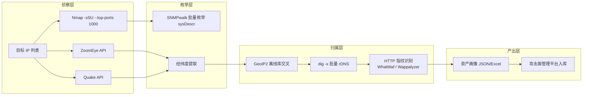

## 概述

本页面沉淀一次针对境外 IoT 设备（以 Cisco 交换机为例）的信息收集实战全流程，覆盖 **资产测绘引擎侦察 → 端口扫描验证 → SNMP 协议深度枚举 → 地理定位多源交叉验证 → rDNS 反查归属确权** 的完整技术链路。适用于红队前置侦察、攻击面管理、HVV 护网溯源等场景。

> **来源**：火线 Zone 云安全社区文章《境外IOT目标信息收集实战——Red Sun》，原文链接见文末引用。

---

## 技术链路总览

```mermaid
flowchart TD
    A[目标 IP 列表] --> B[资产测绘引擎检索]
    B --> C[ZoomEye / 360 Quake]
    C --> D[设备指纹识别\n型号、固件、开放端口、地理位置]
    D --> E[Nmap 端口扫描验证]
    E --> F[SNMP 协议枚举\nsysDescr (1.3.6.1.2.1.1.1.0)]
    F --> G[设备型号/版本二次确证]
    G --> H[经纬度地理定位交叉验证]
    H --> I[rDNS 反向解析]
    I --> J[域名访问确权归属]
    J --> K[完整资产画像]
```

---

## 资产测绘引擎侦察

### ZoomEye

- **定位**：全球网络空间测绘引擎，擅长 IoT/工控设备指纹识别。
- **输出字段**：设备厂商、设备类型、开放端口（如 161/UDP SNMP）、地理位置（国家/城市/经纬度）、历史变更记录。
- **实战截图要点**：识别出目标为 Cisco 设备，获得 161 端口开放情况及地区信息。

### 360 Quake

- **定位**：国内主流资产测绘平台，对境外资产同样有较好覆盖。
- **差异化优势**：对设备型号（如 `Cisco Catalyst 2960`）、固件版本（如 `IOS 15.2(4)E5`）识别更精准；同步返回 161 端口 Banner、地理位置。
- **实战截图要点**：准确获知目标为 Cisco 交换机，并给出具体型号与版本。

> **交叉引用**：资产测绘引擎的批量化调用可参考 [[xd-security-python-security-development-notes]] 中的 FOFA API 爬虫实现；ZoomEye/Quake 均提供 API，可集成至自动化侦察流水线。

---

## Nmap 端口验证

### 扫描策略

| 参数 | 说明 |
|------|------|
| `-sS` | SYN 半连接扫描，隐蔽性较好 |
| `-sU` | UDP 扫描，**必须包含 161/UDP**（SNMP） |
| `--top-ports 1000` | 快速覆盖高频端口 |
| `-Pn` | 跳过主机存活探测（目标可能禁 ping） |
| `-oA nmap_result` | 三格式同步输出 |

### 实战发现

- 文章撰写时目标已加端口防护，Nmap 结果与引擎历史数据**基本一致**，验证了引擎数据的可信度。
- 关键端口：`22/TCP (SSH)`、`23/TCP (Telnet)`、`80/TCP (HTTP)`、`161/UDP (SNMP)`、`443/TCP (HTTPS)`。

> **交叉引用**：Nmap 进阶用法（脚本扫描、漏洞检测、输出解析）见 [[xd-security-vulnerability-discovery-notes-day42-45]]；大规模扫描调度可结合 [[xd-security-python-security-development-notes]] 中的多线程/异步框架。

---

## SNMP 协议深度枚举

### 核心 OID

| OID | 名称 | 说明 |
|-----|------|------|
| `1.3.6.1.2.1.1.1.0` | **sysDescr** | 设备描述：型号、固件版本、编译日期 |
| `1.3.6.1.2.1.1.5.0` | sysName | 设备主机名 |
| `1.3.6.1.2.1.1.6.0` | sysLocation | 物理部署位置（运维配置） |
| `1.3.6.1.2.1.2.2.1.2` | ifDescr | 接口描述表（端口映射） |
| `1.3.6.1.4.1.9.2.1.3` | ciscoFlashVersion | Cisco 专用 Flash 版本 |

### 实战命令

```bash
# SNMPv2c 社区字符串 public（默认弱口令）
snmpwalk -v 2c -c public <TARGET_IP> 1.3.6.1.2.1.1.1.0

# 批量枚举所有标量对象
snmpwalk -v 2c -c public <TARGET_IP> 1.3.6.1.2.1.1

# 遍历接口表
snmpwalk -v 2c -c public <TARGET_IP> 1.3.6.1.2.1.2.2.1.2
```

### 输出示例

```
SNMPv2-MIB::sysDescr.0 = STRING: Cisco IOS Software, C2960 Software (C2960-LANBASEK9-M), Version 15.2(4)E5, RELEASE SOFTWARE (fc1)
Technical Support: http://www.cisco.com/techsupport
Copyright (c) 1986-2018 by Cisco Systems, Inc.
Compiled Thu 26-Jul-18 22:53 by prod_rel_team
```

- **验证结论**：所有目标 IP 的型号、版本与引擎结果**完全一致**，确证了资产指纹准确性。

> **防御视角**：SNMP 社区字符串默认 `public`/`private` 属于弱口令，建议参考 [[xd-security-logic-vulnerability-notes-day33-36]] 中的弱口令治理策略；SNMPv3 强制认证加密、ACL 限制源 IP、关闭不必要的 UDP 161 对公网暴露。

---

## 地理定位多源交叉验证

### 问题背景

不同引擎返回的地理位置存在差异（如 ZoomEye 显示「日本东京」，Quake 显示「美国加州」），需引入**经纬度坐标**作为中立基准。

### 获取经纬度来源

1. **引擎字段**：ZoomEye/Quake 均返回 `latitude`/`longitude`。
2. **IP 地理库**：MaxMind GeoIP2、IP2Location、DB-IP（离线库适合批量）。
3. **在线查询**：ipinfo.io、ip-api.com、db-ip.com（API 限频）。

### 交叉验证流程

```text
引擎 A 经纬度 → 反查地址（Google Maps / OpenStreetMap）
引擎 B 经纬度 → 反查地址
离线库 经纬度 → 反查地址
→ 取交集/置信度加权 → 确定最终归属地
```

### 实战技巧

- 经纬度精度至小数点后 4 位（≈11 米）通常足够定位到数据中心/园区。
- 结合 **ASN 归属**（whois/cymru）判断是否为云厂商/IDC 出口 IP，避免误判为设备物理位置。

> **交叉引用**：IP/ASN 归属自动化查询可复用 [[xd-security-python-security-development-notes]] 中的 Whois/DNS 查询模块；批量经纬度可视化可导入 Kepler.gl 或 QGIS。

---

## rDNS 反向解析确权归属

### 核心逻辑

1. 对目标 IP 执行 `dig -x <IP>` 或 `nslookup <IP>` 获取 PTR 记录。
2. 解析得到的域名（如 `switch-core-01.tokyo.example-corp.jp`）直接揭示**组织命名规范、部署区域、设备角色**。
3. 访问域名对应的 Web 服务（HTTP/HTTPS），往往落地到**官网、管理门户、VPN 入口**，从而完成「IP → 设备 → 组织」的确权闭环。

### 实战记录

- 目标 IP 存在 4 条 PTR 记录，首条域名访问直接跳转至目标组织官网。
- 确权结论：**目标归属某日本跨国企业的核心网络设备**。

### 扩展技巧

| 技术 | 用途 |
|------|------|
| `dig +trace -x <IP>` | 追踪反向解析授权链，发现委托异常 |
| `dnsrecon -r <IP/CIDR>` | 批量 PTR 枚举 |
| `massdns -r resolvers.txt -q <IP.list> -o ptr` | 亿级 PTR 高速解析 |
| SSL 证书 Subject/Subject Alternative Name | 交叉验证域名归属 |

> **交叉引用**：DNS 枚举与证书透明度日志利用见 [[xd-security-vulnerability-discovery-notes-day42-45]] 与 [[xd-security-python-security-development-notes]]；大规模 rDNS 可结合 [[frp内网渗透应用]] 中的代理池分发查询压力。

---

## 完整资产画像输出模板

| 字段 | 示例值 | 来源 |
|------|--------|------|
| **IP** | `2XX.XXX.XX.XXX` | 任务下发 |
| **设备厂商** | Cisco | ZoomEye / Quake |
| **设备型号** | Catalyst 2960-24TT-L | Quake / SNMP sysDescr |
| **固件版本** | IOS 15.2(4)E5 | Quake / SNMP sysDescr |
| **开放端口** | 22, 23, 80, 161, 443 | Nmap / 引擎历史 |
| **SNMP 社区串** | public (v2c) | SNMPwalk 验证 |
| **经纬度** | 35.6895, 139.6917 | 引擎 / GeoIP2 |
| **归属地** | 日本东京都千代田区 | 经纬度反查 + ASN |
| **rDNS 域名** | `sw-core-01.tyo.corp.example.jp` | dig -x |
| **组织归属** | Example Corporation (Japan) | 官网访问 / WHOIS |
| **暴露风险** | SNMP 弱社区串、Telnet 明文、HTTP 管理口 | 端口 + 协议枚举 |

---

## 工具链自动化建议



- **并发控制**：ZoomEye/Quake API 有速率限制，建议使用令牌桶限流。
- **去重策略**：以 `IP + sysDescr hash` 为主键去重。
- **持久化**：写入 Elasticsearch/ClickHouse，配合 Kibana/Grafana 做资产看板。

> **交叉引用**：自动化框架选型可参考 [[xd-security-python-security-development-notes]]（Requests/LXML/多线程）、[[pocsuite3-vulnerability-testing-framework]]（PoC 标准化）、[[aiiod-awd-framework-analysis]]（epoll/多线程提交器）。

---

## 防御与合规提示

1. **授权前置**：境外资产侦察需确认授权范围，避免触犯《计算机犯罪法》（US CFAA）、《网络安全法》（中国）等。
2. **最小化原则**：仅收集完成任务所需字段，不抓取配置文件、路由表等敏感数据。
3. **日志留痕**：扫描源 IP、时间窗口、工具版本、参数全记录，便于事后审计。
4. **数据脱敏**：报告中 IP 后两段、经纬度精度、域名关键字段脱敏处理（本页面已按原文打码示范）。

---

## 交叉引用索引

| 主题 | 页面 | 关联点 |
|------|------|--------|
| 资产测绘/FOFA API | [[xd-security-python-security-development-notes]] | 批量资产拉取、经纬度入库 |
| 漏洞扫描器集成 | [[xd-security-vulnerability-discovery-notes-day42-45]] | Goby/Nessus/Nmap/Quake 联动 |
| 内网穿透代理 | [[frp内网渗透应用]] | 多出口 IP 轮换规避限频 |
| DNS/证书枚举 | [[xd-security-vulnerability-discovery-notes-day42-45]] | rDNS/SSL 证书交叉验证 |
| 弱口令治理 | [[xd-security-logic-vulnerability-notes-day33-36]] | SNMP 社区串/默认口令清理 |
| IoT 硬件清单 | [[0w1club-hardware-atlas]] | 实体设备对应型号/固件库 |
| 红队侧写 | [[threat-attribution-tracing-techniques]] | IP/域名/证书归因溯源 |

---

## 原文引用

> 原文标题：《境外IOT目标信息收集实战——Red Sun》  
> 发布平台：火线 Zone 云安全社区（微信公众号）  
> 原文链接：http://mp.weixin.qq.com/s?__biz=Mzg4Njc1MTIzMw==&mid=2247484096&idx=1&sn=d080bbd0bd9a1e99b28a7c0d2c4513d4  
> 归档日期：2024-01-15（本页面整理日期）

---

## 变更记录

| 版本 | 日期 | 变更摘要 |
|------|------|----------|
| 1.0 | 2024-01-15 | 初始版本：结构化沉淀原文全流程，补充自动化建议、防御合规、交叉引用索引。 |

## 来源

- [0x6270安全团队-202203-202304_49](../sources/0x6270安全团队-202203-202304_49.md)
