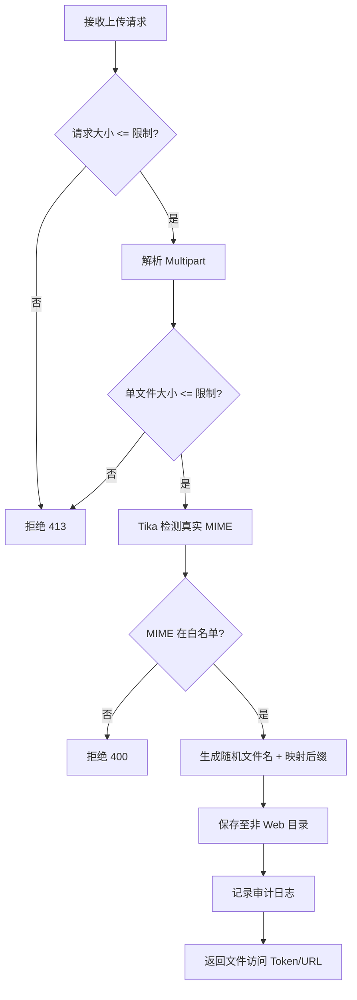

## 漏洞背景与危害

任意文件上传漏洞是 Java Web 应用中常见的高危漏洞，攻击者可通过上传恶意脚本文件（JSP、PHP、ASPX 等）获取服务器代码执行权限。典型利用链包括：绕过前端 JS 校验、伪造 `Content-Type`、利用解析漏洞（如 `.htaccess`、`.user.ini`）、条件竞争等。[[upload-labs-file-upload-bypass-writeup]] 详细复现了 19 种绕过技术，可作为对照参考。

## 核心修复策略

### 白名单校验 Content-Type

仅允许预期的 MIME 类型上传，拒绝一切非白名单类型。

```java
String[] allowedTypes = {"image/png", "image/jpeg", "text/plain"};
String contentType = request.getContentType(); // 或从 MultipartFile 获取
boolean allowed = Arrays.asList(allowedTypes).contains(contentType);
```

> **注意**：客户端发送的 `Content-Type` 可伪造，必须结合**文件内容检测**二次校验。

### Apache Tika 文件内容检测（推荐）

利用 Apache Tika 解析文件真实类型，基于魔数而非扩展名或头部声明，有效防御文件头伪造、多后缀绕过。

#### Maven 依赖

```xml
<dependency>
    <groupId>org.apache.tika</groupId>
    <artifactId>tika-core</artifactId>
    <version>2.9.1</version>
</dependency>
<dependency>
    <groupId>org.apache.tika</groupId>
    <artifactId>tika-parsers-standard-package</artifactId>
    <version>2.9.1</version>
</dependency>
```

#### 核心检测代码

```java
import org.apache.tika.metadata.Metadata;
import org.apache.tika.parser.AutoDetectParser;
import org.apache.tika.parser.ParseContext;
import org.apache.tika.parser.Parser;
import org.apache.tika.sax.BodyContentHandler;
import java.io.File;
import java.io.FileInputStream;
import java.io.InputStream;
import java.util.Arrays;

public class FileTypeValidator {

    private static final String[] ALLOWED_TYPES = {
        "image/png", "image/jpeg", "image/gif", "application/pdf", "text/plain"
    };

    /**
     * 使用 Tika 检测文件真实 MIME 类型并校验白名单
     * @param file 待检测文件
     * @return true=通过 false=拦截
     */
    public static boolean validate(File file) {
        Parser parser = new AutoDetectParser();
        Metadata metadata = new Metadata();
        metadata.set(Metadata.RESOURCE_NAME_KEY, file.getName());
        ContentHandler handler = new BodyContentHandler();

        try (InputStream is = new FileInputStream(file)) {
            parser.parse(is, handler, metadata, new ParseContext());
        } catch (Exception e) {
            // 解析异常视为非法文件
            return false;
        }

        String detectedType = metadata.get(Metadata.CONTENT_TYPE);
        if (detectedType == null) {
            return false;
        }

        return Arrays.stream(ALLOWED_TYPES).anyMatch(detectedType::equals);
    }
}
```

**关键点**：
- `AutoDetectParser` 自动选择对应解析器
- `Metadata.CONTENT_TYPE` 返回检测到的真实 MIME
- 异常统一按非法处理，避免解析错误被利用

### 随机文件名 + 后缀映射

上传成功后**不保留原始文件名**，采用 UUID/雪花算法生成随机名，后缀根据 Tika 检测到的 MIME 类型映射。

```java
import java.util.HashMap;
import java.util.Map;
import java.util.UUID;

public class FileNameGenerator {

    private static final Map<String, String> MIME_TO_EXT = new HashMap<>();
    static {
        MIME_TO_EXT.put("image/png", ".png");
        MIME_TO_EXT.put("image/jpeg", ".jpg");
        MIME_TO_EXT.put("image/gif", ".gif");
        MIME_TO_EXT.put("application/pdf", ".pdf");
        MIME_TO_EXT.put("text/plain", ".txt");
    }

    public static String generate(String mimeType) {
        String ext = MIME_TO_EXT.getOrDefault(mimeType, ".bin");
        return UUID.randomUUID().toString().replace("-", "") + ext;
    }
}
```

**防御价值**：
- 消除路径遍历（`../../shell.jsp`）、双写后缀（`shell.jpg.jsp`）、空字节截断（`shell.jsp%00.jpg`）等绕过
- 结合存储目录非 Web 可访问路径（如 `/data/uploads/` 而非 `/webapps/ROOT/uploads/`）进一步降低风险

### 文件大小限制（防 DoS）

#### Servlet 原生 / Commons FileUpload

```java
import org.apache.commons.fileupload.servlet.ServletFileUpload;
import org.apache.commons.fileupload.disk.DiskFileItemFactory;

DiskFileItemFactory factory = new DiskFileItemFactory();
factory.setSizeThreshold(1024 * 1024); // 1MB 内存阈值
factory.setRepository(new File("/tmp")); // 临时目录

ServletFileUpload upload = new ServletFileUpload(factory);
upload.setFileSizeMax(10 * 1024 * 1024);      // 单文件 10MB
upload.setSizeMax(50 * 1024 * 1024);          // 总请求 50MB
```

#### Spring MVC / Spring Boot 配置

```xml
<!-- Spring MVC XML -->
<bean id="multipartResolver"
      class="org.springframework.web.multipart.commons.CommonsMultipartResolver">
    <property name="maxUploadSize" value="10485760"/> <!-- 10MB -->
    <property name="defaultEncoding" value="UTF-8"/>
</bean>
```

```yaml
# Spring Boot application.yml
spring:
  servlet:
    multipart:
      max-file-size: 10MB
      max-request-size: 50MB
      file-size-threshold: 1MB
      location: /tmp/uploads
```

> **最佳实践**：在网关层（Nginx `client_max_body_size`）、WAF、应用层三级限制，纵深防御。

### ESAPI 后缀验证（补强）

OWASP ESAPI 提供 `Validator.getValidFileName()` 等工具，可作为**二次校验**或**遗留系统快速接入**方案。[[java-xss-prevention-struts-esapi]] 中已详细介绍 ESAPI 编码器用法，此处补充文件名校验示例：

```java
import org.owasp.esapi.ESAPI;
import org.owasp.esapi.Validator;

public class EsapiFileNameValidator {

    private static final Validator validator = ESAPI.validator();

    /**
     * 校验文件名是否符合安全规范（仅允许字母数字下划线中划线点）
     * @param fileName 原始文件名
     * @return 校验通过的安全文件名
     */
    public static String sanitize(String fileName) {
        // 定义文件名正则：仅允许字母数字、下划线、中划线、点，长度 1-255
        String fileNameRegex = "^[a-zA-Z0-9_.-]{1,255}$";
        return validator.getValidInput("fileName", fileName, fileNameRegex, 255, false);
    }
}
```

**适用场景**：
- 需保留用户原始文件名（如网盘、邮件附件）时的安全清洗
- 无法引入 Tika 的老旧项目快速加固

## 完整防御链路图



## 关键配置清单

| 层面 | 措施 | 示例 |
|------|------|------|
| **网络层** | Nginx 限制请求体 | `client_max_body_size 50m;` |
| **容器层** | Tomcat `maxPostSize` | `<Connector maxPostSize="52428800" />` |
| **框架层** | Spring `maxUploadSize` | `10MB` |
| **应用层** | 代码级单文件/总大小校验 | `upload.setFileSizeMax(...)` |
| **内容层** | Tika MIME 白名单 | `image/png, image/jpeg, application/pdf` |
| **存储层** | 非 Web 目录 + 随机名 | `/data/uploads/` + UUID |
| **访问层** | 独立下载接口 + 权限校验 | `/api/files/{token}` 不直接映射静态资源 |
| **审计层** | 上传/下载全链路日志 | 用户ID、IP、文件名、MIME、大小、时间 |

## 常见误区与对抗

| 误区 | 风险 | 正确做法 |
|------|------|----------|
| 仅校验扩展名 | `shell.jpg.jsp` 绕过 | Tika 检测内容 + 随机名 |
| 仅校验 `Content-Type` | 客户端可伪造 | 必须结合 Tika 二次校验 |
| 仅用 `getImagesize()` 判断图片 | GIF 多帧、EXIF 注入、polyglot 绕过 | Tika + 图片重绘（`ImageIO.write`） |
| 保存至 Web 目录 | 直接访问执行 | 存储在非公开目录，通过 Controller 分发 |
| 未限制大小 | DoS 填满磁盘/内存 | 三级限制：网关/容器/应用 |
| 信任文件名 | 路径遍历、覆盖系统文件 | 随机名 + 路径规范化校验 |

## 关联实战案例

- **CNVD-2021-49104 泛微 E-Office**：`uploadType=eoffice_logo` 缺失校验导致任意文件上传 RCE，[[cnvd-2021-49104-eoffice-v9-file-upload-rce]] 完整复现利用链。
- **Oasys 代码审计**：文件上传缺失后缀校验 Getshell，[[oasys-system-code-audit]] 记录挖掘过程。
- **Upload-Labs 靶场**：19 关绕过技术全覆盖，[[upload-labs-file-upload-bypass-writeup]] 可作为防御测试基准。
- **XD安全渗透测试笔记**：文件上传模块系统梳理黑白名单绕过、解析漏洞、编辑器漏洞、WAF 绕过及修复方案，[[xd-security-pentest-basic-stage-notes]]。

## 参考资源

- Apache Tika 官方文档：https://tika.apache.org/
- OWASP ESAPI Java：https://github.com/ESAPI/esapi-java-legacy
- OWASP File Upload Cheat Sheet：https://cheatsheetseries.owasp.org/cheatsheets/File_Upload_Cheat_Sheet.html
- 《Java 安全编码规范》CERT-OBJ08-J：https://wiki.sei.cmu.edu/confluence/display/java/OBJ08-J.+Do+not+expose+unvalidated+file+upload+functionality

## 小结

Java 任意文件上传漏洞修复的核心在于**内容信任而非声明信任**：
1. **Tika 检测真实 MIME** → 白名单放行
2. **随机文件名 + 映射后缀** → 消除路径/解析风险
3. **三级大小限制** → 防御 DoS
4. **非 Web 目录存储 + 受控下载接口** → 打破执行链路
5. **ESAPI 补强** → 兼容需保留原始文件名的业务场景

将上述措施集成至通用上传组件/Filter/Interceptor，配合单元测试与渗透测试验证，可系统性消除此类漏洞。[[java-preparedstatement-sql-injection-defense]] 同理展示了参数化查询从根源消除 SQL 注入的思想，二者均体现“架构层面根治而非点状修补”的安全工程原则。

## 来源

- [226安全团队-201805-202103_24](../sources/226安全团队-201805-202103_24.md)
