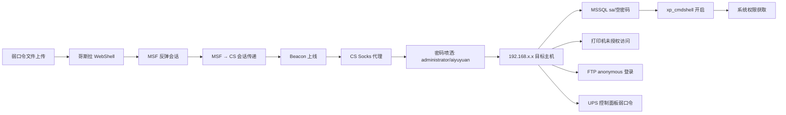

## 概述

本页面整合自火线 Zone 实战复盘文章（作者：小黑），记录一次针对某房地产公司的完整内网渗透测试攻击链。攻击链覆盖 **Web 入口突破 → C2 会话对接 → 内网代理建立 → 密码喷洒横向移动 → 数据库接管 → IoT/OT 设备失陷** 等核心环节，展示了从外网边界到核心业务系统及物理设备控制面的完整渗透路径。

> **来源声明**：原文首发于火线 Zone（https://zone.huoxian.cn/d/953），作者「小黑」。本页面仅作技术复盘与知识沉淀，所有漏洞均为公开漏洞利用，严禁用于非授权测试。

---

## 攻击链全景图



---

## 0x01 Web 入口突破：弱口令文件上传拿 Shell

### 漏洞利用过程

目标系统存在**文件上传漏洞**，结合**弱口令**认证绕过，攻击者上传 WebShell 文件成功落地可执行脚本。

### 关键技术点

- **文件上传绕过技术栈**：弱口令认证绕过 → 前端 JS 校验绕过 → `Content-Type` 伪造 → 魔数/文件头绕过 → 解析漏洞利用（IIS/Apache/Nginx 解析差异）
- **WebShell 选择**：使用 **Godzilla（哥斯拉）** 动态加密 WebShell，流量加密对抗 WAF/IDS 检测
- **落地验证**：通过哥斯拉客户端连接确认执行权限

> 相关技术详解：[[php-webshell-fundamentals-chopper-analysis]]、[[php-webshell-obfuscation-av-evasion]]、[[xd-security-file-inclusion-notes]]（含上传绕过专节）、[[pikachu-target-writeup-part4]]（文件上传多层绕过实战）

---

## 0x02 C2 基础设施对接：MSF 会话传递给 Cobalt Strike

### 操作流程

1. **MSF 监听器配置**：`use exploit/multi/handler` + `set payload windows/x64/meterpreter/reverse_tcp`
2. **哥斯拉执行命令**：在 WebShell 中执行 `msfvenom` 生成的 Payload 或直接反弹 Meterpreter
3. **会话建立**：MSF 收到 Meterpreter 会话，执行信息收集（安装程序、补丁信息、网络配置等）
4. **会话传递至 CS**：
   - 方法一：MSF `sessions -u <session_id>` 直接升级为 CS Beacon（需 CS Team Server 配置 `metasploit` 监听器）
   - 方法二：`generate -t raw -f raw -o payload.bin` → CS `script` 导入
   - 方法三：使用 `post/multi/manage/shell_to_meterpreter` 配合 CS External C2

### 实战截图对应步骤

| 阶段 | 对应操作 |
|------|----------|
| 图 1 | 哥斯拉客户端连接 WebShell |
| 图 2 | MSF 会话建立与信息收集（`sysinfo`、`ps`、`netstat` 等） |
| 图 3 | MSF `sessions -u` 传递命令执行 |
| 图 4 | Cobalt Strike Beacon 成功上线 |

> 相关技术详解：[[cobalt-strike-external-c2-smb-beacon]]（External C2 与会话传递）、[[metasploit-framework-basics-tutorial]]（MSF 基础与会话管理）、[[xd-security-internal-network-penetration-notes-day69-70]]（CS 部署、监听器、Beacon 生成、MSF 会话移交实战）、[[c2-redirectors-malleable-c2-profiles]]（C2 基础设施隐匿）

---

## 0x03 内网代理建立：Cobalt Strike Socks 代理

### 代理配置

Beacon 上线后，在 CS 中右键 Beacon → **Proxy** → **SOCKS Server**，指定监听端口（如 1080），生成 SOCKS4/5 代理通道。

### 工具链代理化

配合 **Proxychains** / **Proxytool** / **nmap -x** / **impacket** 等工具实现全工具链代理化：

```bash
# proxychains.conf 添加
socks5 127.0.0.1 1080

# 使用示例
proxychains nmap -sT -Pn 192.168.1.0/24
proxychains python3 mssqlclient.py sa@192.168.1.120
```

> 相关技术详解：[[internal-network-pivoting-techniques]]（Venom/Frp/SSH/CS SMB Beacon/iox 等代理技术横向对比）、[[xd-security-internal-network-penetration-notes-day69-70]]（Ngrok/Frp/MSF 路由/SOCKS 代理三层内网渗透演练）、[[frp内网渗透应用]]（frp 四大典型场景完整配置）、[[iox-proxy-protocol-evasion]]（流量指纹对抗型代理工具）

---

## 0x04 横向移动：密码喷洒与凭证复用

### 密码喷洒攻击

利用已控主机权限，通过 Socks 代理对内网段进行 **密码喷洒**：

- **目标**：内网存活主机（如 192.168.x.x）
- **用户名**：`administrator`、`admin` 等常见管理员账户
- **密码字典**：`aiyuyuan`、弱口令 Top N、业务相关关键词组合
- **工具**：`crackmapexec`、`smbmap`、`hydra`、自定义脚本

### 实战产出

```
administrator / aiyuyuan  →  多台服务器复用成功
```

> 相关技术详解：[[xd-security-internal-network-penetration-notes-day67-68]]（SMB/WMI/Pass-the-Hash 横向移动、Ladon 内网扫描）、[[named-pipe-smb-detection-sysmon]]（SMB 命名管道检测对抗）、[[mimikatz-sekurlsa-pth-internals]]（PTH 底层原理）、[[xd-security-privilege-escalation-notes-day58-64]]（Windows 提权与令牌窃取）

---

## 0x05 核心资产接管：MSSQL 数据库弱口令 → xp_cmdshell

### 攻击路径

1. **MSSQL 连接**：通过 `sqsh`、`impacket-mssqlclient`、Navicat、DBeaver 等客户端连接 1433 端口
2. **弱口令验证**：`sa` / 空密码 登录成功
3. **权限利用**：
   - 开启 `xp_cmdshell` 执行系统命令
   - `sp_oacreate` / `sp_oamethod` COM 对象执行
   - 沙箱绕过（`xp_dirtree`、`xp_fileexist` 读取文件）
   - 链接服务器攻击（`OPENQUERY` 注入）

### 关键命令流

```sql
-- 开启高级选项
EXEC sp_configure 'show advanced options', 1; RECONFIGURE;
-- 开启 xp_cmdshell
EXEC sp_configure 'xp_cmdshell', 1; RECONFIGURE;
-- 执行系统命令
EXEC xp_cmdshell 'whoami';
EXEC xp_cmdshell 'net user test Test@123 /add';
EXEC xp_cmdshell 'net localgroup administrators test /add';
```

### 实战产出（原文图 2-1 至 2-6）

- 成功开启 `xp_cmdshell`
- 获取目标服务器系统权限
- 翻阅配置文件、连接字符串、备份脚本获取更多凭证

> 相关技术详解：[[xd-security-src-vulnerability-hunting-notes-day86-88]]（MSSQL 写 Shell 编码问题、单点登录漏洞）、[[xd-security-internal-network-penetration-notes-day67-68]]（数据库提权实战）、[[vulnhub-admx-new-writeup]]（MySQL UDF 提权实战对比）

---

## 0x06 IoT/OT 设备失陷：打印机、FTP、UPS 控制面板

### 打印机未授权访问（图 2-7、2-8）

- **攻击面**：网络打印机 Web 管理界面（通常 80/443/8080/9100 端口）
- **漏洞类型**：默认无认证、默认弱口令（admin/admin、admin/123456）、CVE-2021-3438 (PrintNightmare) 等
- **利用价值**：
  - 读取打印任务缓存（敏感文档、合同、财务报表）
  - 固件版本信息收集 → 进一步漏洞利用
  - 作为内网跳板（部分打印机支持 SSH/Telnet/SMB）
  - 打印机硬盘残留数据恢复

### FTP 默认凭证匿名登录（图 2-9）

- **攻击面**：内网 FTP 服务（21 端口）
- **漏洞类型**：`anonymous` 匿名登录、默认账号密码（ftp/ftp、user/user）、写权限开放
- **利用价值**：
  - 敏感文件下载（源码、备份、配置）
  - 上传 WebShell/恶意脚本（若有 Web 目录写权限）
  - 文件替换/植入供应链投毒

### UPS 控制面板弱口令（图 2-10）

- **攻击面**：不间断电源 (UPS) 网络管理卡 Web 界面 / SNMP / SSH
- **常见设备**：APC、Eaton、Vertiv、Delta 等品牌
- **漏洞类型**：默认凭证（apc/apc、admin/1234）、固件已知漏洞（CVE-2021-2719、CVE-2022-25232 等）
- **利用价值**：
  - **物理影响**：远程关机/重启服务器、修改电池阈值导致供电中断
  - **网络跳板**：UPS 管理卡往往与服务器同网段，可作为横向移动立足点
  - **监控绕过**：篡改告警阈值、清除事件日志
  - **供应链风险**：云管理平台凭证复用

> 相关技术详解：[[0w1club-hardware-atlas]]（硬件安全设备清单含 RFID/蓝牙/Proxmark3/Ubertooth）、[[badusb-hid-attack-arduino-leonardo]]（物理接触攻击向量）、[[tdi-kernel-mode-networking]]（内核态网络通信技术）、[[ppldump-userland-ppl-bypass-evasion]]（内核态凭据窃取对比）

---

## 0x07 防御视角与检测建议

### 关键检测点矩阵

| 攻击阶段 | MITRE ATT&CK 技术ID | 检测手段 | 关键日志/特征 |
|----------|---------------------|----------|---------------|
| 文件上传 | T1190、T1505.003 | WAF/应用层日志、FIM | 高危扩展名、异常 `Content-Type`、WebShell 特征（`eval`、`assert`、`@eval`、`preg_replace /e`） |
| MSF/CS 上线 | T1059、T1055、T1573.001 | EDR/杀软、NDR | Meterpreter/Beacon 特征流量（默认证书、Heartbeat 间隔、User-Agent）、内存特征（反射式 DLL 注入、RWX 内存、睡眠掩码） |
| 会话传递 | T1055、T1106 | 进程创建审计 | `rundll32.exe`、`powershell.exe` 启动异常子进程、命令行含 Base64/编码 Payload |
| Socks 代理 | T1090、T1572 | 网络基线、流量指纹 | 长连接、固定心跳间隔、非业务端口、Socks5 握手特征 |
| 密码喷洒 | T1110.003 | 登录失败监控、SIEM 关联 | 短时间内多主机同一用户登录失败、账户锁定事件 (4740)、Kerberos 预认证失败 |
| MSSQL 接管 | T1210、T1569.002 | 数据库审计、进程监控 | `xp_cmdshell` 启用、`sa` 登录异常、链接服务器创建、`cmd.exe` 由 `sqlservr.exe` 启动 |
| 打印机/FTP/UPS | T1499、T1021、T0861 | 资产发现、漏洞扫描、网络分段 | 非授权设备暴露管理界面、默认凭证登录成功、SNMP 社区字符串暴力破解 |

### 缓解措施分层

#### Web 应用层
- 严格文件上传白名单、禁用脚本执行目录、部署 WAF 规则、RASP/IAST 实时防护
- 实施**强密码策略**、多因子认证 (MFA)、账户锁定策略

#### 主机/端点层
- 开启 **LSA Protection (RunAsPPL)**、配置 **Credential Guard**、**禁止 LM/NTLMv1**、**限制本地管理员远程登录**
- 部署 **EDR** 监控进程注入、内存转储、敏感 API 调用 (`OpenProcess`、`MiniDumpWriteDump`)
- 关闭不必要的服务（`xp_cmdshell`、`OLE Automation`、`WebDAV` 等）

#### 网络层
- **零信任网络分段**：核心数据库、管理界面、IoT/OT 设备置于独立 VLAN，仅允许必要访问
- 禁用非必要 SMB/RDP/MSSQL/FTP/SNMP 对外暴露、部署 **Sysmon + SIEM** 关联分析
- **网络微隔离**：打印机、UPS、摄像头等 IoT 设备仅允许管理 VLAN 访问，禁止互访生产网段

#### 凭证与身份管理
- 推广 **密码管理器**（而非浏览器保存）、强制 **MFA**、定期轮换服务账号密码
- 实施 **Tiered Administration** 模型（Layer 0/1/2 分层）、**PAW (Privileged Access Workstation)**
- 启用 **Windows Hello for Business** / **FIDO2** 硬件密钥

#### IoT/OT 设备专项加固
| 设备类型 | 加固清单 |
|----------|----------|
| 网络打印机 | 修改默认密码、禁用非必要服务 (FTP/Telnet/HTTP)、启用 HTTPS/SNMPv3、固件定期更新、硬盘加密/擦除 |
| FTP 服务器 | 禁用匿名登录、强制 FTPS/SFTP、目录权限最小化、日志审计、文件完整性监控 |
| UPS/PDU | 修改默认凭证、禁用 HTTP/非加密 SNMP、网络隔离管理接口、固件签名验证、云管理账号独立强认证 |
| 摄像头/门禁 | 更改默认端口/密码、VLAN 隔离、禁用 UPnP/云 P2P、定期固件升级 |

#### 应急响应建议
- 建立 **WebShell 应急排查 SOP**、**凭证泄露应急处置流程**、**内网横向移动溯源剧本**、**IoT 设备失陷应急预案**
- 定期开展 **紫队演练**，重点验证：内网代理检测、密码喷洒阻断、数据库命令执行拦截、管理接口暴露面清理

> 相关技术详解：[[xd-security-incident-response-notes]]（应急响应标准流程、日志分析、WebShell 溯源、勒索病毒处置、自动化工具箱）、[[threat-attribution-tracing-techniques]]（威胁溯源全技术体系）、[[memory-scanning-tools-evasion-techniques]]（内存扫描工具与 UDRL 对抗现状）、[[windows-token-nerfing-pplguard-trusted-labels]]（PPLGuard 防护 Token 篡改）

---

## 0x08 知识图谱交叉引用索引

### 核心技术页面

| 技术域 | 页面 | 说明 |
|--------|------|------|
| Web 入口 | [[php-webshell-fundamentals-chopper-analysis]] | PHP 一句话木马原理与蚁剑/菜刀连接流程 |
| Web 入口 | [[php-webshell-obfuscation-av-evasion]] | PHP WebShell 混淆免杀工程化实现 |
| C2 对接 | [[cobalt-strike-external-c2-smb-beacon]] | CS External C2、SMB Beacon、会话传递完整架构 |
| C2 对接 | [[metasploit-framework-basics-tutorial]] | MSF 安装、监听器、Payload 生成、会话管理 |
| C2 基建 | [[c2-redirectors-malleable-c2-profiles]] | 重定向器、Malleable C2 Profile、域名前置 |
| 内网代理 | [[internal-network-pivoting-techniques]] | Venom/Frp/SSH/CS SMB Beacon/iox 横向对比与工具链代理化 |
| 内网代理 | [[frp内网渗透应用]] | frp 四大场景配置实战（Socks5、多级、MSF 代理、RDP 转发） |
| 内网代理 | [[iox-proxy-protocol-evasion]] | iox 协议握手、加密、随机 Padding、协议栈重构对抗沙箱 |
| 横向移动 | [[xd-security-internal-network-penetration-notes-day67-68]] | SMB/WMI/PTH/PTK/PTT、黄金/白银票据、Ladon 扫描 |
| 横向移动 | [[named-pipe-smb-detection-sysmon]] | SMB 命名管道检测 (Sysmon 17/18)、网络基线 |
| 横向移动 | [[xd-security-internal-network-penetration-notes-day69-70]] | Kerberoasting、RDP 凭证复用、SOCKS 代理三层渗透 |
| 提权/凭证 | [[xd-security-privilege-escalation-notes-day58-64]] | Windows/Linux/数据库提权、烂土豆、Dirty COW、令牌窃取 |
| 提权/凭证 | [[mimikatz-sekurlsa-pth-internals]] | sekurlsa::logonpasswords/pth 底层内存补丁原理 |
| 数据库攻击 | [[xd-security-src-vulnerability-hunting-notes-day86-88]] | MSSQL 写 Shell 编码问题、单点登录漏洞 |
| 应急响应 | [[xd-security-incident-response-notes]] | Day71-75 完整应急流程、日志分析、工具箱 |
| 应急响应 | [[threat-attribution-tracing-techniques]] | IP 定位、钓鱼溯源、样本分析、主机取证、流量回溯 |
| 硬件/IoT | [[0w1club-hardware-atlas]] | 硬件安全设备清单（树莓派、Proxmark3、Ubertooth One 等） |
| 硬件/IoT | [[badusb-hid-attack-arduino-leonardo]] | BadUSB HID 攻击原理与实战复现 |

### 实战案例页面

| 场景 | 页面 | 关联点 |
|------|------|--------|
| 教育 SRC 实战 | [[edu-src-penetration-test-case-study]] | FOFA 资产发现 → 弱口令 → 文件上传 Getshell → 蚁剑连接 |
| 医疗系统内网 | [[medical-system-internal-penetration-case-study]] | 越权上传 → 凭证导出 → 横向移动 → 多数据系统权限获取 |
| VulnHub 靶机 | [[vulnhub-boredhackerblog-social-network-writeup]] | 代码注入 → Docker 逃逸 → 代理隧道 → 横向移动 → 提权全链路 |
| GKCTF 实战 | [[gkctf-2021-web-writeup]] | NoSQL 盲注 → Session Upload Progress Getshell → WebLogic CVE-2020-14882 → **frp 内网穿透** |
| 上市公司渗透 | [[listed-company-penetration-test-case-study]] | 文件上传 → Godzilla → MSF → CS → frp → MSSQL → 浏览器凭证复用云后台 |
| Shiro RCE 实战 | [[shiro-internal-penetration-case-study]] | Shiro RCE 初始访问 → 火绒免杀上线 CS → NTLM 导出 → FTP 横向移动 → 威胁溯源 |

---

## 0x09 结语

本案例展示了**从单一 Web 弱口令文件上传切入，通过 C2 基础设施灵活对接（Godzilla→MSF→CS）、内网代理建立持久通道、密码喷洒横向移动、核心数据库接管（MSSQL xp_cmdshell）、最后泛化至 IoT/OT 设备攻击面（打印机、FTP、UPS）实现物理层面影响**的完整红队作业链路。

**关键启示**：

1. **边界防护失效**：弱口令 + 文件上传 = 直接拿 Shell，Web 应用安全基线建设迫在眉睫
2. **C2 灵活对接**：MSF 作为跳板传递会话至 CS，体现红队工具链组合拳能力
3. **内网代理核心地位**：Socks 代理贯穿横向移动全过程，代理检测与流量指纹对抗是蓝队重点
4. **凭证复用威力巨大**：单组 `administrator/aiyuyuan` 撬动多台服务器，**密码策略与分层管理**刻不容缓
5. **数据库即跳板**：MSSQL `xp_cmdshell` 直通系统层，**最小权限原则**与**危险存储过程禁用**必须落地
6. **IoT/OT 设备成新攻击面**：打印机、FTP、UPS 等设备常被忽视，实则掌握**物理供电、敏感文档、供应链跳板**等高价值权限，**资产发现与网络分段**是根本对策

每个环节均对应成熟的攻击技术与对应的检测对抗体系，适合作为**红队实战复盘、蓝队检测规则编写、紫队对抗演练、安全基线建设**的参考教案。

> **合规提醒**：所有技术仅限授权渗透测试、红队演练、安全研究与教学使用。未经书面授权对目标系统实施测试违反《网络安全法》及相关法规，后果自负。

---

## 附录：原文图片索引（占位）

| 图编号 | 原文描述 | 对应章节 |
|--------|----------|----------|
| 图 1 | 哥斯拉 WebShell 连接界面 | 0x01 |
| 图 2 | MSF 会话建立与信息收集截图 | 0x02 |
| 图 3 | MSF `sessions -u` 传递命令执行 | 0x02 |
| 图 4 | Cobalt Strike Beacon 上线截图 | 0x02 |
| 图 5 | CS Socks 代理配置/连接测试 | 0x03 |
| 图 6 | 密码喷洒成功记录 | 0x04 |
| 图 2-1 | MSSQL 连接成功（sa/空密码） | 0x05 |
| 图 2-2 | `xp_cmdshell` 开启成功 | 0x05 |
| 图 2-3 | 通过 `xp_cmdshell` 执行系统命令 | 0x05 |
| 图 2-4 | 数据库配置文件/敏感信息 | 0x05 |
| 图 2-5 | 更多数据库服务器信息 | 0x05 |
| 图 2-6 | 服务器权限确认 | 0x05 |
| 图 2-7 | 打印机 Web 管理界面未授权访问 | 0x06 |
| 图 2-8 | 打印机设置/状态页面 | 0x06 |
| 图 2-9 | FTP anonymous 登录成功 | 0x06 |
| 图 2-10 | UPS 控制面板登录/管理界面 | 0x06 |

---

*页面维护者：知识库策展人 | 最后更新：2024-01-15 | 版本：v1.0*

## 来源

- [0x6270安全团队-202203-202304_48](../sources/0x6270安全团队-202203-202304_48.md)
