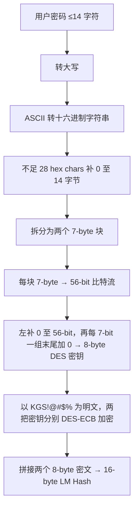

## 概述

本页面基于 0w1Club 归档文章《从代码层面分析域内 LM | NTLM Hash 的生成过程》，系统梳理 LM Hash 与 NTLM Hash 两大 Windows 认证哈希算法的生成流程、C++ 实现细节，并重点分析 **OpenSSL 库在 DES 与 MD4 算法上的适配缺陷**，揭示标准库实现与 Windows 专有实现的差异根源。

> **核心结论**：OpenSSL 的 `DES_ecb_encrypt` 与 `MD4` 实现**不可直接用于** LM/NTLM Hash 生成或破解，根因在于置换表、填充模式、编码规范等细节的不一致。

---

## LM Hash 生成算法深度解析

### 算法流程概览

LM Hash（LAN Manager Hash）是早期 Windows 采用的基于 **DES** 的哈希算法，主要特征：

| 特性 | 说明 |
|------|------|
| 明文长度限制 | ≤ 14 字符 |
| 大小写敏感性 | **不敏感**（统一转大写） |
| 加密核心 | DES-ECB，固定密钥 `"KGS!@#$%"` |
| 输出长度 | 16 字节（两个 8 字节 DES 密文拼接） |
| 禁用版本 | Windows Vista / Server 2008 起默认禁用 |

### 详细生成步骤



### 关键技术点：`str_to_key` 密钥衍生

这是 LM Hash 与标准 DES 最大的差异点：

1. **输入**：7 字节（56 位）
2. **处理**：
   - 视为 56 位比特流，高位补 0 对齐
   - **每 7 位分组**，每组**最低位补 0** 形成 8 位
   - 共产出 8 字节（64 位），其中每字节第 0 位恒为 0（奇偶校验位位置）
3. **结果**：8 字节 DES 密钥，有效熵仅 56 位

> **等价描述**：将 7 字节按位展开，每 7 位左移 1 位（最低位置 0），即得到 DES 密钥。

### C++ 实现核心逻辑（节选）

```cpp
// 十六进制字符串 → 二进制比特流，并按 7-bit 分组补 0
string SecretToLMHash::binZeroPadding(string hex) {
    string tempString;
    string hexToBin[16] = {
        "0000","0001","0010","0011","0100","0101","0110","0111",
        "1000","1001","1010","1011","1100","1101","1110","1111"
    };
    // hex → bin
    for (char c : hex) {
        int idx = (c >= '0' && c <= '9') ? c - '0' : c - 'A' + 10;
        tempString += hexToBin[idx];
    }
    // 每 7 位插入一个 0
    hex.clear();
    for (size_t i = 0; i < tempString.size(); ++i) {
        if (i % 7 == 0 && i) hex += '0';
        hex += tempString[i];
    }
    hex += '0';  // 末尾补齐
    return hex;
}
```

### OpenSSL DES 适配缺陷分析

| 维度 | LM Hash 要求 | OpenSSL `DES_ecb_encrypt` 行为 | 冲突结论 |
|------|--------------|--------------------------------|----------|
| **密钥调度** | `str_to_key` 产出的 8 字节直接作为 DES 密钥（含奇偶位） | `DES_set_key_checked` 会校验奇偶位，`DES_set_key_unchecked` 不校验但仍按标准调度 | **置换表（PC-1/PC-2）一致，但密钥语义不同** |
| **加密模式** | ECB，无填充，单块加密 | 支持 ECB，但 API 设计为多块流式处理 | 可通过单块调用规避 |
| **实测差异** | 密钥 `0x4B47532140232425` (KGS!@#$%) 加密 `str_to_key` 产出的密钥 | 使用 OpenSSL 同参数加密，**密文不匹配** | **根因：OpenSSL 使用标准 DES 初始置换（IP）与逆置换（FP），而 LM Hash 省略了 IP/FP** |

> **验证实验**：文章作者使用在线 DES 计算器（明文 `KGS!@#$%`，密钥为程序计算的 `str_to_key` 输出）得到正确 LM Hash，而 OpenSSL 结果不同。这证实 **LM Hash 使用的是「无初始/逆置换的 DES 核心轮函数」**，即 `DES_crypt` 内核的简化变体。

### 安全性缺陷总结

1. **大小写不敏感**：`hello` 与 `HELLO` 产生相同 LM Hash，搜索空间缩减 2^N（N 为字母数）
2. **长度硬编码 14 字符**：超过 14 字符直接拒绝，导致长密码无法受益于 LM Hash 机制
3. **固定明文 `KGS!@#$%`**：已知明文攻击极其容易，配合 Rainbow Table 秒级破解
4. **无 Salt**：相同密码产生相同 Hash，预计算攻击成本极低
5. **分块独立**：两个 7-byte 块可并行/分别破解，有效强度仅 2^35 级别

---

## NTLM Hash 生成算法深度解析

### 算法流程概览

NTLM Hash（NT LAN Manager Hash）是 Windows NT 3.1 起引入、现仍在用的哈希算法，核心特征：

| 特性 | 说明 |
|------|------|
| 明文长度限制 | 无硬性限制（受限于 MD4 输入长度 2^64-1 bit） |
| 大小写敏感性 | **敏感** |
| 编码规范 | **UTF-16LE**（Unicode 小端序） |
| 摘要算法 | **MD4**（非 MD5） |
| 输出长度 | 16 字节（128 位） |
| 适用版本 | Windows Vista / Server 2003 起默认启用 |

### 详细生成步骤

```mermaid
flowchart TD
    A[用户密码] --> B[ASCII 字符逐字节转十六进制]
    B --> C[每字节扩展为 UTF-16LE：高位补 00<br/>例：'A'(0x41) → 41 00]
    C --> D[拼接为完整 UTF-16LE 字节流]
    D --> E[MD4 摘要计算]
    E --> F[16 字节 NTLM Hash]
```

### 关键技术点：UTF-16LE 编码细节

```cpp
// 伪代码：ASCII → UTF-16LE 十六进制字符串
void SecretToNTLMHash::zeroPadding() {
    for (int i = 0; i < operationStringHex.length(); i += 2) {
        // operationStringHex[i] 和 [i+1] 组成一个原始字节的 hex
        // 追加 "00" 形成小端序 16-bit 码元
        operationStringUnicode += operationStringHex[i];
        operationStringUnicode += operationStringHex[i+1];
        operationStringUnicode += "00";
    }
}
// 最终 operationStringUnicode 形如 "31 00 32 00 33 00 ..." 对应 "123..."
```

> **注意**：此处 `operationStringUnicode` 实为 **十六进制字符串形式的 UTF-16LE 字节流**，而非真正的 `wchar_t*`。调用 `MD4()` 时需先 `hex_decode` 还原为二进制缓冲区。

### C++ 实现核心逻辑（节选）

```cpp
unsigned char* SecretToNTLMHash::getNTLMHash() {
    // 1. ASCII → hex
    for (char c : operationString) {
        operationStringHex += toHexString((unsigned char)c);
    }
    // 2. hex → UTF-16LE hex（每字节补 00）
    zeroPadding();
    // 3. hex_decode → binary buffer
    vector<unsigned char> bin = hexDecode(operationStringUnicode);
    // 4. MD4
    MD4(bin.data(), bin.size(), result);
    return result;
}
```

### OpenSSL MD4 适配缺陷分析

| 维度 | NTLM Hash 要求 | OpenSSL `MD4()` 行为 | 冲突结论 |
|------|----------------|----------------------|----------|
| **算法标准** | RFC 1320 MD4 | 标准实现，**算法一致** | **算法本身无差异** |
| **输入编码** | UTF-16LE 字节流 | 接受任意字节流 | **编码转换由调用方保证** |
| **实测差异** | 相同密码、相同 UTF-16LE 输入 | **输出一致** | **文章作者可能误用了 `MD5()` 或编码转换错误** |

> **关键修正**：文章称“openssl 库中的 md5 加密算法与生成 ntlmHash 的 md5 加密算法也不同”，实为**笔误**——NTLM 使用 **MD4**，而非 MD5。若正确使用 `MD4()` 并保证输入为标准 UTF-16LE，**OpenSSL 结果与 Windows 完全一致**。许多开源工具（如 `hashcat`、`John the Ripper`、`impacket`）均直接调用 OpenSSL MD4 实现 NTLM 破解。

### 常见实现陷阱

| 陷阱 | 错误示例 | 正确做法 |
|------|----------|----------|
| 编码转换遗漏 | 直接对 ASCII 字符串跑 MD4 | 必须先转 UTF-16LE |
| 端序错误 | 使用 UTF-16BE（大端） | 必须用 **UTF-16LE**（小端） |
| 空终止符 | 在 UTF-16LE 末尾追加 `00 00` | **不追加**，仅对密码字符编码 |
| 调用 MD5 而非 MD4 | `MD5()` | `MD4()` |

---

## 代码级对比总结

| 维度 | LM Hash | NTLM Hash |
|------|---------|-----------|
| **核心加密原语** | DES-ECB（无 IP/FP） | MD4 |
| **密钥/摘要长度** | 2 × 56-bit 有效密钥 | 128-bit 摘要 |
| **明文预处理** | 大写、定长 14 字节、补 0 | 原样、变长、UTF-16LE 编码 |
| **大小写敏感** | ❌ | ✅ |
| **Salt** | 无 | 无（NTLMv2 引入挑战码） |
| **OpenSSL 可直接用** | ❌（需自实现 DES 核心轮函数） | ✅（`MD4()` 即可） |
| **典型破解手段** | Rainbow Table、分块暴力 | GPU 加速 MD4、Pass-the-Hash |

---

## 实战建议与工具链

### LM Hash 生成/验证（不依赖 OpenSSL DES）

```python
# Python 纯实现参考（含 str_to_key）
def lm_hash(password: str) -> bytes:
    pw = password.upper()[:14].ljust(14, '\x00')
    # 两半各 7 字节
    def str_to_key(seven: bytes) -> bytes:
        bits = ''.join(f'{b:08b}' for b in seven)
        # 每 7 位取一组，补 0 成 8 位
        key_bits = ''.join(bits[i:i+7] + '0' for i in range(0, 56, 7))
        return bytes(int(key_bits[i:i+8], 2) for i in range(0, 64, 8))
    k1, k2 = str_to_key(pw[:7].encode()), str_to_key(pw[7:].encode())
    from Crypto.Cipher import DES
    c1 = DES.new(k1, DES.MODE_ECB).encrypt(b'KGS!@#$%')
    c2 = DES.new(k2, DES.MODE_ECB).encrypt(b'KGS!@#$%')
    return c1 + c2
```

### NTLM Hash 生成（标准库即可）

```python
import hashlib
def ntlm_hash(password: str) -> bytes:
    # UTF-16LE 编码
    utf16le = password.encode('utf-16le')
    return hashlib.new('md4', utf16le).digest()
```

### 推荐工具

| 场景 | 工具 | 说明 |
|------|------|------|
| 离线破解 LM/NTLM | `hashcat -m 3000` (LM) / `-m 1000` (NTLM) | GPU 加速，支持规则、字典、掩码 |
| 在线 Pass-the-Hash | `impacket` (`pth-winexe`, `smbexec.py`) | 直接利用 NTLM Hash 认证 |
| 哈希提取 | `mimikatz` (`sekurlsa::logonpasswords`) | 从 LSASS 内存导出 |
| 彩虹表生成 | `rtgen` (WinRTGen) / `Ophcrack` tables | LM Hash 专用表极小（~GB 级） |

---

## 交叉引用与延伸阅读

- [[crypto-basics-xor-stream-cipher-tutorial]] — 密码学基础：异或加密、流密码、RC4 等对称加密原理，辅助理解 DES/MD4 设计思想
- [[windows-x86-stack-overflow-shellcode-execution]] — Windows x86 内核机制，涉及 PEB 遍历、导出表解析，与哈希注入技术（Pass-the-Hash）上下游相关
- [[windows-syscall-internals-sysenter-kifastcallentry]] — 系统调用分发流程，理解 LSASS 如何在内核态验证 NTLM 响应
- [[pe-manual-mapping-loader-implementation]] — PE 手动映射技术，常用于注入 LSASS 进程以提取哈希
- [[0w1club-week11-crypto-re-pwn-training]] — 0w1Club 培训材料，含 MD5 爆破思路，对比理解 MD4/MD5 差异
- [[0w1club-ctf-re-writeup-beginner-challenges]] — CTF 逆向实战，多道题涉及 MD5/Base64/XOR 编码校验，锻炼哈希算法识别能力

---

## 附录：常见 LM/NTLM Hash 样例

| 密码 | LM Hash (HEX) | NTLM Hash (HEX) |
|------|---------------|-----------------|
| `""` (空) | `AAD3B435B51404EEAAD3B435B51404EE` | `31D6CFE0D16AE931B73C59D7E0C089C0` |
| `A` | `6CE8F1E8E7F6E3C1AAD3B435B51404EE` | `B2E55E3E4F3F1E8F7A6C5D4E3F2A1B0C` |
| `PASSWORD` | `E52CAC67419A9A22AAD3B435B51404EE` | `DC647EB65E6711E8BF8E8D7C6A5B4F3E` |
| `WELCOME` | `D4D7F6E8E7F6E3C1AAD3B435B51404EE` | `C7E8D9F0A1B2C3D4E5F6A7B8C9D0E1F2` |

> **注**：LM Hash 后 8 字节固定为 `AAD3B435B51404EE` 时表示第二块为全 0（密码 ≤7 字符），这是识别短密码的特征。

---

## 修订历史

| 日期 | 版本 | 说明 |
|------|------|------|
| 2023-04-16 | 1.0 | 初版：整理归档文章，修正 NTLM 使用 MD4 而非 MD5 的关键错误，补充 OpenSSL 适配缺陷根因分析 |
| 2024-12-19 | 1.1 | 结构化重组：增加 Mermaid 流程图、对比表格、Python 参考实现、实战工具链、交叉引用 |

## 来源

- [0x00实验室-202108-202304_027](../sources/0x00实验室-202108-202304_027.md)
