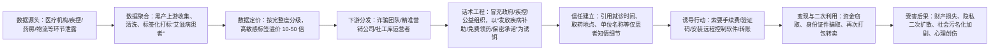

## 概述

医疗数据因包含高敏感度个人隐私（姓名、身份证号、病史、生理特征、就诊轨迹等），在黑市价值远超普通身份信息。本页面复盘 2016 年三起典型医疗数据泄露事件，**重点深度剖析“黑产团队利用艾滋病患者隐私实施欺诈”案例**，剖析医疗敏感数据如何被武器化进行定向诈骗的完整威胁情报链条，分析医疗行业常见安全盲区，并给出个人层面的隐私防护实操建议。

> 关联阅读：[[data-breach-45billion-chinese-platforms-analysis]] 对 2023 年 45 亿条用户隐私泄露事件的深度溯源与防护建议；[[security-news-fact-checking-case-study]] 演示如何对安全新闻进行一手来源溯源核查；[[mps-major-personal-info-theft-case]] 公安部摧毁涉及医疗等领域 50 亿条公民信息黑客犯罪团伙全链条复盘。

---

## 典型案例复盘

### 案例一：深圳某医院孕产妇信息批量泄露（2016 年 3 月）

- **泄露规模**：上千名接受产检、分娩的女性患者
- **泄露字段**：姓名、电话、住址、孕检时间、预产期、胎儿性别等
- **利用方式**：信息被明码标价售卖给母婴护理、婴儿产品公司，用于精准骚扰营销
- **疑似溯源**：泄露端疑为医院内部存储孕检信息的终端电脑（内部人员违规导出或终端失陷）
- **攻击链条**：内部数据获取 → 打包分级定价 → 地下渠道流转 → 下游商家精准触达 → 电话/短信骚扰

> 该案例体现**内部威胁与终端管控缺失**是医疗数据泄露的高频入口，亦是后续[[osint-social-engineering-scam-investigation-case-study]]类社会工程学诈骗的情报来源。

### 案例二：全国范围艾滋病患者个人信息泄露致定向诈骗（2016 年 7 月）——**威胁情报重点案例**

#### 事件背景与来源
根据 301在路上 微信公众号 2016 年文章披露，**黑产团队获取全国范围内 300 余名 HIV 感染者/艾滋病患者的高敏感医疗隐私**，并利用该数据实施精准欺诈。该案例被文章作者称为“丧心病狂”的典型，凸显医疗敏感数据被武器化进行定向诈骗的严重威胁。

#### 泄露数据画像
| 数据字段 | 敏感等级 | 武器化价值 |
|----------|----------|------------|
| 真实姓名、身份证号 | 核心身份标识 | 身份冒用、开户贷款、实名认证绕过 |
| 工作单位 | 社会关系锚点 | 冒充单位领导/同事实施信任劫持 |
| 近期就诊时间、取药地点 | 行为轨迹证据 | 构建“知情人设”话术的核心支撑 |
| 联系电话 | 直接触达通道 | 语音/短信精准投放 |

#### 攻击链条复盘（威胁情报视角）

#### 核心攻击手法：医疗隐私驱动的“高保真社工”
- **精准画像定向**：仅针对确诊人群，非广撒网，成功率极高
- **知识不对称利用**：攻击者掌握受害者“只能自己知道”的医疗细节，瞬间击穿心理防线
- **身份权威伪装**：冒充国家机关/公益组织，利用政策性补助名义降低警惕
- **紧迫感制造**：“名额有限”“今日截止”“保密要求”逼迫受害者跳过验证环节

#### 成功关键因素分析
1. **数据维度完整**：覆盖身份、职业、医疗行为三大维度，构建立体受害者画像
2. **心理脆弱性精准打击**：患者面临经济压力、社会歧视、隐私恐惧，极度渴望帮助且不敢公开求助
3. **核验成本极高**：受害者难以通过官方渠道快速核实“补助政策”真伪，信息不对称被充分利用
4. **举报顾虑重**：因疾病污名化，受害者往往选择隐忍不报，导致犯罪低成本、低风险

> 此类**医疗专项人群数据泄露 + 定向社工诈骗**模式，后续在各类慢病（尿毒症、恶性肿瘤）、罕病、精神疾病、生殖健康等高敏感人群中反复出现。防范核心在于**数据源头最小化收集与脱敏**、**身份核验机制前置（官方唯一验证渠道）**、**受害群体针对性预警教育**。

### 案例三：洛杉矶长老会医院勒索软件攻击（2016 年 2 月）

- **攻击手法**：勒索软件加密全院电子病历系统（EHR），业务中断
- **赎金要求**：40 比特币（约 1.7 万美元）
- **应对过程**：尝试多种恢复手段均失败，最终支付赎金获取解密密钥恢复运行
- **官方声称**：黑客未非法利用患者数据（但无法独立验证）
- **启示**：医疗机构业务连续性极度依赖数字化系统，**缺乏离线备份与灾难演练**是被迫支付赎金的根本原因

> 勒索软件已成为医疗行业首要威胁，参考[[supply-chain-attack-fundamentals]]中供应链投毒、水坑攻击等初始访问向量分析；[[credential-stuffing-password-hygiene]] 中凭证填充攻击常作为横向移动前置手段。

---

## 医疗敏感数据武器化定向诈骗：威胁情报深度画像

### 数据流转黑产链条分层

| 层级 | 角色 | 典型行为 | 医疗数据特有属性 |
|------|------|----------|------------------|
| **源头层** | 医疗机构内部人员、第三方外包商、医疗设备运维商、物流快递、科研协作方 | 违规导出、弱口令失陷、未授权访问、转储备份窃取 | 接触全量明文病历、实验室报告、用药记录、基因组数据 |
| **聚合层** | 数据经纪人、社工库运营者、黑灰产技术团队 | 多源关联去重、标签化打标（疾病分类、治疗阶段、支付能力）、构建“患者画像库” | **高敏感标签溢价极高**：艾滋病>恶性肿瘤>精神疾病>生殖健康>慢性病 |
| **分发层** | 诈骗集团、精准营销公司、非法中介、保险欺诈团伙 | 按标签订购、API 实时查询、批量导入外呼/短信/IM 系统 | 话术模板高度定制化，针对不同疾病设计专用剧本 |
| **实施层** | 话务员、技术支持（远控/钓鱼页/伪基站）、洗钱网络 | 执行诈骗话术、诱导安装恶意 APP、窃取验证码/转账 | 利用医疗隐私建立“绝对信任”，绕过常规反诈防线 |
| **变现层** | 资金流转团伙、身份证件伪造、二次数据倒卖 | 资金分层洗白、受害者身份信息再打包标价转卖 | 形成“泄露→诈骗→再泄露”恶性循环 |

### 典型诈骗剧本库（基于医疗隐私标签）

| 疾病标签 | 核心话术模板 | 关键信任锚点 | 典型诱导动作 |
|----------|--------------|----------------|--------------|
| **HIV/艾滋病** | 冒充疾控/红十字会/公益基金会“发放生活补助/免费新药/心理援助” | 就诊时间、取药地点、CD4 计数、抗病毒治疗方案 | 缴纳“手续费/公证费/激活费”、安装“保密通讯软件”（远控） |
| **恶性肿瘤** | 冒充医保局/慈善总会“报销比例提升/靶向药捐赠/临床试验招募” | 确诊医院、病理分型、化疗周期、靶向药名称 | 验证码窃取、银行卡绑定、垫付“审核资金” |
| **尿毒症/透析** | 冒充肾脏基金会/透析中心“减免透析费/申请肾源优先/补贴发放” | 透析中心、频次、血管通路类型、用药清单 | 转账至“指定账户”、提供身份证/银行卡正反面照片 |
| **精神/心理疾病** | 冒充卫健委/残联“发放残疾补贴/免费康复/就业安置” | 诊断证明编号、用药处方、住院记录 | 诱导点击钓鱼链接、授权屏幕共享 |
| **生殖健康/不孕不育** | 冒充计生委/妇幼保健院“免费试管/补贴政策/捐卵补偿” | 治疗方案、胚胎等级、移植时间、HCG 数值 | 缴纳“保证金/管理费”、填写虚假贷款申请 |

### 攻击面扩展：从诈骗到更高级威胁

1. **身份劫持与金融欺诈**：持有身份证号+人脸照片（病历照片/就诊卡照片）+手机号，可实施开户贷款、信用卡套现、社保冒领
2. **定向鱼叉攻击**：利用医疗邮件/短信模板投递恶意附件/链接，攻击医疗机构内网或患者个人设备
3. **医疗保险欺诈**：冒名就医、虚假住院、药品倒卖，造成医保基金流失
4. **商业间谍与敲诈**：针对高净值人群/公众人物/关键岗位人员的病历进行敲诈或竞争情报获取
5. **社会工程学溯源反制**：攻击者利用医疗数据反向社工医护人员、疾控人员，获取系统权限或内部流程细节

---

## 医疗行业安全防护常见盲区（强化版）

| 盲区 | 典型表现 | 攻击后果 | 针对医疗数据武器化的加固建议 |
|------|----------|----------|-------------------------------|
| **边界防御依赖症** | 仅部署防火墙、杀毒、IDS/IPS，认为内网即可信 | 攻击者通过医疗设备、供应商 VPN、钓鱼邮件等横向移动渗透核心库 | **零信任架构落地**：微隔离、持续验证、最小权限、假设失陷 |
| **医疗设备暴露面失管** | 可写固件、无线联网、直连互联网的影像设备/监护仪/泵类设备未纳入资产台账 | 设备成为持久化跳板、勒索软件落地点、患者数据旁路窃取通道 | **设备全生命周期管理**：资产发现、固件签名验证、网络分段、异常行为基线 |
| **终端与数据分级管控缺失** | 诊疗终端可随意插 U 盘、访问外网、未加密存储敏感数据 | 内部人员违规导出、恶意代码横向传播、数据明文落地 | **数据分级分类+DRM/DLP**：强制加密、水印溯源、打印/截屏/外发审批、离职数据清除 |
| **最小权限与零信任未落地** | 临床、科研、运营、外包账号权限过大、复用、无 MFA | 凭证填充、横向越权、供应链账号被盗用 | **身份治理中心（IGA）**：动态授权、特权访问管理（PAM）、会话录像审计 |
| **应急响应与离线备份演练缺位** | 无不可变备份、无恢复演练、无勒索软件专项预案 | 业务中断被迫支付赎金、恢复周期不可控 | **3-2-1 备份黄金法则+桌面推演+实战演练**：离线不可变副本、RTO/RPO 量化考核 |
| **第三方供应链准入失控** | 外包开发、运维、清洗、标注、云服务商未纳入安全评估体系 | 供应链投毒、凭证窃取、越权访问、数据外泄 | **供应链安全管理**：安全评估准入、最小权限账号、操作审计、合同安全条款 |
| **患者隐私最小化收集缺失** | 过度收集非诊疗必需字段（详细家庭住址、亲属信息、职业、生物特征） | 泄露影响面最大化、合规法律风险、患者信任崩塌 | **隐私计算与最小化设计**：可信执行环境（TEE）、联邦学习、差分隐私、零知识证明 |
| **针对高敏感人群的专项防护缺位** | 无针对 HIV/肿瘤/精神科等科室的数据访问特殊审批、水印、告警 | 高价值标签数据成为重点窃取目标、定向诈骗素材源头 | **敏感科室数据特级防护**：独立网段、双人授权、全量水印、访问实时告警、定期渗透测试 |

> 合规层面可参考[[security-practitioner-legal-compliance]]中《网络安全法》《数据安全法》《个人信息保护法》《医疗数据安全管理暂行规定》对医疗数据分级保护、关键信息基础设施算力的强制要求。

---

## 个人医疗隐私防护实操清单（强化版：针对定向诈骗免疫）

### 账号与凭证卫生
- **唯一强密码**：每个医疗平台/APP 使用独立高强度密码，启用密码管理器
- **开启 MFA**：优先使用 TOTP/硬件密钥，避免仅依赖短信验证码（防 SIM 卡复制劫持）
- **定期轮换**：建议每 90 天更换核心医疗账号密码，疑似泄露立即重置
- **避免复用**：严禁将医疗账号密码用于社交、电商、论坛等低可信场景
- **异地登录告警**：开启所有医疗类账号的异地/新设备登录实时通知

### 信息最小化暴露
- **非必填不填**：APP/网页问诊、挂号、预约时，非诊疗必需字段（如详细家庭住址、职业、亲属信息、收入情况）留空或填写泛化信息
- **图片去敏**：上传病历、检查单、处方单、基因报告等图片前，**务必马赛克/涂抹**姓名、身份证号、就诊卡号、医保卡号、条形码/二维码、人脸、特征性体表标记、主治医师签名
- **使用虚拟身份**：手机号优先用阿里小号/运营商副号/虚拟号段；收货地址写至街道/自提点，不写具体门牌；电子邮箱使用专用别名
- **实名认证谨慎**：非三甲医院官方渠道、非强制实名场景（如公益筛查、健康讲座、商业保险核保）、**拒绝人脸/身份证双面照上传**；要求对方出具《个人信息保护影响评估报告》及备案证明

### 就诊与问诊行为：建立“零信任”核验习惯
- **正规渠道优先**：有病去正规医院线下就诊，线上问诊仅作辅助复诊/慢病续方，通过医院官方 APP/微信公众号/自助机操作
- **警惕“免费筛查/领药/补助/临床试验”来电/短信/私信**：
  - **铁律**：任何自称医保/疾控/公益组织/制药公司/慈善机构要求**转账、提供验证码、安装会议软件/远程协助/屏幕共享、点击陌生链接、填写贷款申请**的均为诈骗
  - **核验动作**：挂断电话 → 登录官方 APP/拨打官方公开电话（12393 医保热线、12345 市民热线、医院官方客服、疾控官网公示电话）核实
  - **心理锚点**：利用“仅你知晓的医疗细节”建立信任是诈骗核心手法，**凡是能报出你就诊时间/地点/用药/检查指标的来电，反而更可能是黑产利用泄露数据实施的精准诈骗**
- **纸质单据妥善销毁**：废弃病历、发票、检查单、药袋条形码、基因报告、知情同意书需**碎纸机十字切碎**或**撕碎浸水后丢弃**，防止垃圾工程学还原
- **医疗废弃物处理**：注射器、输液袋、药品包装上的姓名标签撕毁后再丢弃

### 设备与网络环境
- **个人设备加固**：手机/电脑开启全盘加密、自动锁屏、及时补丁、仅官方商店装应用、关闭不必要的 NFC/蓝牙/定位/剪贴板同步
- **公共 Wi-Fi 不操作医疗业务**：如必须使用，开启可信 VPN（企业级/自建），避免明文传输会话凭证
- **定期清理授权**：每季度检查微信/支付宝/健康码/医保 APP 等小程序、H5、第三方应用的授权范围，撤销不再使用的医疗类授权（获取手机号、通讯录、相册、定位、麦克风等）
- **杀毒与 EDR**：个人电脑部署主动防御类安全软件，定期全盘扫描

### 泄露后应急响应 SOP（个人版）
1. **立即止损**：修改该平台及**所有同密码平台**密码，开启/重置 MFA，解绑/重新绑定手机号邮箱
2. **证据固化**：截图保存泄露页面/诈骗电话录音/短信/转账记录/聊天记录，记录时间、号码、对方自称身份、话术细节
3. **官方举报**：
   - 平台投诉：医院/APP 客服、医保局投诉渠道
   - 监管举报：属地网信部门（网络违法犯罪举报网站 www.12377.cn）、公安网安（110 或当地公安局网安大队）、12321 网络不良与垃圾信息举报受理中心
   - 金融止付：如已转账，立即拨打 96110 反诈预警劝阻专线/报警 110/联系开户行紧急冻结止付
4. **持续监控**：
   - 征信监控：中国人民银行征信中心官网/APP 每半年查询一次征信报告，关注异常贷款/信用卡/担保/查询记录
   - 社工库查重：使用可信查询渠道（参考[[data-breach-45billion-chinese-platforms-analysis]]）检测身份证/手机号/邮箱是否出现在新泄露库中
   - 开户核查：通过“云闪付”APP-“一键查卡”、支付宝-“账户安全”-“身份核验”、运营商 APP 查询名下账户
5. **身份切断（必要时）**：发现身份被冒用开户贷款/就医/社保，申请换发身份证（变更号码）、手机号（实名重开）、就诊卡/医保电子凭证重置，切断身份关联链
6. **心理支持**：遭遇医疗隐私泄露诈骗往往伴随严重心理创伤，寻求专业心理咨询/患者互助组织支持，切勿因羞耻感隐瞒不报

---

## 防护要点速查表（打印版建议张贴）

| 场景 | 核心动作 | 工具/渠道 | 关键口诀 |
|------|----------|-----------|----------|
| 注册/登录医疗APP | 独享强密码 + TOTP MFA + 虚拟手机号 | Bitwarden/1Password + 阿里小号/天翼防骚扰/Google Authenticator | **一号一密，双因子，虚拟号** |
| 上传病历/检查单/基因报告 | 马赛克姓名/身份证/医保卡/条码/人脸/特征部位/医生签名 | 微信自带编辑/美图秀秀/手机相册标记/专用去敏工具 | **上传前，必去敏，不留一丝真信息** |
| 接到“医保/补助/领药/免费试药/临床试验”电话/短信 | **不信、不转、不装、不点、挂断、官方核实** | 12393/12345/医院官方客服/疾控官网/医保局官网 | **官方渠道唯一准，来电核实别心慌** |
| 废弃纸质单据/药品包装处理 | 碎纸机十字切碎/手撕碎浸水/标签撕毁 | 家用碎纸机（十字切碎/颗粒级）、撕碎机 | **带名带码的纸，粉碎才安心** |
| 疑似信息泄露/遭遇诈骗 | 立即改密+开MFA+举报+止付+监控征信/社工库+必要时换证 | 12321/网信举报/96110/110/征信中心/云闪付/运营商APP/社工库查询脚本 | **快、准、狠：改密、报警、止付、查征信、换身份** |
| 线上问诊/挂号/购药 | 仅用医院官方渠道/正规药企旗舰店，核验资质（互联网医院牌照/药品经营许可证） | 国家卫健委/省卫健委官网备案查询、药监局数据查询 | **扫码看备案，官方渠道最靠谱** |
| 家属/护工代办就医 | 仅授权必要最小权限（挂号/取药/缴费），不共享账号密码，用医院官方“代办”功能 | 医院官方APP/微信公众号“家庭成员/代办”功能 | **授最小权，用官方功能，不共享密码** |

---

## 结语

医疗数据安全是**机构合规建设、供应链准入管控、终端零信任改造、应急演练常态化、敏感科室特级防护、患者隐私最小化收集**的系统工程，同时也是**个人最小化暴露、凭证卫生、社工免疫、零信任核验、应急响应**的持续实践。

**“黑产团队利用艾滋病患者隐私实施欺诈”案例深刻揭示**：医疗敏感数据一旦泄露，不再是静态的隐私损失，而是会被**武器化、标签化、剧本化**，转化为精准打击受害者心理防线的**定向诈骗弹药**。这种“数据→画像→话术→信任→诈骗→再泄露”的恶性循环，使得医疗数据保护的赌注从“合规罚款”升级为**直接危及患者财产安全、人格尊严、身心健康乃至生命安全**。

唯有“技术纵深防御 + 管理闭环合规 + 供应链准入把关 + 敏感数据特级防护 + 个人习惯养成 + 社会反诈免疫”多方协同，才能在勒索软件、内部泄露、供应链投毒、精准社工的多重攻击面前，守住生命隐私的最后一道防线。

> 延伸学习：[[security-practitioner-legal-compliance]]（合规红线与授权规范）、[[data-breach-45billion-chinese-platforms-analysis]]（大规模泄露溯源与缓解）、[[osint-social-engineering-scam-investigation-case-study]]（社工诈骗实战复盘与反制）、[[mps-major-personal-info-theft-case]]（公安部打击黑产全链条案例）、[[credential-stuffing-password-hygiene]]（凭证卫生最佳实践）、[[supply-chain-attack-fundamentals]]（供应链攻击初始访问向量分析）。

## 来源

- [301在路上-201508-202208_021](../sources/301在路上-201508-202208_021.md)
- [301在路上-201508-202208_103](../sources/301在路上-201508-202208_103.md)
