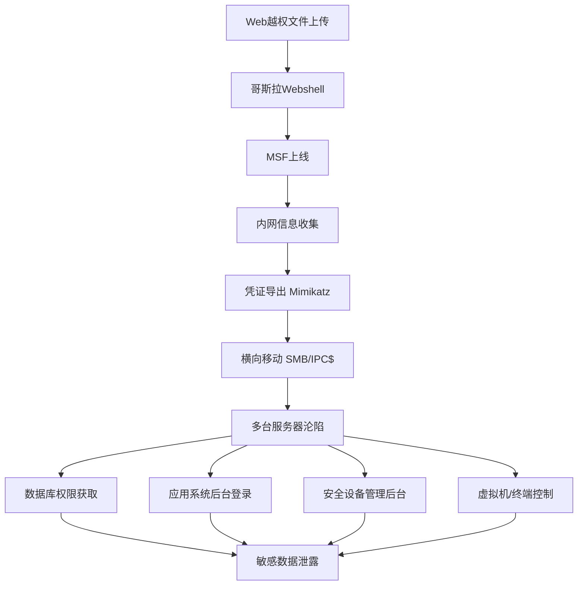

## 概述

本页面记录一次针对某医疗系统的完整内网渗透测试实战案例。攻击链条涵盖：**Web层越权文件上传获取初始立足点** → **内网信息收集与凭证导出** → **横向移动攻陷多台服务器** → **数据库、应用系统、安全设备多维度权限获取** → **大量敏感数据泄露**。案例直观展示了内网渗透中“一点突破、面面俱到”的典型攻击路径，并暴露了弱口令、凭证复用、浏览器存储明文密码、安全设备默认/弱配置等普遍存在的安全隐患。

> **来源**：火线Zone 原文《记一次某单位的内网渗透测试》，作者：小黑（0x6270安全团队合伙人）

---

## 攻击链总览

---

## 初始入口：Web层越权文件上传

### 漏洞发现
- **目标系统**：某医疗业务系统 `http://www.xx.xx.com`
- **漏洞类型**：垂直越权 + 任意文件上传
- **利用方式**：通过越权访问上传功能点，绕过前端校验直接上传恶意脚本文件

### Webshell植入
- **工具**：**哥斯拉**  动态加密 Webshell（Godzilla）
- **连接方式**：哥斯拉客户端直接管理，流量加密对抗 WAF/流量检测
- **落地路径**：Web 目录可写路径，解析执行 PHP/JSP/ASPX 等动态脚本

> **关联技术**：[[php-webshell-fundamentals-chopper-analysis]]、[[php-webshell-obfuscation-av-evasion]]、[[inceptor-av-edr-evasion-framework]]

---

## 立足点建立与通道构建

### MSF 会话上线
- 通过哥斯拉执行命令/上传 Loader，反弹 **Meterpreter** 会话至 Metasploit Framework
- 会话特权：`WIN-Ixxxx\Administrator`（本地管理员）

### 通道隐蔽与对抗
- 哥斯拉 AES 加密通信 + MSF 反向 HTTPS/TCP 多通道备选
- 关闭/绕过终端杀毒（文中提及“终端管理杀毒但登录有效期短且未保存密码”）

> **关联技术**：[[metasploit-framework-basics-tutorial]]、[[cobalt-strike-external-c2-smb-beacon]]、[[memory-scanning-tools-evasion-techniques]]

---

## 内网信息收集与凭证获取

### 核心收集维度
| 维度 | 关键动作 | 典型命令/工具 |
|------|----------|---------------|
| 网络拓扑 | 网卡信息、路由表、ARP缓存 | `ipconfig /all`、`route print`、`arp -a` |
| 补丁/防护 | 补丁列表、杀毒进程、EDR特征 | `systeminfo`、`tasklist /svc`、`wmic qfe` |
| 账户体系 | 域/工作组判断、在线用户、密码策略 | `net view`、`net user`、`query user` |
| 凭证存储 | 浏览器保存密码、配置文件、注册表 | `LaZagne`、`SharpWeb`、手工翻阅 |
| 敏感文件 | 数据库连接串、备份脚本、运维文档 | `dir /s /b *.config`、`findstr` |

### 关键凭证导出
- **工具**：**Mimikatz** `sekurlsa::logonpasswords`（内存读取 LSASS）
- **获取凭证**：
  - `Administrator / xxx`（域/本地通用）
  - 多台服务器通杀同一组凭证

> **关联技术**：[[mimikatz-sekurlsa-pth-internals]]、[[mimikatz-source-code-architecture-golden-ticket-audit]]、[[xd-security-internal-network-penetration-notes-day67-68]]

---

## 横向移动与多系统沦陷

### 横向移动手法
| 目标IP段 | 认证方式 | 利用工具/模块 | 结果 |
|----------|----------|---------------|------|
| 192.168.xx.x/24 | Administrator/xxx | `psexec`、`smbexec`、`wmiexec`、IPC$ 连接 | 两台服务器拿下 |
| 192.158.xx.x | Administrator/xxx | 同上 | 获取虚拟机/软件/数据库权限 |
| 192.168.xx.x (caiwu) | Administrator/123 | 弱口令喷射/爆破 | 财务主机沦陷，大量敏感文件泄露 |

### 凭证复用与密码喷射
- **核心发现**：全网 **Administrator 本地管理员密码高度复用**，甚至财务主机使用 `123` 极弱口令
- **浏览器凭证**：多台主机 Chrome/Edge 保存了业务系统、数据库、安全设备的明文账号密码

> **关联技术**：[[internal-network-pivoting-techniques]]、[[xd-security-internal-network-penetration-notes-day65-66]]、[[xd-security-internal-network-penetration-notes-day67-68]]、[[xd-security-internal-network-penetration-notes-day69-70]]、[[frp内网渗透应用]]、[[cobalt-strike-external-c2-smb-beacon]]

---

## 核心资产权限获取清单

### 数据库系统
| 资产 | 类型 | 端口 | 账号/密码 | 获取方式 |
|------|------|------|-----------|----------|
| 192.168.xxx.x | MySQL (OA) | 3306 | root / ls123123 | 翻读 Web 配置文件/连接串 |
| 192.168.xx.x | MSSQL | 1433 | sa / (弱口令) | 同服务器配置文件/注册表 |

### 业务应用系统
- **入口**：`https://xx.xx.com/login/signin`
- **凭证来源**：浏览器自动填充保存的账号密码
- **权限**：业务后台管理员/高权限账号

### 安全管理设备
- **设备**：**天擎** 终端安全管理平台
- **入口**：`http://192.168.xx.xx:8080/login?refer=%2`
- **凭证获取**：服务端安装目录下配置文件/数据库明文存储
- **账号**：`admin / xxxx`
- **影响**：**可控终端 73 台个人 PC**（全网终端落地控制权）

### 虚拟化/容器环境
- 发现 **虚拟机服务器**（VMware/Hyper-V），宿主机密码与域管一致
- 可进一步逃逸至宿主机或横向攻击虚拟机内网段

> **关联技术**：[[docker-container-security-fundamentals]]、[[kubernetes-penetration-testing]]、[[vulnhub-boredhackerblog-social-network-writeup]]

---

## 敏感数据泄露范围

文中截图显示泄露内容包括但不限于：
- **财务凭证/报表/合同** 等核心业务文档（财务主机）
- **数据库完整备份/导出文件**（MySQL、MSSQL）
- **患者/医疗业务数据**（推测，属医疗系统核心资产）
- **运维账号密码表、网络拓扑图、资产清单**
- **安全设备策略配置、终端资产清单**（天擎后台）

> **合规提示**：医疗数据属《网络安全法》《数据安全法》《个人信息保护法》重点保护对象，泄露将面临严厉监管处罚。

---

## 攻击路径复盘与关键教训

### 攻击路径要素
1. **Web层防护缺失**：越权+上传组合拳，无 WAF 有效拦截，无文件类型/内容二次校验
2. **凭证管理混乱**：
   - 本地管理员统一弱口令/复用
   - 浏览器明文存储高价值凭证
   - 配置文件/安装目录硬编码数据库/应用密码
3. **网络边界模糊**：无微隔离，C 段横向移动无阻断，财务/核心数据库与普通业务同网段
4. **安全设备成跳板**：天擎管理端弱口令/明文存储，反成最大攻击面
5. **终端防护失效**：杀毒软件“登录有效期短、未保存密码”暗示运维未强制部署/策略下发失败

### 防御建议清单
| 领域 | 硬化措施 |
|------|----------|
| Web应用 | 严格 RBAC、上传文件类型/内容双重校验、WAF 规则覆盖 OWASP Top 10、定期代码审计 |
| 账号体系 | 强制复杂密码策略、本地管理员 LAPS 随机化、禁止跨系统复用、启用 MFA |
| 凭证存储 | 禁用浏览器密码管理器、配置文件加密、密钥托管 Vault/KMS、定期轮换 |
| 网络隔离 | 零信任微隔离、核心库/财务/安全设备独立 VLAN+ACL、跳板机审计 |
| 终端防护 | EDR 全量部署、策略强制下发、关闭 LLMNR/NBT-NS、开启 Credential Guard |
| 安全运营 | 攻击面管理（资产梳理）、蜜罐/欺骗防御、红蓝对抗常态化、应急预案演练 |

---

## 工具与技术栈映射表

| 阶段 | 核心工具/技术 | 知识库交叉引用 |
|------|---------------|----------------|
| Webshell | 哥斯拉、蚁剑、中国菜刀 | [[php-webshell-fundamentals-chopper-analysis]]、[[php-webshell-obfuscation-av-evasion]] |
| C2框架 | Metasploit Framework、Cobalt Strike (SMB Beacon/External C2) | [[metasploit-framework-basics-tutorial]]、[[cobalt-strike-external-c2-smb-beacon]] |
| 凭证导出 | Mimikatz (sekurlsa::pth/logonpasswords)、LaZagne、SharpWeb | [[mimikatz-sekurlsa-pth-internals]]、[[mimikatz-source-code-architecture-golden-ticket-audit]] |
| 横向移动 | Impacket (psexec/wmiexec/smbexec/atexec)、IPC$、SMB Relay、RDP劫持 | [[internal-network-pivoting-techniques]]、[[xd-security-internal-network-penetration-notes-day67-68]] |
| 隧道/代理 | Frp、SSH隧道、SOCKS5 (Proxifier/SocksCap64/蚁剑代理)、iox、lcx/Portmap | [[frp内网渗透应用]]、[[internal-network-pivoting-techniques]]、[[iox-proxy-protocol-evasion]] |
| 权限维持 | 计划任务、服务注册、WMI事件订阅、黄金/白银票据 | [[xd-security-privilege-escalation-notes-day58-64]]、[[xd-security-internal-network-penetration-notes-day67-68]] |
| 免杀/对抗 | Inceptor、Donut/sRDI、Shellcode加载器、AMSI/ETW/WLDP Bypass | [[inceptor-av-edr-evasion-framework]]、[[memory-scanning-tools-evasion-techniques]]、[[argument-spoofing-edr-evasion]] |

---

## 相关实战案例对比

| 案例 | 相似点 | 差异点 |
|------|--------|--------|
| [[vulnhub-boredhackerblog-social-network-writeup]] | Web代码执行→Docker逃逸→内网代理→横向→提权 | 靶机环境，含容器逃逸、CVE-2015-1427 ES RCE |
| [[gkctf-2021-web-writeup]] (hackme) | NoSQL盲注→Session Upload Progress Getshell→WebLogic CVE→frp内网穿透 | CTF赛题，链条更长、技术栈更杂 |
| [[edu-src-penetration-test-case-study]] | 弱口令→存储型XSS→文件上传绕过Getshell→蚁剑 | 教育SRC授权测试，范围更窄 |
| [[oasys-system-code-audit]] | 代码审计视角：SQLi、文件上传、越权、任意文件读取、存储型XSS | 白盒审计发现同类漏洞类型 |

---

## 归属与参考

- **原文作者**：小黑（0x6270安全团队合伙人，“黑总”）
- **首发平台**：火线 Zone `https://zone.huoxian.cn/d/1101`
- **微信公众号**：0x6270网络空间安全学院（知识星球同名）
- **团队成员**：gq(星主)、永安寺、Colorado、陈滑稽、0r@nge 等

> **免责声明**：本页面仅供安全研究、教学复盘、蓝队建设参考。严禁将技术用于未授权目标。所有敏感信息（IP、账号、密码、具体单位名）均已脱敏/抽象化处理。

---

## 交叉引用索引

### 内网渗透核心技术体系
- [[internal-network-pivoting-techniques]] — 代理/隧道/横向移动全景图
- [[xd-security-internal-network-penetration-notes-day65-66]] — 域环境信息收集
- [[xd-security-internal-network-penetration-notes-day67-68]] — 凭证导出与PTH/PTK/PTT
- [[xd-security-internal-network-penetration-notes-day69-70]] — Cobalt Strike 团队协作、SOCKS代理、Frp/Ngrok实战
- [[xd-security-internal-network-penetration-notes-day71-72]] — ICMP/DNS隧道、CS↔MSF会话移交、应急溯源

### 凭证与免杀对抗
- [[mimikatz-sekurlsa-pth-internals]] — Mimikatz 内存补丁原理
- [[inceptor-av-edr-evasion-framework]] — 免杀框架工程化实现
- [[memory-scanning-tools-evasion-techniques]] — 内存扫描对抗全景
- [[argument-spoofing-edr-evasion]] — 命令行欺骗绕过 EDR

### C2 与流量隐匿
- [[cobalt-strike-external-c2-smb-beacon]] — SMB Beacon/External C2 深度解析
- [[c2-redirectors-malleable-c2-profiles]] — 重定向器与 Malleable C2 Profile
- [[iox-proxy-protocol-evasion]] — iox 协议栈重构对抗流量指纹

### 实战靶场/案例库
- [[vulnhub-platform-resource-index]] — VulnHub 靶机资源总索引
- [[vulnhub-boredhackerblog-social-network-writeup]] — 含 Docker逃逸+内网穿透完整链
- [[gkctf-2021-web-writeup]] — GKCTF 2021 hackme 多技术链复现
- [[edu-src-penetration-test-case-study]] — 教育行业 SRC 实战记录

### 合规与蓝队建设
- [[threat-attribution-tracing-techniques]] — 威胁溯源取证全流程
- [[xd-security-incident-response-notes]] — 应急响应标准化流程与工具箱
- [[xd-security-blue-team-defense]] — ATT&CK映射、蜜罐、NIDS/HIDS部署

---

*页面维护：知识库策展人 | 最后更新：2024-01-15 | 版本：1.0*

## 来源

- [0x6270安全团队-202203-202304_35](../sources/0x6270安全团队-202203-202304_35.md)
