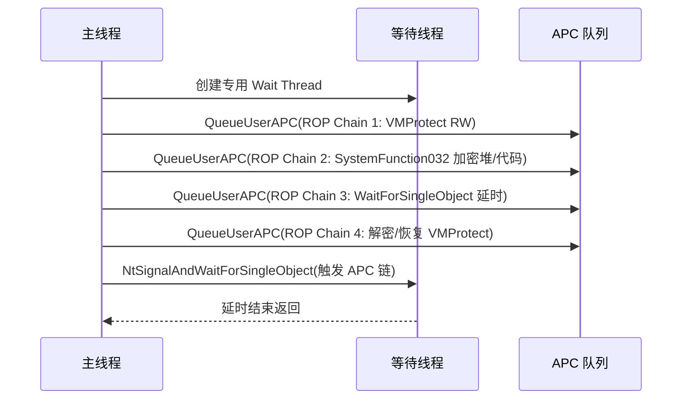

## 概述

内存扫描工具是蓝队发现无文件攻击、反射加载、进程注入等内存驻留威胁的核心手段。本页面系统梳理七大主流开源内存扫描器的检测原理，并结合 **AceLdr** 这一 UDRL (User-mode Reflective Loader) 的规避实现，分析当前攻防对抗的技术要点。

> **核心对抗逻辑**：扫描器通过「线程状态异常」「内存属性异常」「PE 结构异常」「行为特征异常」四大维度发现恶意内存制品；规避端通过「睡眠混淆 (FOLIAGE/Ekko)」「堆加密」「返回地址欺骗」「手动映射与模块隐藏」对抗检测。

---

## 一、 主流内存扫描工具检测原理深度解析

### Hunt-Sleeping-Beacons

**项目地址**：`thefLink/Hunt-Sleeping-Beacons`

**核心检测流程**：

1. **线程状态枚举筛选**  
   调用 `NtQuerySystemInformation(SystemThreadInformation)` 枚举全系统线程，筛选 `WaitReason == DelayExecution` 的线程所在进程。  
   - `Sleep()` 导致的线程处于 `DelayExecution` 状态  
   - 规避：改用 `WaitForSingleObject` 等待对象，线程状态为 `UserRequest`

2. **三重深度检测**  
   对筛选出的进程执行：

   | 检测模块 | 核心逻辑 | 关键 API |
   |----------|----------|----------|
   | **Call Stack 模块完整性** | `StackWalk64` 遍历调用栈模块，检查模块是否存在于磁盘、`.text` 段是否被修改 (Module Stomping) | `StackWalk64`, `GetModuleInformation` |
   | **KernelTime/UserTime 比值** | 统计线程内核/用户态时间比，Beacon 长期睡眠、短期执行导致比值异常 | `SYSTEM_THREAD_INFORMATION.KernelTime / UserTime` |
   | **KERNEL32 Inline Hook** | 扫描 `KERNEL32.dll` 导出函数前 5 字节，检测 `Sleep` 等关键函数被 Hook | 内存比对 |

   > **注**：忽略 .NET 程序、NTDLL/KERNELBASE 合法 Hook。

### BeaconHunter

**项目地址**：`3lp4tr0n/BeaconHunter`

**检测特点**：基于 **ETW (Event Tracing for Windows)** 行为日志分析，而非纯内存扫描。

**关注行为向量**：
- HTTP/HTTPS 回连
- DNS 查询
- 文件系统操作
- 进程终止
- Shell 命令执行

通过计算可疑行为分值进行告警，适合部署在 EDR 传感器层。

### BeaconEye

**项目地址**：`CCob/BeaconEye`

**检测原理**：**YARA 规则匹配内存特征码**。  
直接读取目标进程内存，匹配 Cobalt Strike Beacon 静态特征（配置块、硬编码字符串、加密密钥等）。属于特征库对抗，易被变形/加密绕过。

### patriot

**项目地址**：`joe-desimone/patriot`

**五大检测模块**：

| 模块 | 检测目标 | 关键技术点 |
|------|----------|------------|
| **FindSuspiciousContext** | 线程 EIP 指向 VM Protect 混淆代码 | 针对 **Ekko/NightHawk** 的 Timer+APC+ROP 延时混淆；8 字节步长暴力扫描 Commit 内存 |
| **Process Hollowing** | 内存中 PE/DOS 头异常 | 扫描内存映像基址的 `MZ`/`PE` 签名 |
| **EnumerateMemory** | 非 Image、可执行、已提交的私有内存 | `VirtualQueryEx` 过滤 `MEM_PRIVATE + PAGE_EXECUTE_*` |
| **ValidateIntegrity** | 模块内容被 Stomping/Overwriting | 对比磁盘文件与内存映像的节区哈希 |
| **ParseHeader** | PE 结构异常 | RWX 节、PE 头越界、节表越界、校验和错误 |

### moneta

**项目地址**：`forrest-orr/moneta`  
**参考文章**：[Masking Malicious Memory Artifacts – Part II](https://www.forrest-orr.net/post/masking-malicious-memory-artifacts-part-ii-insights-from-moneta)

**三层检测体系**：

#### Layer 1：动态/未知代码扫描
1. **可执行非 Image 内存** → Shellcode/注入代码典型特征
2. **映射 Image 中被修改的代码段** → `.text` 段写入 (Module Stomping)
3. **PEB ImageBase / 线程起始地址不在模块范围** → 手动映射/反射加载
4. **未签名 Image 的未修改代码** → 软指标，用于狩猎

#### Layer 2：PE Image 自身可疑特征
1. **内存/磁盘节保护属性不一致** (如磁盘 `R` → 内存 `RX`)
2. **内存中 PE 头被篡改** (EntryPoint、节表、导入表修改)
3. **无法查询 `FILE_OBJECT`** → 无对应磁盘文件 (Reflective DLL / Memfd)

#### Layer 3：进程自身异常
1. **内存有映射 Image 但 PEB 无 Module Entry** → 模块隐藏
2. **PEB Entry 记录路径与 `FILE_OBJECT` 不符** → 路径欺骗

### pe-sieve

**项目地址**：`hasherezade/pe-sieve`  
**作者同类项目**：`hollows_hunter`、`pe_to_shellcode`、Process Ghosting/Doppelgänging 实现

**扫描类别全景**：

| 扫描器 | 覆盖检测 | 核心源码入口 |
|--------|----------|--------------|
| **scanModules** | 模块名不匹配、磁盘不存在、Hollowing (PEB 无 Entry/头被改)、Inline Hook | `scanner.cpp:314` |
| **scanModuleIATs** | IAT Hook 检测 | `scanner.cpp:402` |
| **scanThreads** | 线程堆栈异常、Context 异常、StartAddress 不在模块内 | `scanner.cpp:449` / `thread_scanner.cpp` |

**检测能力矩阵**：
- ✅ Replaced/Injected PEs
- ✅ Shellcode (私有可执行内存)
- ✅ Inline/IAT/EAT Hooks
- ✅ Process Hollowing / Doppelgänging
- ✅ Reflective DLL Injection
- ✅ 模块隐藏 (PEB 解链)

### MalMemDetect

**项目地址**：`waldo-irc/MalMemDetect`  
**运行模式**：编译为 DLL 注入目标进程内部检测。

**双轨检测**：
1. **Hollowing 检测**：对比内存 PE 头与磁盘
2. **关键 API Hook + 调用栈回溯**：
   - Hook `RtlAllocateHeap`、`NtWaitForSingleObject`、`InternetConnect*`
   - 触发时回溯调用栈，定位可疑内存区域 (Shellcode/手动映射模块)

---

## 二、 AceLdr 规避技术实现剖析

**项目地址**：`kyleavery/AceLdr`  
**定位**：Cobalt Strike UDRL (User-mode Reflective DLL Loader)，专注内存规避。

### 核心 Feature 矩阵

| 特性 | 实现技术 | 对抗目标 |
|------|----------|----------|
| **Dynamic Memory Encryption** | 创建私有堆 (`RtlCreateHeap`)，Sleep 前加密堆条目 | `EnumerateMemory` / `scanModules` 私有堆扫描 |
| **Code Obfuscation & Encryption** | **FOLIAGE** 技术：代码区 `RWX→RW→加密→RX` 循环 | `BeaconEye` YARA、代码段完整性校验 |
| **Return Address Spoofing** | Hook `RtlAllocateHeap`/`InternetConnectA`/`NtWaitForSingleObject` 伪造返回地址 | `MalMemDetect` 调用栈回溯、`Hunt-Sleeping-Beacons` Call Stack 检测 |
| **Sleep Without Sleep** | `WaitForSingleObjectEx` 替代 `Sleep`，配合 FOLIAGE APC 链 | `Hunt-Sleeping-Beacons` `DelayExecution` 状态筛选 |
| **RC4 Encryption** | `SystemFunction032` (advapi32) 统一加密原语 | 统一加密算法降低特征 |

### Sleep_Hook：FOLIAGE 技术落地

**源码位置**：`src/hooks/delay.c:468`  
**参考实现**：`SecIdiot/FOLIAGE`、NightHawk Ekko 技术

**执行流程图解**：



**关键点**：
- 通过 **APC 排队 ROP 链** 实现「睡眠期间代码加密、堆加密、内存属性翻转」
- 主线程阻塞于 `NtSignalAndWaitForSingleObject`，不触发 `DelayExecution`
- 规避 `Hunt-Sleeping-Beacons` 线程状态筛选与 `patriot` VM Protect EIP 检测

### Heap_Hook：私有堆劫持与全量加密

**源码片段**：

```c
// 初始化阶段
BeaconHeap = NtCreateHeap(HEAP_GROWABLE, NULL, 0, 0, NULL, NULL);

// Hook GetProcessHeap 返回私有堆
HANDLE GetProcessHeap_Hook() {
    return ((PSTUB)OFFSET(Stub))->Heap;
}
```

**效果**：Beacon 所有堆分配均落入 AceLdr 可控私有堆，Sleep_Hook 可一次性加密整个堆内数据，对抗 `moneta`/`pe-sieve` 对私有可执行内存的扫描。

### Spoof：返回地址欺骗

**源码位置**：`src/hooks/spoof.c`  
**参考技术**：[x64 Return Address Spoofing](https://www.unknowncheats.me/forum/anti-cheat-bypass/268039-x64-return-address-spoofing-source-explanation.html)

**Hook 目标 API**：
- `RtlAllocateHeap` / `HeapAlloc` → 隐藏堆分配调用链
- `InternetConnectA` → 隐藏 C2 网络连接调用链
- `NtWaitForSingleObject` → 隐藏睡眠调用链

**原理**：利用 x64 调用约定中返回地址存储在栈上，在 Hook 中修改栈上返回地址为合法模块地址 (如 `ntdll!KiFastSystemCallRet`)，使调用栈回溯显示为正常系统调用路径。

---

## 三、 实测对抗效果评估

### 测试环境
- **目标**：集成 AceLdr 的 Beacon (PID 9272)
- **扫描器**：`Moneta64.exe -m ioc`、`pe-sieve64.exe /shellc`

### Moneta 检测结果

```text
0x0000000000100000:0x00001000 | Private | RX | 0x00000000 | Abnormal private executable memory...
```
**判定**：**检出** —— 存在 `PAGE_EXECUTE_READ` 的私有内存 (Shellcode 特征)。

### pe-sieve 检测结果

```text
---SUMMARY:
Total scanned:      53
Hooked:             3
Hdrs Modified:      52
Implanted:          1
Implanted shc:      1
Total suspicious:   56
```
**判定**：**检出** —— 发现 1 处 Shellcode 植入、52 处模块头修改、3 处 Inline Hook。

### 根因分析：AceLdr 尚未覆盖的检测面

```c
// 源码片段：分配 RW 内存后再改 RX
NtAllocateVirtualMemory(-1, &MemoryBuffer, 0, &size, MEM_COMMIT, PAGE_READWRITE);
NtProtectVirtualMemory(-1, &MemoryBuffer, &size, PAGE_EXECUTE_READ, &old);
```

**未对抗项**：
| 检测点 | 相关工具 | 缺失对抗 |
|--------|----------|----------|
| 私有可执行内存 (RW→RX) | moneta Layer 1 #1、pe-sieve `/shellc` | ❌ 无 RX→RW→加密→RX 循环覆盖该区域 |
| 模块头大量修改 | pe-sieve `Hdrs Modified: 52` | ❌ 手动映射模块未做头部伪装/归档 |
| Inline Hook 残留 | pe-sieve `Hooked: 3` | ❌ Spoof 仅覆盖特定 API，未全链路清理 |

> **结论**：AceLdr 在 **睡眠混淆 (FOLIAGE)**、**堆加密**、**调用栈欺骗** 三大核心技术上实现完备，但对 **手动映射模块的 PE 头伪装**、**私有代码区的全生命周期加密** 覆盖不足，导致被 `moneta`/`pe-sieve` 精准检出。

---

## 四、 技术演进与对抗路线图

### 睡眠混淆技术谱系

```mermaid
graph LR
    A[Sleep() DelayExecution] --> B[WaitForSingleObject UserRequest]
    B --> C[Ekko/NightHawk: Timer+APC+ROP]
    C --> D[FOLIAGE: APC队列ROP链+VMProtect翻转]
    D --> E[AceLdr Sleep_Hook: 集成堆/代码加密]
    E --> F[下一代: 硬件断点/VEH/异步调度]
```

### 内存规避完整性清单 (针对 moneta/pe-sieve 全通过)

| 检测层 | 对抗措施 | 参考实现 |
|--------|----------|----------|
| **私有可执行内存** | 代码区全周期 `RX↔RW` 加密、睡眠时 `PAGE_NOACCESS` | FOLIAGE 扩展、[[phantom-dll-hollowing-technique]] 模块劫持 |
| **PE 头/节表完整性** | 手动映射后恢复磁盘一致性、伪造 PEB Module Entry | [[pe-manual-mapping-loader-implementation]]、[[pe-export-table-internals]] |
| **模块隐藏 (PEB 解链)** | 双重 PEB 链表维护、VAD 节点伪装 | `pe-sieve` scanModules 逻辑逆向 |
| **调用栈/返回地址** | 全链路 Return Address Spoofing、VEH 动态修正 | [[cobalt-strike-4.7-bof-internals]] BOF 调用约定 |
| **ETW/行为遥测** | 用户态 ETW Patch、syscall 直调绕过用户态 Hook | [[dotnet-clr-usage-log-tampering-edr-evasion]] 思路迁移 |
| **YARA/特征码** | 运行时解密、多态存根、配置块外置 | [[php-webshell-obfuscation-av-evasion]] 多态思路 |

---

## 五、 交叉引用与延伸阅读

### 核心工具与技术页面
- [[pe-manual-mapping-loader-implementation]] — 手动映射加载器全流程，覆盖导入表修复、重定位、模块隐藏
- [[phantom-dll-hollowing-technique]] — Phantom DLL Hollowing：劫持合法 DLL 节区实现内存隐藏
- [[pe-export-table-internals]] / [[pe-import-table-internals]] — PE 导出/导入表结构，支撑手动解析与伪装
- [[cobalt-strike-4.7-bof-internals]] — BOF 加载器内部实现，关联 Beacon 执行上下文
- [[cobalt-strike-external-c2-smb-beacon]] — SMB Beacon 通信模型，关联 C2 流量规避
- [[dotnet-clr-usage-log-tampering-edr-evasion]] — .NET CLR 日志篡改，思路可迁移至 ETW 规避
- [[windows-kernel-callback-injection-defense]] — 内核回调拦截注入，蓝队视角理解检测边界

### 对抗框架与实战
- [[c2-redirectors-malleable-c2-profiles]] — C2 基础设施隐匿，配合内存规避形成纵深防御
- [[internal-network-pivoting-techniques]] — 内网穿透隧道技术，Beacon 落地后的横向移动
- [[xd-security-blue-team-defense]] — 蓝队防御体系：ATT&CK 映射、蜜罐、NIDS/HIDS 部署

### 相关漏洞利用与逆向分析
- [[v8-issue-944062-gc-arbitrary-write]] / [[v8-turbofan-changeint32toint64-1day-analysis]] — 浏览器漏洞利用链，理解内存布局操纵
- [[heap-overflow-principles-unlink-exploitation]] — 堆利用原理，关联堆加密对抗
- [[rop-linux-x86-beginner-tutorial]] — ROP 链构造基础，支撑 FOLIAGE/Ekko 技术理解

---

## 六、 结语

当前内存扫描对抗已进入 **「多维度交叉验证」** 阶段：单一技术 (如仅睡眠混淆) 无法对抗 `moneta`/`pe-sieve` 这类全面扫描器。构建高生存力 UDRL 需要：

1. **睡眠混淆** (FOLIAGE/Ekko) 解决线程状态与代码静态特征
2. **私有堆/代码区全生命周期加密** 解决动态内存扫描
3. **手动映射模块完美伪装** (PEB/VAD/PE头/节属性) 解决模块完整性校验
4. **全链路调用栈欺骗** 解决 API Hook 回溯
5. **行为遥测规避** (ETW Patch / 直调 Syscall) 解决 EDR 传感器层

AceLdr 在 1、2、4 上实现较完善，3、5 为后续强化方向。防御侧则持续收敛误报、提升 `moneta` 式「软指标狩猎」与 `pe-sieve` 式「硬指标扫描」的融合能力。

---

## 附录：工具索引速查表

| 工具 | 类型 | 核心检测维度 | 开源地址 |
|------|------|--------------|----------|
| Hunt-Sleeping-Beacons | 独立扫描器 | 线程状态、调用栈、时间比值、Inline Hook | `thefLink/Hunt-Sleeping-Beacons` |
| BeaconHunter | ETW 行为分析 | 网络/文件/进程/命令行为分值 | `3lp4tr0n/BeaconHunter` |
| BeaconEye | YARA 内存扫描 | Beacon 静态特征码 | `CCob/BeaconEye` |
| patriot | 综合扫描器 | VM Protect EIP、Hollowing、私有可执行内存、模块完整性、PE 异常 | `joe-desimone/patriot` |
| moneta | 综合扫描器 | 三层体系：动态代码、PE异常、进程异常 | `forrest-orr/moneta` |
| pe-sieve | 综合扫描器 | 模块/IAT/线程全维度、Shellcode/Hollowing/Doppelgänging/Reflective DLL | `hasherezade/pe-sieve` |
| MalMemDetect | 注入式扫描器 | Hollowing + 关键API Hook回溯 | `waldo-irc/MalMemDetect` |
| **AceLdr** | **UDRL 规避** | **FOLIAGE睡眠混淆、私有堆加密、返回地址欺骗、WaitForSingleObject睡眠** | `kyleavery/AceLdr` |
| **FOLIAGE** | **睡眠混淆库** | **APC队列ROP链+VMProtect翻转** | `SecIdiot/FOLIAGE` |
| **Ekko** | **睡眠混淆库** | **Timer+APC+ROP** | `Cracked5pider/Ekko` |

## 来源

- [0x4d5a-202103-202209_05](../sources/0x4d5a-202103-202209_05.md)
