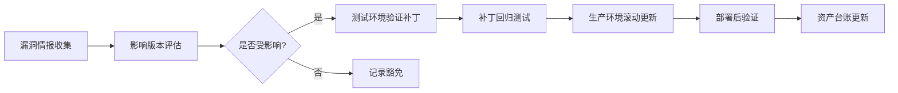

## 概述

本页面基于微信公众号「301在路上」归档文章《Nginx安全配置参考》整理，系统梳理 Nginx 核心安全加固配置项，覆盖**日志审计、IP 访问控制、超时参数调优、下载并发限速、模块精简、防盗链、自定义错误页、隐藏版本号、补丁管理**九大维度，形成可落地的配置清单与检测验证方法。适用于运维安全基线核查、合规建设及渗透测试前的防御配置参考。

> 交叉参考：[[apache-security-hardening-guide]]  Apache HTTP Server 同类加固体系对比；[[0x727-bugreporter-automated-report-platform]]  0x727 漏洞报告自动化平台中的 Nginx 安全配置实践。

---

## 一、日志审计

### 核心配置

启用错误日志与访问日志，并自定义访问日志格式以包含关键安全字段（客户端 IP、User-Agent、X-Forwarded-For、Referer 等）。

```nginx
# nginx.conf
error_log  logs/error.log  warn;   # 建议级别 warn 或 error

log_format security_audit '$remote_addr - $remote_user [$time_local] '
                          '"$request" $status $body_bytes_sent '
                          '"$http_referer" "$http_user_agent" '
                          '"$http_x_forwarded_for"';

access_log  logs/access.log  security_audit;
```

**关键字段说明**：

| 变量 | 含义 | 安全价值 |
|------|------|----------|
| `$remote_addr` | 客户端真实 IP | 溯源、关联威胁情报 |
| `$http_x_forwarded_for` | 代理链传递 IP | 识别真实来源、绕过代理伪装 |
| `$http_user_agent` | 客户端标识 | 识别爬虫、扫描器、异常 UA |
| `$http_referer` | 来源页面 | 发现钓鱼、CSRF、异常跳转 |
| `$request` | 完整请求行 | 还原攻击 Payload、SQLi/XSS 特征 |

### 验证检测

```bash
# 1. 检查配置文件是否取消注释
grep -E '^\s*(error_log|access_log)' /usr/local/nginx/conf/nginx.conf

# 2. 验证日志写入
tail -f /usr/local/nginx/logs/access.log
# 发起测试请求，确认字段完整

# 3. 日志轮转配置检查（logrotate）
cat /etc/logrotate.d/nginx
```

---

## 二、IP 访问控制

### 核心配置

利用 `allow` / `deny` 指令实现基于 CIDR 的白名单/黑名单控制，**规则按顺序匹配，首个匹配生效**。

```nginx
# nginx.conf - http/server/location 均可
location /admin/ {
    allow 10.0.0.0/8;        # 内网运维网段
    allow 192.168.1.100;     # 具体运维主机
    deny  all;               # 拒绝其余所有
}
```

**最佳实践**：

- 敏感目录（/admin、/phpmyadmin、/backup 等）强制 IP 白名单
- 配合 `geo` / `map` 模块实现动态 IP 信誉库对接
- 结合 `ngx_http_access_module` 与 `ngx_http_limit_req_module` 实现「限流+封禁」联动

### 验证检测

```bash
# 1. 配置语法检查
nginx -t

# 2. 实战验证
curl -I http://target/admin/   # 非白名单 IP 应返回 403
curl -I -H "X-Forwarded-For: 10.0.0.5" http://target/admin/  # 测试代理头绕过风险
```

---

## 三、超时参数调优

### 核心配置

防范 Slowloris 类慢速攻击，减少连接占用，提升并发承载能力。

```nginx
# nginx.conf - http/server/location
client_body_timeout   10s;   # 读取请求体超时
client_header_timeout 10s;   # 读取请求头超时
keepalive_timeout     5 5;   # 保持连接超时、响应头 Keep-Alive: timeout=5
send_timeout          10s;   # 发送响应超时
```

**参数建议值范围**：

| 参数 | 建议值 | 场景调整 |
|------|--------|----------|
| `client_body_timeout` | 10-30s | 文件上传业务适当放宽 |
| `client_header_timeout` | 5-10s | 无特殊理由不建议过大 |
| `keepalive_timeout` | 5-15s | 高并发短连接业务可降至 2-5s |
| `send_timeout` | 10-60s | 大文件下载/流媒体需放宽 |

### 验证检测

```bash
# 1. 配置生效检查
nginx -T | grep -E 'client_body_timeout|client_header_timeout|keepalive_timeout|send_timeout'

# 2. 慢速攻击模拟验证（需授权）
# 使用 slowhttptest 或自定义脚本发送不完整请求，观察连接是否在超时后被切断
slowhttptest -c 100 -H -g -o slow_read_stats -i 10 -r 200 -t GET -u http://target/ -x 30 -p 3
```

---

## 四、下载并发限速

### 核心配置

限制单 IP 连接数与传输速率，防止资源耗尽、带宽滥用。

```nginx
# nginx.conf - http 块定义共享内存区
limit_conn_zone $binary_remote_addr zone=download_zone:10m;

server {
    listen 80;
    server_name down.example.com;
    root /data/download;

    location / {
        limit_conn  download_zone 1;   # 单 IP 并发连接数
        limit_rate  20k;               # 单连接限速 20KB/s
        # limit_rate_after 1m;         # 可选：前 1M 不限速，随后限速
    }
}
```

**进阶用法**：

- `limit_conn_zone $server_name zone=perserver:10m;` 限制整站并发
- `limit_req_zone $binary_remote_addr zone=req_zone:10m rate=10r/s;` 限制请求频率（需配合 `limit_req`）
- 结合 `map` 实现差异化限速（会员/匿名、内网/外网）

### 验证检测

```bash
# 1. 并发连接数测试
for i in {1..5}; do curl --limit-rate 100k -o /dev/null http://target/largefile.iso & done
# 第 2 个连接应被拒绝或排队（返回 503）

# 2. 限速验证
curl --limit-rate 50k -o /dev/null http://target/largefile.iso  # 实际速度不应超过 20k
```

---

## 五、模块精简编译

### 核心原则

**「最小攻击面」**：仅编译业务必需模块，禁用默认开启但未使用的模块（如 `autoindex`、`ssi`、`dav`、`flv`、`mp4` 等）。

### 编译示例

```bash
# 1. 查看可选模块
./configure --help | less

# 2. 典型精简编译（示例）
./configure \
  --prefix=/usr/local/nginx \
  --with-http_ssl_module \
  --with-http_v2_module \
  --with-http_gzip_static_module \
  --without-http_autoindex_module \
  --without-http_ssi_module \
  --without-http_dav_module \
  --without-http_flv_module \
  --without-http_mp4_module \
  --without-mail_pop3_module \
  --without-mail_imap_module \
  --without-mail_smtp_module \
  --with-cc-opt='-O2 -fstack-protector-strong -D_FORTIFY_SOURCE=2' \
  --with-ld-opt='-Wl,-z,relro,-z,now'

make && make install
```

**编译加固选项说明**：

| 选项 | 作用 |
|------|------|
| `-fstack-protector-strong` | 栈保护，缓解栈溢出利用 |
| `-D_FORTIFY_SOURCE=2` | libc 安全加固，覆盖字符串/内存操作函数 |
| `-Wl,-z,relro,-z,now` | 重定向只读（RELRO）+ 立即绑定，防止 GOT 篡改 |

### 验证检测

```bash
# 1. 查看已编译模块
nginx -V 2>&1 | tr ' ' '\n' | grep -E '^--(with|without)'

# 2. 运行时模块检查
nginx -T 2>&1 | grep -c 'module'  # 统计加载模块数
```

---

## 六、防盗链保护

### 核心配置

基于 `Referer` 头校验，仅允许合法域名引用静态资源（图片、视频、压缩包等）。

```nginx
# nginx.conf - server/location
location ~* \.(gif|jpg|jpeg|png|bmp|swf|flv|mp4|rar|zip|pdf)$ {
    valid_referers none blocked server_names *.example.com example.com;
    if ($invalid_referer) {
        # 方案 A：返回 403
        return 403;

        # 方案 B：重写到默认图片（需确保默认图片不触发防盗链）
        # rewrite ^/ /static/images/hotlink-denied.png last;
    }
}
```

**`valid_referers` 参数详解**：

| 参数 | 含义 |
|------|------|
| `none` | 允许无 Referer 头（直接访问、浏览器隐私模式） |
| `blocked` | 允许 Referer 被防火墙/代理标记为非标准值（如 "Referer: blocked"） |
| `server_names` | 允许当前 `server_name` 域名 |
| `*.example.com` | 允许子域名 |

### 绕过风险与对抗

- **Referer 可伪造**：客户端可任意设置，仅作基础阻断
- **HTTPS → HTTP Referer 丢失**：建议全站 HTTPS，配合 `Referrer-Policy: strict-origin-when-cross-origin`
- **CDN 场景**：需在 CDN 边缘节点同步配置，或使用 Token 防盗链（签名 URL、JWT、时间戳防重放）

### 验证检测

```bash
# 1. 正常引用
curl -I -H "Referer: http://example.com/page.html" http://target/image.jpg
# 应返回 200

# 2. 非法引用
curl -I -H "Referer: http://evil.com/steal.html" http://target/image.jpg
# 应返回 403

# 3. 无 Referer
curl -I http://target/image.jpg
# 视 valid_referers none 策略返回 200/403
```

---

## 七、自定义错误页面

### 两种实现方式

#### 方式一：修改源码重新编译（原文方案）

编辑 `src/http/ngx_http_special_response.c` 中的静态字符串：

```c
static char ngx_http_error_400_page[] = "<html>...自定义 400...</html>" CRLF;
static char ngx_http_error_404_page[] = "<html>...自定义 404...</html>" CRLF;
static char ngx_http_error_413_page[] = "<html>...自定义 413...</html>" CRLF;
static char ngx_http_error_500_page[] = "<html>...自定义 500...</html>" CRLF;
static char ngx_http_error_502_page[] = "<html>...自定义 502...</html>" CRLF;
static char ngx_http_error_503_page[] = "<html>...自定义 503...</html>" CRLF;
static char ngx_http_error_504_page[] = "<html>...自定义 504...</html>" CRLF;
```

> ⚠️ 缺点：升级维护成本高，需重新编译安装。

#### 方式二：配置文件指定（推荐，原生支持）

```nginx
# nginx.conf - http/server/location
error_page 400 /errors/400.html;
error_page 403 /errors/403.html;
error_page 404 /errors/404.html;
error_page 413 /errors/413.html;
error_page 500 502 503 504 /errors/50x.html;

location /errors/ {
    internal;                    # 仅内部重定向可访问
    alias /usr/local/nginx/html/errors/;
}
```

**错误页面设计原则**：

- **不泄露技术细节**：无版本号、路径、堆栈、数据库结构
- **统一风格**：品牌化、友好引导、提供搜索/首页链接
- **监控埋点**：前端上报错误码、URL、UA，便于 SIEM 关联分析

### 验证检测

```bash
# 1. 触发各错误码
curl -I http://target/nonexist      # 404
curl -I -X INVALID http://target/   # 400
# 上传超大文件触发 413（需配置 client_max_body_size）

# 2. 检查响应体是否为自定义页面
curl -s http://target/nonexist | grep -c "自定义关键词"
```

---

## 八、隐藏版本号与服务标识

### 核心配置

```nginx
# nginx.conf - http/server/location
server_tokens off;    # 隐藏错误页尾部及 HTTP 响应头中的版本号
```

**进阶：修改 Server 头字符串（需重新编译）**

编辑 `src/http/ngx_http_header_filter_module.c`：

```c
static char ngx_http_server_string[] = "Server: CustomWAF" CRLF;
static char ngx_http_server_full_string[] = "Server: CustomWAF" CRLF;
```

> ⚠️ 仅修改字符串无法欺骗指纹识别工具（如 Wappalyzer、WhatWaf），特征仍在响应头顺序、默认头集合、协议行为中。生产环境建议配合 **WAF/边缘网关** 统一重写 Server 头。

### 验证检测

```bash
# 1. 检查响应头
curl -I http://target/
# 应无 "Server: nginx/1.x.x"，仅显示 "Server: CustomWAF" 或无 Server 头

# 2. 错误页面版本号检查
curl -s http://target/nonexist | grep -i nginx
# 不应出现版本号
```

---

## 九、补丁管理与版本生命周期

### 管理流程



### 关键动作清单

| 阶段 | 动作 | 工具/渠道 |
|------|------|-----------|
| 情报收集 | 订阅 Nginx 官方公告、CVE 数据库、厂商安全通告 | nginx.org/en/security_advisories.html、NVD、CNVD、各大厂商安全博客 |
| 评估 | 对比当前版本、`nginx -V` 编译参数、第三方模块版本 | 自动化资产扫描、SBOM 对比 |
| 测试 | 复现 PoC、功能回归、性能基线对比 | 测试环境、压测工具 |
| 部署 | 蓝绿/滚动发布、保留回滚方案 | Ansible、K8s RollingUpdate、自动化运维平台 |
| 验证 | 版本号确认、漏洞复现失效、业务监控无异常 | 主动扫描、日志审计 |

### 版本选择建议

- **主线版本**：新特性快、更新频繁、适合追求新特性的业务
- **稳定版本**：仅修复高危漏洞、生命周期长、适合生产核心系统
- **长期支持（LTS）**：企业级首选，如 Tengine、OpenResty 官方打包版本

---

## 十、配置清单速查表

| 编号 | 加固项 | 配置指令/动作 | 验证命令 | 优先级 |
|------|--------|--------------|----------|--------|
| NGX-01 | 启用访问/错误日志 | `access_log`, `error_log`, `log_format` | `grep -E 'access_log\|error_log' nginx.conf` | P0 |
| NGX-02 | 自定义日志格式含安全字段 | `$http_x_forwarded_for` 等 | `curl -v` 对比日志字段 | P0 |
| NGX-03 | 敏感目录 IP 白名单 | `allow/deny` | `curl -I` 非白名单 IP 返回 403 | P0 |
| NGX-04 | 超时参数硬化 | `client_body_timeout 10s` 等 | `nginx -T \| grep timeout` | P1 |
| NGX-05 | 下载限速/限并发 | `limit_conn_zone`, `limit_rate` | 并发下载测试 | P1 |
| NGX-06 | 精简编译模块 | `--without-http_xxx_module` | `nginx -V` | P1 |
| NGX-07 | 静态资源防盗链 | `valid_referers`, `if ($invalid_referer)` | `curl -H Referer` | P2 |
| NGX-08 | 自定义错误页 | `error_page`, `internal` | 触发 404/50x 检查响应体 | P2 |
| NGX-09 | 隐藏版本号 | `server_tokens off` | `curl -I` 检查 Server 头 | P1 |
| NGX-10 | 修改 Server 头(可选) | 源码修改重编译 | `curl -I` | P3 |
| NGX-11 | 编译加固选项 | `-fstack-protector-strong` 等 | `nginx -V` 检查 cc/ld 选项 | P1 |
| NGX-12 | 补丁管理流程 | 订阅情报、测试验证、滚动更新 | 资产台账版本一致性 | P0 |

---

## 十一、常见误区与避坑指南

| 误区 | 后果 | 正确做法 |
|------|------|----------|
| 仅靠 `server_tokens off` 认为隐藏了版本 | 指纹工具仍可通过头顺序、默认页面、协议行为识别 | 配合 WAF/边缘网关重写 Server 头、部署蜜罐页面干扰 |
| 防盗链仅配 `valid_referers` | Referer 可伪造，无法阻止有心攻击者 | 关键资源改用签名 URL（带过期时间、IP 绑定、一次性 Token） |
| 超时参数设置过大（如 300s） | 易受 Slowloris 攻击耗尽连接池 | 业务评估后设最小可用值，配合 `limit_conn` 双重保护 |
| 直接修改源码字符串隐藏版本 | 升级极其痛苦，易引入编译错误 | 优先用配置项 `server_tokens off`，必要时通过 Lua/WAF 层重写 |
| 忽略第三方模块安全更新 | 模块漏洞（如 ngx_lua、ModSecurity 规则集）成入口 | 将第三方模块纳入 SBOM，同步上游安全公告 |

---

## 十二、参考资源

- Nginx 官方文档：[ngx_http_core_module](http://nginx.org/en/docs/http/ngx_http_core_module.html)、[ngx_http_access_module](http://nginx.org/en/docs/http/ngx_http_access_module.html)、[ngx_http_limit_conn_module](http://nginx.org/en/docs/http/ngx_http_limit_conn_module.html)
- Nginx 安全公告：<https://nginx.org/en/security_advisories.html>
- CIS Benchmark for Nginx：<https://www.cisecurity.org/benchmark/nginx>
- OWASP Secure Headers Project：<https://owasp.org/www-project-secure-headers/>
- Mozilla SSL Configuration Generator（含 Nginx 推荐配置）：<https://ssl-config.mozilla.org/>

---

## 十三、版本记录

| 版本 | 日期 | 变更说明 | 编辑者 |
|------|------|----------|--------|
| 1.0 | 2024-01-15 | 初版：基于「301在路上」归档文章结构化整理，补充验证命令、进阶配置、误区指南、清单表 | 知识库策展人 |

---

> **交叉引用导航**
> - [[apache-security-hardening-guide]]  Apache HTTP Server 同维度加固对比
> - [[0x727-bugreporter-automated-report-platform]]  0x727 平台中的 Nginx 安全配置实践
> - [[xd-security-waf-bypass-techniques-day46-49]]  WAF 绕过视角下的 Nginx 配置弱点分析
> - [[info-gathering-tools-collection]]  资产测绘中识别 Nginx 版本与配置指纹的工具链

## 来源

- [301在路上-201508-202208_031](../sources/301在路上-201508-202208_031.md)
