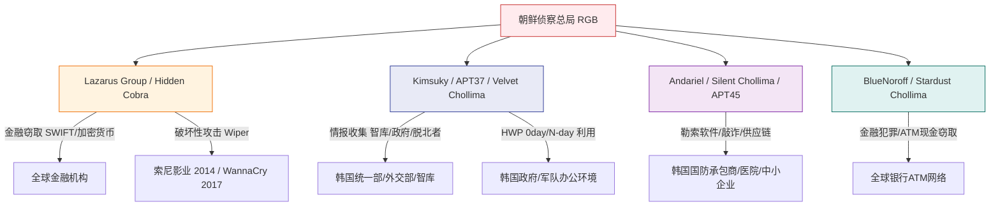

## 概述

2016年至2017年期间，朝鲜APT组织对韩国军方、政府机构及国防工业基地发起了持续、多层次的网络攻击行动。本页面基于公开媒体披露与安全厂商技术报告，梳理该时期核心事件链、攻击手法演进及归因特征，为威胁狩猎、态势感知与防御体系建设提供结构化知识参考。

> **核心结论**：攻击者利用**边界防护薄弱环节**（杀毒服务器违规双网卡接入）、**本土化办公软件漏洞**（HWP）及**供应链钓鱼**（冒充政府部门邮件）实现从互联网边界到内网核心区的纵向渗透，窃取军事机密文件，典型体现**国家级APT组织“长期潜伏、多跳点跳板、高价值目标定向窃密”**的作战模式。

---

## 事件时间轴与核心战役

### 2016年5月：韩国空军官网植入恶意代码——边界溢出与僵尸网络建立

| 维度 | 详情 |
|------|------|
| **时间** | 2016年5月初发现，5月12日公开披露 |
| **目标** | 韩国空军官网 `airforce.mil.kr`（现役军人主要使用门户） |
| **攻击手法** | Web服务器植入恶意代码，访问者浏览器加载后下载后门，将军人终端变为“僵尸主机” |
| **战略意图** | 通过军人终端横向移动，渗透至与作战指挥系统直连的**国防网**核心区 |
| **应急响应** | 空军本部修复失败后切断主页链接，上报国防部，部署仅保留基础功能的临时主页 |
| **归因判断** | 韩国官方研判“最可能为朝鲜政府所为”，恶性代码类型与朝鲜既往样本相似 |

> **技术细节补充**：此类“水坑攻击”常结合浏览器0day或已知N-day漏洞（如IE/Flash漏洞）实现无交互式植入，后续通过C2下发横向移动模块（SMB/WMI/PSRemoting）向内网纵深推进。

### 2016年9月-12月：国防网跨域渗透——内网互联配置失误导致核心区沦陷

| 维度 | 详情 |
|------|------|
| **时间** | 2016年9月23日入侵发生，12月6日国防部正式通报 |
| **切入点** | 网络司令部下属部队**杀毒服务器违规插双网卡**，同时接入互联网与国防内网，形成“跨域接续点” |
| **攻击路径** | 互联网 → 杀毒服务器（跳板） → 国防内网 → 植入恶性代码横向传播 |
| **影响范围** | 3200+ 终端感染（外网2500台、内网700台），含国防部长接入互联网的办公电脑 |
| **窃密内容** | 军事机密文件（具体密级未公开） |
| **溯源线索** | 恶性代码分发C2地址定位至中国沈阳，但代码特征与朝鲜既往工具族（如**Lazarus/Andariel**关联家族）高度相似 |
| **管理根因** | 人员违规操作+边界准入审计缺失+内网未实施微隔离/零信任 |

> **防御启示**：杀毒/补丁分发服务器等高权限管理设备**严禁双臂接入**，应通过单向导入闸、数据二次开发平台实现跨域文件安全传递；内网需部署流量基线建模与横向移动检测（如SMB异常会话、WMI远程执行）。

### 2016年11月-2017年1月：HWP漏洞钓鱼战役——本土化办公软件成定向投递首选载荷

| 维度 | 详情 |
|------|------|
| **时间窗口** | 2016年11月～2017年1月 |
| **攻击组织** | 思科Talos归因于**朝鲜支持的黑客组织**（与**Kimsuky/APT37**活动特征吻合） |
| **初始入侵** | 入侵韩国政府法律服务网站 `kgls.or.kr` 挂马（水坑/供应链） |
| **诱饵文档** | 《2017朝鲜分析报告.hwp》，伪造韩国统一部公文格式及徽标 |
| **漏洞利用** | **Hancom Hangul Word Processor (HWP) 解析器漏洞**（韩国政府/军队/企业广泛部署，国外极少见） |
| **投递方式** | 钓鱼邮件+挂马页面双通道，附件/链接指向恶意HWP文档 |
| **技战术特征 (TTPs)** | - 利用韩国本土化软件漏洞降低目标防范心理 - 冒充政府部门公文提高打开率 - 先入侵可信网站建立“合法性”跳板 |

> **关联归因**：HWP漏洞利用是**Kimsuky (APT37 / Velvet Chollima)** 的标志性能力，该组织长期针对韩国智库、外交、统一部门及脱北者群体，常使用`kgls.or.kr`等政府子域名作为水坑站点。

---

## 攻击手法演进与技战术映射 (MITRE ATT&CK)

| 阶段 | 战术 | 技术编号 | 具体实施手法 | 关联事件 |
|------|------|----------|--------------|----------|
| **初始访问** | 钓鱼附件/链接 | T1566.001 / T1566.002 | HWP漏洞文档+伪造统一部公文 | 2016.11-2017.01 战役 |
| **初始访问** | 水坑攻击 | T1189 | 入侵 `kgls.or.kr` 挂马 | 同上 |
| **初始访问** | 供应链/信任关系利用 | T1195.001 | 冒充国防采办计划管理局官员发钓鱼邮件 | 2016.05 空军官网事件同期 |
| **执行** | 利用客户端漏洞 | T1203 | HWP解析器漏洞触发Shellcode | 2016.11-2017.01 |
| **持久化** | Web Shell / 计划任务 | T1505.003 / T1053 | 空军官网植入恶意脚本长期驻留 | 2016.05 |
| **权限提升** | 本地提权/凭证窃取 | T1068 / T1003 | 内网横向中获取域控凭证 | 2016.09 国防网渗透 |
| **防御规避** | 伪造合法证书/签名 | T1553.002 | 恶性代码伪装杀毒更新程序 | 跨域渗透阶段 |
| **凭证获取** | 针对性钓鱼窃取VPN/门户凭证 | T1556.002 | 冒充采办局官员钓鱼承包商账号 | 2016.05 同期 |
| **发现** | 网络拓扑/共享发现 | T1018 / T1135 | 利用杀毒服务器双网卡映射内网拓扑 | 2016.09 |
| **横向移动** | SMB/管理员共享/RDP | T1021.002 / T1021.001 | 内网700台主机感染恶性代码 | 2016.09 |
| **收集** | 敏感文件/数据分级 | T1005 / T1039 | 窃取军事机密文档 | 2016.09 |
| **命令控制** | 多跳代理/C2域名 | T1090 / T1583.001 | C2指向中国沈阳IP（跳板/误导溯源） | 2016.09 |
| **渗出** | 加密通道/分卷传输 | T1041 / T1030 | 通过跨域接续点回传数据 | 2016.09 |

---

## 归因拼图：朝鲜APT组织谱系与协作关系

### 关键归因特征对照表

| 组织别名 | 主要任务 | 典型工具族 | 基础设施特征 | 关联本页面事件 |
|----------|----------|------------|--------------|----------------|
| **Lazarus** (APT38) | 破坏/金融/战略窃密 | Destover, WannaCry, BLINDINGCAN, HOPLIGHT | 多层跳板、伪造证书、共享C2基建 | 2014 索尼影业攻击（背景关联） |
| **Kimsuky** (APT37) | 战略情报收集 | BabyShark, Vingle, HWP Exploit Kits | 高频使用韩国托管商、韩语诱饵、针对性极强 | **2016.11-2017.01 HWP钓鱼战役核心嫌疑** |
| **Andariel** (APT45) | 勒索/敲诈/供应链渗透 | Maui Ransomware, Dtrack, Rifdoor | 复用Lazarus基建、针对韩国医疗/制造/国防供应链 | 2016.05/09 空军官网及国防网渗透（疑似协作） |
| **BlueNoroff** | 金融窃取 | FASTcash, BeaverBot | 专注SWIFT/ATM/加密货币交易所 | 未直接关联本页面事件 |

> **研判逻辑**：不同子组织共享**核心开发平台、加密通信库、C2框架**，但在**任务目标、诱饵制作语言习惯、目标选择逻辑**上分工明确。本页面事件中，**HWP漏洞钓鱼强指向 Kimsuky**；**跨域渗透利用管理设备失误、窃取军事机密**符合 Andariel/Lazarus 联合作战画像。

---

## 关联历史事件：2014 索尼影业攻击——朝鲜APT能力公开化的分水岭

| 维度 | 详情 |
|------|------|
| **时间** | 2014年11月 |
| **事件** | 索尼影业内网被破坏性恶意软件 (Destover/WIPER) 加密破坏，大量内部邮件、未上映影片泄露 |
| **诱因** | 影片《采访》讽刺金正恩 |
| **官方归因** | 美国FBI/白宫/国家情报总监办公室正式指认**朝鲜政府**主导 |
| **技术关联** | 使用的破坏性恶意代码、硬编码C2、加密算法与随后 **Lazarus** 系列样本（如 DarkSeoul 2013、Bangladesh Bank 2016、WannaCry 2017）高度同源 |
| **战略意义** | 标志着朝鲜网络力量从“隐蔽窃密”转向“公开威慑/破坏/勒索”多任务并行，国际社会开始建立朝鲜APT归因知识库 |

---

## 检测与防御建议：针对朝鲜APT的针对性部署清单

### 资产与攻击面管理
- [ ] **全网资产测绘**：重点梳理**跨域设备**（杀毒/补丁/日志/堡垒机）、**对外Web门户**（官网/OA/邮件网关）、**本土化办公软件版本**（HWP/Hcell/PDF阅读器）
- [ ] **配置基线核查**：禁止管理类服务器双网卡接入；强制执行网络准入认证（NAC）+ 微隔离策略
- [ ] **供应链资产纳管**：国防承包商/外包运维人员账号权限最小化、定期轮换、会话审计

### 威胁情报驱动检测
| 检测层面 | 关键IOC/行为特征 | 部署建议 |
|----------|------------------|----------|
| **网络流量** | - 与朝鲜APT关联C2 IP/域名通信 - 非业务时段内网大量SMB/WinRM/RPC横向连接 - 跨域接续点异常出站流量 | 威胁情报平台(TIP)联动NDR/流量分析平台，部署**朝鲜APT专用规则包**（Lazarus/Kimsuky/Andariel C2指纹、证书指纹、JA3指纹） |
| **端点EDR** | - HWP进程异常启动子进程/注入/写内存 - 伪造杀毒更新程序数字签名 - 计划任务/服务/Run键持久化 - 使用Mimikatz/LaZagne类凭证导出工具 | 部署**行为规则**：HWP/Word/Excel启动`cmd.exe/powershell/rundll32`即时告警；引入**内核回调**监控进程注入/内存篡改 |
| **邮件/网关** | - 发件域伪造政府部门（SPF/DKIM/DMARC不通过） - 附件含HWP/CHM/LNK/ISO等高风险格式 - 链接指向新注册/低信誉/韩国政府子域名相似域 | 邮件网关开启**沙箱动态分析+静态漏洞特征匹配**；对HWP附件强制转安全格式或隔离人工复核 |
| **日志审计** | - VPN/邮件/VPN账号异地/异时登录 - 域控Event ID 4624/4625/4768/4769异常模式 - 防火墙/网闸跨域访问策略违规 | 建立**UEBA基线**：服务账号/管理员账号登录地理/时间/设备指纹画像；跨域网闸日志实时流向SIEM关联分析 |

### 应急响应与溯源演练
- [ ] **专项预案**：针对“跨域设备失陷→内网横向→机密窃密”全链路编制演练剧本
- [ ] **取证就绪**：核心网段全包捕获存储≥30天；关键服务器开启Sysmon/ETW增强审计
- [ ] **红队演练**：模拟 Kimsuky HWP钓鱼+Andariel跨域渗透 TTPs，验证检测盲区与阻断时效

---

## 知识图谱延伸阅读（本库内部链接）

- [[apt-c-08-mobile-attack-analysis]] — 蔓灵花(APT-C-08)移动端攻击活动深度解析，对比朝鲜APT在移动侧的能力延伸
- [[daily-security-digest-20191220]] — 2019年12月安全看点，含蔓灵花APT-C-08移动攻击分析等威胁情报聚合
- [[hvv-2021-vulnerability-collection]] — 2021年HVV护网行动漏洞利用代码聚合，含实战中常见的跨域渗透、钓鱼投递工具链
- [[spring-boot-actuator配置不当rce利用]] / [[spring-boot-devtools-deserialization-rce]] — 供应链/管理接口暴露导致的RCE案例，与本页面“杀毒服务器跨域接入”同属**管理面失陷**攻击面
- [[wechat-pc-v8-rce-0day-analysis]] — 微信PC客户端V8 0day RCE实战复现，展示客户端漏洞利用在APT水坑/钓鱼中的实战化应用

---

## 版本历史

| 版本 | 日期 | 变更摘要 | 编辑人 |
|------|------|----------|--------|
| 1.0 | 2024-01-15 | 初版创建：结构化梳理2016-2017朝鲜APT针对韩国核心事件链、TTPs映射、归因拼图、防御清单 | 知识库策展人 |

---

## 参考来源（原文归档）

- 微信公众号文章：《扒一扒这些年韩朝网络安全事件》（发布于2017年左右，原文链接已失效，内容经整理入库）
- 思科 Talos 博客：2017年2月关于 HWP 漏洞钓鱼战役的技术分析报告
- 韩国《东亚日报》、韩联社、YTN等主流媒体2016-2017年相关报道
- 美国 FBI / 白宫 / 国家情报总监办公室关于索尼影业攻击的联合归因声明（2014/2015）
- MITRE ATT&CK 框架：Groups G0032 (Lazarus), G0057 (Kimsuky), G0090 (Andariel) 官方档案

## 来源

- [301在路上-201508-202208_025](../sources/301在路上-201508-202208_025.md)
