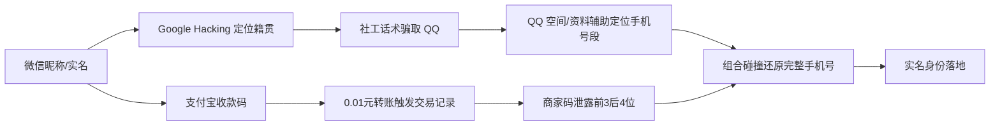

## 案例背景

2022 年某天下午，作者好友（文中称"锅锅"）遭遇网络借贷诈骗。对方以"代练游戏"为由通过微信联系，索要钱财。好友请求作者协助追踪对方真实身份与位置。

## 信息收集与画像构建

### 初始情报

通过好友提供的微信资料获得以下关键信息：

- **微信昵称**：`XXXXXhe_Q`
- **实名姓名**：`XX泷`
- **年龄推测**：1998/1999 年出生（约 22-23 岁）
- **性别**：男
- **职业声称**：游戏代练
- **地区线索**：朋友圈动态显示特定省市

### Google Hacking 定位籍贯

使用 Google 语法搜索真实姓名 `XX泷`，在贴吧/论坛发现 **2013 年某中学初一录取通知名单**，包含该姓名。

**推算逻辑**：
- 2013 年上初一 ≈ 13 岁
- 2022 - 2013 = 9 年
- 13 + 9 = 22 岁 → 吻合 1999/2000 年出生
- 确认对方 **老家省份、城市**

> 此类公开名单、毕业照、获奖名单是 OSINT 中常见的"数字指纹"来源，配合 [[ctf-beginner-self-study-guide#writeup-驱动学习法核心步骤|Writeup 驱动学习法]] 中的信息收集思路可系统化复用。

## 社交工程钓鱼获取 QQ 与手机号

### 构建信任场话术

以"找代练"为由添加对方微信，编造剧情：
- 通过某群认识
- 需要练号，愿意付费（"给马内"）
- 索要 QQ 方便联系

### 突破防备心理

对方警觉性高，拒绝提供 QQ。作者采用 **"软磨硬泡 + 利益诱导"** 组合拳：
1. 持续建立"雇主-代练"信任关系
2. 暗示后续长期合作
3. 最终诱导对方发送 QQ 号

### QQ 号反查手机号

获取 QQ 号后，通过 QQ 空间/资料页/好友印象等辅助信息，结合已知省市，**精准定位手机号段**，最终锁定手机号：**`187******66`**。

> 手机号前 3 位（运营商/地区）+ 后 4 位 + 归属地，搜索空间压缩至几十个候选，逐个核验即可命中。

## 支付宝交易记录枚举手机号（关键技术细节）

### 前置条件

好友提供了对方的 **支付宝收款码**（商家码/个人码均可尝试）。

### 操作步骤

1. 登录 **支付宝网页版**（PC 端功能更完整）
2. 先向对方转账 **0.01 元**（制造交易记录）
3. 进入"账单-交易记录-详情"
4. **商家码**场景下，交易详情页可能显示对方手机号 **前 3 位 + 后 4 位**（即 `187****66` 格式）

### 组合碰撞还原完整号码

| 已知信息 | 熵值降低 |
|----------|----------|
| 归属地（省/市） | 确定号段归属地，排除外省段 |
| 前 3 位（运营商识别码） | 如 `187` 为移动 |
| 后 4 位 | 从交易记录获取 |
| 中间 4 位 | 仅 10,000 组合，结合归属地再压缩 |

**实战效果**：候选号码仅几十个，逐个通过微信/支付宝搜索、通讯录匹配、社工库比对即可唯一确认。

## 结果固定与后续处理

- 将完整身份信息（姓名、手机号、籍贯、常驻地、QQ、微信）移交好友
- 好友持证据前往当地派出所报案
- 对方因被拉黑（微信"小黑屋"）无法继续作案

## 技术复盘与防御启示

### 攻击链复盘

### 关键防范建议

| 风险点 | 防御措施 |
|--------|----------|
| 真实姓名+地区公开 | 减少实名信息在公开平台（贴吧、校园名单、奖状照）的暴露 |
| 微信好友验证薄弱 | 陌生人借钱/代练/投资**一律拒绝**，核实身份需视频/电话多因子确认 |
| 支付宝商家码泄露手机尾号 | 个人收款优先用**个人码**；商家码需关闭"交易详情展示手机号"权限 |
| 小额转账探测 | 收到陌生 0.01 元转账警惕，及时隐藏交易详情或更换收款码 |
| 社会工程话术 | 任何"先干活后付款""长期合作""高佣金"均为典型诈骗红旗 |

## 交叉引用与延伸阅读

- [[007攻防实验室]] — 007 攻防实验室微信归档，含更多实战溯源案例
- [[waf-bypass-techniques-case-study-ruijie]] — 另一实战案例：从 XSS 到 WAF 多层绕过的完整复盘
- [[usb流量取证与隐写综合实战]] — 物理取证与流量分析结合的 CTF 实战链路
- [[ctf-beginner-self-study-guide]] — CTF 入门方法论，含信息收集、OSINT 训练平台推荐

## 结语

本案例展示了 **OSINT 公开源情报** 与 **社会工程学** 结合的典型打法：从一条微信昵称出发，通过搜索引擎语法、社交媒体关联、即时通讯软件社工、支付系统侧信道泄露，层层剥洋葱完成实名落地。核心在于**信息碎片的拼接与熵值的逐步降低**——每一步单独看技术门槛不高，但串联成链即形成强大的溯源能力。

> **法律提示**：本文技术仅供防御研究、反诈宣传与授权渗透测试使用。未经授权对他人实施社工钓鱼、非法获取公民个人信息均违反《网络安全法》《个人信息保护法》等法规，切勿尝试。

## 来源

- [0x536d72-202112-202205_1](../sources/0x536d72-202112-202205_1.md)
