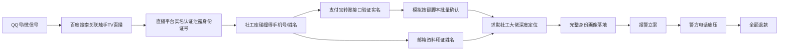

## 案例背景

作者因研究游戏逆向工程需求，欲购买可过驱动保护的调试器（OD/CE）。在微信上联系卖家（QQ：`71925*140`），转账后被拉黑，随后被引导至另一小号继续诈骗，再次转账后再次被拉黑。损失金额未明确披露，但包含两笔微信转账及部分支付宝转账。

## 信息收集与溯源过程

### 搜索引擎定位网络身份

- 通过百度搜索骗子 QQ 大号 `71925*140`
- 发现其在 **触手TV** 进行直播
- 直播平台要求实名认证，成为突破口

### 实名信息获取与社工库比对

- 利用“特殊手段”从触手TV实名认证数据中获取身份证号：**`33262419990322***2`**（浙江绍兴，1999年出生）
- 将身份证号/姓名/手机号投入 **社工库（社会工程学数据库）** 查询
- 关键命中信息：
  - 电话：`13626605747`
  - 电话：`17858276940`
  - 姓名：**赵子安**

> 社工库查询是黑灰产常用手段，合法渗透测试中仅限授权范围内使用。普通用户切勿尝试购买/查询非法获取的公民个人信息，违反《个人信息保护法》第27、28条。

### 支付宝转账验证关联身份

- 已知骗子电话，通过支付宝“转账到手机号”功能验证实名姓名
- 编写**模拟按键脚本**自动化遍历测试（规避风控频率限制）
- 确认两个手机号对应实名姓名：
  - `13626605747` → **王蓉蓉**
  - `17858276940` → **赵卫兵**

> 支付宝转账页面会脱敏显示收款人姓名（如“王*蓉”），需结合已知信息反推。此类侧信道泄露属于支付系统隐私保护薄弱点，已在 [[osint-social-engineering-scam-investigation-case-study#支付宝交易记录枚举手机号关键技术细节|支付宝交易记录枚举手机号]] 案例中详细复盘。

### 邮箱/账号关联印证

- 继续查询骗子邮箱信息
- 邮箱资料显示姓名为 **赵子安**，与社工库结果一致，锁定骗子真实身份

### 社工协助深度定位（关键补充）

- 作者自行查询受限，求助圈内大佬“杰哥”
- 通过更深层数据源（疑似户籍/学籍/通讯录库）获取：
  - 骗子**初中学校**
  - **家庭住址**
  - **家庭电话/本人电话**
- 形成完整画像：姓名、身份证、多个手机号、家庭住址、就读学校、直系亲属信息

## 法律途径止损追款

### 报警立案

- 次日清早前往当地派出所报案
- 民警受理后**现场立案**（诈骗金额达立案标准）

### 警方电话施压

- 民警当面拨打骗子电话
- 骗子被震慑，当场同意退款
- 微信转账款项**原路退回**，支付宝部分款项亦随后到账

### 结果确认

- 全额追回被骗款项
- 案件进入司法流程，骗子面临刑事责任追究

## 技术复盘与攻击链还原

## 关键技术点总结

| 环节 | 手段 | 关键工具/平台 | 风险提示 |
|------|------|---------------|----------|
| 网络身份关联 | 搜索引擎语法 | 百度/Google | 公开信息聚合即OSINT基础 |
| 实名信息获取 | 平台实名认证数据 | 触手TV等直播平台 | 涉及非法获取公民个人信息罪风险 |
| 社工库查询 | 撞库/社工库检索 | 地下数据库/黑市 | **严重违法**，切勿触碰 |
| 支付宝实名验证 | 转账接口侧信道 | 支付宝网页版/APP + 自动化脚本 | 灰色手法，支付宝已加强风控 |
| 深度定位 | 户籍/学籍/通讯录库 | 内部渠道/社工大佬 | 核心违法环节，涉及侵犯公民个人信息罪 |
| 法律止损 | 报警立案+警方施压 | 派出所刑侦大队 | **唯一合法合规的追款路径** |

## 防御与避坑指南

### 交易安全
- **虚拟商品/技术服务交易**：优先使用担保平台（闲鱼、淘宝、专业技术论坛担保区）
- **微信直转**无追回机制，除非对方主动退款或警方介入
- **调试器/过驱动工具**属灰色地带产品，交易纠纷极难维权

### 个人信息保护
- 实名认证平台最小化授权，直播/游戏/论坛尽量不用真实身份证
- 手机号、身份证号、家庭住址不在公开社交媒体露出
- 定期在“国家反诈中心APP”“支付宝-安全中心”自查信息泄露

### 遇到诈骗的标准动作
1. **第一时间截图保证据**（聊天记录、转账凭证、对方账号信息）
2. **立即拨打 96110 或 110 报警**，提供完整证据链
3. **联系银行/支付平台申请紧急止付**（24小时内成功率最高）
4. **切勿自行“黑客反制”**，任何非法手段获取对方信息均构成犯罪

## 交叉引用与延伸阅读

- [[osint-social-engineering-scam-investigation-case-study]] — 另一视角：协助好友通过OSINT与社工追踪代练诈骗分子的完整案例
- [[data-breach-45billion-chinese-platforms-analysis]] — 45亿条数据泄露事件分析，理解社工库数据来源与危害
- [[social-engineering-attack-techniques]] — 社会工程学攻击手法体系化梳理，含钓鱼、预设借口等防御视角
- [[cybersecurity-training-resources-guide#避坑指南]] — 网络安全学习避坑指南，防止入行初期遭遇类似技术交易诈骗

## 结语

本案例展示了**“技术手段溯源 + 法律手段止损”**的完整闭环。技术层面上，从一个QQ号出发，通过公开信息聚合（OSINT）、平台实名数据泄露、社工库撞库、支付接口侧信道、深度社工定位，层层剥离匿名层；法律层面上，报警立案后警方电话施压即达成追款。

**核心启示**：
- 技术手段只能辅助取证，**法律强制力才是追款的根本保障**
- 任何非法获取公民个人信息的行为（购买社工库、雇佣黑客、非法侵入数据库）均面临**三年以下有期徒刑**（情节严重三至七年），得不偿失
- 虚拟交易**务必走担保平台**，保留完整证据链是报警立案的前提

> **法律声明**：本文复盘仅供反诈宣传、安全研究与案例教学使用。文中涉及的社工库查询、非法获取身份证/手机号/户籍信息、编写脚本绕过支付风控等行为均违反《中华人民共和国网络安全法》《个人信息保护法》《刑法》第253条等法规，**严禁模仿或实施**。遇到诈骗请第一时间报警处理。

## 来源

- [226安全团队-201805-202103_12](../sources/226安全团队-201805-202103_12.md)
