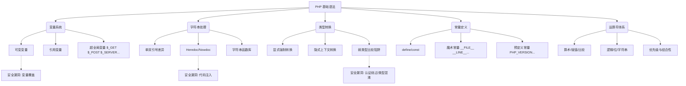

## 概述

本页面沉淀自 0w1Club 微信归档文章《[学员作品]PHP入门基础学习笔记》，系统梳理 PHP 入门阶段必须掌握的七大核心语法知识点。内容覆盖变量进阶用法、字符串声明与解析差异、类型转换机制、常量定义规范及运算符全景，适合 PHP 初学者快速建立知识骨架，也为后续 Web 安全、代码审计、CTF 解题提供基础支撑。

> **来源归档**：0w1Club 微信公众号，原文链接见页面元数据。  
> **关联进阶主题**：[[php-webshell-fundamentals-chopper-analysis]]、[[php-file-inclusion-vulnerability]]、[[php-non-alphanumeric-webshell-construction]]、[[xd-security-file-inclusion-notes]]、[[php伪协议与反序列化利用]]

---

## 可变变量

**定义**：变量的变量名可以动态设置和使用。即 `$$var` 将 `$var` 的值作为新变量名。

### 代码示例

```php
<?php
$a = 'Hello';   // 普通变量，值为 "Hello"
$$a = 'World';  // 可变变量：等价于 $Hello = 'World'

echo $a;      // 输出 Hello
echo $Hello;  // 输出 World
?>
```

### 执行流程解析

1. `$a = 'Hello'` → 变量 `$a` 存储字符串 `"Hello"`
2. `$$a` → 解析为 `$Hello`（以 `$a` 的值作为变量名）
3. `$Hello = 'World'` → 创建新变量 `$Hello`
4. 最终可通过 `$Hello` 访问 `"World"`

### 典型应用场景

- 动态变量名构造（如配合循环批量创建变量）
- 模板引擎变量替换
- **安全注意**：若可控变量名来源于用户输入，可能导致变量覆盖漏洞

---

## 引用变量

**定义**：使用 `&` 符号让两个变量指向同一内存地址，修改其中一个会影响另一个。

### 代码示例

```php
<?php
$a = 10;
$b = 20;
$c = &$a;  // $c 成为 $a 的别名

echo $c;   // 输出 10

$c = 100;  // 修改 $c 实际修改 $a 指向的内存

echo $a;   // 输出 100
echo $c;   // 输出 100
?>
```

### 核心规则

| 规则 | 说明 |
|------|------|
| 仅变量可引用 | 表达式、常量、字面量不可作为引用目标 |
| 同步变更 | 任一变量值改变，所有引用变量同步更新 |
| `unset()` 行为 | 仅解除引用关系，不销毁底层数据（另一变量仍可访问） |
| 重新绑定引用 | `$c = &$b` 会切断 `$c` 与 `$a` 的关联，建立与 `$b` 的新引用 |

### 安全相关

- 引用机制在代码审计中常见于变量覆盖、全局变量污染分析
- 结合 `extract()`、`parse_str()` 等函数可能引发安全问题，参考 [[php-file-inclusion-vulnerability]]、[[xd-security-file-inclusion-notes]]

---

## 单引号与双引号字符串

PHP 中字符串声明必须使用单引号 `'` 或双引号 `"`，两者在解析行为、性能、转义支持上存在显著差异。

### 对比总览

| 特性 | 单引号 `'` | 双引号 `"` |
|------|------------|------------|
| **变量解析** | ❌ 不解析，原样输出 | ✅ 自动解析变量 |
| **转义字符** | 仅支持 `\'` 和 `\\` | 支持 `\n`、`\r`、`\t`、`\\`、`\$` 等 |
| **性能** | 略高（无解析开销） | 略低（需解析变量与转义） |
| **嵌套引用** | 可直接包含 `"` | 可直接包含 `'` |

### 代码示例

```php
<?php
$name = 'World';

// 单引号：原样输出
echo 'Hello $name\n';   // 输出：Hello $name\n

// 双引号：解析变量与转义
echo "Hello $name\n";   // 输出：Hello World（含换行）

// 转义演示
echo 'It\'s single';    // 单引号内转义单引号
echo "It's double";     // 双引号内单引号无需转义
echo "Path: C:\\dir";   // 双引号内转义反斜杠
?>
```

### 变量解析进阶语法

双引号中支持复杂变量解析：

```php
<?php
$arr = ['key' => 'value'];
$obj = new stdClass();
$obj->prop = 'property';

echo "Array: {$arr['key']}";      // 花括号语法（推荐）
echo "Object: {$obj->prop}";      // 对象属性
echo "Var: ${name}";              // 简写形式
?>
```

### 最佳实践

- 纯静态字符串优先使用单引号
- 需要变量插值、转义序列时使用双引号
- 复杂表达式建议使用 `{}` 包裹避免歧义

---

## 定界符声明字符串

定界符提供多行字符串声明方式，分为 **Heredoc** 与 **Nowdoc** 两种模式。

### 语法规则

```php
// Heredoc：双引号语义，支持变量解析与转义
<<<EOT
内容行 1
内容行 2
$variable 解析
EOT;

// Nowdoc：单引号语义，不解析变量，不处理转义（PHP 5.3+）
<<<'EOT'
内容行 1
$variable 原样输出
EOT;
```

### 关键约束

1. 起始标识符：`<<<` 后紧跟自定义标识符（如 `EOT`、`EOF`、`HTML` 等）
2. 结束标识符：**必须顶格书写**（行首无任何空白字符），且与起始标识符完全一致
3. 结束标识符后可跟分号 `;`
4. 起始标识符可加单引号 `<<<'EOT'` 启用 Nowdoc 模式

### 代码示例

```php
<?php
$lang = 'PHP';

// Heredoc 示例
$heredoc = <<<EOT
这是 Heredoc 字符串
当前语言：$lang
支持 \n 换行转义
EOT;

// Nowdoc 示例（单引号语义）
$nowdoc = <<<'EOT'
这是 Nowdoc 字符串
变量 $lang 不会被解析
转义 \n 也会原样输出
EOT;

echo $heredoc;
echo $nowdoc;
?>
```

### 典型用途

- SQL 语句、HTML 模板、大段文本嵌入
- 避免大量引号转义带来的可读性下降
- **注意**：Heredoc 仍会解析变量，若内容含用户输入需警惕注入风险

---

## 数据类型之间的转换

PHP 是弱类型语言，变量类型由上下文自动推断，也可显式强制转换。

### 类型检测函数

| 函数 | 说明 |
|------|------|
| `var_dump($var)` | 打印变量类型、长度、值（调试首选） |
| `gettype($var)` | 返回类型字符串（如 `"integer"`、`"array"`） |
| `settype($var, $type)` | **原地修改**变量类型，返回 `bool` |

### 强制类型转换（C 风格）

```php
<?php
$val = "123abc";

$intVal = (int)$val;      // 123
$floatVal = (float)$val;  // 123.0
$strVal = (string)$val;   // "123abc"
$boolVal = (bool)$val;    // true（非空字符串）
$arrVal = (array)$val;    // ["123abc"]
$objVal = (object)$val;   // stdClass 对象
?>
```

> **特性**：强制转换生成**新变量**，原变量类型与值保持不变。

### 专用转换函数

| 函数 | 等价转换 | 行为 |
|------|----------|------|
| `intval($var)` | `(int)` | 转整数，非数字字符串返回 0 |
| `floatval($var)` | `(float)` | 转浮点数 |
| `strval($var)` | `(string)` | 转字符串 |

### 类型转换陷阱（安全相关）

- **弱类型比较**：`"123abc" == 123` 为 `true` → 导致认证绕过、逻辑漏洞
- **数组转字符串**：`(string)[]` 抛出 Notice 并返回 `"Array"`，常见于 SQL 注入报错回显
- **对象注入**：`unserialize()` 结合魔术方法 (`__wakeup`、`__destruct`) 触发链，详见 [[php伪协议与反序列化利用]]、[[xd-security-deserialization-xxe-notes-day37-39]]

---

## 常量声明

常量一经定义不可修改（运行时），全局可见，无需 `$` 前缀。

### 定义方式

```php
<?php
// 基础语法：define("常量名", "值" [, 是否区分大小写])
define("SITE_NAME", "MySite");           // 区分大小写（默认）
define("VERSION", "1.0", true);          // 不区分大小写（第三参数 true）

// PHP 5.6+ 支持 const 关键字（编译时定义，仅限标量/数组）
const API_KEY = "abc123";
const ALLOWED_HOSTS = ["localhost", "example.com"];
?>
```

### 核心规则

| 规则 | 说明 |
|------|------|
| 命名规范 | 惯例全大写，下划线分隔（`MAX_SIZE`） |
| 无 `$` 前缀 | 访问时直接使用名字：`echo SITE_NAME;` |
| 值类型限制 | 仅支持标量（`bool`、`int`、`float`、`string`）、`null`、数组（PHP 7+） |
| 不可 `unset` | 运行时无法销毁常量 |
| 存在性检测 | `defined("CONST_NAME")` 返回 `bool` |
| 动态获取值 | `constant("CONST_NAME")` 返回值，常量名可为变量 |
| 获取所有常量 | `get_defined_constants()` 返回关联数组 |

### 代码示例

```php
<?php
define("DEBUG", true);
define("MAX_RETRY", 3);

if (defined("DEBUG") && DEBUG) {
    echo "调试模式开启\n";
}

echo "最大重试次数：" . constant("MAX_RETRY") . "\n";

// 获取所有用户定义常量
$userConstants = get_defined_constants(true)['user'] ?? [];
var_dump($userConstants);
?>
```

### 未定义常量行为

```php
<?php
// 未定义常量会触发 Warning，并被当作字符串处理（效率极低）
echo UNDEFINED_CONST;  // 输出 "UNDEFINED_CONST" + Warning
?>
```

> **最佳实践**：生产环境关闭 `error_reporting` 中的 `E_NOTICE`/`E_WARNING` 仍会隐藏此类问题，建议开发阶段全量开启错误报告。

---

## 运算符体系

PHP 运算符按功能分为七大类，优先级与结合性决定表达式求值顺序。

### 算术运算符

| 运算符 | 名称 | 示例 | 结果 |
|--------|------|------|------|
| `+` | 加法 | `$a + $b` | 和 |
| `-` | 减法 | `$a - $b` | 差 |
| `*` | 乘法 | `$a * $b` | 积 |
| `/` | 除法 | `$a / $b` | 商（浮点） |
| `%` | 取模 | `$a % $b` | 余数 |
| `**` | 幂运算 | `$a ** $b` | `$a` 的 `$b` 次方（PHP 5.6+） |
| `++` / `--` | 自增/自减 | `++$a` / `$a++` | 前置/后置差异 |

### 赋值运算符

```php
<?php
$a = 10;
$a += 5;   // $a = $a + 5  → 15
$a -= 3;   // 12
$a *= 2;   // 24
$a /= 4;   // 6
$a %= 5;   // 1
$a .= "str"; // 字符串拼接赋值
?>
```

> **注意**：`+` 在 PHP 中**仅用于数学加法**，字符串拼接使用 `.`（点号），区别于 JS/Java。

### 比较运算符

| 运算符 | 名称 | 说明 |
|--------|------|------|
| `==` | 宽松相等 | 类型转换后比较值（弱类型陷阱来源） |
| `===` | 全等 | **类型与值均相等**（推荐用于安全判断） |
| `!=` / `<>` | 不等 | 宽松不等 |
| `!==` | 不全等 | 类型或值任一不同 |
| `<` `>` `<=` `>=` | 大小比较 | 数值/字符串按 ASCII 顺序 |
| `<=>` | 太空船运算符 | PHP 7+：返回 -1/0/1 表示小于/等于/大于 |

**经典弱类型陷阱**：

```php
<?php
"123abc" == 123      // true（字符串转数字截取前导数字）
"0e12345" == "0e67890" // true（科学计数法均为 0）
md5("240610708") == md5("QNKCDZO") // true（均以 0e 开头）
?>
```

> **防御**：认证、校验、权限判断**必须使用 `===`**，参考 [[ctfshow-web-sql-injection-bypass-basics]]、[[attack-defense-world-beginner-web-writeup]]

### 逻辑运算符

| 运算符 | 名称 | 短路特性 | 优先级 |
|--------|------|----------|--------|
| `&&` / `and` | 逻辑与 | ✅ | `&&` 高于 `and` |
| `||` / `or` | 逻辑或 | ✅ | `||` 高于 `or` |
| `!` | 逻辑非 | - | 高 |
| `xor` | 逻辑异或 | - | 低 |

```php
<?php
// 短路求值示例
function foo() { echo "foo "; return true; }
function bar() { echo "bar "; return false; }

foo() && bar();  // 输出 "foo bar "，bar 执行
foo() || bar();  // 输出 "foo "，bar 不执行（短路）
?>
```

### 位运算符

| 运算符 | 名称 | 示例 |
|--------|------|------|
| `&` | 按位与 | `$a & $b` |
| `\|` | 按位或 | `$a \| $b` |
| `^` | 按位异或 | `$a ^ $b` |
| `~` | 按位取反 | `~$a` |
| `<<` | 左移 | `$a << 2` |
| `>>` | 右移 | `$a >> 2` |

**典型应用**：
- 权限位掩码（RBAC 权限系统）
- 加密算法实现（XOR 加密、哈希混合）
- CTF 题目中常见位运算混淆，参考 [[crypto-basics-xor-stream-cipher-tutorial]]、[[0w1club-ctf-re-writeup-beginner-challenges]]

### 字符串运算符

| 运算符 | 名称 | 示例 |
|--------|------|------|
| `.` | 拼接 | `$a . $b` |
| `.=` | 拼接赋值 | `$a .= $b` |

```php
<?php
$greeting = "Hello" . " " . "World";  // "Hello World"
$greeting .= "!";                     // "Hello World!"
?>
```

### 数组运算符

| 运算符 | 名称 | 行为 |
|--------|------|------|
| `+` | 联合 | 键名不冲突时合并，冲突保留左侧值 |
| `==` | 宽松相等 | 键值对相同（顺序无关、类型转换） |
| `===` | 全等 | 键名、键值、顺序、类型均相同 |
| `!=` `<>` | 不等 | 宽松不等 |
| `!==` | 不全等 | 严格不等 |

---

## 运算符优先速查表（高 → 低）

| 优先级 | 运算符 | 结合性 |
|--------|--------|--------|
| 1 | `clone` `new` | 无 |
| 2 | `**` | 右 |
| 3 | `++` `--` `~` `(int)` `(float)` `(string)` `(array)` `(object)` `(bool)` `@` | 右 |
| 4 | `instanceof` | 无 |
| 5 | `*` `/` `%` | 左 |
| 6 | `+` `-` `.` | 左 |
| 7 | `<<` `>>` | 左 |
| 8 | `<` `<=` `>` `>=` | 无 |
| 9 | `==` `!=` `===` `!==` `<=>` | 无 |
| 10 | `&` | 左 |
| 11 | `^` | 左 |
| 12 | `\|` | 左 |
| 13 | `&&` | 左 |
| 14 | `\|\|` | 左 |
| 15 | `? :` | 右 |
| 16 | `=` `+=` `-=` `*=` `/=` `%=` `**=` `.=` `&=` `\|=` `^=` `<<=` `>>=` | 右 |
| 17 | `and` | 左 |
| 18 | `xor` | 左 |
| 19 | `or` | 左 |

> **建议**：复杂表达式显式加括号 `()` 明确优先级，提升可读性与维护性。

---

## 知识图谱与延伸阅读



### 关联页面索引

| 方向 | 页面 | 关联点 |
|------|------|--------|
| WebShell 攻防 | [[php-webshell-fundamentals-chopper-analysis]] | `eval()` 执行、变量函数调用、字符串拼接绕过 |
| 文件包含漏洞 | [[php-file-inclusion-vulnerability]] | 伪协议、变量可控包含路径、引用变量污染 |
| 非字母数字 WebShell | [[php-non-alphanumeric-webshell-construction]] | 变量解析、字符串构造、异或/取反/自增技巧 |
| 伪协议与反序列化 | [[php伪协议与反序列化利用]] | `php://filter`、类型转换触发魔术方法、弱类型绕过 |
| XD安全课程笔记 | [[xd-security-file-inclusion-notes]] | LFI/RFI 实战、伪协议利用链、敏感路径清单 |
| CTF 入门 Web | [[attack-defense-world-beginner-web-writeup]] | PHP 弱类型比较绕过、命令执行、WebShell 连接 |
| 密码学基础 | [[crypto-basics-xor-stream-cipher-tutorial]] | 位运算 `^` 在异或加密中的应用 |

---

## 结语

掌握 PHP 基础语法是通往 Web 安全、代码审计、CTF 解题的基石。本页面梳理的七大知识点构成了 PHP 语言运行时的核心行为模型，**弱类型转换**、**引用机制**、**字符串解析差异**是漏洞挖掘与利用构造的高频攻击面。

> **学习建议**：
> 1. **动手验证**：每个代码片段在本地 PHP 环境（`php -a` 或 `php -r`）运行观察输出
> 2. **阅读源码**：关注 `Zend/zend_operators.c` 中类型转换、比较函数实现
> 3. **实战靶场**：[[pikachu-target-writeup-part1-setup-brute-force]]、[[ctf-training-platforms-collection]] 中的 SQLi、XSS、RCE 关卡
> 4. **代码审计**：从 [[xd-security-code-audit-notes-day50-57]] 入手，搜索 `define`、`extract`、`parse_str`、`$$` 等危险模式

---

**页面维护信息**  
- 首次创建：2023-04-13  
- 归档来源：0w1Club 微信公众号《[学员作品]PHP入门基础学习笔记》  
- 维护者：数字知识库策展人  
- 交叉引用更新：依据现有知识库页面动态关联

## 来源

- [226安全团队-201805-202103_16](../sources/226安全团队-201805-202103_16.md)
