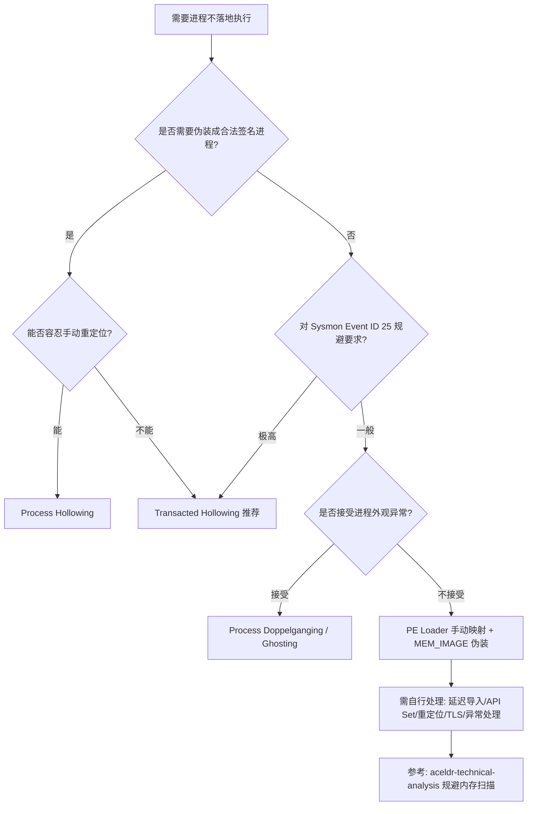

## 概述

本页面系统整理五大主流 **进程镂空/篡改技术**（Process Hollowing、Process Doppelganging、Process Ghosting、Process Herpaderping、Transacted Hollowing）的核心原理、实现流程、优缺点对比，以及在 **Sysmon Event ID 25 (Process Tampering)** 检测下的规避现状。同时补充 **PE Loader（反射式加载器）** 的关键实现细节，形成进程内存执行技术的完整知识图谱。

> **核心分类**：PE 不落地执行技术可归为三大类：
> 1. **PE 加载器类**：手动映射 PE、RDI、sRDI、pe2shellcode (Donut/pe2shc) —— 核心是用户态 PE 解析与重定位/导入表修复。
> 2. **Section 内核对象类**：Process Doppelganging、Process Ghosting、Process Herpaderping —— 核心利用 `NtCreateSection` + `SEC_IMAGE` 创建镜像节区，再通过 `NtCreateProcessEx` 创建进程。
> 3. **镂空傀儡进程类**：Process Hollowing、Transacted Hollowing —— 核心创建挂起进程并替换其内存映像。

---

## 技术原理与实现流程对比

### Process Hollowing（经典进程镂空）

**核心思想**：创建合法进程挂起 → 卸载原镜像 → 手动映射恶意 PE → 修复重定位 → 修改 PEB/OEP → 恢复主线程。

#### 实现步骤
1. `CreateProcess` + `CREATE_SUSPENDED` 创建傀儡进程（如 `svchost.exe`、`notepad.exe`）。
2. （可选）`NtUnmapViewOfSection` 卸载原有镜像节区视图。
3. `VirtualAllocEx` 在目标进程分配内存（优选 `ImageBase`）。
4. `WriteProcessMemory` 依次写入 PE 头、各节区（Raw → Virtual 展开）。
5. 手动处理 **重定位表**（因基址可能冲突）。
6. 修改目标进程 **PEB.ImageBaseAddress** 指向新基址。
7. 修改主线程上下文 **RIP/EIP** 指向新 OEP。
8. `ResumeThread` 恢复执行。

#### 关键特征
- 需手动处理重定位，**不需处理导入表**（OS Loader 在主线程恢复后通过 APC/进程挂靠机制延迟处理）。
- 映射内存属性为 `MEM_PRIVATE`，易被内存扫描发现（`pe-sieve`、`moneta` 等）。

> **交叉引用**：[[pe-manual-mapping-loader-implementation]] 中详细记录了手动映射的导入表修复、重定位修正、节区拉伸全流程 C++ 实现。

---

### Process Doppelganging（进程替身）

**核心思想**：利用 **TxF (Transactional NTFS)** 创建仅存在于内存的合法 PE 文件 → 创建 `SEC_IMAGE` Section → 回滚事务 → 用 Section 创建进程。

#### 实现步骤
1. `CreateTransaction` 创建 NTFS 事务。
2. `CreateFileTransacted` 在事务中创建/覆写文件，写入 Payload PE。
3. `NtCreateSection` + `SEC_IMAGE` 由文件句柄创建 **镜像节区**。
4. 关闭文件句柄，`RollbackTransaction` 回滚（文件从未落盘）。
5. `NtCreateProcessEx` 传入 Section 句柄创建进程。
6. 手动写入 `PEB.ProcessParameters` 与 `Environment`（命令行、环境变量）。
7. `NtCreateThreadEx` 创建主线程执行。

#### 关键特征
- **真正不落地**：ProcMon 无法捕获文件创建/写入事件。
- 无需手动重定位：`NtMapViewOfSection` 映射 `SEC_IMAGE` 时会尝试按 `ImageBase` 映射，失败返回 `STATUS_IMAGE_NOT_AT_BASE`，OS Loader 在主线程启动时自动重定位。
- **进程异常**：任务管理器/`tasklist` 显示进程名与实际不符，Process Hacker 显示源文件不存在。

---

### Process Ghosting（进程幽灵）

**核心思想**：利用 **DELETE_PENDING** 文件状态实现“近似不落地”创建 `SEC_IMAGE` Section。

#### 实现步骤
1. `NtCreateFile` 创建文件。
2. `NtSetInformationFile` + `FILE_DISPOSITION_INFORMATION.DeleteFile = TRUE` 标记删除挂起。
3. `NtWriteFile` 写入 Payload PE（此时文件已标记删除，但句柄有效）。
4. `NtCreateSection` + `SEC_IMAGE` 创建镜像节区。
5. 关闭文件句柄（文件彻底删除）。
6. `NtCreateProcessEx` + 手动写 PEB/Environment + 创建主线程（同 Doppelganging 后半段）。

#### 关键特征
- **近似不落地**：内核层监控（Process Hacker/ETW）仍可见写文件行为，但磁盘无残留。
- 同样享受 `SEC_IMAGE` 自动重定位优势。
- Windows 删除文件两种方式：`FILE_DELETE_ON_CLOSE` 或设置 `FILE_DISPOSITION_INFORMATION`（`DeleteFileW` 内部即走此路径）。

> **参考**：[Windows 删除文件机制](https://www.osronline.com/article.cfm^article=245.htm)、[ReactOS DeleteFileW 实现](https://doxygen.reactos.org/dd/db0/dll_2win32_2kernel32_2client_2file_2delete_8c.html#a6ef6fb74f843f5a3a7ce135d57411806)

---

### Process Herpaderping（进程伪装）

**核心思想**：与 Doppelganging/Ghosting 同属 Section 类技术，区别在于**先创建进程再修改文件内容**，利用文件句柄与 Section 解耦的时间差。

#### 简化流程
1. 创建合法文件 → 创建 `SEC_IMAGE` Section → 创建进程。
2. 进程创建后、主线程启动前，覆写同一文件为恶意 PE。
3. 主线程启动时映射的已是恶意内容。

> **定位**：本质上是 Doppelganging/Ghosting 的变体，利用“文件内容校验发生在进程创建之后”的竞争窗口。此处不再赘述细节。

---

### Transacted Hollowing（事务镂空）

**核心思想**：**Process Hollowing + Process Doppelganging** 结合体，取长补短。

#### 实现步骤
1. `CreateTransaction` 创建 TxF 事务。
2. 事务中创建/写入 Payload PE。
3. `NtCreateSection` + `SEC_IMAGE` 创建镜像节区。
4. 关闭句柄，`RollbackTransaction`（文件不落地）。
5. `CreateProcess` + `CREATE_SUSPENDED` 创建**傀儡进程**（保留合法签名/路径）。
6. `NtMapViewOfSection` 将步骤 3 的 Section 映射入傀儡进程（覆盖原镜像）。
7. 修改傀儡进程 `PEB.ImageBaseAddress`。
8. 修改主线程上下文 `RIP/EIP` → 新 OEP。
9. `ResumeThread`。

#### 核心优势对比表

| 维度 | Process Hollowing | Process Doppelganging | **Transacted Hollowing** |
|---|---|---|---|
| **重定位处理** | 手动处理 | OS Loader 自动 | OS Loader 自动（映射 `SEC_IMAGE` 触发） |
| **内存属性** | `MEM_PRIVATE` 可疑 | `MEM_IMAGE` 正常 | `MEM_IMAGE` 正常 |
| **PEB 处理** | 仅需改 ImageBase | 需重建 ProcessParameters/Environment | 仅需改 ImageBase（复用傀儡进程 PEB） |
| **进程外观** | 正常（模拟合法进程） | 异常（名字/路径不符） | **正常**（继承傀儡进程身份） |
| **不落地程度** | 磁盘有原傀儡文件 | 真不落地（TxF） | 真不落地（TxF Section）+ 合法进程外壳 |

> **参考**：[Malwarebytes: Process Doppelganging meets Process Hollowing](https://blog.malwarebytes.com/threat-analysis/2018/08/process-doppelganging-meets-process-hollowing_osiris/)

---

## Sysmon Event ID 25 (Process Tampering) 检测规避现状

Sysmon 8.0+ 引入 **Event ID 25 - Process Tampering**，旨在检测“内存镜像与磁盘文件不一致”的进程。官方文档声明两种检测类型：
1. **Image is locked for access** —— 文件被锁无法读取哈希。
2. **Image is replaced** —— 磁盘文件内容与内存映像哈希不匹配。

### 实测检测覆盖情况

| 技术 | Event ID 25 检测结果 | 说明 |
|---|---|---|
| **Process Hollowing** | ✅ 检测到 | 内存为 Private 映射，磁盘原文件未变，哈希不匹配。 |
| **Process Doppelganging** | ✅ 检测到 | 进程由 Section 创建，但磁盘无对应文件，触发 Type 2。 |
| **Process Ghosting** | ✅ 检测到 | 同 Doppelganging，文件已删除但内存映像存在。 |
| **Process Herpaderping** | ✅ 检测到 | 文件内容被覆写，磁盘哈希与内存不符。 |
| **Transacted Hollowing** | ❌ **未检测到** | **核心优势**：傀儡进程磁盘文件合法且未修改，内存映射虽为恶意 Section，但 Sysmon 仅对比“进程主模块磁盘文件”与“内存映像”，傀儡进程主模块路径指向合法文件，哈希一致，规避检测。 |

> **结论**：Transacted Hollowing 目前仍是规避 Sysmon Event ID 25 的优选方案。结合 [[aceldr-technical-analysis]] 中的 Sleep Hook、Heap Hook、Return Address Spoofing、动态内存加密，可构建更完整的内存规避链。

---

## PE Loader（反射式加载器）核心实现难点

PE Loader 类技术（RDI、sRDI、Donut、pe2shc、[[pe-manual-mapping-loader-implementation]]）完全在用户态实现 PE 映射，三大易被忽略的关键点：

### 延迟导入表处理
- 多数开源 Loader（如 `MemoryModule`）未实现，**导致 `cmd.exe` 等依赖 `cmdext.dll` 延迟加载的 PE 无法运行**。
- 必须解析 `IMAGE_DIRECTORY_ENTRY_DELAY_IMPORT`，按需加载 DLL 并解析函数地址。

### API Set Schema 解析
- Windows 8+ 引入虚拟 DLL（`api-ms-win-core-*-l1-*-*.dll`），`GetProcAddress` 需正确解析转发链。
- **陷阱**：`kernel32!InitializeProcThreadAttributeList` → `api-ms-win-core-processthreads-l1-1-0` → 转发回 `kernel32` → **无限循环**。
- **正确做法**：指定 Base Module（`kernelbase.dll`）解析虚拟 DLL，直接落地真实导出。
- **DarkLoadLibrary 奇技**：不解析 Schema，回退搜索 `kernel32`/`kernelbase`/`ntdll` 三大核心 DLL，再 fallback `LdrGetProcedureAddress` 处理 `dbghelp!MiniDumpWriteDump` 等特殊转发。

> **参考**：[API Set Schema 解析](https://lucasg.github.io/2017/10/15/Api-set-resolution/)、[DarkLoadLibrary 实现](https://github.com/bats3c/DarkLoadLibrary/blob/master/DarkLoadLibrary/src/pebutils.c#L413)

### 分配 `MEM_IMAGE` 内存而非 `MEM_PRIVATE`
- `VirtualAlloc` 返回 `MEM_PRIVATE` + `PAGE_EXECUTE_READWRITE` 极其可疑，极易被 [[memory-scanning-tools-evasion-techniques]] 中的 `pe-sieve`/`moneta`/`patriot`/`Hunt-Sleeping-Beacons` 等工具特征匹配。
- **解法**：通过 `NtCreateSection` + `SEC_IMAGE` + `NtMapViewOfSection` 或手动构造 `MEM_IMAGE` VAD，使内存区域呈现合法模块特征（含 PE 头、节区属性、签名校验通过）。

> **交叉引用**：[[aceldr-technical-analysis]] 实测 `moneta`/`pe-sieve` 对 UDRL 内存特征的检出情况；[[memory-scanning-tools-evasion-techniques]] 系统梳理七大主流内存扫描工具检测原理与规避对抗。

---

## 关键底层机制深度剖析

### NtCreateProcessEx 与 Section 对象
- `NtCreateProcessEx` 仅需一个 **Image Section 句柄** 即可创建进程，完全绕过 `CreateProcess` 的文件路径校验、参数构造、PPID 欺骗等用户态逻辑。
- **可控点**：
  - 文件句柄可设 `NO SHARE MODE` 独占。
  - TxF 使文件仅存在内存，回滚后无磁盘痕迹。
  - `DELETE_PENDING` 状态下仍可创建 Section，关闭句柄即删除。
  - Section 创建后可立即覆写/删除磁盘源文件（Herpaderping 利用点）。

### PEB 与进程参数构造
- Doppelganging/Ghosting 创建的进程**无 PEB 参数块**，需手动：
  1. 分配目标进程内存写入 `RTL_USER_PROCESS_PARAMETERS`（命令行、当前目录、环境变量、窗口标题等）。
  2. 修改 `PEB.ProcessParameters` 指针。
  3. 设置 `PEB.CommandLine`/`Environment` 等关键字段。
- Hollowing/Transacted Hollowing **复用傀儡进程 PEB**，仅需改 `ImageBaseAddress` 与 `EntryPoint`，隐蔽性极强。

> **交叉引用**：[[argument-spoofing-edr-evasion]] 详细解析 `PEB.RTL_USER_PROCESS_PARAMETERS` 结构利用实现命令行欺骗，对抗 EDR 进程创建回调与 Sysmon Event ID 1。

### OS Loader 延迟重定位机制
- 挂起进程创建时，仅映射 `ntdll.dll` 与自身镜像，**重定位/导入表处理均推迟至主线程首次运行**（通过 `LdrInitializeThunk` → `LdrpInitializeProcess`）。
- 这解释了为何 Hollowing 必须手动重定位，而 Section 类技术映射 `SEC_IMAGE` 可由内核/Loader 自动完成。

---

## 技术选型决策树（红队视角）

---

## 防御与检测视角

| 检测层面 | 关键点 | 参考工具/技术 |
|---|---|---|
| **内核回调** | `ObRegisterCallbacks` 拦截 `PROCESS_VM_WRITE`/`PROCESS_VM_OPERATION` 句柄创建 | [[windows-kernel-callback-injection-defense]] (pi-defender) |
| **内存扫描** | `MEM_PRIVATE` 可执行内存、`MEM_IMAGE` 但无磁盘文件、PE 头异常、节区属性不匹配 | [[memory-scanning-tools-evasion-techniques]] (pe-sieve, moneta, patriot, Hunt-Sleeping-Beacons) |
| **ETW/事件日志** | Sysmon Event ID 25 (Tampering)、Event ID 8 (CreateRemoteThread)、Event ID 10 (ProcessAccess) | Sysmon 配置优化、[[named-pipe-smb-detection-sysmon]] 管道监控 |
| **进程参数审计** | `PEB.ProcessParameters` 与命令行/父进程不一致、环境变量异常 | [[argument-spoofing-edr-evasion]] 检测思路 |
| **行为启发式** | 挂起创建→内存大量写入→恢复执行、TxF 事务创建/回滚高频、`DELETE_PENDING` 文件写入后创建进程 | EDR 行为分析引擎 |

---

## 相关页面交叉引用索引

- [[aceldr-technical-analysis]] — UDRL 四大规避技术（Sleep Hook、Heap Hook、Return Address Spoofing、动态内存加密）实测对抗内存扫描器。
- [[phantom-dll-hollowing-technique]] — 幽灵 DLL 空洞化：劫持已加载合法 DLL 内存区段实现注入持久化。
- [[pe-manual-mapping-loader-implementation]] — 从零构建 PE 手动映射加载器全流程 C++ 实现（导入表修复、重定位、TLS、模块隐藏）。
- [[memory-scanning-tools-evasion-techniques]] — 七大主流内存扫描工具检测原理（线程枚举、ETW、YARA、PE 完整性、VAD 遍历）与 UDRL 对抗实测。
- [[argument-spoofing-edr-evasion]] — 命令行欺骗对抗 EDR 进程创建监控，深度解析 `PEB.RTL_USER_PROCESS_PARAMETERS` 篡改。
- [[windows-kernel-callback-injection-defense]] — 内核回调 `ObRegisterCallbacks` 阻断进程注入的原理、实现与绕过。
- [[cobalt-strike-external-c2-smb-beacon]] — SMB Beacon 横向移动中的进程注入、令牌窃取、PPL 规避实战。
- [[rust-proc-macro-win32-dynamic-import]] — Rust 宏实现 Win32 API 动态导入、符号哈希、UTF-16 栈上构造，适用于 Shellcode 武器化。
- [[named-pipe-smb-detection-sysmon]] — Sysmon Event ID 17/18 命名管道检测 SMB Beacon/External C2 通信。
- [[xd-security-pentest-basic-stage-notes]] — 渗透测试基础阶段 SQL注入、文件上传、WAF绕过知识体系，含进程注入相关实战笔记。

---

## 参考资料与延伸阅读

1. **Process Hollowing 经典实现**：`CreateProcess` + `NtUnmapViewOfSection` + 手动映射 + `SetThreadContext`。
2. **Process Doppelganging**：TxF + `SEC_IMAGE` + `NtCreateProcessEx` —— [原文](http://mp.weixin.qq.com/s?__biz=Mzg5MjU2NTc1Mg==&mid=2247483721&idx=1&sn=5ce84fc04adbedce1a40a348d28e7a10)。
3. **Process Ghosting**：`DELETE_PENDING` + `SEC_IMAGE` —— [Windows 删除文件机制](https://www.osronline.com/article.cfm^article=245.htm)、[ReactOS DeleteFileW](https://doxygen.reactos.org/dd/db0/dll_2win32_2kernel32_2client_2file_2delete_8c.html#a6ef6fb74f843f5a3a7ce135d57411806)。
4. **Transacted Hollowing**：[Malwarebytes 分析](https://blog.malwarebytes.com/threat-analysis/2018/08/process-doppelganging-meets-process-hollowing_osiris/)。
5. **Sysmon Event ID 25**：[官方文档](https://docs.microsoft.com/en-us/sysinternals/downloads/sysmon#event-id-25-processtampering-process-image-change)。
6. **API Set Schema**：[Lucas G 解析](https://lucasg.github.io/2017/10/15/Api-set-resolution/)。
7. **DarkLoadLibrary 奇技**：[GitHub 实现](https://github.com/bats3c/DarkLoadLibrary/blob/master/DarkLoadLibrary/src/pebutils.c#L413)。

---

> **维护提示**：本页面聚焦“进程镂空/篡改技术族”，如需了解 **DLL 注入、APC 注入、线程劫持、Early Bird、Module Stomping** 等其他注入分支，请另建页面或在 [[memory-scanning-tools-evasion-techniques]] 中检索对抗细节。

## 来源

- [0x4d5a-202103-202209_09](../sources/0x4d5a-202103-202209_09.md)
