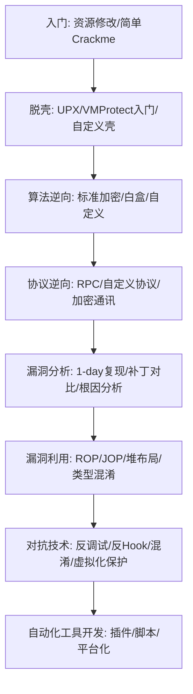

## 什么是逆向工程

**逆向工程**（Reverse Engineering），又称**反向工程**，是一种技术过程：对目标产品（软件、固件、硬件）进行逆向分析及研究，从而演绎并得出该产品的处理流程、组织结构、功能性能规格等设计要素。

> 正向工程：源代码 → 编译/链接 → 可执行程序  
> 逆向工程：可执行程序 → 反汇编/反编译 → 伪代码/汇编 → 理解逻辑 → 还原设计意图

逆向工程源于商业及军事领域中的硬件分析，主要目的是在无法轻易获得必要的生产信息下，直接从成品的分析中推导产品的设计原理。

## 逆向工程的应用场景

| 场景 | 说明 |
|------|------|
| **软件破解/注册机制作** | 分析证书验证算法，还原密钥生成逻辑 |
| **游戏外挂开发** | 读写游戏内存、Hook 关键函数、绕过反作弊 |
| **恶意软件分析** | 静态/动态分析病毒、木马、勒索软件行为，提取 IOC |
| **漏洞挖掘与利用** | 组件级代码审计、Fuzzing、漏洞利用链构造 |
| **CTF 竞赛** | Reverse/Pwn 方向核心技能，二进制题型必考 |
| **软件汉化/修改** | 资源提取、字符串定位、界面文本替换（如 [[ida-pro-tips-plugins-python]] 中资源处理技巧） |
| **软件知识产权保护** | 检测代码盗用、抄袭对比（参考 [[sourcerercc-code-clone-detection]]） |
| **IoT/固件安全** | 路由器、智能设备固件提取与分析（参考 [[xihulunjian-2020-iot-pwn3-ezarmpwn-writeup]]） |

## 核心预备知识体系

无论细分方向（Windows 应用、Android/iOS 移动端、IoT 固件、浏览器内核、内核驱动等），以下基础知识是**绕不开的门槛**：

### 编程语言基础
- **C 语言**：指针、内存布局、结构体/联合、函数调用约定、栈帧管理
- **C++**：类与对象模型、虚表指针、多态实现、STL 容器内部结构、模板实例化
- **Python**：IDA Pro / Binary Ninja / Ghidra 脚本自动化、POC/EXP 编写、数据处理

### 汇编语言（逆向的“母语”）
- **x86 / x86-64**：寄存器、标志位、栈操作、函数调用约定、SIMD 指令集
- **ARM / AArch64**：移动端、IoT 设备主流架构，条件执行、Thumb 模式
- **MIPS**：路由器、嵌入式设备常见
- **读懂核心模式**：循环识别、switch-case 跳转表、虚函数调用、异常处理、SEH/VEH

### 计算机系统基础
- **计算机组成原理**：CPU 流水线、缓存层级、虚拟内存、MMU、TLB
- **操作系统原理**：进程/线程管理、内存管理、文件系统、I/O 模型、系统调用
- **链接与加载**：ELF/PE 格式解析、动态链接流程、重定位、PLT/GOT、TLV、ASLR

### 平台专用知识
| 平台 | 必学 API / 机制 |
|------|----------------|
| **Windows** | Win32 API、PE 结构、注册表、COM、WMI、驱动模型、ETW、APC、回调、PatchGuard |
| **Linux** | ELF、glibc malloc、ptrace、seccomp、namespace/cgroup、eBPF、内核模块 |
| **Android** | JNI、DEX/OAT、ART 运行时、Binder IPC、SELinux、frida/Objection 生态 |
| **iOS/macOS** | Mach-O、Objective-C/Swift 运行时、dyld、XPC、codesign、PAC、Hardened Runtime |

### 工具链掌握
| 类别 | 代表工具 | 核心用途 |
|------|----------|----------|
| **静态分析** | IDA Pro / Ghidra / Binary Ninja | 反汇编、反编译、交叉引用、类型重建、脚本自动化 |
| **动态调试** | x64dbg / WinDbg / GDB / LLDB / Frida | 断点、内存搜索、寄存器修改、调用栈回溯、Hook |
| **辅助工具** | CFF Explorer / PE-bear / Resource Hacker / DIE / YARA | 壳检测、资源提取、特征匹配、签名生成 |
| **自动化/脚本** | IDAPython / BNIL / Ghidra Script / pwntools / angr | 批量重命名、去混淆、符号执行、ROP 链生成 |

> 💡 **进阶方向**：代码混淆与反混淆（OLLVM 平坦化参考 [[binary-ninja-ollvm-deobfuscation]]）、内核漏洞利用（Linux 内核防护参考 [[linux-kernel-hardening-mechanisms]]）、浏览器内核利用（V8 类漏洞参考 [[v8-turbofan-changeint32toint64-1day-analysis]]、[[google-ctf-2021-full-chain-v8-exploitation]]）、虚拟化逃逸（QEMU 参考 [[d3ctf-2021-d3dev-qemu-escape-writeup]]）。

## 推荐学习资源清单

### 经典书籍（按阅读顺序建议）

| 书籍 | 定位 | 重点章节 |
|------|------|----------|
| **《C Primer Plus》（第 6 版+）** | C 语言入门 | 指针、动态内存、文件 IO、预处理器 |
| **《汇编语言》（王爽，第 3/4 版）** | x86 汇编入门 | 寄存器、标志位、栈、中断、BIOS/DOS 调用、模块化编程 |
| **《加密与解密》（段钢，第 3/4 版）** | Windows 逆向“红皮书” | PE 结构、壳原理、调试技巧、加密算法识别、Hook 技术 |
| **《逆向工程核心原理》（姜雪伟）** | 进阶提升 | 编译原理视角、控制流分析、数据流分析、混淆对抗 |
| **《Android 软件安全与逆向分析》（丰生强）** | Android 方向 | DEX 格式、ART、JNI、Native 层分析、加固对抗 |
| **《iOS 应用逆向工程》（沙梓社/吴航）** | iOS 方向 | Mach-O、Objective-C 运行时、越狱环境、砸壳、Hook |
| **《实战恶意代码分析》（Michael Sikorski）** | 恶意样本分析 | 静态/动态分析流程、反调试/反VM、C2 通信、Rootkit |

### 免费视频课程（B 站 / YouTube）

| UP主 / 频道 | 系列名称 | 适合阶段 |
|-------------|----------|----------|
| **小甲鱼** | “解密系列”（配合《加密与解密》书籍） | 入门、配套练习题 |
| **看雪学院** | 官方公开课、专题直播回放 | 系统性、工程化视角 |
| **罗云彬** | 《逆向工程核心原理》配套课程 | 理论深度、编译器视角 |
| **PwnColleg** / **LiveOverflow** | Binary Exploitation / RE 系列 | CTF 实战、漏洞利用思维 |
| **NoodleDoodle** / **hacksplaining** | Browser Exploitation 入门 | V8/SpiderMonkey/JSC 利用 |

### 实战靶场与练习平台

| 平台 | 特色 | 入口 |
|------|------|------|
| **Crackmes.one** | 分级破解题、社区 Writeup | 入门必刷 |
| **RE4B (Reverse Engineering for Beginners)** | 经典教程配套练习 | 理论联系实际 |
| **微信小游戏/小程序逆向** | 真实业务逻辑、无壳保护 | 移动端入门 |
| **攻防世界 / BUUCTF / PicoCTF** | CTF 题库、标准 Writeup | 竞赛备战 |
| **Malware-Traffic-Analysis.net** | 真实流量包+样本 | 恶意分析实战 |

## 任务驱动学习法：从“想破解它”开始

> “学习逆向最好的方法就是直接找个小软件，动手开始逆向，遇到问题了再学再查。”

### 为什么任务驱动有效
- **目标明确**：为了解决具体问题（如绕过验证、提取密钥、修改逻辑）而学习
- **反馈即时**：能否跑通、能否 Patch 成功、Flag 能否拿到，立竿见影
- **知识串联**：单个任务会串起“识别壳 → 脱壳 → 定位关键代码 → 理解算法 → 编写脚本/补丁”完整链路
- **抗遗忘**：解决过的痛点比背诵的概念记忆深得多

### 入门级任务推荐（按难度递增）

| 任务 | 涉及技能点 | 产出 |
|------|------------|------|
| **Resource Hacker 修改 EXE 资源/菜单文本** | PE 资源节、字符串定位、校验和修正 | 可运行的汉化/修改版程序 |
| **简单 Crackme（无壳、逻辑在主函数）** | 静态分析、字符串交叉引用、条件跳转修改、Keygen 编写 | 注册机/补丁程序 |
| **UPX/ASPack 等已知壳脱壳** | 壳识别、ESP 定律/单步跟踪/内存镜像导出、IAT 修复 | 脱壳后的干净二进制 |
| **算法还原类 Crackme（MD5/AES/RC4/自定义）** | 加密常数识别、动态调试验证、Python 还原脚本 | 解密脚本/Keygen |
| **Android App 简单 Hook（Frida/Objection）** | JNI 识别、so 文件分析、动态 Hook、RPC 调用 | 绕过 Root 检测/证书绑定 |
| **CTF RE 入门题（Base64 变种、异或、虚拟机保护）** | 模式识别、符号执行/angr 辅助、脚本自动化 | Flag + 通用解题脚本 |

### 进阶任务路线图

## 搜索引擎使用技巧：面向 Google/Bing 编程

> “基本上你能遇到的任何问题都能搜到。没有搜不到的，只有还没搜到的。”

### 高效检索语法速查

| 语法 | 作用 | 示例 |
|------|------|------|
| `site:` | 限定站点 | `site:bbs.pediy.com OLLVM 控制流平坦化` |
| `filetype:` | 限定文件类型 | `filetype:pdf "reverse engineering" tutorial` |
| `intitle:` / `inurl:` | 标题/URL 包含关键词 | `intitle:"writeup" "Crackme" "IDA Pro"` |
| `""` | 精确匹配短语 | `"virtual function table" reconstruction` |
| `-` | 排除词 | `IDA Pro plugin -Hex-Rays -官方` |
| `OR` / `|` | 多关键词任一 | `Ghidra OR "Binary Ninja" script` |
| `..` | 数字范围 | `CTF 2020..2024 reverse writeup` |

### 常用高质量技术社区（优先站内搜）

| 社区 | 特色 | 搜索技巧 |
|------|------|----------|
| **看雪论坛 (bbs.pediy.com)** | 中文逆向第一社区、Wall of Fame | `site:bbs.pediy.com 关键词` |
| **GitHub / GitLab** | 开源工具、脚本、Writeup、PoC | `repo:用户名/项目名 关键词` |
| **Stack Overflow / Reverse Engineering SE** | 具体报错、API 用法、技术细节 | `site:reverseengineering.stackexchange.com` |
| **CTFtime / CTF Wiki** | 历年赛题、Writeup 聚合 | `site:ctftime.org/writeup 关键词` |
| **VirusTotal / MalwareBazaar / Hybrid Analysis** | 样本行为、静态特征、家族标签 | 搜 Hash / 行为关键词 |
| **Microsoft Docs / Apple Developer / Android Developers** | 官方 API 文档、安全机制说明 | 直接站内搜或 `site:learn.microsoft.com` |

### 搜索策略建议

1. **报错全文搜**：直接复制完整报错信息（去掉路径/行号等变量部分）
2. **关键词组合**：`工具名 + 版本 + 问题现象 + 目标平台`（如 `IDA Pro 7.6 Python3.10 import error Windows 11`）
3. **跟踪大佬**：关注领域内活跃研究员的 GitHub/Twitter/Blog，搜 `author:用户名 关键词`
4. **善用 Writeup 关键词**：`vulnerability analysis` `root cause analysis` `exploit development` `patch diffing`
5. **中英结合**：国内社区搜中文，国际前沿搜英文，必要时用翻译工具辅助阅读

## 学习心态与避坑指南

### 认清现实
- **学习曲线陡峭**：前 3-6 个月体感进度极慢，属于正常现象
- **反馈周期长**：不像 Web 安全“学完注入马上打靶”，逆向需要大量积累才能独立分析复杂目标
- **知识面极广**：汇编、编译原理、OS、网络、密码学、硬件架构……终身学习

### 避免的误区
| 误区 | 正确做法 |
|------|----------|
| 买了一堆书不看、下了一堆工具不用 | **极简工具链起步**（IDA/Ghidra 二选一 + 一个调试器），跑通一个最小闭环 |
| 死磕汇编指令集手册、不写代码 | **读汇编配合写脚本**，用 Python/IDAPython 验证理解 |
| 只看视频/Writeup、不动手复现 | **必须复现**，并尝试变种（换编译器、换优化等级、加壳） |
| 追求“全栈”逆向、什么方向都浅尝辄止 | **先深挖一个方向**（如 Windows 用户态 / Android Native / 浏览器内核）建立知识树，再横向扩展 |
| 遇到不懂就问群/发帖、不先搜 | **先搜索 20 分钟**，整理现象/环境/已尝试方案再提问，提高解决率 |

### 长期成长建议
1. **建立个人知识库**：Obsidian/Notion 记录每个样本分析过程、关键代码片段、工具配置、踩坑笔记
2. **输出倒逼输入**：写 Writeup、录教程、开源脚本、分享会，费曼学习法最强
3. **参与开源/社区**：给 Ghidra/IDA/Binary Ninja 提 PR、报 Issue、写插件，深度理解工具内部
4. **定期复盘**：每季度回顾“解决过的最难问题”、“新掌握的技术栈”、“下个季度攻克目标”
5. **关注前沿论文/会议**：USENIX Security、NDSS、IEEE S&P、Black Hat、DEFCON、CanSecWest、Pwn2Own 议题与幻灯片

## 交叉引用与延伸阅读

| 页面 | 关联说明 |
|------|----------|
| [[ida-pro-tips-plugins-python]] | IDA Pro 实用技巧：FLIRT 签名生成、Findcrypt-Yara、Keypatch、IDAPython 第三方库配置 |
| [[binary-ninja-ollvm-deobfuscation]] | Binary Ninja IL 分析去除 OLLVM 控制流平坦化，插件开发思路 |
| [[linux-kernel-hardening-mechanisms]] | Linux 内核缓解措施体系，内核漏洞利用前置知识 |
| [[v8-turbofan-changeint32toint64-1day-analysis]] | V8 JIT 编译器漏洞分析，浏览器内核逆向进阶 |
| [[google-ctf-2021-full-chain-v8-exploitation]] | 完整利用链：V8 漏洞 → MojoJS 沙箱逃逸 |
| [[d3ctf-2021-d3dev-qemu-escape-writeup]] | QEMU 虚拟化逃逸，MMIO OOB 读写利用 |
| [[xihulunjian-2020-iot-pwn3-ezarmpwn-writeup]] | ARM IoT 固件 Pwn 实战：栈溢出、UAF、ROP、堆利用 |
| [[mtctf-2021-pwn-writeup]] | 堆利用技巧：UAF、Fastbin、Unlink、Double Free、setcontext |
| [[phantom-dll-hollowing-technique]] | 无文件攻击技术：DLL Hollowing 内存注入与规避 |
| [[oo7-spectre-defense-binary-analysis]] | 二进制层面 Spectre 检测与修复：污点分析、推测执行窗口 |
| [[sourcerercc-code-clone-detection]] | 大规模代码克隆检测，辅助逆向中的库函数识别与版本定位 |

---

> **结语**：逆向工程之于二进制安全，犹如数学之于理科。入门陡峭、反馈延迟，但一旦建立起“静态分析 ↔ 动态调试 ↔ 代码理解 ↔ 自动化脚本”的闭环思维，无论最终走向漏洞研究、恶意分析、CTF 竞技还是安全工程化，都将具备极强的迁移能力。**沉得下心，动得起手，搜得会题，写得出脚本**——这就是逆向入门的全部秘诀。

## 来源

- [0w1Club-201908-202207_06](../sources/0w1Club-201908-202207_06.md)
