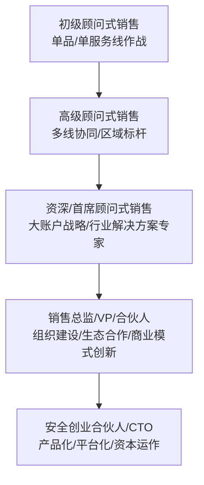

## 概述

**顾问式销售 / 技术型销售** 是网络安全行业（尤其是乙方安全服务/产品厂商）新兴的复合型关键岗位。其核心定位是：**打通售前技术支撑、销售业务推进、售后交付服务的全链路，以「懂业务痛点、懂销售方法论、懂技术价值转化」为核心竞争力，帮助客户构建安全体系，而非单纯推销产品/服务。**

> **文章来源**：301 公众号（301在路上）发布的《白帽子黑客浅谈顾问式销售与服务》及后续《安全顾问式销售，你感兴趣？》和读者问答讨论《讨论 | 安全行业的不归路，你怎么走？》。  
> **招聘联系**：301@allsec.cn（allsec 为安全创业公司，详见 [[security-startup-entrepreneurship-lessons]]）

---

## 角色定位：为何行业需要「顾问式销售」

### 传统模式的断层
- **纯技术售前**：懂技术、不懂业务场景与商业谈判，难以将技术能力转化为客户可感知的价值。
- **纯业务销售**：懂谈判、不懂技术本质，面对甲方安全负责人技术提问时信誉受损，无法深度挖掘需求。
- **纯售后交付**：项目制思维，缺乏账户运营与二次销售视角，客户全生命周期价值低。

### 顾问式销售的三位一体融合
| 维度 | 传统分工 | 顾问式销售融合要求 |
|------|----------|-------------------|
| **售前** | 方案编写、POC 演示 | **业务痛点挖掘 + 技术方案落地化表达 + 商业价值量化** |
| **销售** | 关系维护、投标报价 | **信任型销售 + 账户战略规划 + 竞品对抗策略** |
| **售后** | 项目交付、验收结项 | **持续服务运营 + 成果复用沉淀 + 续约/扩售线索挖掘** |

### 真正的安全顾问定义
> **「真正的安全顾问，更懂企业、懂行业、懂产品、懂技术转化的一群人。」**  
> —— 301

**核心区别**：
- **传统安全销售**：从产品介绍角度看，客户是「上帝」，只做基本产品/服务介绍；从定位看，打价格战、倒贴做案例，以销售为导向；从服务看，不参与实施，不关心售后体验。
- **顾问式销售**：客户定位为「朋友、队友」，双方共同利益群体；提供的是**价值而非产品/服务**；以**价值驱动**，解决企业真正痛点；站在客户角度，**先解决问题、再传递价值、引导达成合作**。

---

## 核心能力模型（四大核心素养）

文章明确提出顾问式销售需具备的四大核心能力：

### 安全评估与安全分析能力
- **核心**：了解目标对象所处行业领域、企业背景、部门职能、个人背景信息
- **基础功**：**信息收集能力**——解决服务对象与自身的信任问题
- **应用**：通过专业的安全评估与信息分析，建立专业信任基础

### 安全总结与实战能力
- **核心**：将信息源与安全领域结合，快速找到客户业务与安全的联系点
- **前提**：丰富的项目实战经历，透彻了解企业真实需求
- **输出**：安全总结能力——不同领域知识储备中的快速关联匹配

### 安全创造力与说服力
- **定位差异**：**不是「传达室」或「念稿者」，而是服务专家**
- **创造力**：站在企业位置创造安全价值，最大化挖掘有效价值信息，通过产品/服务创造新安全价值
- **说服力**：判断企业提出需求是否合理（大多为伪需求），引导企业了解真正需求，**帮助/说服企业看清真实需求**

### 预见未来安全需求的能力，价值持续
- **终极目标**：帮助企业预见未曾考虑的问题，建立长期安全信任关系
- **规划价值**：规划企业在安全领域的每一步如何走，如何通过产品/服务解决真正价值
- **核心信条**：**「原地踏步，就是退步」**——无论个人能力还是企业安全能力，都需保持价值持续输出

---

## 安全项目评估四步法（方法论核心）

### 步骤 1：安全需求是什么？
- **核心追问**：客户需要**实现什么目标，解决什么样的问题**？
- **判据**：真实需求不能偏离，是否偏离将决定解决问题思路和方法的有效性。

### 步骤 2：安全需求分析
- **核心追问**：企业为什么会提出这个需求？为什么采购安全产品/服务？**出发点是什么？**
- **定位**：安全需求判断分析是基本功，项目驱动力见「靠谱客户判断四维度」。

### 步骤 3：评估后的策略选择
- **三维结合**：
  1. **自身产品和服务价值**匹配度
  2. **项目实施方法、成本、可行性**全方位分析判断
  3. **售后消化交付能力**——项目确定后如何消化、售后如何解决、满足服务要求

### 步骤 4：购买的反馈及售后体验
- **痛点**：大部分销售订单搞定后不参与实施，不了解实施中发现的问题和新价值，无法保证质量和周期
- **后果**：**项目价值持续性难保证**，更谈不上真正有效的顾问价值
- **要求**：全程参与，沉淀反馈，形成闭环

---

## 靠谱客户/需求判断四维度

> **方法论本质通用**，可参考《如何(xuan)做(ze)一个靠谱的老大？》

### 维度 1：分析项目来源信息
- 了解项目来源，谁发起需求，需求是否真实
- **关键**：解决实际问题这是第一道关，**情报信息来源有误，决定项目/服务价值的生死**

### 维度 2：考量项目的出发点
- 没有项目无故发起，**发起原因最终会落实到真实需求上**

### 维度 3：企业/对方的需求分析
- 同评估四步法步骤 2，**懂客户/领导价值的人，才能走得更远**

### 维度 4：对项目整体购买力的判断
- **终极目标**：花多少钱做多少事情，**花小钱做大价值**
- **专业顾问标准**：用合理预算超出企业预期

---

## 90% 以上销售易犯的四大坑（反模式预警）

| 坑位 | 具体表现 | 后果 | 破局建议 |
|------|----------|------|----------|
| **坑 1：什么都能做** | 不懂客户/业务需求，随意承诺服务需求，「不管三七二十一，项目打下来再说」 | 交付崩盘、信誉破产 | **严守能力边界**，按「客户痛点→技术方案→商业结果」验证后再承诺 |
| **坑 2：交付时间随意承诺** | 为拿单压缩工期，导致实施压力大、售后体系混乱、服务人员骂声一片 | 销售与售后起冲突、交付质量失控 | **联合交付团队共同评估工期**，在合同中明确里程碑与验收标准 |
| **坑 3：不懂实施/服务流程** | 前期随意承诺，导致落地无着落，期望与现实差距大，满意度极差 | 项目烂尾、客户投诉 | **轮岗交付 1-2 个完整项目**，建立「承诺-交付」对照清单 |
| **坑 4：售后维保服务承诺失信** | 项目没做完企业/团队就挺了，或维保承诺兑现不了 | 品牌信用归零、法律风险 | **仅承诺资源范围内可兑现的服务**，建立服务兑现跟踪台账 |

> **301 原话**：「这种人就该 tjjtds（统计局特别调查队首字母缩写，网络用语意指『该处理』）」

---

## 经典段子复盘：售前与销售的协作反模式

> **IT 段子实录**：

> 安全售前开着车，安全销售扛着枪在副驾驶座上坐着。这就到了一片森林。安全售前把车停稳了，对安全销售说你去吧，我等着你的好消息。
> 
> 于是安全销售下了车。走进森林寻找猎物。不一会儿，安全售前听到远处「呯」一声枪响。紧接着就看到销售拖着枪正往车这边跑来。他后边一瘸一拐跟着一头受了伤的狗熊……
> 
> 情况万分紧急，售前连忙发动引擎，迎上去准备接上安全销售逃命。安全销售跑到了车门口，可狗熊也跟过来了！
> 
> 说时迟那时快，就见安全销售打开车门，身子一躲闪，顺势一把将追上来的狗熊推进了车里，然后「咣」一声将车门推上。车里头安全售前和狗熊就打起来了……
> 
> 车外安全销售此时不慌不忙地点上根烟，冲车里的安全售前说：「**兄弟，你把它搞定，我再去找下一头去。**」

**深度复盘**：
- **售前** = 交付/技术落地端，**被迫背锅、独自对抗风险（狗熊）**
- **销售** = 只管拿单、甩包袱，**专属技能：坑的一手好队友**
- **根因**：缺乏「顾问式」全链路思维，**销售不懂交付、售前不参与商务、售后无话语权**
- **顾问式销售的破局**：**同上车、同下车、同打熊、同分肉**——全流程共担风险与价值

> **原文警示**：「最后，别笑，**95% 以上的销售都是这样子的**。」

---

## 乙方从业者转型路径对照表（更新版）

| 现岗位 | 核心优势 | 补齐短板 | 推进行动（结合四大能力） |
|--------|----------|----------|--------------------------|
| **渗透测试/红队/漏洞挖掘** | 技术深度、攻击者视角、实战案例 | 业务话术、商业文书、账户规划、需求分析 | 1. 轮岗售前 3-6 个月<br>2. 考取 PMP/软考高级/TOGAF<br>3. 主导 2-3 个完整投标项目<br>4. 练习「技术指标→业务风险量化」翻译 |
| **安全服务项目经理/交付经理** | 交付流程、客户沟通、资源协调 | 主动挖掘需求、技术方案设计、竞品对抗、创造力说服 | 1. 学习主流安全产品架构与对标<br>2. 参与售前 POC 与方案评审<br>3. 输出 3 份可复用标准化服务包<br>4. 练习「预见未来需求」规划能力 |
| **售前工程师/解决方案架构师** | 方案设计、POC 技术攻关、产品知识 | 商业谈判、大客户关系、销售漏斗管理、购买力判断 | 1. 跟随资深销售全程参与 2 个大单<br>2. 系统学习销售方法论认证<br>3. 建立个人「客户痛点-技术方案-商业价值」案例库<br>4. 掌握「四维度判断靠谱客户」实操 |
| **渠道/大客户销售** | 客户关系、谈判节奏、回款意识 | 技术可信度、方案主导力、交付风控、实战总结能力 | 1. 考取 CISSP/CISP-PTE/红队认证<br>2. 深度参与 1-2 个复杂交付项目<br>3. 组建「虚拟售前小组」定期复盘技术难点<br>4. 补齐「安全评估分析」信息收集基本功 |

> **核心心法**：**「技术为骨，业务为肉，销售为魂，顾问为形」**——四位一体，缺一不可，入行顺序因人而异。

---

## 实战问答案例库：读者困惑与专家回复实录

以下案例源自 301 公众号后台真实留言与作者回复，呈现乙方从业者在角色定位、薪资预期、技能体系梳理上的典型困惑与破局建议。

### 案例 1：跨专业矿山安全管理专业 → 互联网安全
**背景**：大专学历，正在跨考计算机研究生，零计算机基础。  
**核心困惑**：如何踏入互联网安全？  
**专家回复**：
> **「找准自己喜欢的方向了，就好好去做，把业余时间都挤出来，别把时间浪费在不该浪费的经历和人身上。」**

**启示**：跨行入局需「单点突破 + 时间复利」，先选一个细分方向（如渗透、代审、合规、运营）深耕，用业余时间系统补齐 CS 基础（网络、操作系统、Web 原理），作品集/证书/靶场通关记录作为敲门砖。

---

### 案例 2：两年乙方驻场运营商项目经理，二线城市 7-8K，方向迷茫
**画像**：
- 运营商长期驻场，熟悉各类乙方厂商设备/工具
- 自学渗透 1 年+，参与安全合规及主机加固
- 多地级运营商服务项目经理经验，沟通能力强
- **困惑**：渗透 vs 安全服务 vs 售前 vs 售后，薪资偏低，不知如何定位

**专家回复要点**：
1. **薪资对标**：2 年乙方经验，二线城市 **9K 基本差不多**，当前 7-8K 低于市场均值。
2. **渗透方向判断**：纯工具驱动渗透思路有局限，驻场更多锻炼的是运维协调沟通，非核心攻击技术沉淀。
3. **核心建议**：
   > **「好好梳理下自己的知识体系吧，看看自己到底都掌握什么技能了，然后再看自己适合做什么。」**

**可执行的技能盘点清单（对标四大核心能力）**：
| 维度 | 自查问题 | 产出物 |
|------|----------|--------|
| 技术广度/实战能力 | 能否独立完成从信息收集到内网横向的完整渗透链？ | 靶场通关记录 / 实战渗透报告脱敏版 |
| 技术深度/创造力 | 对主流框架（Spring/ThinkPHP/Struts2）漏洞原理能否手写 Exp？ | 代码审计笔记 / 漏洞复现文档 |
| 合规/服务/需求分析 | 熟悉等保 2.0/关保/数据安全法测评要点？能否独立产出整改方案？ | 过往项目交付物脱敏版 |
| 售前/方案/策略选择 | 能否针对某行业输出「安全建设三年规划」PPT？ | 1-2 份行业解决方案草案 |
| 销售/谈判/购买力判断 | 是否完整经历过投标全流程（编标、澄清、开标、评标、谈判、签约）？ | 标书目录结构 / 谈判复盘笔记 |

**转型建议**：若倾向顾问式销售，建议先内部轮岗售前 3 个月，主导 1-2 个中型项目投标，补齐「方案包装+商业谈判」短板；若倾向技术深耕，集中 3 个月攻克一个细分方向（如内网渗透/代审/云安全），产出高含金量技术输出。

---

### 案例 3：北漂实习生，网康实验室实习 2000+/月，生存焦虑
**背景**：信息对抗专业大三，北京实习，月薪 2000 元勉强维持生存，质疑「实习生是最廉价劳动力」。  
**作者反向招聘**：
> **「网康实验室薪资这么低？？？求靠谱安全实习生（运营、销售方向），150-200/天。301@allsec.cn」**

**行业参考**：
- 一线城市安全类实习生日薪 **150-300 元/天** 较为常见（销售/运营/售前方向偏高，纯技术研发/渗透实习偏低）
- 建议：实习前明确 **「导师制培养计划 + 转正标准 + 薪资涨幅机制」**，避免陷入「廉价劳动力」陷阱；同步建立个人品牌（技术博客/公众号/知识星球），为后续跳槽积累筹码。

---

### 案例 4：薪资地域差异讨论——魔都 vs 帝都
**读言**：「魔都三年功能测试都有二十万……」  
**作者回应**：「现在魔都功能测试，3年经验有20万？虚高吧？」

**薪资现实校准（2023-2024 年参考）**：
| 岗位/经验 | 北京（头部厂商/独角兽） | 上海（头部厂商/独角兽） | 二线城市（省会/计划单列市） |
|-----------|---------------------------|---------------------------|-------------------------------|
| 渗透测试/红队 3 年 | 25-35K × 14-16 | 25-35K × 14-16 | 15-22K × 13-14 |
| 售前工程师 3 年 | 20-30K × 14-16 | 20-30K × 14-16 | 13-20K × 13-14 |
| 顾问式销售/大客户销售 3 年 | 底薪 15-25K + 高提成（年包 40-80 万+） | 同左 | 底薪 10-18K + 提成（年包 30-60 万） |
| 功能测试/安全测试 3 年 | 18-25K × 14-16 | 18-25K × 14-16 | 10-16K × 13-14 |

> **结论**：头部厂商薪资倒挂不明显，地域差异主要体现在房租/生活成本；**顾问式销售的上限取决于提成结构与大单能力，而非地域**。选择城市时应综合考量「行业集聚度 + 生活成本 + 家庭支持系统」，详见 [[security-career-city-choice]]。

---

### 案例 5：同行挖角 vs 创业招聘
**读者**：「有意向来我们公司面试吗？我们是一家从事网络安全的公司。」  
**作者反问**：「你们是哪家安全公司呀？我现在在创业，我招 HR 和销售，你跳槽吗？」

**职场启示**：
- 安全圈子小，**个人品牌与人脉网络** 是核心资产
- 创业期招聘更看重 **「全栈执行力 + 结果导向 + 低管理成本」**，而非单一技能证书
- 顾问式销售岗位常通过 **内推/熟人/社群直招** 而非公开 JD 流转

---

## 职业发展阶梯



### 关键里程碑指标（更新版：含实战薪资对标）
| 阶段 | 业绩指标 | 能力标志（对标四大核心能力） | 典型薪资区间（一线城市，含提成） |
|------|----------|--------------------------------|-----------------------------------|
| 初级 | 单年签单 300-500万 | 独立完成标书、POC、商务谈判；具备基础评估分析与需求分析能力 | 25-40 万 |
| 高级 | 单年签单 800-1500万 | 主导行业标杆案例、建立可复制打法；具备创造力说服与预见未来需求能力 | 45-70 万 |
| 资深 | 单年签单 2000万+ / 负责战略大客户 | 输出行业白皮书、主导生态合作、培养新人；四大能力全面成熟 | 70-120 万 |
| 管理/合伙人 | 团队业绩/利润中心负责人 | 组织架构设计、薪酬体系、资本对接；建立顾问式销售体系化能力 | 100 万+ / 股权激励 |

---

## 避坑指南：两大「反模式」标签（源自后续讨论文章）

文章明确指出，**具备以下两个标签者建议深度反思**，否则难以在顾问式销售赛道长跑：

| 标签 | 具体表现 | 破局建议 |
|------|----------|----------|
| **「懒惰」** | 不愿投入时间系统学习业务/销售/管理知识；依赖人脉/低价搞定单；拒绝复盘沉淀 | 1. 制定 **季度学习计划**（行业报告、销售书籍、竞品拆解）<br>2. 建立 **个人知识库**（Obsidian/Notion），沉淀话术库、案例库<br>3. 寻找 **导师/教练**，定期复盘单单得失 |
| **「胆小」** | 面对甲方高层不敢开口；遇技术质疑即退让；不敢推动内部资源协同；怕拒绝不敢追单 | 1. 刻意练习 **高风险对话**（角色扮演、录音复盘）<br>2. 积累 **小胜利**（先搞定 1 个非关键人，再突破关键人）<br>3. 重构心智：**「被拒绝是常态，搞定难题才是价值」** |

> **原文金句**：「既然选择了远方，选择了安全行业，走上这条不归路，就放手一搏，对得起青春。」

---

## 技能体系梳理实操模板（针对案例 2 类从业者）

建议每季度执行一次 **「技能雷达图自检」**，维度满分 10 分，目标：**核心维度 ≥ 7 分，短板维度 ≤ 3 个**。

```markdown
## 顾问式销售技能雷达自检表（示例）

### 技术价值转化/创造力说服（权重 30%）
- [ ] 漏洞/风险技术指标 → 业务风险量化（CVSS → 年化损失预期 ALE）  ____/10
- [ ] 主流安全产品/服务对标差异化话术库（竞品矩阵）  ____/10
- [ ] 至少 1 个行业标杆级 POC/方案落地复盘  ____/10
- [ ] 能否判断/引导客户伪需求 → 真需求（说服力实战案例）  ____/10

### 业务洞察与方案/评估分析（权重 25%）
- [ ] 目标行业合规法规/标准体系梳理（等保/关保/数据安全/行业规范）  ____/10
- [ ] 客户组织架构/采购流程/关键人地图（KPM）绘制能力  ____/10
- [ ] 可复用「行业解决方案白皮书/服务包」产出数量  ____/10
- [ ] 信息收集基本功：企业/行业/人背景挖掘效率与深度  ____/10

### 销售方法论与实战/策略选择购买力（权重 25%）
- [ ] 熟练运用 SPIN/MEDDIC/Challenger 至少 1 套框架  ____/10
- [ ] 完整大单投标复盘案例（含谈判博弈/回款节奏）  ____/10
- [ ] 个人年签单/回款/毛利达成率  ____/10
- [ ] 四维度判断靠谱客户（来源/出发点/需求/购买力）实操熟练度  ____/10

### 账户运营与生态协同/价值持续（权重 20%）
- [ ] 存量客户续约率/扩售率/推荐线索转化率  ____/10
- [ ] 内部资源协同案例（研发/交付/法务/市场联合作战）  ____/10
- [ ] 个人品牌/行业影响力（演讲/文章/社群/奖项）  ____/10
- [ ] 预见客户未来安全需求、规划多年安全建设路线图能力  ____/10

### 综合得分：____/100  |  目标：≥ 75 分
```

---

## 交叉引用：关联知识页面

### 职业成长案例库
- [[shanshan-cso-career-growth-story]] —— 白帽黑客到 CSO 的 7 年跨越，「一万小时定律」实践
- [[xiaoyang-whitehat-practitioner-profile]] —— 北漂自学、渗透实战、十九大安保、转型安全讲师全景画像
- [[whitehat-wuhan-epidemic-contribution-story]] —— 白帽子在重大公共事件中的价值实现路径
- [[security-career-city-choice]] —— 一线城市 vs 家乡就业的多维抉择因素与心声

### 组织与生态视角
- [[security-startup-entrepreneurship-lessons]] —— allsec 从 0 到 1 的团队建设、项目获取、业务模式抉择实录
- [[internal-vulnerability-disclosure-culture]] —— 安全团队与业务/HR/法务协作的健康机制建设
- [[mooncake-gate-security-ethics-analysis]] —— 技术伦理、责任漏洞披露、零容忍文化对职业生涯的深远影响

### 合规与自我保护
- [[security-practitioner-legal-compliance]] —— 授权测试、漏洞披露、数据合规、刑事证据规则全景合规指南
- [[hvv-blue-team-recruitment-standards]] —— 护网行动蓝军分级标准、薪资待遇、招聘流程参考

### 身心可持续
- [[security-practitioner-health-wellbeing]] —— 高压环境下健康作为核心职业资产的管理实践

---

## 行动清单：如果你决定尝试

1. **简历重构**：按「客户痛点 → 技术方案 → 商业结果 → 个人贡献」重写 3-5 个 STAR 案例
2. **知识补课**：
   - 书单：《SPIN 销售法》、《挑战式销售》、《大客户销售铁律》、《顾问式销售实战》
   - 认证：CISSP / CISP-PTE / PMP / TOGAF 9（按缺口择一）
3. **实战练兵**：
   - 主动申请参与 **1 个完整大客户投标全过程**（标书撰写、现场答辩、商务谈判）
   - 产出 **1 份行业解决方案白皮书**（如「某行业数据安全建设实践」），内部评审通过后对外发布
   - 练习 **「四步评估法」** 与 **「四维判断法」** 于 2-3 个真实/模拟项目中
4. **人脉拓展**：
   - 进入 2-3 个高质量安全销售/售前交流群（微信/钉钉/知识星球）
   - 约谈 3 位已在岗的资深顾问式销售/销售总监，复盘其成单关键动作
5. **投递与面试**：
   - 重点关注 **头部安全厂商（安恒、奇安信、启明星辰、深信服等）、快成长独角兽、专精特新专项赛道厂商** 的「解决方案销售/大客户销售/售前顾问」JD
   - 面试时主动提出：**「可先以项目制/顾问制试岗 1 个月，产出 1 份可交付方案包再定转正」**
6. **薪资谈判锚点**：
   - 底薪参考：一线城市 15-25K/月（初级-高级），二线 10-18K/月
   - 提成结构：签单额 2%-5% 或 回款额 3%-8%，含阶梯加速器
   - 要求书面约定：**「试用期全额底薪 + 提成同权、年终奖不打折、股权期权池额度」**

---

## 后续内容预告（源自原文）

1. **顾问式销售第二章** —— 深度拆解销售全流程关键动作、话术库、竞品对抗实战
2. **安全领域这些事情不要做** —— 行业反模式、职业红线、避坑指南进阶版

> 关注 **301在路上** 公众号获取首发更新。

---

## 结语

网络安全行业正从「技术驱动」向「价值驱动」跨越，**顾问式销售/技术型销售** 是连接技术能力与商业价值的关键枢纽。对于渴望突破纯技术天花板、拥抱业务复杂性、实现收入与影响力双重跃升的乙方从业者而言，这是一条 **「难但正确」** 的进阶之路。

> **招聘邀约依然有效**：若你沟通能力不错、对安全行业有热情、向往顾问式销售、拥有一颗不满足现状的心、执行力强，**欢迎发送简历至 301@allsec.cn**，我们可以好好聊聊。

---

*本页面基于 301 公众号文章《白帽子黑客浅谈顾问式销售与服务》《安全顾问式销售，你感兴趣？》及读者讨论《讨论 | 安全行业的不归路，你怎么走？》沉淀而成，持续更新中。欢迎通过交叉引用页面补充案例、话术库、薪资对标等一手资料。*

## 来源

- [301在路上-201508-202208_122](../sources/301在路上-201508-202208_122.md)
