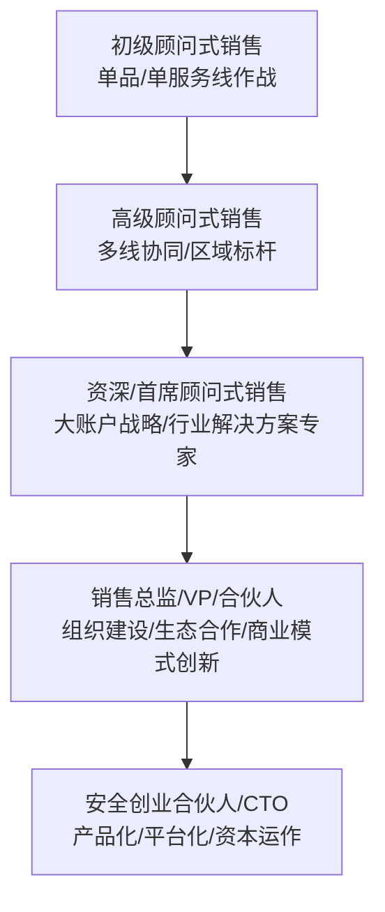

## 概述

**顾问式销售 / 技术型销售** 是网络安全行业（尤其是乙方安全服务/产品厂商）新兴的复合型关键岗位。其核心定位是：**打通售前技术支撑、销售业务推进、售后交付服务的全链路，以「懂业务痛点、懂销售方法论、懂技术价值转化」为核心竞争力，帮助客户构建安全体系，而非单纯推销产品/服务。**

> **文章来源**：301 公众号（301在路上）发布的《安全顾问式销售，你感兴趣？》，系对前文《白帽子黑客浅谈顾问式销售与服务》的延续与招聘号召。  
> **招聘联系**：301@allsec.cn（allsec 为安全创业公司，详见 [[security-startup-entrepreneurship-lessons]]）

---

## 角色定位：为何行业需要「顾问式销售」

### 传统模式的断层
- **纯技术售前**：懂技术、不懂业务场景与商业谈判，难以将技术能力转化为客户可感知的价值。
- **纯业务销售**：懂谈判、不懂技术本质，面对甲方安全负责人技术提问时信誉受损，无法深度挖掘需求。
- **纯售后交付**：项目制思维，缺乏账户运营与二次销售视角，客户全生命周期价值低。

### 顾问式销售的三位一体融合
| 维度 | 传统分工 | 顾问式销售融合要求 |
|------|----------|-------------------|
| **售前** | 方案编写、POC 演示 | **业务痛点挖掘 + 技术方案落地化表达 + 商业价值量化** |
| **销售** | 关系维护、投标报价 | **信任型销售 + 账户战略规划 + 竞品对抗策略** |
| **售后** | 项目交付、验收结项 | **持续服务运营 + 成果复用沉淀 + 续约/扩售线索挖掘** |

---

## 核心能力模型

### 业务洞察力
- 熟悉 **金融、能源、政企、互联网、制造** 等重点行业合规要求（等保、关保、数据安全、供应链安全等）
- 能将「漏洞扫描、渗透测试、红蓝对抗、安全运营」等技术动作映射为 **业务风险降低、合规达标、运营效率提升** 的客户语言

### 销售方法论
- 掌握 **SPIN / Challenger / MEDDIC** 等大客户销售框架
- 具备 **标书策划、竞品拆解、谈判博弈、回款管理** 实战经验
- 能建立 **关键人地图（KPM）**、推进多线程决策链

### 技术价值转化
- 拥有 **渗透测试 / 代码审计 / 应急响应 / 安全架构** 至少一项深度技术背景
- 能将技术指标（如漏洞数、覆盖率、MTTD/MTTR）翻译为 **ROI、风险敞口降低百分比、审计整改通过率** 等商业指标
- 具备 **安全产品化/服务标准化包装** 思维，输出可复制交付包

### 账户运营与生态协同
- 从「单项目交付」转向 **账户全生命周期管理（LTV 最大化）**
- 协同 **研发、交付、市场、法务** 等内部资源，构建联合作战单元
- 建立 **客户成功案例库、最佳实践白皮书、竞品对抗话术库** 等知识资产

---

## 乙方从业者转型路径对照表

| 现岗位 | 核心优势 | 补齐短板 | 推进行动 |
|--------|----------|----------|----------|
| **渗透测试/红队/漏洞挖掘** | 技术深度、攻击者视角、实战案例 | 业务话术、商业文书、账户规划 | 1. 轮岗售前 3-6 个月 2. 考取 PMP/软考高级/TOGAF 3. 主导 2-3 个完整投标项目 |
| **安全服务项目经理/交付经理** | 交付流程、客户沟通、资源协调 | 主动挖掘需求、技术方案设计、竞品对抗 | 1. 学习主流安全产品架构与对标 2. 参与售前 POC 与方案评审 3. 输出 3 份可复用标准化服务包 |
| **售前工程师/解决方案架构师** | 方案设计、POC 技术攻关、产品知识 | 商业谈判、大客户关系、销售漏斗管理 | 1. 跟随资深销售全程参与 2 个大单 2. 系统学习销售方法论认证 3. 建立个人「客户痛点-技术方案-商业价值」案例库 |
| **渠道/大客户销售** | 客户关系、谈判节奏、回款意识 | 技术可信度、方案主导力、交付风控 | 1. 考取 CISSP/CISP-PTE/红队认证 2. 深度参与 1-2 个复杂交付项目 3. 组建「虚拟售前小组」定期复盘技术难点 |

> **核心心法**：**「技术为骨，业务为肉，销售为魂」**——缺一不可，但入行顺序因人而异。

---

## 职业发展阶梯

### 关键里程碑指标
| 阶段 | 业绩指标 | 能力标志 | 典型薪资区间（一线城市，含提成） |
|------|----------|----------|-----------------------------------|
| 初级 | 单年签单 300-500万 | 独立完成标书、POC、商务谈判 | 25-40 万 |
| 高级 | 单年签单 800-1500万 | 主导行业标杆案例、建立可复制打法 | 45-70 万 |
| 资深 | 单年签单 2000万+ / 负责战略大客户 | 输出行业白皮书、主导生态合作、培养新人 | 70-120 万 |
| 管理/合伙人 | 团队业绩/利润中心负责人 | 组织架构设计、薪酬体系、资本对接 | 100 万+ / 股权激励 |

---

## 避坑指南：两大「反模式」标签

文章明确指出，**具备以下两个标签者建议深度反思**，否则难以在顾问式销售赛道长跑：

| 标签 | 具体表现 | 破局建议 |
|------|----------|----------|
| **「懒惰」** | 不愿投入时间系统学习业务/销售/管理知识；依赖人脉/低价搞定单；拒绝复盘沉淀 | 1. 制定 **季度学习计划**（行业报告、销售书籍、竞品拆解） 2. 建立 **个人知识库**（Obsidian/Notion），沉淀话术库、案例库 3. 寻找 **导师/教练**，定期复盘单单得失 |
| **「胆小」** | 面对甲方高层不敢开口；遇技术质疑即退让；不敢推动内部资源协同；怕拒绝不敢追单 | 1. 刻意练习 **高风险对话**（角色扮演、录音复盘） 2. 积累 **小胜利**（先搞定 1 个非关键人，再突破关键人） 3. 重构心智：**「被拒绝是常态，搞定难题才是价值」** |

> **原文金句**：「既然选择了远方，选择了安全行业，走上这条不归路，就放手一搏，对得起青春。」

---

## 交叉引用：关联知识页面

### 职业成长案例库
- [[shanshan-cso-career-growth-story]] —— 白帽黑客到 CSO 的 7 年跨越，「一万小时定律」实践
- [[xiaoyang-whitehat-practitioner-profile]] —— 北漂自学、渗透实战、十九大安保、转型安全讲师全景画像
- [[whitehat-wuhan-epidemic-contribution-story]] —— 白帽子在重大公共事件中的价值实现路径
- [[security-career-city-choice]] —— 一线城市 vs 家乡就业的多维抉择因素与心声

### 组织与生态视角
- [[security-startup-entrepreneurship-lessons]] —— allsec 从 0 到 1 的团队建设、项目获取、业务模式抉择实录
- [[internal-vulnerability-disclosure-culture]] —— 安全团队与业务/HR/法务协作的健康机制建设
- [[mooncake-gate-security-ethics-analysis]] —— 技术伦理、责任漏洞披露、零容忍文化对职业生涯的深远影响

### 合规与自我保护
- [[security-practitioner-legal-compliance]] —— 授权测试、漏洞披露、数据合规、刑事证据规则全景合规指南
- [[hvv-blue-team-recruitment-standards]] —— 护网行动蓝军分级标准、薪资待遇、招聘流程参考

### 身心可持续
- [[security-practitioner-health-wellbeing]] —— 高压环境下健康作为核心职业资产的管理实践

---

## 行动清单：如果你决定尝试

1. **简历重构**：按「客户痛点 → 技术方案 → 商业结果 → 个人贡献」重写 3-5 个 STAR 案例
2. **知识补课**：
   - 书单：《SPIN 销售法》、《挑战式销售》、《大客户销售铁律》、《顾问式销售实战》
   - 认证：CISSP / CISP-PTE / PMP / TOGAF 9（按缺口择一）
3. **实战练兵**：
   - 主动申请参与 **1 个完整大客户投标全过程**（标书撰写、现场答辩、商务谈判）
   - 产出 **1 份行业解决方案白皮书**（如「某行业数据安全建设实践」），内部评审通过后对外发布
4. **人脉拓展**：
   - 进入 2-3 个高质量安全销售/售前交流群（微信/钉钉/知识星球）
   - 约谈 3 位已在岗的资深顾问式销售/销售总监，复盘其成单关键动作
5. **投递与面试**：
   - 重点关注 **头部安全厂商（安恒、奇安信、启明星辰、深信服等）、快成长独角兽、专精特新专项赛道厂商** 的「解决方案销售/大客户销售/售前顾问」JD
   - 面试时主动提出：**「可先以项目制/顾问制试岗 1 个月，产出 1 份可交付方案包再定转正」**

---

## 结语

网络安全行业正从「技术驱动」向「价值驱动」跨越，**顾问式销售/技术型销售** 是连接技术能力与商业价值的关键枢纽。对于渴望突破纯技术天花板、拥抱业务复杂性、实现收入与影响力双重跃升的乙方从业者而言，这是一条 **「难但正确」** 的进阶之路。

> **招聘邀约依然有效**：若你沟通能力不错、对安全行业有热情、向往顾问式销售、拥有一颗不满足现状的心、执行力强，**欢迎发送简历至 301@allsec.cn**，我们可以好好聊聊。

---

*本页面基于 301 公众号文章《安全顾问式销售，你感兴趣？》沉淀而成，持续更新中。欢迎通过交叉引用页面补充案例、话术库、薪资对标等一手资料。*

## 来源

- [301在路上-201508-202208_059](../sources/301在路上-201508-202208_059.md)
