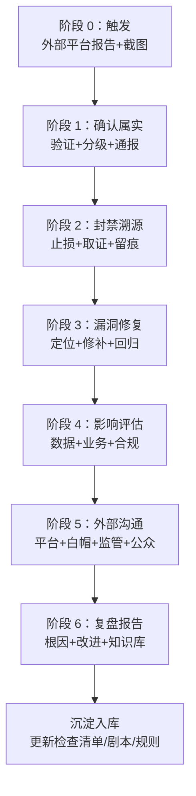

## 页面导读

本页面基于 **301在路上（杨蔚）微信公众号 2016 年核心文章**《安全观点：95%的人处理不好的安全问题——Webshell应急响应实战讨论》整理沉淀。原文以某大厂安全实习生面试题为引——**“外部某平台报告，公司网站被黑客上传了 webshell 并且截图证明。老板指定你为安全工程师，全权协调处理此事，请思考，你需要做些什么？”**——征集并整理了 11 位不同角色从业者的实战处置思路。

本页面将零散的 11 则回答**重构为六阶段标准化应急响应流程**，并提炼出**可落地的检查清单**，同时建立与知识库既有技术页面的交叉引用，形成「决策全景 → 技术落地 → 工具链支撑」的立体知识体系。

> **来源归档**：[[301-zai-lushang-wechat-archive-201508-202208]]（301在路上微信归档索引页，含本文原文链接）

---

## 一、 事件背景与核心挑战

### 面试题原文

> **外部某平台报告，公司网站被黑客上传了 webshell 并且截图证明。老板指定你为安全工程师，全权协调处理此事，请思考，你需要做些什么？**

### 核心考察点

- **紧急事件处理方法论**：是否具备标准化、可复用的应急响应流程
- **跨部门协调能力**：技术排查、业务沟通、对外公关、向上汇报的统筹
- **证据保全与溯源意识**：在「删 shell」与「留证据」的博弈中取舍
- **业务连续性判断**：何时停机、何时降级、何时切换备用站点
- **外部生态协作**：与 SRC 平台、白帽子、第三方平台的沟通规范
- **复盘沉淀文化**：事后报告是否包含根因分析、改进措施、知识库更新

### 11 位从业者角色画像

| 编号 | 角色标签 | 核心视角关键词 |
|------|----------|----------------|
| 0x01 | SRC 榜单杀手 | 删 shell → 排查漏洞 → 保留证据 → 追责 → 加强管理 |
| 0x02 | 女白帽 | 先修漏洞 → 对外端正态度 → 内部案例化 → 规范操作 |
| 0x03 | 典型乙方 | 众测项目 + 整改项目 + WAF 采购 + HC 申请 → 报老板审批 |
| 0x04 | 技术派（详尽） | 分两种情况（黑客自报/白帽子报告）→ 屏蔽外网 → 溯源日志 → 联系提交者 → 评估损失 → 报警 → 送礼品鼓励 |
| 0x05 | 实战派 | 确定黑客身份/目的/脱裤/入侵时间/漏洞点 → 修补方案 → 改密码 → 排查同类漏洞 → 协助修补 → 写报告 → 提升意识 |
| 0x06 | 典型大型甲方 | 联系平台获取详情 → 调查影响 → 引导白帽子进自家 SRC → 发放奖励 |
| 0x07 | 技术态度派（最详尽） | 无详细报告先沟通 → 删 shell → Linux 日志分析 → 代码打包脱机检测 → 系统日志定位入侵程度 → netstat 进程/端口 → 数据库日志 → Rootkit 分析 → 定位漏洞类型 → 出具全维度报告 |
| 0x08 | 渗透测试视角 | 联系平台获取详情 → 还原漏洞/检测隐患/清除后门 → 写渗透测试报告给老板和开发/运维 |
| 0x09 | 流程派 | 判断能否立即解决 → 联系外部平台沟通意向 → 综合解决 → 汇总报告提交领导 |
| 0x0a | 业务连续性派 | 持续谈判获取信息 → 修改备用站点密码/备份/切换 → 牺牲部分业务启用强策略 → 定位漏洞解决 |
| 0x0b | 猎头/野路子 | 邀请漏洞提交者喝酒谈心 → 职位合适则挖走 |

---

## 二、 六阶段标准化应急响应流程

将上述 11 视角映射到 **PDCA 风格的六阶段模型**，每阶段给出**核心动作、关键决策点、产出物、交叉引用技术页**。



### 阶段 1：确认属实 —— 验证、分级、首轮通报

| 核心动作 | 关键决策点 | 产出物 | 代表视角 | 交叉引用 |
|----------|------------|--------|----------|----------|
| 1.1 联系报告平台获取完整漏洞详情（PoC、路径、参数、时间戳） | 平台是否提供完整报告？无则需主动索取 | 漏洞详情记录单 | 0x04, 0x06, 0x08 | [[vulnerability-mining-recon-aiqicha-fofa]]（资产测绘验证） |
| 1.2 内部复现验证：搭建隔离环境还原漏洞，确认 webshell 真实存在 | 能否在非生产环境复现？ | 验证报告（含截图、日志） | 0x01, 0x07, 0x08 | [[php-webshell-fundamentals-chopper-analysis]]（Webshell 连接验证） |
| 1.3 按影响范围/数据敏感度/业务关键度分级（P0/P1/P2） | 是否涉及核心数据/核心业务/合规红线？ | 事件分级单+升级通知名单 | 0x05, 0x09 | [[threat-attribution-tracing-techniques]]（初步研判） |
| 1.4 首轮内部通报：老板、安全部门负责人、业务负责人、法务/合规、公关 | 是否启动重大安全事件响应机制？ | 首轮通报邮件/会议纪要 | 0x03, 0x09 | [[redteam-hw-opsec-guidelines]]（内部通报 OPSEC） |

> **检查清单 1**：□ 平台联系人/渠道确认 □ PoC 完整性评估 □ 隔离环境复现步骤文档化 □ 分级标准引用公司制度 □ 通报名单覆盖技术/业务/法务/公关

---

### 阶段 2：封禁溯源 —— 止损、取证、留痕

| 核心动作 | 关键决策点 | 产出物 | 代表视角 | 交叉引用 |
|----------|------------|--------|----------|----------|
| 2.1 **止损优先**：若确认高危，立即屏蔽外网访问或切换维护页/备用站点 | 业务可接受的最大停机窗口？是否有热备/冷备？ | 止损操作记录（时间、命令、执行人） | 0x04, 0x0a, 0x07 | [[xd-security-incident-response-notes]]（Webshell 排查溯源实战） |
| 2.2 **保留现场**：镜像磁盘、导出内存、备份关键日志（Web/系统/数据库/防火墙/WAF） | 取证前是否已通知法务/确保证据链完整？ | 取证清单+哈希值记录 | 0x01, 0x04, 0x07 | [[backdoor-persistence-techniques]]（后门持久化痕迹识别） |
| 2.3 **Webshell 定位与清除**：按截图路径/日志分析定位 shell 文件，记录后删除/隔离 | 是否存在多个 shell/变种/内存马？ | Webshell 清除记录（路径、MD5、时间、关联进程） | 0x01, 0x07, 0x04 | [[php-webshell-fundamentals-chopper-analysis]]（一句话木马/哥斯拉/蚁剑流量特征） |
| 2.4 **溯源分析**：<br>• Web 访问日志（高频 IP、异常 UA、POST 载荷）<br>• 系统日志（SSH 登录、计划任务、进程创建）<br>• 数据库日志（异常查询、UDF 创建、binlog）<br>• 网络流量（PCAP 回溯、C2 通信特征）<br>• 文件系统（时间线、SUID/SetGID、隐藏文件、Rootkit） | 是否发现横向移动/提权/数据窃取/持久化？ | 溯源分析报告（攻击链重构、IOC 列表、ATT&CK 映射） | 0x04, 0x07, 0x05 | [[threat-attribution-tracing-techniques]]（IP 定位/钓鱼反查/VPS 渗透/样本沙箱/主机入侵排查/流量回溯）<br>[[xd-security-incident-response-notes]]（日志分析/Webshell 查杀/进程网络文件执行记录） |
| 2.5 **同类资产排查**：FOFA/ZoomEye/灯塔系统/资产台账 → 全网同类组件/代码/配置自查 | 是否存在同款漏洞的其他资产？ | 受影响资产清单+修复优先级 | 0x05, 0x07 | [[vulnerability-mining-recon-aiqicha-fofa]]（FOFA 语法/灯塔系统/Wappalyzer 指纹） |

> **检查清单 2**：□ 止损动作有审批/记录/可回滚 □ 磁盘镜像/内存 dump/日志导出哈希留存 □ Webshell 样本提交沙箱/威胁情报平台 □ 日志分析覆盖 Web/系统/数据库/网络/文件系统 □ IOC 输出格式标准化（STIX/OpenIOC/自定义 CSV） □ 全网同类资产排查脚本化/自动化

---

### 阶段 3：漏洞修复 —— 定位、修补、回归

| 核心动作 | 关键决策点 | 产出物 | 代表视角 | 交叉引用 |
|----------|------------|--------|----------|----------|
| 3.1 **根因定位**：代码审计/配置审计/架构复盘 → 确认漏洞类型（上传绕过、SQLi、RCE、反序列化、逻辑缺陷等） | 是业务代码/框架/中间件/供应链/配置哪一层？ | 根因分析文档（含代码行号/配置项/架构图标注） | 0x04, 0x07, 0x05, 0x08 | [[code-audit-file-upload-vulnerabilities]]（文件上传白盒审计）<br>[[code-audit-global-protection-blindspots]]（全局防护盲点）<br>[[thinkphp5-deserialization-chain-analysis]]（框架反序列化链） |
| 3.2 **修补方案设计**：<br>• 代码层：输入校验/输出编码/最小权限/安全框架升级<br>• 配置层：禁用危险函数/目录执行权限/WAF 规则/中间件加固<br>• 架构层：上传隔离存储/内容检测/CDN WAF/零信任网关 | 修补是否引入新风险/兼容性问题？是否需灰度/回滚预案？ | 修补设计文档+测试用例+回滚预案 | 0x02, 0x05, 0x07 | [[php-application-security-hardening]]（PHP 7 安全加固）<br>[[nginx-security-hardening-guide]] / [[apache-security-hardening-guide]]（中间件加固）<br>[[java-arbitrary-file-upload-mitigation]]（Java 上传修复） |
| 3.3 **修补实施与回归**：灰度发布 → 自动化回归测试 → 手工复现验证 → WAF 规则验证 → 红队复测 | 回归测试覆盖率？红队复测是否通过？ | 修补发布记录+回归测试报告+红队复测结果 | 0x02, 0x08 | [[xd-security-waf-bypass-techniques-day46-49]]（WAF 绕过验证视角） |
| 3.4 **同类漏洞批量修复**：将根因模式化为检测规则（SAST/DAST/IAST/语义 grep），全代码库/配置库扫描修复 | 是否建立「漏洞模式 → 修复模板」知识库？ | 批量修复清单+规则入库记录 | 0x05 | [[oasys-system-code-audit]]（MyBatis/Fastjson/文件上传/越权/任意文件读取/XSS 批量审计案例） |

> **检查清单 3**：□ 根因分析到代码行/配置项级别 □ 修补方案经架构/开发/运维/安全多方评审 □ 灰度/回滚预案已演练 □ 回归测试含正向/逆向/边界/并发用例 □ 红队复测无绕过 □ 漏洞模式入库（规则 ID、匹配样例、修复模板、负责人）

---

### 阶段 4：影响评估 —— 数据、业务、合规

| 核心动作 | 关键决策点 | 产出物 | 代表视角 | 交叉引用 |
|----------|------------|--------|----------|----------|
| 4.1 **数据影响**：结合溯源日志 + 数据库审计 + 文件系统时间线 → 判断是否脱裤/篡改/删除/加密 | 是否触发《网络安全法》/GDPR/行业合规通报义务？ | 数据影响评估报告（表级/字段级/记录级） | 0x04, 0x05, 0x07 | [[threat-attribution-tracing-techniques]]（主机入侵排查/流量回溯） |
| 4.2 **业务影响**：停机时长/功能降级/用户投诉/收入损失/品牌声誉 | 是否需启动业务连续性计划（BCP）/灾备切换？ | 业务影响量化报告 | 0x0a, 0x03 | [[redteam-hw-opsec-guidelines]]（业务连续性视角） |
| 4.3 **合规/法律影响**：监管通报时限/证据保全/配合调查/潜在罚款/民事赔偿 | 法务是否介入？是否需报警/通报监管？ | 合规风险清单+通报时间表 | 0x04, 0x03 | [[whitehat-arrest-baihe-case]]（白帽子法律风险/行业自律参考） |
| 4.4 **攻击者画像与威胁情报关联**：IOC 碰撞威胁情报库（TTP、组织、动机、关联活动） | 是定向攻击/APT/犯罪团伙/脚本小子/内部人员？ | 威胁情报研判简报 | 0x04, 0x07 | [[threat-attribution-tracing-techniques]]（攻击者 ID 画像/社工库碰撞/恶意样本分析）<br>[[competitor-cyber-espionage-kumi-case]]（商业间谍溯源案例） |

> **检查清单 4**：□ 数据影响逐表/逐字段确认 □ 业务影响有量化指标（RPO/RTO/收入/用户数） □ 合规通报义务逐条核对（网安法/个信法/行业规范） □ 威胁情报关联输出 ATT&CK TTP 映射表

---

### 阶段 5：外部沟通 —— 平台、白帽、监管、公众

| 核心动作 | 关键决策点 | 产出物 | 代表视角 | 交叉引用 |
|----------|------------|--------|----------|----------|
| 5.1 **平台反馈**：向报告平台同步验证结果、修复进度、致谢、奖励发放 | 平台是否有 SLA/奖励规则？是否需补全自家 SRC 流程？ | 平台反馈记录+奖励发放凭证 | 0x06, 0x04, 0x02 | [[360bugcloud-vulnerability-response-platform]]（SRC 平台建设案例）<br>[[bug-bounty-program-history-evolution]]（赏金计划演变） |
| 5.2 **白帽子/研究员协作**：邀请复测、技术细节交流、引导进自家 SRC、长期关系维护 | 是否签署 NDA/授权测试协议？ | 协作记录+授权协议+复测报告 | 0x06, 0x04, 0x0b | [[xd-security-src-vulnerability-hunting-notes-day86-88]]（教育 SRC/CNVD 挖掘技巧） |
| 5.3 **监管/行业通报**（如达标）：按法定时限/格式上报，配合调查 | 法务主导，技术配合取证/说明 | 监管通报文件+配合记录 | 0x04, 0x03 | [[whitehat-arrest-baihe-case]]（法律授权/行业自律） |
| 5.4 **公众/用户侧沟通**（如涉及用户数据）：公告/通知/补偿/客服话术/媒体应对 | 公关主导，技术提供口径/技术细节脱敏 | 对外公告+客服 FAQ+媒体问答集 | 0x02, 0x03 | [[redteam-hw-opsec-guidelines]]（对外口径 OPSEC） |

> **检查清单 5**：□ 平台反馈在 SLA 内完成 □ 白帽子奖励发放合规（税务/发票/NDA） □ 监管通报格式/时限/密级均合规 □ 对外口径经法务/公关/技术三方审核 □ 用户通知含风险说明/防护建议/投诉渠道

---

### 阶段 6：复盘报告 —— 根因、改进、知识库

| 核心动作 | 关键决策点 | 产出物 | 代表视角 | 交叉引用 |
|----------|------------|--------|----------|----------|
| 6.1 **全周期复盘会**：全员参与（安全/开发/运维/业务/法务/公关），按时间线复盘每阶段得失 | 是否引入无责复盘文化？ | 复盘会议纪要+行动项清单 | 0x02, 0x05, 0x08, 0x09 | [[xd-security-incident-response-notes]]（应急响应标准流程/自动化工具箱） |
| 6.2 **根因分析（RCA）**：5 Why / 鱼骨图 / 故障树 → 触达制度/流程/架构/文化层面 | 是否止步于技术层面？ | RCA 文档（含系统性根因分类） | 0x07, 0x05 | [[logic-vulnerability-password-reset-audit]]（逻辑漏洞 RCA 方法论） |
| 6.3 **改进措施落地**：<br>• 技术：规则/工具/平台/自动化<br>• 流程：SLA/审批/演练/清单<br>• 人员：培训/考核/红蓝对抗/认证<br>• 制度：奖惩/预算/采购/供应链 | 每条措施有责任人/截止日/验收标准/预算？ | 改进计划表（PDCA 闭环） | 0x02, 0x03, 0x05 | [[security-study-group-methodology]]（零基础培训体系）<br>[[cybersecurity-interview-guide-2022]]（面试题库沉淀） |
| 6.4 **知识库沉淀**：<br>• 更新本检查清单/剧本<br>• 入库 IOC/规则/PoC/脚本<br>• 案例库脱敏入库<br>• 培训教材更新 | 是否建立「事件 → 知识资产」自动化流水线？ | 知识库变更记录+版本号 | 0x08, 0x07 | [[xd-security-pentest-course-curriculum]]（课程资料迭代）<br>[[0x00lab-wechat-archive-202108-202304]]（归档索引更新机制） |

> **检查清单 6**：□ 复盘会在 5 个工作日内完成 □ RCA 触达非技术根因 □ 改进措施全 SMART 原则 □ 知识库更新纳入定期巡检指标

---

## 三、 11 视角融合对照表：谁在哪阶段贡献了什么

| 阶段 | 0x01 SRC杀手 | 0x02 女白帽 | 0x03 乙方 | 0x04 技术派 | 0x05 实战派 | 0x06 大型甲方 | 0x07 技术态度派 | 0x08 渗透视角 | 0x09 流程派 | 0x0a 业务派 | 0x0b 猎头 |
|------|--------------|-------------|-----------|-------------|-------------|---------------|-----------------|---------------|-------------|-------------|-----------|
| 1 确认 | ✓验证 | | | ✓分两种情况 | ✓确定细节 | ✓联系平台 | ✓沟通了解环境 | ✓联系平台获取详情 | ✓判断能否立即解决 | | |
| 2 封禁溯源 | ✓删shell/留证据 | | | ✓屏蔽外网/日志/联系提交者 | ✓排查业务机器 | | ✓极详尽技术溯源 | ✓还原漏洞/清除后门 | | ✓切换备用站点 | |
| 3 漏洞修复 | ✓排查漏洞位置 | ✓先处理漏洞 | ✓整改项目 | ✓推测漏洞点/修复 | ✓制定修补方案/协助修补 | | ✓定位问题代码/修复加固 | ✓检测其他隐患 | | ✓定位漏洞解决 | |
| 4 影响评估 | ✓留意过激行为 | | ✓众测项目 | ✓评估损失/报警 | ✓确定脱裤/损失 | ✓调查影响 | ✓定位入侵程度/Rootkit | | | ✓牺牲部分业务 | |
| 5 外部沟通 | | ✓对外端正态度 | ✓WAF采购/HC | ✓感谢/送礼品/鼓励 | ✓写安全报告 | ✓引导进自家SRC/发奖励 | ✓出具报告 | ✓写渗透报告给老板开发 | ✓联系外部平台沟通 | ✓持续谈判获取信息 | ✓邀请喝酒/挖人 |
| 6 复盘报告 | ✓加强管理 | ✓内部案例化/规范操作 | ✓报老板审批 | ✓报告含过程/程度/时间/IP/代码/修复 | ✓写报告/提升意识 | | ✓出具全维度报告 | ✓报告给老板开发运维 | ✓汇总报告提交领导 | | |

> **阅读指引**：横向看某视角的完整链路；纵向看某阶段的多视角补全度。0x07（技术态度派）覆盖度最高，0x03（乙方）视角最独特（预算/项目化），0x0a（业务派）补全业务连续性，0x0b（猎头）补全人才视角。

---

## 四、 落地交付物模板库（可直接复用）

### 事件分级单（阶段 1 产出）

```markdown
# 安全事件分级单 - [事件编号]

## 基本信息
- 发现时间：YYYY-MM-DD HH:MM
- 发现渠道：外部平台/白帽子/内部监控/用户投诉
- 报告平台/人员：[平台名称/联系人/联系方式]
- 初步判断漏洞类型：[文件上传/SQLi/RCE/反序列化/逻辑缺陷/其他]
- 受影响系统：[系统名称/URL/IP/业务归属/数据敏感度]

## 分级判定（参考公司《安全事件分级标准》）
| 维度 | 评分 (1-5) | 说明 |
|------|------------|------|
| 数据敏感度 |   | 核心用户数据/源码/凭证/财务/其他 |
| 业务关键度 |   | 核心交易/用户中心/内部管理/边缘服务 |
| 影响范围 |   | 单机/集群/全网/供应链 |
| 利用难度 |   | 无需认证/低权限/高权限/内网/物理 |
| 是否在野利用 |   | 已证明/疑似/否 |
| 合规触发 |   | 网安法/个信法/行业规范/否 |

**综合等级**：P0 / P1 / P2 / P3
**升级通知名单**：[姓名/角色/通知时间/方式]
```

### 取证清单（阶段 2 产出）

```markdown
# 取证清单 - [事件编号]

## 磁盘镜像
- [ ] 系统盘 dd 镜像 → 存储路径 / SHA256
- [ ] 数据盘 dd 镜像 → 存储路径 / SHA256

## 内存镜像
- [ ] 完整物理内存 dump → 存储路径 / SHA256
- [ ] 关键进程内存 (pid=xxx) → 存储路径 / SHA256

## 日志导出 (含时间范围/哈希)
- [ ] Web 访问日志 (Nginx/Apache/IIS/Tomcat)
- [ ] Web 错误日志
- [ ] 应用框架日志 (Laravel/ThinkPHP/Spring/Node.js 等)
- [ ] 系统认证日志 (/var/log/secure, /var/log/auth.log, Windows Security Event)
- [ ] 系统操作日志 (/var/log/messages, syslog, Windows System/Application Event)
- [ ] 数据库审计日志 (MySQL general_log/slow_log/binlog, MSSQL Trace, Oracle AUD$)
- [ ] 数据库错误日志
- [ ] 防火墙/WAF 日志
- [ ] 流量包 (PCAP, 关键时间窗口/全量)
- [ ] 容器/K8s 审计日志 (如适用)

## 文件系统时间线
- [ ] 时间范围内创建/修改/访问的文件 (fls/mactime/Plaso)
- [ ] 可疑文件 (Webshell/后门/工具/脚本) 样本提交沙箱/威胁情报平台

## 网络连接/进程快照
- [ ] netstat -antulp / ss -antulp 输出
- [ ] ps aux / tasklist / Get-Process 输出
- [ ] lsof -i / Get-NetTCPConnection 输出
```

### 溯源分析报告模板（阶段 2 核心产出）

```markdown
# 溯源分析报告 - [事件编号]

## 攻击链重构 (ATT&CK 映射)
| 战术 | 技术编号 | 技术名称 | 观测到的行为/证据 | 置信度 |
|------|----------|----------|-------------------|--------|
| Initial Access | T1190 | Exploit Public-Facing Application | Web 日志显示 POST /upload.php 携带恶意文件 | High |
| Execution | T1059.007 | Command and Scripting Interpreter: JavaScript/PHP/Python | Webshell 执行 system("id") | High |
| Persistence | T1505.003 | Server Software Component: Web Shell | 发现 /var/www/html/images/shell.php | High |
| Privilege Escalation | T1068 | Exploitation for Privilege Escalation | 脏牛 (CVE-2016-5195) 提权至 root | Medium |
| Defense Evasion | T1070.004 | Indicator Removal: File Deletion | access.log 中删除了攻击 IP 相关行 | Medium |
| Credential Access | T1003.001 | OS Credential Dumping: LSASS Memory | 发现 mimikatz 输出文件 /tmp/cred.txt | Low |
| Discovery | T1083 | File and Directory Discovery | Webshell 执行 ls -la /home/ | High |
| Lateral Movement | T1021.004 | Remote Services: Pass the Hash | 无证据 | - |
| Collection | T1005 | Data from Local System | 发现打包好的数据库导出文件 /tmp/dump.sql.gz | High |
| Exfiltration | T1041 | Exfiltration Over Command and Control Channel | 流量包显示向 203.0.113.45:443 传输大量数据 | High |

## IOC 列表 (标准化导出)
- **IP**：203.0.113.45 (C2), 198.51.100.12 (攻击源)
- **Domain**：evil.example.com (C2)
- **File Hash (SHA256)**：a1b2c3... (shell.php), d4e5f6... (mimikatz.exe)
- **URL Path**：/upload.php, /images/shell.php, /api/backup
- **User-Agent**：Mozilla/5.0 (compatible; AttackTool/1.0)
- **Email**：attacker@protonmail.com (如泄露)
- **Crypto Wallet**：0x... (如勒索)

## 关键时间线
| 时间 | 事件 | 数据源 | 备注 |
|------|------|--------|------|
| 2024-01-15 02:13:07 | 首次上传 Webshell | Nginx access.log | IP 198.51.100.12 |
| 2024-01-15 02:15:22 | Webshell 首次交互执行 id | Nginx access.log + shell.php 内容 | |
| 2024-01-15 02:20:01 | 尝试脏牛提权 | auth.log (失败) + /tmp/exploit.c | |
| 2024-01-15 02:35:10 | 提权成功，写入 root crontab | crontab -l + /var/spool/cron/root | |
| 2024-01-15 03:00:00 | 打包数据库导出 | 进程树 + /tmp/dump.sql.gz | |
| 2024-01-15 03:15:00 | 数据外传 | PCAP + 防火墙日志 | 共 2.3 GB |
```

### 复盘报告大纲（阶段 6 最终交付）

```markdown
# 安全事件复盘报告 - [事件编号]

## 事件摘要
- 事件编号/标题
- 发生/发现/通报/处置/关闭时间
- 影响等级/业务影响/数据影响/合规影响
- 直接责任人/复盘主持人/参会名单

## 时间线全景 (含各阶段关键节点与耗时)
| 阶段 | 启动时间 | 完成时间 | 耗时 | 关键产出 | 偏差说明 |
|------|----------|----------|------|----------|----------|
| 确认属实 | | | | 分级单/验证报告 | |
| 封禁溯源 | | | | 取证清单/溯源报告/IOC | |
| 漏洞修复 | | | | 修补设计/回归报告/红队复测 | |
| 影响评估 | | | | 数据/业务/合规/威胁情报报告 | |
| 外部沟通 | | | | 平台反馈/白帽协作/监管通报/公众公告 | |
| 复盘报告 | | | | 本文档 | |

## 根因分析 (RCA)
### 技术根因
- 直接原因：[代码缺陷/配置错误/架构缺陷/供应链/零日]
- 代码/配置/架构定位：[文件:行号/配置项/组件版本]
### 制度/流程根因 (5 Why)
1. Why 代码上线未拦截？→ 代码审计未覆盖该模块/规则库缺失
2. Why 规则库缺失？→ 漏洞模式未入库/入库流程断裂
3. Why 入库流程断裂？→ 无专人负责/无SLA/无考核
4. Why 无专人/无考核？→ 安全团队编制/预算/优先级不足
5. Why 优先级不足？→ 业务侧未量化安全风险/董事会未纳入KPI
### 组织/文化根因
- 安全话语权/安全左移落地度/红蓝对抗常态化/激励机制/人才梯队

## 改进措施 (SMART)
| 编号 | 措施描述 | 类型(技术/流程/人员/制度) | 责任人 | 截止日 | 验收标准 | 预算/资源 | 进度 |
|------|----------|---------------------------|--------|--------|----------|-----------|------|
| IMP-001 | 补充文件上传类漏洞 SAST 规则 15 条 | 技术 | 安全工程师A | 2024-02-15 | 规则入库/回归通过/历史漏洞复现拦截 | 0.5 人周 | 进行中 |
| IMP-002 | 建立「漏洞模式→修复模板」知识库入库 SLA 24h | 流程 | 安全运营负责人 | 2024-03-01 | 文档发布/培训完成/首次入库案例 | 1 人周 | 未启动 |
| ... | ... | ... | ... | ... | ... | ... | ... |

## 知识库沉淀清单
- [ ] 本检查清单版本升级 (vX.Y → vX.Y+1)
- [ ] IOC 入库威胁情报平台 (IOC-2024-XXXX)
- [ ] 检测规则入库 (WAF/EDR/NDR/SAST/DAST/IAST)
- [ ] PoC/EXP/修复脚本入库 GitLab 安全仓库
- [ ] 脱敏案例入库内部案例库 (CASE-2024-XXXX)
- [ ] 培训教材/桌面推演剧本更新
- [ ] 面试题库新增实战题 (参考 [[cybersecurity-interview-guide-2022]])

## 附件
- 完整时间线 CSV
- 溯源分析报告全文
- 修补代码 diff / 配置变更记录
- 监管通报/公众公告/白帽奖励凭证
- 复盘会议录音/纪要
```

---

## 五、 关键技术页交叉引用速查表

| 场景 | 需要的技术能力 | 知识库现有页面 |
|------|----------------|----------------|
| Webshell 识别/清除/流量分析 | 一句话木马/哥斯拉/蚁剑/内存马/.user.ini/.htaccess/PHAR 持久化 | [[php-webshell-fundamentals-chopper-analysis]] |
| 文件上传漏洞白盒审计/批量修复 | MVC 路由分析/全局搜索/危险函数/截断/Content-Type 伪造/条件竞争 | [[code-audit-file-upload-vulnerabilities]]、[[code-audit-global-protection-blindspots]] |
| 中间件/容器/云加固 | Nginx/Apache/Docker/K8s/云厂商最佳实践 | [[nginx-security-hardening-guide]]、[[apache-security-hardening-guide]]、[[docker-container-security-fundamentals]]、[[kubernetes-penetration-testing]] |
| 日志分析/溯源取证 | Web/系统/数据库/网络/文件系统/ATT&CK 映射/威胁情报关联 | [[xd-security-incident-response-notes]]、[[threat-attribution-tracing-techniques]] |
| 业务连续性/灾备切换 | 备用站点/热备/冷备/RPO/RTO/降级策略 | [[redteam-hw-opsec-guidelines]]（业务连续性视角） |
| SRC/白帽/监管/公众沟通 | 平台 SLA/奖励合规/NDA/监管时限/公关口径 | [[360bugcloud-vulnerability-response-platform]]、[[bug-bounty-program-history-evolution]]、[[whitehat-arrest-baihe-case]] |
| 复盘/RCA/知识库沉淀 | 5 Why/鱼骨图/故障树/SMART 改进/案例库/规则库/教材库 | [[logic-vulnerability-password-reset-audit]]、[[security-study-group-methodology]]、[[xd-security-pentest-course-curriculum]] |
| 红队视角验证修复 | WAF 绕过/免杀/内存马/横向移动/C2 隐匿 | [[xd-security-waf-bypass-techniques-day46-49]]、[[redteam-hw-opsec-guidelines]]、[[backdoor-persistence-techniques]] |
| 资产测绘/同类排查 | FOFA/ZoomEye/灯塔/Wappalyzer/指纹识别/语法库 | [[vulnerability-mining-recon-aiqicha-fofa]]、[[info-gathering-tools-collection]] |

---

## 六、 从「面试题」到「能力模型」的映射

原文面试题考察的**综合能力**，在六阶段模型中对应的**可观测行为指标**：

| 能力维度 | 六阶段映射 | 可观测行为指标 (KPI) |
|----------|------------|----------------------|
| 紧急事件处理方法论 | 全阶段 | 人均 MTTD/MTTR、流程合规率、检查清单完成度 |
| 跨部门协调 | 1/3/5/6 | 跨部门会议响应时间、责任人确认率、改进措施按期交付率 |
| 证据保全与溯源 | 2 | 取证完整性哈希覆盖率、溯源报告 ATT&CK 映射完整度、IOC 产出时效 |
| 业务连续性判断 | 2/4 | 止损决策审批时长、RPO/RTO 实际达成值、降级方案演练频次 |
| 外部生态协作 | 5 | 平台反馈 SLA 达成率、白帽奖励合规率、监管通报零延迟率 |
| 复盘沉淀文化 | 6 | RCA 非技术根因占比、改进措施 SMART 率、知识库更新时效、案例库复用率 |

> **给面试官/团队负责人**：可直接用上表作为**行为面试评分卡**或**团队季度 OKR** 拆解依据。

---

## 七、 版本演进与维护建议

| 版本 | 日期 | 核心变更 | 维护人 |
|------|------|----------|--------|
| v1.0 | 2016-12 | 301在路上原文发布，11 视角收集 | 杨蔚 |
| v2.0 | 2024-01 | 本页面创建：六阶段模型化、检查清单化、模板化、交叉引用化 | 知识库策展人 |
| v2.1 | 2024-03 | 新增「能力模型映射表」「版本演进表」「模板库」 | 知识库策展人 |
| v2.x | 每季度 | 结合实战案例/红蓝对抗/新漏洞类型/工具链升级 迭代检查清单/模板/引用 | 安全运营组 |

**维护触发条件**：
- 发生 P0/P1 真实事件复盘后
- 红蓝对抗/桌面推演发现流程断点后
- 新增检测规则/工具/平台能力后
- 合规法规/行业标准更新后
- 团队人员变动/职责调整后

---

## 八、 结语

> **「95% 的人处理不好这个问题，不是因为技术不够，而是因为缺乏结构化的决策框架、跨域的协调机制、以及沉淀复用的资产库。」**

本页面将一道经典面试题拆解为**六阶段标准化流程 + 11 视角融合对照 + 4 套落地模板 + 1 张交叉引用速查表 + 1 个能力模型映射表**，旨在让每个安全团队都能**「拿来即用、落地即查、复盘即改、沉淀即资产」**。

欢迎在实战中持续打磨，将每一次 Webshell 入侵响应，变成组织安全能力的**确定性增长点**。

---

> **知识库导航**：
> - 归档索引：[[301-zai-lushang-wechat-archive-201508-202208]]
> - 同系列实战笔记：[[xd-security-incident-response-notes]]、[[xd-security-pentest-course-curriculum]]
> - 技术深度页：[[php-webshell-fundamentals-chopper-analysis]]、[[threat-attribution-tracing-techniques]]、[[code-audit-file-upload-vulnerabilities]]
> - 红队/运营视角：[[redteam-hw-opsec-guidelines]]、[[vulnerability-mining-recon-aiqicha-fofa]]
> - 法律/生态视角：[[whitehat-arrest-baihe-case]]、[[bug-bounty-program-history-evolution]]

---

*页面维护：知识库策展人 | 最后更新：2024-01-15 | 版本：v2.1*

## 来源

- [301在路上-201508-202208_134](../sources/301在路上-201508-202208_134.md)
