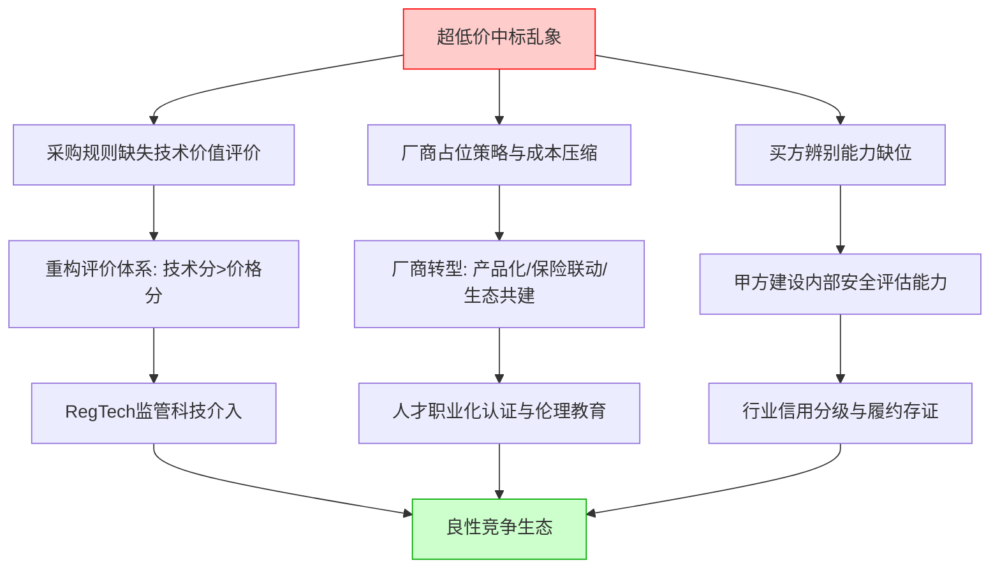

## 核心论点

网络安全行业普遍存在**「赢在技术，输在商务」**的结构性困境：技术团队的核心竞争力被商业规则异化，超低价中标（中标价仅为预算的 1%~20%）成为常态，导致行业陷入「劣币驱逐良币」的恶性循环。本质上是**采购规则缺失技术价值评价维度**、**企业为占位不惜践踏服务底线**、**买方缺乏辨别真伪能力**三方共谋的市场失灵。

## 现象图谱：超低价中标的量级与形态

| 中标价格区间 | 占预算比例 | 典型场景 | 破坏性后果 |
|--------------|------------|----------|------------|
| **极端低价** | < 1% | 关键基础设施安服、等保测评 | 服务形同虚设，漏报隐患酿成重大事故 |
| **严重低价** | 1% ~ 5% | 行业监管合规项目、政府采购 | 以「走过场」替代实战攻防，合规成废纸 |
| **恶性低价** | 5% ~ 10% | 企业年框采购、SRC 运营 | 人力成本压缩至不可持续，核心人才流失 |
| **常态低价** | 10% ~ 20% | 渗透测试、代码审计、应急响应 | 标准化工具扫描替代人工深度分析，报告模板化 |

> **数据来源**：301在路上实地调研与从业者反馈汇总，详见原文「我列几个数据」段落。

## 利益链条深度解剖

### 卖方（安全厂商）的生存逻辑
- **占位策略**：通过「亏本中标」锁定甲方长期框架协议，后续通过变更需求、增项服务回血（参考 [[security-consultative-selling-career]] 中「售前-销售-售后融合」的商业变现路径）
- **成本压缩**：
  - 核心白帽子替换为初级实习生 + 自动化扫描工具
  - 报告产出外包、模板化、甚至抄袭同行成果
  - 放弃漏洞复测、应急演练等高成本环节
- **恶性竞争手段**：围标串标、诋毁友商、利用信息不对称误导甲方决策

### 买方（采购方/甲方）的决策困境
- **规则僵化**：招标文件将「最低价中标」写入硬性条款，技术指标沦为「通过/不通过」二元判断（关联 [[security-value-communication-leadership-buyin]] 中「甲方侧『隐瞒漏洞、不量化产出、价值未传递』」痛点）
- **能力缺位**：
  - 业务部门缺乏安全技术评估能力，无法识别「伪专家」方案
  - 采购部门以价格为唯一KPI，规避「贵买错」责任风险
- **延续性绑定**：历史项目延续性强，新供应商进入壁垒高，倒逼老供应商「以价换量」

### 规则制定者（监管/招标代理）的缺位
- **评分体系单一**：技术分权重 < 20%，商务分权重 > 60%，价格分一票否决
- **缺乏专家库**：评标专家多为财务/法务背景，无法甄别技术方案含金量
- **事中事后监管真空**：中标后无履约质量验收机制，违约成本极低

## 破坏性后果的多维传导

### 对技术生态的摧残
- **人才流失**：核心白帽子因「写脚本跑扫描器」失去成就感，转行开发/运维/管理（呼应 [[security-practitioner-health-wellbeing]] 中「职业倦怠与健康管理」议题）
- **创新停滞**：研发投入被压缩至营收 3% 以下，0day 挖掘、威胁狩猎、攻防对抗平台等高价值能力无法沉淀
- **知识断层**：资深专家无法带教新人，行业经验无法显性化沉淀为方法论

### 对甲方安全的虚假繁荣
- **合规造假**：等保三级测评报告「全合规」，实则端口扫描+弱口令检查了事
- **攻防演练失真**：红队攻击路径被蓝队「提前知晓」，漏洞整改率 100% 但实战防御能力为零
- **供应链投毒**：低价中标厂商在交付环节植入后门、窃取资产数据（参考 [[hotel-pms-security-vulnerabilities]] 第三方供应链风险）

### 对行业信任的系统性瓦解
- **白帽子群体污名化**：媒体将「低价跑工具」等同于「安全服务」，公众认知偏离技术本质（关联 [[white-hat-ethics-industry-trust]] 行业信任危机）
- **资本退场**：投资机构无法区分「有技术护城河」与「靠关系拿单」企业，导致优质项目融资困难（参考 [[china-cybersecurity-financing-landscape-2015]] 资本视角）
- **标准失语**：国家标准、行业标准制定脱离实战，沦为厂商营销背书工具

## 破局路径：从「价格战」回归「价值战」

### 重构采购评价体系（买方主导）
| 维度 | 传统指标 | 价值导向指标 | 验收方式 |
|------|----------|----------------|----------|
| **技术深度** | 资质证书数量 | 真实攻防演练突破率、0day 挖掘能力、威胁狩猎案例 | 实战靶场红蓝对抗、样本溯源测试 |
| **交付质量** | 报告页数/漏洞数 | 核心资产风险覆盖率、整改闭环率、复测通过率 | 第三方复核、攻击面管理平台自动化核验 |
| **持续运营** | 响应时间 SLA | 威胁情报订阅命中率、攻击面变更发现率、应急演练实战化程度 | 季度红蓝对抗、年度攻防复盘 |
| **人才实力** | 项目经理证书 | 核心白帽子实名制入场、CTF 排名、CNVD/CNVD 原创漏洞数 | 人员实名制考核、技术面试抽查 |

> 参考实践：[[threat-intelligence-service-enterprise-view]] 中甲方呼吁的「基于企业资产画像的定制化情报交付模式」

### 厂商转型：从「卖工时」到「卖确定性」
- **产品化交付**：将渗透测试、代码审计、红蓝对抗标准化为 SaaS 化平台能力，边际成本递减
- **保险联动**：引入网络安全保险，以「理赔率」倒逼服务质量，将风险转移给精算模型
- **生态共建**：参考 [[security-startup-entrepreneurship-lessons]] 团队建设心得，组建「红蓝紫」一体化攻防实验室，输出方法论而非单次报告

### 行业自律与监管科技（RegTech）介入
- **信用分级制度**：建立安全服务企业「黑名单/灰名单/白名单」，纳入政府采购资格审查
- **履约区块链存证**：招投标全流程、交付物哈希、验收签章上链，事后可追溯、可审计
- **专家评标智能化**：引入 NLP 自动比对方案相似度、识别模板化报告、量化技术方案创新度

### 人才与文化重塑（长周期）
- **职业化认证体系**：推动「注册渗透测试师」「注册红队工程师」等强制准入资质，切断「证书挂靠」灰产
- **技术荣誉体系**：建立行业级「实战攻防榜单」「漏洞贡献荣誉榜」，让技术口碑可量化、可变现
- **伦理底线教育**：将 [[security-practitioner-legal-compliance]] 法律合规红线、[[mooncake-gate-security-ethics-analysis]] 技术伦理案例纳入入职必修课

## 交叉引用知识图谱

### 关联页面导航
| 维度 | 关联页面 | 核心关联点 |
|------|----------|------------|
| **行业乱象与创业反思** | [[security-industry-entrepreneurship-reflections]] | 「拒绝踩踏上位、理性得舍」创业伦理对标低价乱象 |
| **安全价值量化与向上管理** | [[security-value-communication-leadership-buyin]] | 甲乙方「价值显性化四步法」破解价格战 |
| **顾问式销售角色转型** | [[security-consultative-selling-career]] | 从「卖低价」到「卖确定性」的商业模式重构 |
| **团队建设与人才画像** | [[301-security-team-building-third-season]]、[[security-leadership-team-management]] | 核心人才流失与「五类安全人才」留存策略 |
| **运维安全案例库** | [[ops-security-case-studies-301]] | 低价服务导致的基线检查缺失、弱口令泛滥实证 |
| **白帽子伦理与行业信任** | [[white-hat-ethics-industry-trust]] | 超低价中标加剧白帽群体污名化 |
| **威胁情报服务甲方视角** | [[threat-intelligence-service-enterprise-view]] | 甲方对「同质化通报、缺乏资产上下文」的痛点直指低价交付 |
| **法律合规红线** | [[security-practitioner-legal-compliance]] | 低价服务易触犯《网络安全法》第 21/25/41 条监管红线 |

## 关键洞察卡片

> **洞察 1**：超低价中标的本质不是「价格战」，而是**「价值评价体系缺失」下的劣币驱逐良币**。当技术无法被量化定价，价格便成为唯一锚定变量。

> **洞察 2**：**「占位」是毒药而非蜜糖**。以亏本中标换取框架协议入场券，后续必然通过降级交付、增项收费、数据变现回血，最终由甲方用户买单。

> **洞察 3**：**甲方建设内部安全评估能力是破局前提**。只有买方具备「辨别真伪、量化价值」能力，市场才能从「比价格」转向「比价值」。

> **洞察 4**：**监管科技（RegTech）可将「事后追责」前置为「事中可视」**。区块链存证、智能评标、攻防靶场自动化验收，技术手段可重塑规则公信力。

> **洞察 5**：**行业自律需「强监管+高违约成本」双轮驱动**。建立企业/个人双维度信用黑名单，纳入政府采购、网络安全保险费率、人才职称评定联动惩戒。

## 行动清单（按角色分层）

### 甲方安全负责人
- [ ] 推动招标文件修订：技术分权重 ≥ 50%，引入实战攻防演练评分项
- [ ] 建立供应商「红蓝榜」：履约质量、人员实名制、漏洞复测率纳入季度考核
- [ ] 组建内部「技术评标专家池」：跨部门抽调红队、蓝队、架构师参与评标

### 安全厂商创始人/高管
- [ ] 砍掉毛利 < 15% 的标准化扫描业务，集中资源打磨 1-2 个核心产品化能力
- [ ] 实施「核心白帽子实名制入场」承诺，拒绝人员挂靠、报告外包
- [ ] 与保险公司联合设计「履约质量保证险」，以保费替代隐性降价成本

### 监管/行业协会
- [ ] 发布《网络安全服务采购指南》团体标准，规定最低价法适用边界
- [ ] 建设全国统一「网络安全服务企业信用信息平台」，打通招投标、履约验收、行政处罚数据
- [ ] 试点「攻防靶场验收机制」：中标方必须在国家级靶场完成实战考核方可开票

### 白帽子/一线从业者
- [ ] 拒绝参与「人头外包」「报告代写」「挂靠投标」等灰产链条
- [ ] 沉淀实战方法论至个人知识库（参考 [[ctf-beginner-self-study-guide]] Writeup 驱动学习法），构建不可替代的技术IP
- [ ] 通过 CNVD/CNVD 原创漏洞、CTF 排名、开源工具贡献建立技术声誉护城河

## 结语

网络安全行业的超低价中标乱象，是**技术价值被商业规则异化**的集体性后果。破局不靠单一主体道德觉醒，而需**重构评价体系、重塑商业模式、引入监管科技、重建人才荣誉**四维合力。当「技术能被看见、价值能被量化、违约成本高得无法承受」时，行业才能真正回归「能者为王、价值竞争」的健康轨道。

> **原文来源**：301在路上微信公众号《赢在技术，输在商务—超低价中标》（已删除原文，内容基于归档重构）  
> **结构化沉淀时间**：2025-01-15  
> **维护者**：数字知识库策展人

## 来源

- [301在路上-201508-202208_214](../sources/301在路上-201508-202208_214.md)
