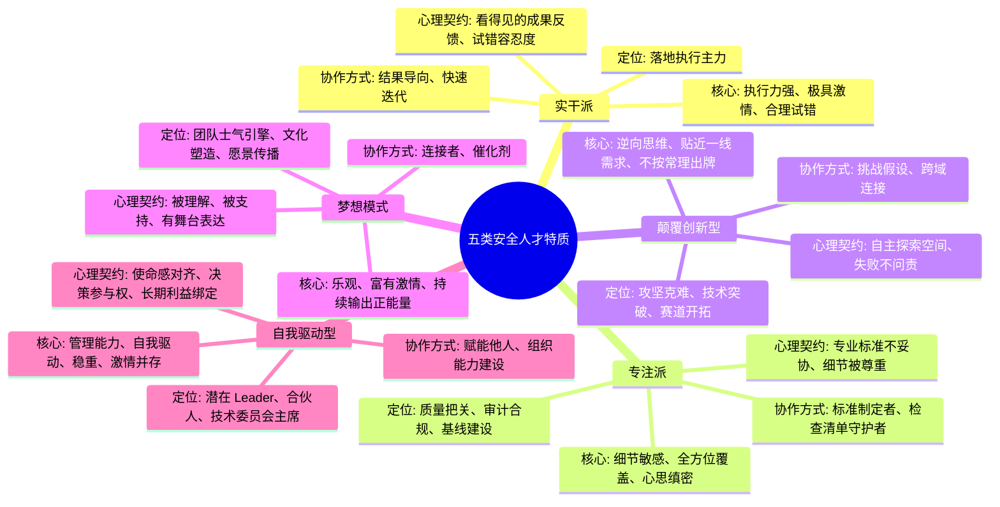
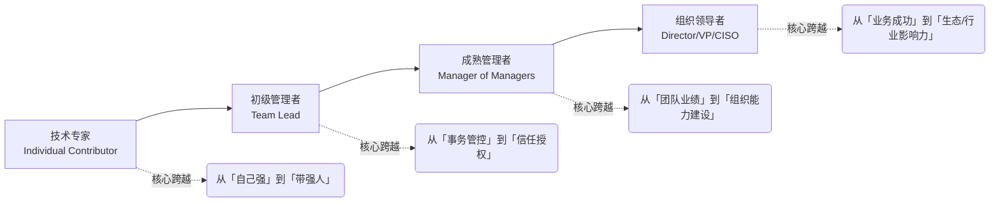

## 概述

本页面沉淀自 301在路上 微信公众号关于「如何做一个靠谱的老大」及「如何选择一个靠谱的老大」的深度讨论实录，并融合《不看后悔：为什么企业招不到安全人才？》《这才是互联网与安全团队需要的几种人才！》等实战文章对招聘困境、薪酬倒挂、组织授权缺失、人才留存、人才画像建设等结构性问题的复盘。文章从技术出身创业者的实战总结、社群读者的多维视角、以及 301 个人的管理反思三个层面，系统梳理了网络安全行业领导力建设的核心要素：**专业素养为基、信任授权为本、心理契约为魂、扁平协作为式、人才梯队为果、组织授权为盾、人才画像为镜**。同时提供「选领导」与「做领导」双视角实战指南，供安全从业者在职业抉择与管理实践中参考。

> **来源**：301在路上微信公众号原创文章《如何(选)做一个靠谱的老大？》《不看后悔：为什么企业招不到安全人才？》《这才是互联网与安全团队需要的几种人才！》及系列人才管理讨论
> **适用场景**：安全团队建设、职业选择决策、管理者自我进阶、创业团队组建、招聘体系设计、薪酬体系校准、人才画像建模

---

## 核心方法论框架

### 专业素养：领导力的「入场券」与「信任锚点」

| 维度 | 具体内涵 | 实战体现 |
|------|----------|----------|
| **技术过硬** | 干过一线活、懂业务细节、能指导实战 | 「外行领导内行沟通障碍会引起更多问题」 |
| **严谨专业** | 工作一丝不苟、不搞「三拍」决策（拍脑门、拍胸脯、拍大腿） | 有大局观、不怕问题、能解决问题 |
| **不忘初心** | 无论角色变化（工程师→Leader→老板），保持初始风格 | 「能上能下，依然保持开始的风格」 |
| **行业口碑** | 在行业内的评价、PR、口碑决定成员留存时长 | only_guest 团队近几年仅 1 人离职 |

> **关联洞察**：专业素养不仅是技术信服力的来源，更是建立**心理契约**的前置条件。参考 [[internal-vulnerability-disclosure-culture#心理契约破裂的代价]]、[[mooncake-gate-security-ethics-analysis#心理契约与安全治理]]。

---

### 信任与授权：基于「意愿-能力」矩阵的情境领导模型

文章引入经典的 **情境领导理论**（Situational Leadership），依据下属「意愿」与「能力」两个维度，划分四种领导角色：

```mermaid
quadrantChart
    title 意愿-能力矩阵与领导角色
    x-axis 低意愿 --> 高意愿
    y-axis 低能力 --> 高能力
    quadrant-1 命令型\n(低意愿/低能力)
    quadrant-2 顾问型\n(高意愿/低能力)
    quadrant-3 教练型\n(低意愿/高能力)
    quadrant-4 授权型\n(高意愿/高能力)
```

| 象限 | 下属特征 | 领导角色 | 核心行为 |
|------|----------|----------|----------|
| **Q1** | 意愿低、能力低 | **命令者** | 明确指令、严密监控、结构化任务分解 |
| **Q2** | 意愿高、能力低 | **顾问者** | 重方向指导、重情感支持、搭建脚手架 |
| **Q3** | 意愿低、能力高 | **教练者** | 激发内驱力、对齐目标、心理契约修复 |
| **Q4** | 意愿高、能力高 | **授权者** | 全权委托、资源托底、结果负责 |

> **实战原则**：「疑人不用，用人不疑」「足够信任下属，下属为不辜负信任而卖力」「给资质平庸的人多点机会」。

---

### 心理契约：隐性契约的显性化管理

文章从心理学视角拆解领导与成员的深层连接：

| 维度 | 关键词 | 实操指引 |
|------|--------|----------|
| **心理上** | 不装、平起平坐、接纳、无条件正反馈、馈赠（传授/帮助/带领）、延伸（共建 PKM 知识管理） | 去权位化交流；建立「师徒+伙伴」双重关系 |
| **言语上** | 倾听（接收+积极反映+主动复述）、分析（确认目标/现状/障碍）、提问（一般→特殊、普适性验证）、回应（做/不做/做了不会怎样的后果推演） | 全是工具，服务于认知对齐 |
| **行为上** | 四角色动态切换：命令、顾问、教练、授权 | 匹配下属当下发展阶段 |

> **关联阅读**：[[security-industry-entrepreneurship-reflections#团队建设核心原则]] 提及「凝聚力为本、拒绝踩踏上位」；[[security-startup-entrepreneurship-lessons#团队建设实战心得]] 记录 allsec 从 0 到 1 的团队磨合过程。

---

### 扁平化协作：去层级化的信息流与信任流

> 「互联网公司扁平化，深入人心」
> 「团队扁平化管理，在团建活动中更加自然，不是领导而是朋友，自然可以『嘻嘻哈哈』，才可以深入交流」

**扁平化 ≠ 无管理**，而是：
- **信息对称**：减少层级传递损耗，技术细节直达决策层
- **角色流动**：Leader 在「命令/顾问/教练/授权」间无缝切换，而非固化在「管理者」身份
- **心理安全感**：成员敢于暴露脆弱、提问愚蠢问题、挑战权威观点
- **知识共建**：共建 PKM（Personal Knowledge Management），形成组织级知识资产

---

### 组织授权与话语权：安全团队生存的「护城河」

> 「企业对外号称重视安全，对内安全没有任何话语权，这是钱解决不了的问题。」
> 「安全人才纯粹当做救火队员，着火时才想着有安全专员来背锅，自然跳槽率很高，留不住人。」

结合读者实战反馈，安全团队在组织中的**结构性授权缺失**是导致招聘难、留人难的核心根因：

| 授权缺失维度 | 典型症状 | 对团队的毁灭性影响 | 破局关键动作 |
|--------------|----------|-------------------|--------------|
| **预算决策权** | 安全投入需逐级审批，业务优先挤占资源 | 无法落实工具采购、红蓝对抗、培训预算 | 争取「安全专项预算包干制」，纳入公司级 OKR |
| **人事决策权** | JD 由 HR 套模板、薪资受职级表硬约束、招聘终决在业务 VP | 招不到对的人、给不起竞争力薪资、背锅侠定位 | Leader 必须掌握 **JD 定稿权、面试一票否决权、薪资破格申请权** |
| **技术话语权** | 业务上线不走安全评估、漏洞整改无强制力、应急响应无指挥权 | 安全沦为「建议部门」，无法推动基础设施加固 | 推行「安全左移」制度化：MR 阻断、上线准入、漏洞 SLA 强制 |
| **汇报线路权** | 安全汇报给 CTO/CIO 而非 CEO/董事会、汇报频次低 | 战略层面被边缘化，遇事找不到发声渠道 | 争取 **双线汇报**（业务线+法务/审计线）或直线向 CEO 汇报 |
| **文化定义权** | 安全文化由非安全背景高管定义、「安全是成本中心」成共识 | 团队使命感缺失，高手不愿来、来了留不住 | Leader 输出「安全赋能业务」叙事，产出可量化的业务价值报告 |

> **实战启示**：没有组织授权的「靠谱老大」是伪命题。**Leader 的核心任务之一，是向上管理、向外争取、向内兜底，为团队换取结构性授权**。参考 [[security-consultative-selling-career#安全项目评估四步法]] 中的「利益相关者对齐」思维。

---

## 五类安全人才特质模型（新增核心章节）

基于 301 在路上《这才是互联网与安全团队需要的几种人才！》实战总结，结合人才梯队培养、心理契约建设、扁平化协作实践，建立 **「五类安全人才特质」结构化模型**，为选人用人、团队配置、成长路径设计提供标准化参考框架。

### 模型总览



### 详细画像与管理策略对照表

| 人才类型 | 核心特质关键词 | 典型岗位匹配 | 核心价值贡献 | 心理契约关键点 | 激励与留存策略 | 扁平协作中的角色 | 易发冲突场景 | Leader 应对策略 |
|----------|----------------|--------------|--------------|----------------|----------------|------------------|--------------|----------------|
| **实干派** | 执行力、激情、试错、逆向成长 | 渗透测试工程师、应急响应工程师、安全运营工程师、安全开发工程师 | 「想法变现实」，高产出、快交付、抗压强 | 成果被看见、试错成本被承担、不被流程绑架 | 项目奖金、实战荣誉、技术债偿还时间、避免无效会议 | 执行核心、复盘主力 | 与专注派「快 vs 稳」冲突；被梦想模式视为「无大局观」 | 设立「快速试错通道」；建立「最小可行性安全交付」标准；公开表彰交付成果 |
| **专注派** | 细节、全覆盖、缜密、处女座、标准制定 | 代码审计、合规审计、基线建设、安全架构评审、数据安全工程师 | 「零疏漏」，底线思维、合规兜底、技术标准沉淀 | 专业标准不被妥协、细节工作被尊重、有完善工具链 | 专家通道晋升、认证考取支持、工具采购话语权、减少非专业干扰 | 质量守门人、标准制定者、Checklist 维护者 | 与实干派「完美 vs 交付」冲突；被创新型视为「保守」 | 推行「分级验收标准」；核心流程由专注派把关；创新项目设「合规豁免流程」 |
| **颠覆创新型** | 逆向思维、一线需求、不按常理、跨域连接 | 安全研究员、红队工程师、威胁狩猎、前沿技术探索、0day 挖掘 | 「破局者」，攻坚关键难题、开拓新赛道、输出差异化能力 | 自主探索时间/预算、失败不问责、成果独享荣誉 | 专项创新基金、会议演讲机会、专利/论文激励、容忍周期性「无产出」 | 破局者、技术雷达、外部生态连接点 | 与专注派「创新 vs 合规」冲突；被实干派视为「不靠谱」 | 设立「创新保护区」（如 20% 时间）；建立「快速验证-快速熔断」机制；Leader 亲自托底风险 |
| **梦想模式** | 乐观、激情、正能量、愿景感、文化传播 | 布道师、社区运营、安全培训讲师、对外合作、内部文化大使 | 「点火者」，提振士气、对外品牌、内部凝聚、愿景对齐 | 被理解而非被利用、有表达舞台、情绪价值被接纳 | 品牌曝光资源、社区影响力建设、团队建设预算、情绪支持 | 连接者、催化剂、心理安全感建设者 | 被务实派视为「虚」「不接地气」；情绪低谷期需支持 | 给予「发声渠道」（周会分享、技术博客）；关注情绪周期；防止「情绪劳动」透支 |
| **自我驱动型** | 管理能力、自我驱动、稳重、使命感、长期主义 | 团队 TL、技术专家、安全架构师、创业合伙人、CISO 储备 | 「造引擎」，建体系、育人才、定战略、对结果负责 | 使命感共鸣、决策参与权、长期利益绑定（期权/分红）、组织授权 | 合伙人机制、虚拟股/期权、董事会观察员、外部董事/顾问机会 | 赋能者、组织架构师、向上管理关键人 | 与创始人/高管「控制权 vs 授权」博弈；孤独感 | 真授权（预算/人事/技术/汇报）；建立「同伴支持圈」（如 only_guest 模式）；定期深度对谈 |

### 模型在人才全生命周期中的应用

#### 招聘定位与 JD 设计
- **JD 显性标注人才类型**：如「渗透测试工程师（实干派+颠覆创新型）」「合规审计工程师（专注派）」「红队研究员（颠覆创新型+实干派）」
- **面试评分卡引入特质维度**：在技术考核外，增加「特质倾向度」评估（行为面试题库：STAR 法提取特质证据）
- **团队配置互补性检查**：单团队建议「实干派≥40%、专注派≥15%、颠覆创新型≥10%、梦想模式≥5%、自我驱动型≥1-2 人」，避免单一结构导致盲区

#### 入职融入与心理契约签署
- **差异化入职地图**：
  - 实干派：首周给「小而确定」交付任务，快速建立成就感
  - 专注派：首周给「标准梳理/清单完善」任务，建立专业秩序感
  - 颠覆创新型：首月给「开放性探索课题」，明确「允许失败」边界
  - 梦想模式：安排「文化大使/分享会」角色，快速建立连接
  - 自我驱动型：直接参与「团队战略复盘/OKR 共创」，给决策参与感
- **心理契约显性化谈话模板**：针对五类人才的「核心诉求-组织承诺-违约后果」三方对齐

#### 绩效考核与成长路径（双通道适配）
| 人才类型 | 管理通道 (M序列) | 专家通道 (P序列) | 关键考核指标差异化 |
|----------|------------------|------------------|---------------------|
| 实干派 | TL → M → D | 高级工程师 → 资深 → 首席 | 交付质效、复盘沉淀、带新人产出 |
| 专注派 | 质量/合规负责人 | 审计专家 → 架构专家 → 首席架构师 | 零重大疏漏、标准沉淀、工具链建设 |
| 颠覆创新型 | 研究组长/实验室主任 | 安全研究员 → 资深研究员 → 首席科学家 | 突破性成果、专利/论文/开源影响力、赛道开拓 |
| 梦想模式 | 文化/品牌负责人、对外合作总监 | 布道师 → 首席布道师 | 品牌声量、社区影响力、内部 eNPS 贡献 |
| 自我驱动型 | 总监/VP/CISO | 技术委员会主席/首席专家 | 组织能力建设、战略落地、人才梯队产出、向上管理成效 |

#### 扁平化协作中的动态角色映射
- **日常站会/周会**：实干派同步进度、专注派提风险、创新型提洞见、梦想模式提士气、自我驱动型做决策对齐
- **复盘会**：实干派讲「怎么做成的」、专注派讲「哪里差点翻车」、创新型讲「下次能不能换条路」、梦想模式讲「我们为什么而战」、自我驱动型讲「组织能力怎么升级」
- **知识共建 (PKM)**：实干派沉淀「实战手册」、专注派沉淀「检查清单/标准库」、创新型沉淀「攻防技巧/前沿雷达」、梦想模式沉淀「文化故事/方法论」、自我驱动型沉淀「管理决策日志/组织设计文档」

#### 离职预警与留存干预（特质视角）
| 人才类型 | 高风险离职信号 | 核心留存杠杆 | 最后挽留话术方向 |
|----------|----------------|----------------|-------------------|
| 实干派 | 连续 2 个冲刺无挑战性任务、被迫写过多文档、试错被问责 | 给「硬仗」、减非业务负担、配专注派搭档 | 「这仗非你不可，资源我给你顶上」 |
| 专注派 | 核心标准被业务强行降级、工具采购连续受阻、专业判断被非专业推翻 | 给「话语权」、守「底线」、建「专家委员会」 | 「这个标准由你守护，我给你授权」 |
| 颠覆创新型 | 探索预算连续砍、失败被算绩效、被安排大量维护性工作 | 给「保护期」、容「失败」、通「外部生态」 | 「这半年你只管折腾，结果我来抗」 |
| 梦想模式 | 分享会被取消、文化预算归零、情绪低谷无人问、被视为「闲人」 | 给「舞台」、懂「情绪」、重「连接」 | 「团队需要你的光，别熄灭了」 |
| 自我驱动型 | 战略建议长期不采纳、授权边界被收缩、利益绑定兑现延期、孤独感强 | 真「授权」、实「绑定」、建「同伴圈」 | 「把预算权/人事权/汇报线都还给你」 |

---

## 人才梯队培养：从「招人」到「育人」的系统工程（升级版）

| 阶段 | 关键动作 | 301 实践反思 | 结构性难点 | **五类人才特质视角的差异化策略（新增）** |
|------|----------|--------------|------------|------------------------------------------|
| **引入期** | 选靠谱老大 > 选靠谱公司；直属上司处事风格深度影响应届生 | 「作为应届生，直属上司会在很大程度上影响你」 | **学历门槛 vs 实战能力冲突**：「企业安全招聘机制不完善，所需门槛高，有学历要求，但安全从业人员大多自学成才」 | **实干派**：看实战项目/Writeup/CTF 排名<br>**专注派**：看代码审计报告/合规项目经历/细节把控案例<br>**创新型**：看 0day/漏洞挖掘/开源工具/非常规解题思路<br>**梦想模式**：看技术博客/分享视频/社区影响力/文化认同度<br>**自我驱动型**：看主导项目经历/组织协调案例/长期主义证据 |
| **成长期** | 给学习机会、展示机会、成长空间；在擅长领域做合理定位 | 「更应该给团队成员更多学习机会、展示能力的机会」 | **单一工作内容**：「工作内容过于单一，甚至充当的是真正保安的角色」「安全研究岗位当做售前使用」 | **实干派**：轮岗核心攻防项目、主导应急演练<br>**专注派**：主导基线/标准建设、参合规审计<br>**创新型**：20% 时间探索、鼓励投稿顶会/开源<br>**梦想模式**：安排对外布道、内部分享、文化建设<br>**自我驱动型**：参与 OKR 制定、带领子项目、向上汇报锻炼 |
| **定位期** | 考虑未来职位方向定位；个人职业规划与团队需求对齐 | 「时间条件允许下，考虑未来职位方向定位」 | **复合型人才缺口**：「甲方企业更看熟悉业务安全的复合型人才，而这方面的安全人才缺口极大」 | **双通道显性化**：<br>- 实干派/专注派/创新型 → 专家通道为主<br>- 自我驱动型 → 管理通道为主（可兼专家）<br>- 梦想模式 → 品牌/文化/对外合作专项通道<br>**IDP 个性化**：按特质定制成长地图 |
| **留存期** | 行业口碑、心理契约、成长兑现、利益分享 | 「leader在行业内的评价、口碑应该决定自己在团队待的时长」 | **价值兑现断层**：「安全是一个隐形的投资，尚未发生安全事件之前，公司不能充分意识到安全人才的重要性」「自我估值与企业估值间差距太大」 | **差异化留存包**：<br>- 实干派：项目分红+技术债偿还周<br>- 专注派：专家津贴+标准版权分成+工具采购权<br>- 创新型：创新基金+专利奖金+顶会资助+容忍期<br>- 梦想模式：品牌曝光配额+团建预算+情绪支持机制<br>- 自我驱动型：虚拟股/期权+董事会观察员+同伴圈+真授权 |

> **关联页面**：
> - [[security-career-development-guide#跨专业入行路径与乙方分岗抉择]] — 新人入行的导师选择指南
> - [[security-practitioner-health-wellbeing#高压环境下的自我调节]] — 团队健康管理作为留存抓手
> - [[recruitment-go-h5-development-chengdu]] — 具体招聘岗位的 JD 参考
> - [[hvv-blue-team-recruitment-standards]] — HVV 蓝军分级招聘标准与薪资对标
> - [[301-security-team-building-third-season#五大安全人才画像]] — 301 早期人才画像版本（实干派、专注派、颠覆创新型、梦想模式、自我驱动型）互补参考

---

## 招聘困境的结构性复盘（升级版：融入五类人才视角）

基于《不看后悔：为什么企业招不到安全人才？》中 20+ 条从业者一线留言，结合五类人才特质，提炼出 **六大结构性矛盾**，这是任何「靠谱老大」在招聘环节必须直面的现实：

### 供需错配：需求爆发 vs 培养周期长
- **现象**：「互联网快速发展，各行业对安全人才需求过于旺盛」「具备一定经验的人才太少，一时无法满足企业缺口」
- **本质**：安全是「靠实战经验的工种」，两年物联网/智能设备/大数据兴起拉动需求，但人才培养周期 3-5 年
- **五类人才差异**：**实干派/专注派**相对好培养（1-2 年可上手）；**创新型/自我驱动型**极度稀缺（需 5+ 年实战+认知沉淀）；**梦想模式**可跨界引入（技术布道师/社区运营）
- **应对**：建立「实习生-初级-骨干-专家」梯队自养体系，与高校/训练营共建实战基地，参考 [[cybersecurity-training-resources-guide]] 资源池；**创新型/自我驱动型**走「猎头+行业口碑+合伙人机制」非标招聘

### 定岗模糊：不知道要什么 vs JD 全网复制
- **现象**：「很多企业也不知道自己究竟需要什么样的人才，招聘广告前面一律，直接 copy」「领导对职位定义不清晰」
- **本质**：业务方缺乏安全建设规划，HR 不懂安全细分领域（渗透/应急/治理/开发/合规）
- **五类人才破局**：**强制 JD 标注「核心人才类型+次要类型」**，如「安全运营工程师（实干派为主、专注派为辅）」，面试考核维度对齐特质模型
- **应对**：Leader 必须亲写 JD，按 **能力模型（知识/技能/素质/经验）+ 特质倾向** 拆解，而非罗列工具清单

### 薪酬倒挂：市场行情 vs 内部职级表
- **现象**：「薪资过高后在企业内部会引起矛盾，HR不能理解安全岗位与其他技术岗位的差距」「互联网岗位的薪资过高，传统金融岗位薪资相差太大」
- **本质**：安全人才稀缺性导致市场价脱离通用薪酬带，HR 依赖传统职级体系无法破格
- **五类人才差异化定价**：**创新型/自我驱动型**溢价最高（30-50% 以上市场中位数）；**实干派/专注派**按成熟度分级定价；**梦想模式**按影响力定价
- **应对**：
  - 建立 **安全专项薪酬带**（参考 [[hvv-blue-team-recruitment-standards#薪资待遇范围]]）
  - 设计「项目奖金+期权/虚拟股+认证津贴+影响力奖金」组合包绕过职级天花板
  - 向 HR/财务输出《安全岗位薪酬合理性论证报告》（含市场对标、业务价值量化、流失成本测算、特质稀缺度系数）

### 信任赤字：黑产经验悖论 vs 背锅侠预期
- **现象**：「要求没有做过黑产的人，又要招聘研究黑产攻防的人员」「钱给的不够多，优秀人才急缺，并且需要一个背锅侠」
- **本质**：企业想要实战能力但拒绝实战来源，想要担责任但不给权利/钱
- **五类人才视角**：**创新型/实干派**常具备「灰产/黑产对抗」实战经验，被简单背景审查拦截；**专注派**最怕「背锅侠」定位
- **应对**：
  - 明确 **授权测试边界与法律保护**（参考 [[security-practitioner-legal-compliance#授权测试规范]]）
  - 建立「容错机制」：非原则性失误不追责、复盘归因到流程而非个人
  - 拒绝「背锅侠」定位，推行「安全赋能业务」的正向叙事
  - **背景审查分级**：核心研发/研究岗聚焦「技术贡献/开源影响力」，而非单一「无灰黑产记录」

### 组织孤岛：安全无话语权 vs 业务不配合
- **现象**：「企业对外号称重视安全，对内安全没有任何话语权」「安全理念，安全工程师不能用业务开发工程师的标准衡量」
- **本质**：安全被视为成本中心而非价值创造者，缺乏组织级授权机制
- **五类人才共振**：**自我驱动型**最敏感（决策参与权被剥夺）；**创新型**最受挫（探索空间被压缩）；**专注派**最无力（标准被妥协）
- **应用**：见上文「组织授权与话语权」章节

### 成长断层：学习投入大 vs 晋升通道窄
- **现象**：「安全人员学的东西更多更难，可是公司只看中产出来评优或者是升职加薪」「自己的能力早已超出了能在该公司实现的，可是实际为公司付出的能获得的收益也相对同样能力的别人的少」
- **本质**：安全技术迭代快、学习成本高，但传统晋升通道（P序列/M序列）无法匹配专家型成长路径
- **五类人才通道差异化**：
  - **实干派/专注派/创新型** → 专家通道为主，设立「技术影响力」「专利/标准/开源贡献/实战成果」作为晋升指标
  - **自我驱动型** → 管理通道为主，设立「组织能力建设」「人才梯队产出」「向上管理成效」指标
  - **梦想模式** → 设立「品牌/文化/生态影响力」专项通道
- **应对**：
  - 设立 **双通道**：管理通道（TL→M→D）+ 专家通道（初级→高级→资深→首席/首席科学家）+ 生态通道（布道师→首席布道师→生态合伙人）
  - 专家通道薪酬上限对齐管理通道
  - 支持外部轮岗、会议演讲、社区建设、认证考取计入绩效

---

## 双视角实战指南（升级版：融入五类人才识别）

### 视角一：如何选择一个靠谱的老大（求职/跳槽决策框架）

#### 决策清单（加权评分表·融入五类人才视角）

| 一票否决项 | 核心加权项（权重） | 加分项 | **五类人才视角的 Leader 识别关键（新增）** |
|------------|-------------------|--------|------------------------------------------|
| ☐ 曾有「三拍」决策前科 | 专业素养过硬（30%） | ☐ 行业内口碑极佳（PR/评价） | **实干派视角**：Leader 是否亲自参与过硬核交付？是否给试错空间？ |
| ☐ 习惯甩锅、推卸责任 | 信任授权度高（25%） | ☐ 过往带出过知名人才 | **专注派视角**：Leader 是否捍卫专业标准？是否给工具/话语权？ |
| ☐ 画大饼不兑现、冷血无情 | 心理契约践行者（20%） | ☐ 乐于共建 PKM/知识分享 | **创新型视角**：Leader 是否有创新保护机制？是否懂前沿技术？ |
| ☐ 权威主义、拒绝扁平沟通 | 扁平化协作实践者（15%） | ☐ 关注成员健康/工作生活平衡 | **梦想模式视角**：Leader 是否给表达舞台？是否懂情绪价值？ |
| ☐ 缺乏大局观、只盯短期 KPI | 人才梯队建设投入（10%） | ☐ 有「不忘初心」的创业/技术故事 | **自我驱动型视角**：Leader 是否真授权？利益绑定是否兑现？ |
| **☐ 组织授权缺失**：安全无预算权/人事权/技术话语权/汇报线低 | **☐ 薪酬破格能力**：能为核心人才争取超职级薪酬/期权 | **☐ 双通道晋升落地**：专家通道真实可行、有案例 | **综合判断**：团队五类人才结构是否均衡？离职率按类型是否可控？ |

#### 面试反向提问话术（升级版·按人才类型可选）

| 人才类型 | 高质量提问示例 |
|----------|----------------|
| **实干派** | 「最近亲自参与过的最硬核技术攻关是什么？怎么指导团队攻克的？」「团队最近一次『试错失败』怎么处理的？」「有没有『技术债偿还周』这种机制？」 |
| **专注派** | 「团队的基线/标准由谁维护？业务强行上线不合规怎么拦截？」「工具采购/合规预算由安全侧决定吗？」「有没有『专家委员会』一票否决机制？」 |
| **颠覆创新型** | 「团队有『20% 探索时间』或『创新保护基金』吗？最近一个被支持的『疯狂想法』是什么？」「失败的研究项目如何复盘？会影响绩效吗？」「Leader 自己最近在研究什么前沿方向？」 |
| **梦想模式** | 「团队多久一次技术分享会/对外布道机会？Leader 会亲自上台分享吗？」「成员情绪低谷时，Leader 怎么介入？」「团队文化建设有专项预算吗？」 |
| **自我驱动型** | 「安全团队预算由谁拍板？上线阻断权在不在安全侧？汇报给谁？」「如果遇到极其匹配但超职级的候选人，你有什么破格路径？」「团队里有纯技术晋升到高薪专家/合伙人的案例吗？利益绑定怎么设计？」「Leader 如何向 CEO/董事会汇报安全价值？」 |

> **避坑指南**：参考 [[security-career-development-guide#避坑指南]]、[[cybersecurity-training-resources-guide#避坑指南]]、[[security-career-city-choice#北漂与家乡就业的抉择因素]]。

---

### 视角二：如何做一个靠谱的老大（管理者进阶路线图·融入五类人才培养）

#### 阶段演进模型



#### 关键能力建设清单（升级版·含五类人才识别与培养）

| 能力域 | 具体行为锚点 | 自我检视频次 | 组织杠杆动作 | **五类人才差异化管理动作（新增）** |
|--------|--------------|--------------|----------------|-----------------------------------|
| **专业信服力** | 每季度至少深度参与 1 个技术攻关/架构评审/应急响应 | 季度 | 输出《安全技术白皮书/最佳实践》沉淀组织资产 | **实干派**：带头冲锋陷阵<br>**专注派**：把关核心标准<br>**创新型**：亲自探索前沿<br>**梦想模式**：对外输出观点<br>**自我驱动型**：定战略、判方向 |
| **情境领导力** | 能说出每个核心成员当前所在象限(Q1-Q4)及对应策略 | 月度 | 建立「人才画像墙」可视化，季度复盘流动 | **按特质分层**：实干派给目标给资源、专注派给标准给话语权、创新型给保护给容错、梦想模式给舞台给连接、自我驱动型给授权给绑定 |
| **心理契约维护** | 季度 1v1 谈「成长/困惑/期望」而非只谈 KPI；承诺兑现率 > 90% | 季度 | 引入「心理契约健康度调查」（匿名），追踪 eNPS | **差异化契约项**：实干派-成果兑现、专注派-标准不妥协、创新型-探索保护、梦想模式-情绪被见、自我驱动型-使命共鸣+利益绑定 |
| **扁平化机制** | 建立「技术周会/复盘会/知识分享会」三会融合机制；Leader 发言占比 < 30% | 月度 | 推行「全员轮流主持」「复盘产出文档入库」 | **会议角色轮换**：实干派讲交付、专注派讲风险、创新型讲洞见、梦想模式讲愿景、自我驱动型讲决策 |
| **人才梯队** | 每人制定 IDP（个人发展计划）；内部晋升/轮岗比例 > 30% | 半年度 | **建立双通道晋升委员会、专家评审机制、薪酬破格预案** | **五类人才 IDP 模板化**：实干派-项目清单、专注派-标准清单、创新型-探索清单、梦想模式-影响力清单、自我驱动型-组织能力清单 |
| **组织健康度** | eNPS 跟踪；离职面谈核心原因分类复盘 | 季度 | **向上管理：定期向 CEO/董事会汇报「安全组织能力建设进展」** | **按类型追踪离职原因**：实干派-无挑战/被流程拖累、专注派-标准被妥协、创新型-无空间/被问责、梦想模式-无舞台/情绪耗竭、自我驱动型-授权收缩/利益失信 |
| **向上争取授权** | 能说出当前缺失的 3 项关键授权（预算/人事/技术/汇报/文化），并有推进计划 | 季度 | 产出《安全组织授权成熟度模型评估报告》，作为年度 OKR 之一 | **授权映射五类人才需求**：预算权→实干派/创新型资源、人事权→自我驱动型绑定、技术话语权→专注派/创新型标准、汇报线→全类型战略对齐、文化定义权→梦想模式/全类型归属感 |
| **薪酬体系设计** | 熟悉市场行情，能与 HR/财务共创「安全专项薪酬带」，有破格案例 | 半年度 | 建立「市场薪酬监测机制」（含猎头反馈、社群情报、公开报告） | **五类人才薪酬包差异化**：实干派-高变动高项目奖、专注派-高固定高专家津贴、创新型-高期权高创新基金、梦想模式-品牌预算+影响力奖金、自我驱动型-虚拟股+分红+合伙人机制 |

#### 个人实践原则（原文摘录 + 实战增补 + 五类人才视角）

> 「作为从一线成长起来的同学，个人自认为『略懂员工、略懂团队、略懂客户、略懂行业』各个角色要什么。但是个人从管理者的角度上，更应该给团队成员更多的学习机会、展示能力的机会，当然包括成长空间，作为 leader 帮助团队成员在自己擅长领域做合理定位。时间条件允许下，考虑未来职位方向定位。」

> 「如果，从老大选择的角度上看，如果 leader 在行业内的评价、口碑应该决定自己在团队待的时长。这点我很佩服 only_guest 团队近几年只有 1 个离职的同学，不过 301 也在尝试组建这样的团队，希望做个好的 leader.」

> **实战增补**：「招不到人、留不住人，归根结底是**组织授权不到位、薪酬体系不匹配、成长通道不清晰、安全话语权缺失、人才特质不识别**。靠谱老大不只要『懂技术、懂人心』，更要『懂组织、懂博弈、懂向上管理、懂人才画像』。把团队建设好，本质上是把**组织环境**为团队改造好，**让五类人才各得其所、各司其职、相互补位、共同进化**。」

---

## 行业对标与延伸阅读

### 标杆团队观察样本

| 团队/组织 | 典型特征 | 可借鉴点 | **五类人才结构观察（新增）** |
|-----------|----------|----------|------------------------------|
| **only_guest** | 近年仅 1 人离职、极高行业口碑 | 信任授权文化、心理契约兑现、Leader 专业信服力 | 核心骨干多为**自我驱动型+实干派**复合，Leader 亲自托底**创新型**空间 |
| **301 团队** | 从 0 到 1 组建、强调「略懂四角色」 | 成长机会给足、擅长领域定位、职位方向规划 | 有意识配置**五类人才互补**，Leader 扮演**自我驱动型**赋能者角色 |
| **allsec** | 创业早期团队建设实战 | 踏实做事、凝聚力为本、拒绝踩踏上位、理性得舍 | 早期以**实干派+创新型**为主，逐步补齐**专注派+梦想模式** |
| **HVV 蓝军体系** | 分级招聘标准（A/B/C/D）、明确薪资带、结算周期透明 | 标准化招聘模型、灵活用工机制、应急响应专项补贴 | A级对标**创新型+自我驱动型**，B/C级对标**实干派+专注派**，D级引入**梦想模式**做文化传递 |

> 详见：[[security-industry-entrepreneurship-reflections]]、[[security-startup-entrepreneurship-lessons]]、[[hvv-blue-team-recruitment-standards]]、[[301-security-team-building-third-season#五大安全人才画像]]

### 关联知识页面交叉引用索引

| 主题域 | 相关页面 | 关联点 |
|--------|----------|--------|
| **职业发展** | [[security-career-development-guide]] | 跨专业入行导师选择、乙方分岗、薪资预期校准、避坑指南 |
| **城市选择** | [[security-career-city-choice]] | 一线城市 vs 家乡、实习生生存现状、工作生活平衡 |
| **健康管理** | [[security-practitioner-health-wellbeing]] | 高压下的健康基石、酒文化应酬、运动建议 |
| **法律合规** | [[security-practitioner-legal-compliance]] | 授权测试规范、漏洞披露最佳实践、自我保护清单、电子数据取证 |
| **顾问式销售** | [[security-consultative-selling-career]] | 技术型销售角色定位、核心能力模型、项目评估四步法、向上管理 |
| **内部漏洞文化** | [[internal-vulnerability-disclosure-culture]] | 心理契约在安全治理中的体现、反模式识别、谁提问题干掉谁 |
| **月饼门复盘** | [[mooncake-gate-security-ethics-analysis]] | 技术伦理、零容忍文化、心理契约破裂案例、安全治理反思 |
| **白帽成长故事** | [[shanshan-cso-career-growth-story]]、[[xiaoyang-whitehat-practitioner-profile]]、[[whitehat-wuhan-epidemic-contribution-story]] | 从技术到管理的跨越、一万小时定律、重保贡献、自学成才 |
| **招聘实战参考** | [[recruitment-go-h5-development-chengdu]]、[[hvv-blue-team-recruitment-standards]] | 具体 JD 编写、薪资带对标、分级招聘标准 |
| **培训资源池** | [[cybersecurity-training-resources-guide]] | 内部培养资源、外部训练营对接、证书规划 |
| **301 团队建设三季** | [[301-security-team-building-third-season]] | 业务分级、基础安全落地、五大安全人才画像早期版本 |

---

## 结语：领导力是「被信任」的艺术，更是「改造环境」的勇气

> 「得人心，得天下」「不忘初心，在路上」

网络安全行业的特殊性——**高技术门槛、高压持续性、高人才流动性、高组织依赖度、人才特质高度多元**——决定了「靠谱老大」的稀缺性与价值。本页面沉淀的方法论，不仅适用于安全团队，亦可迁移至任何**知识密集型、专业强依赖、创新驱动、组织授权敏感、人才结构复杂**的技术组织。

**给管理者**：把「专业素养」练成肌肉记忆，把「信任授权」刻进管理基因，把「心理契约」守成生命线，把「扁平协作」做成组织反射弧，把「人才梯队」建成护城河，**把「向上争取组织授权」作为核心 KPI 之一，把「识别五类人才、配置五类人才、成就五类人才」作为管理基本功**。

**给求职者**：用「六维决策清单」面试老大（含组织授权、薪酬破格、双通道落地、五类人才友好度），用「反向提问话术」验证真伪，用「行业口碑」做长期背书，用「成长兑现」算投资回报，**识别自己的核心特质类型，寻找能让该特质绽放的土壤**。

**给行业**：期待更多「only_guest」式团队涌现，让「靠谱老大」成为常态而非传说；期待 HR 与财务真正读懂安全岗位价值，打破职级表束缚，建立**特质感知的薪酬与晋升体系**；期待 CEO 给安全团队真实的预算权、人事权、技术话语权、汇报线、文化定义权——**没有结构性授权，就没有真正的安全建设；没有人才特质识别，就没有精准的人才配置与成就**。

---

## 附录：原文推荐阅读清单（301 强烈推荐 + 新增）

1. [企业信息安全十大痛点](http://mp.weixin.qq.com/s?__biz=MzIwMTQ2NzY4NA==&mid=405036648&idx=1&sn=b2778cafdee9b1a7f63eb1fc75025fdc&scene=21#wechat_redirect)
2. [成长型互联网企业该如何构建安全团队——第一季](http://mp.weixin.qq.com/s?__biz=MzIwMTQ2NzY4NA==&mid=403917916&idx=1&sn=c3931efa25bdae014307d87f535b60ce&scene=21#wechat_redirect)
3. [这才是互联网与安全团队需要的几种人才！](http://mp.weixin.qq.com/s?__biz=MzIwMTQ2NzY4NA==&mid=403755240&idx=1&sn=d56e1ed063496343991a14624bc89c07&scene=21#wechat_redirect) **（本次新增核心来源：五类安全人才特质模型）**
4. [白帽子黑客：EX，还记得我们一起去太平山顶的约定么？](http://mp.weixin.qq.com/s?__biz=MzIwMTQ2NzY4NA==&mid=403269419&idx=1&sn=c22f62606e81d29d0eb6f70577126321&scene=21#wechat_redirect)
5. [少年黑客：我的初恋女友，你在哪里？](http://mp.weixin.qq.com/s?__biz=MzIwMTQ2NzY4NA==&mid=403247984&idx=1&sn=9974d4054350f14c37f2906c82ba6e86&scene=21#wechat_redirect)
6. [开春巨献！全球TOP500安全公司到底在做些什么](http://mp.weixin.qq.com/s?__biz=MzIwMTQ2NzY4NA==&mid=403223215&idx=1&sn=66f32613ec48196b43c15e29b592c1c1&scene=21#wechat_redirect)
7. [2015年至今国内信息安全领域那些投资那些事](http://mp.weixin.qq.com/s?__biz=MzIwMTQ2NzY4NA==&mid=403187021&idx=1&sn=406ded7b5588e542dd8e013867c1bb1f&scene=21#wechat_redirect)
8. [301:浅谈互联网安全现状与攻击趋势](http://mp.weixin.qq.com/s?__biz=MzIwMTQ2NzY4NA==&mid=402541797&idx=1&sn=0df62b06fba94221a57680c0238b5eaf&scene=21#wechat_redirect)
9. [招人必看！301浅谈国内安全人才薪酬现状](http://mp.weixin.qq.com/s?__biz=MzIwMTQ2NzY4NA==&mid=400407181&idx=1&sn=cf6cb8a5573a11afa0a315ad4bebba13&scene=21#wechat_redirect)
10. [301：从安全角度浅谈云计算服务平台现状与发展](http://mp.weixin.qq.com/s?__biz=MzIwMTQ2NzY4NA==&mid=401823685&idx=1&sn=19396bda6cee67910254b52facb43692&scene=21#wechat_redirect)
11. [不看后悔：为什么企业招不到安全人才？](http://mp.weixin.qq.com/s?__biz=MzIwMTQ2NzY4NA==&mid=2652520514&idx=1&sn=48dc75d611654f88993bbee235b6e234&scene=21#wechat_redirect) **（核心来源：招聘困境结构性复盘）**
12. [信息不对称之人才招聘](http://mp.weixin.qq.com/s?__biz=MzIwMTQ2NzY4NA==&mid=400381762&idx=1&sn=e58728489ec90edcd21e7f5e583d402d&scene=21#wechat_redirect)
13. [信息安全不对称之人才流失](http://mp.weixin.qq.com/s?__biz=MzIwMTQ2NzY4NA==&mid=400397471&idx=1&sn=ea9239f4d199dc0cfbbe99b2f4c9cf26&scene=21#wechat_redirect)

---

> **页面维护提示**：本页面为动态沉淀文档，欢迎通过 PR 补充最新管理实践案例、行业对标数据、工具模板（如 JD 模板、薪酬对标表、IDP 模板、组织授权成熟度评估表、五类人才面试评分卡、心理契约谈话模板）等内容。交叉引用目标页面若不存在，请先创建目标页面或调整引用路径。

## 来源

- [301在路上-201508-202208_128](../sources/301在路上-201508-202208_128.md)
- [301在路上-201508-202208_129](../sources/301在路上-201508-202208_129.md)
- [301在路上-201508-202208_133](../sources/301在路上-201508-202208_133.md)
- [301在路上-201508-202208_180](../sources/301在路上-201508-202208_180.md)
