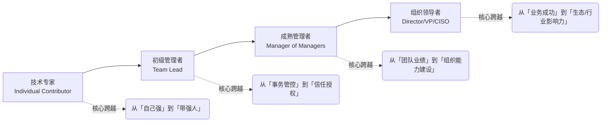

## 概述

本页面沉淀自 301在路上 微信公众号关于「如何做一个靠谱的老大」及「如何选择一个靠谱的老大」的深度讨论实录。文章从技术出身创业者的实战总结、社群读者的多维视角、以及 301 个人的管理反思三个层面，系统梳理了网络安全行业领导力建设的核心要素：**专业素养为基、信任授权为本、心理契约为魂、扁平协作为式、人才梯队为果**。同时提供「选领导」与「做领导」双视角实战指南，供安全从业者在职业抉择与管理实践中参考。

> **来源**：301在路上微信公众号原创文章《如何(选)做一个靠谱的老大？》
> **适用场景**：安全团队建设、职业选择决策、管理者自我进阶、创业团队组建

---

## 核心方法论框架

### 专业素养：领导力的「入场券」与「信任锚点」

| 维度 | 具体内涵 | 实战体现 |
|------|----------|----------|
| **技术过硬** | 干过一线活、懂业务细节、能指导实战 | 「外行领导内行沟通障碍会引起更多问题」 |
| **严谨专业** | 工作一丝不苟、不搞「三拍」决策（拍脑门、拍胸脯、拍大腿） | 有大局观、不怕问题、能解决问题 |
| **不忘初心** | 无论角色变化（工程师→Leader→老板），保持初始风格 | 「能上能下，依然保持开始的风格」 |
| **行业口碑** | 在行业内的评价、PR、口碑决定成员留存时长 | only_guest 团队近几年仅 1 人离职 |

> **关联洞察**：专业素养不仅是技术信服力的来源，更是建立**心理契约**的前置条件。参考 [[internal-vulnerability-disclosure-culture#心理契约破裂的代价]]、[[mooncake-gate-security-ethics-analysis#心理契约与安全治理]]。

---

### 信任与授权：基于「意愿-能力」矩阵的情境领导模型

文章引入经典的 **情境领导理论**（Situational Leadership），依据下属「意愿」与「能力」两个维度，划分四种领导角色：

```mermaid
quadrantChart
    title 意愿-能力矩阵与领导角色
    x-axis 低意愿 --> 高意愿
    y-axis 低能力 --> 高能力
    quadrant-1 命令型\n(低意愿/低能力)
    quadrant-2 顾问型\n(高意愿/低能力)
    quadrant-3 教练型\n(低意愿/高能力)
    quadrant-4 授权型\n(高意愿/高能力)
```

| 象限 | 下属特征 | 领导角色 | 核心行为 |
|------|----------|----------|----------|
| **Q1** | 意愿低、能力低 | **命令者** | 明确指令、严密监控、结构化任务分解 |
| **Q2** | 意愿高、能力低 | **顾问者** | 重方向指导、重情感支持、搭建脚手架 |
| **Q3** | 意愿低、能力高 | **教练者** | 激发内驱力、对齐目标、心理契约修复 |
| **Q4** | 意愿高、能力高 | **授权者** | 全权委托、资源托底、结果负责 |

> **实战原则**：「疑人不用，用人不疑」「足够信任下属，下属为不辜负信任而卖力」「给资质平庸的人多点机会」。

---

### 心理契约：隐性契约的显性化管理

文章从心理学视角拆解领导与成员的深层连接：

| 维度 | 关键词 | 实操指引 |
|------|--------|----------|
| **心理上** | 不装、平起平坐、接纳、无条件正反馈、馈赠（传授/帮助/带领）、延伸（共建 PKM 知识管理） | 去权位化交流；建立「师徒+伙伴」双重关系 |
| **言语上** | 倾听（接收+积极反映+主动复述）、分析（确认目标/现状/障碍）、提问（一般→特殊、普适性验证）、回应（做/不做/做了不会怎样的后果推演） | 全是工具，服务于认知对齐 |
| **行为上** | 四角色动态切换：命令、顾问、教练、授权 | 匹配下属当下发展阶段 |

> **关联阅读**：[[security-industry-entrepreneurship-reflections#团队建设核心原则]] 提及「凝聚力为本、拒绝踩踏上位」；[[security-startup-entrepreneurship-lessons#团队建设实战心得]] 记录 allsec 从 0 到 1 的团队磨合过程。

---

### 扁平化协作：去层级化的信息流与信任流

> 「互联网公司扁平化，深入人心」
> 「团队扁平化管理，在团建活动中更加自然，不是领导而是朋友，自然可以『嘻嘻哈哈』，才可以深入交流」

**扁平化 ≠ 无管理**，而是：
- **信息对称**：减少层级传递损耗，技术细节直达决策层
- **角色流动**：Leader 在「命令/顾问/教练/授权」间无缝切换，而非固化在「管理者」身份
- **心理安全感**：成员敢于暴露脆弱、提问愚蠢问题、挑战权威观点
- **知识共建**：共建 PKM（Personal Knowledge Management），形成组织级知识资产

---

### 人才梯队培养：从「招人」到「育人」的系统工程

| 阶段 | 关键动作 | 301 实践反思 |
|------|----------|--------------|
| **引入期** | 选靠谱老大 > 选靠谱公司；直属上司处事风格深度影响应届生 | 「作为应届生，直属上司会在很大程度上影响你」 |
| **成长期** | 给学习机会、展示机会、成长空间；在擅长领域做合理定位 | 「更应该给团队成员更多学习机会、展示能力的机会」 |
| **定位期** | 考虑未来职位方向定位；个人职业规划与团队需求对齐 | 「时间条件允许下，考虑未来职位方向定位」 |
| **留存期** | 行业口碑、心理契约、成长兑现、利益分享 | 「leader在行业内的评价、口碑应该决定自己在团队待的时长」 |

> **关联页面**：
> - [[security-career-development-guide#跨专业入行路径与乙方分岗抉择]] — 新人入行的导师选择指南
> - [[security-practitioner-health-wellbeing#高压环境下的自我调节]] — 团队健康管理作为留存抓手
> - [[recruitment-go-h5-development-chengdu]] — 具体招聘岗位的 JD 参考

---

## 双视角实战指南

### 视角一：如何选择一个靠谱的老大（求职/跳槽决策框架）

#### 决策清单（加权评分表）

| 一票否决项 | 核心加权项（权重） | 加分项 |
|------------|-------------------|--------|
| ☐ 曾有「三拍」决策前科 | 专业素养过硬（30%） | ☐ 行业内口碑极佳（PR/评价） |
| ☐ 习惯甩锅、推卸责任 | 信任授权度高（25%） | ☐ 过往带出过知名人才 |
| ☐ 画大饼不兑现、冷血无情 | 心理契约践行者（20%） | ☐ 乐于共建 PKM/知识分享 |
| ☐ 权威主义、拒绝扁平沟通 | 扁平化协作实践者（15%） | ☐ 关注成员健康/工作生活平衡 |
| ☐ 缺乏大局观、只盯短期 KPI | 人才梯队建设投入（10%） | ☐ 有「不忘初心」的创业/技术故事 |

#### 面试反向提问话术

| 维度 | 高质量提问示例 |
|------|----------------|
| **专业素养** | 「最近亲自参与过的最硬核技术攻关是什么？怎么指导团队攻克的？」 |
| **信任授权** | 「团队里能力最强的人现在在做什么？TA 有多大决策自主权？」 |
| **心理契约** | 「最近一次成员犯错/挑战你时，你怎么处理的？事后关系如何？」 |
| **扁平协作** | 「团队日常怎么开技术复盘会？初级成员敢不敢反驳架构师？」 |
| **人才培养** | 「过去一年团队内部晋升/轮岗/外派学习有哪些案例？」 |

> **避坑指南**：参考 [[security-career-city-choice#北漂与家乡就业的抉择因素]]、[[cybersecurity-training-resources-guide#避坑指南]]。

---

### 视角二：如何做一个靠谱的老大（管理者进阶路线图）

#### 阶段演进模型



#### 关键能力建设清单

| 能力域 | 具体行为锚点 | 自我检视频次 |
|--------|--------------|--------------|
| **专业信服力** | 每季度至少深度参与 1 个技术攻关/架构评审/应急响应 | 季度 |
| **情境领导力** | 能说出每个核心成员当前所在象限(Q1-Q4)及对应策略 | 月度 |
| **心理契约维护** | 季度 1v1 谈「成长/困惑/期望」而非只谈 KPI；承诺兑现率 > 90% | 季度 |
| **扁平化机制** | 建立「技术周会/复盘会/知识分享会」三会融合机制；Leader 发言占比 < 30% | 月度 |
| **人才梯队** | 每人制定 IDP（个人发展计划）；内部晋升/轮岗比例 > 30% | 半年度 |
| **组织健康度** | eNPS（员工净推荐值）跟踪；离职面谈核心原因分类复盘 | 季度 |

#### 个人实践原则（原文摘录）

> 「作为从一线成长起来的同学，个人自认为『略懂员工、略懂团队、略懂客户、略懂行业』各个角色要什么。但是个人从管理者的角度上，更应该给团队成员更多的学习机会、展示能力的机会，当然包括成长空间，作为 leader 帮助团队成员在自己擅长领域做合理定位。时间条件允许下，考虑未来职位方向定位。」

> 「如果，从老大选择的角度上看，如果 leader 在行业内的评价、口碑应该决定自己在团队待的时长。这点我很佩服 only_guest 团队近几年只有 1 个离职的同学，不过 301 也在尝试组建这样的团队，希望做个好的 leader。」

---

## 行业对标与延伸阅读

### 标杆团队观察样本

| 团队/组织 | 典型特征 | 可借鉴点 |
|-----------|----------|----------|
| **only_guest** | 近年仅 1 人离职、极高行业口碑 | 信任授权文化、心理契约兑现、Leader 专业信服力 |
| **301 团队** | 从 0 到 1 组建、强调「略懂四角色」 | 成长机会给足、擅长领域定位、职位方向规划 |
| **allsec** | 创业早期团队建设实战 | 踏实做事、凝聚力为本、拒绝踩踏上位、理性得舍 |

> 详见：[[security-industry-entrepreneurship-reflections]]、[[security-startup-entrepreneurship-lessons]]

### 关联知识页面交叉引用索引

| 主题域 | 相关页面 | 关联点 |
|--------|----------|--------|
| **职业发展** | [[security-career-development-guide]] | 跨专业入行导师选择、乙方分岗、薪资预期校准 |
| **城市选择** | [[security-career-city-choice]] | 一线城市 vs 家乡、实习生生存现状、工作生活平衡 |
| **健康管理** | [[security-practitioner-health-wellbeing]] | 高压下的健康基石、酒文化应酬、运动建议 |
| **法律合规** | [[security-practitioner-legal-compliance]] | 授权测试规范、漏洞披露最佳实践、自我保护清单 |
| **顾问式销售** | [[security-consultative-selling-career]] | 技术型销售角色定位、核心能力模型、项目评估四步法 |
| **内部漏洞文化** | [[internal-vulnerability-disclosure-culture]] | 心理契约在安全治理中的体现、反模式识别 |
| **月饼门复盘** | [[mooncake-gate-security-ethics-analysis]] | 技术伦理、零容忍文化、心理契约破裂案例 |
| **白帽成长故事** | [[shanshan-cso-career-growth-story]]、[[xiaoyang-whitehat-practitioner-profile]]、[[whitehat-wuhan-epidemic-contribution-story]] | 从技术到管理的跨越、一万小时定律、重保贡献 |

---

## 结语：领导力是「被信任」的艺术

> 「得人心，得天下」「不忘初心，在路上」

网络安全行业的特殊性——**高技术门槛、高压持续性、高人才流动性**——决定了「靠谱老大」的稀缺性与价值。本页面沉淀的方法论，不仅适用于安全团队，亦可迁移至任何**知识密集型、专业强依赖、创新驱动**的技术组织。

**给管理者**：把「专业素养」练成肌肉记忆，把「信任授权」刻进管理基因，把「心理契约」守成生命线，把「扁平协作」做成组织反射弧，把「人才梯队」建成护城河。

**给求职者**：用「五维决策清单」面试老大，用「反向提问话术」验证真伪，用「行业口碑」做长期背书，用「成长兑现」算投资回报。

**给行业**：期待更多「only_guest」式团队涌现，让「靠谱老大」成为常态而非传说。

---

## 附录：原文推荐阅读清单（301 强烈推荐）

1. [企业信息安全十大痛点](http://mp.weixin.qq.com/s?__biz=MzIwMTQ2NzY4NA==&mid=405036648&idx=1&sn=b2778cafdee9b1a7f63eb1fc75025fdc&scene=21#wechat_redirect)
2. [成长型互联网企业该如何构建安全团队——第一季](http://mp.weixin.qq.com/s?__biz=MzIwMTQ2NzY4NA==&mid=403917916&idx=1&sn=c3931efa25bdae014307d87f535b60ce&scene=21#wechat_redirect)
3. [这才是互联网与安全团队需要的几种人才！](http://mp.weixin.qq.com/s?__biz=MzIwMTQ2NzY4NA==&mid=403755240&idx=1&sn=d56e1ed063496343991a14624bc89c07&scene=21#wechat_redirect)
4. [白帽子黑客：EX，还记得我们一起去太平山顶的约定么？](http://mp.weixin.qq.com/s?__biz=MzIwMTQ2NzY4NA==&mid=403269419&idx=1&sn=c22f62606e81d29d0eb6f70577126321&scene=21#wechat_redirect)
5. [少年黑客：我的初恋女友，你在哪里？](http://mp.weixin.qq.com/s?__biz=MzIwMTQ2NzY4NA==&mid=403247984&idx=1&sn=9974d4054350f14c37f2906c82ba6e86&scene=21#wechat_redirect)
6. [开春巨献！全球TOP500安全公司到底在做些什么](http://mp.weixin.qq.com/s?__biz=MzIwMTQ2NzY4NA==&mid=403223215&idx=1&sn=66f32613ec48196b43c15e29b592c1c1&scene=21#wechat_redirect)
7. [2015年至今国内信息安全领域那些投资那些事](http://mp.weixin.qq.com/s?__biz=MzIwMTQ2NzY4NA==&mid=403187021&idx=1&sn=406ded7b5588e542dd8e013867c1bb1f&scene=21#wechat_redirect)
8. [301:浅谈互联网安全现状与攻击趋势](http://mp.weixin.qq.com/s?__biz=MzIwMTQ2NzY4NA==&mid=402541797&idx=1&sn=0df62b06fba94221a57680c0238b5eaf&scene=21#wechat_redirect)
9. [招人必看！301浅谈国内安全人才薪酬现状](http://mp.weixin.qq.com/s?__biz=MzIwMTQ2NzY4NA==&mid=400407181&idx=1&sn=cf6cb8a5573a11afa0a315ad4bebba13&scene=21#wechat_redirect)
10. [301：从安全角度浅谈云计算服务平台现状与发展](http://mp.weixin.qq.com/s?__biz=MzIwMTQ2NzY4NA==&mid=401823685&idx=1&sn=19396bda6cee67910254b52facb43692&scene=21#wechat_redirect)

---

> **页面维护提示**：本页面为动态沉淀文档，欢迎通过 PR 补充最新管理实践案例、行业对标数据、工具模板等内容。交叉引用目标页面若不存在，请先创建目标页面或调整引用路径。

## 来源

- [301在路上-201508-202208_128](../sources/301在路上-201508-202208_128.md)
