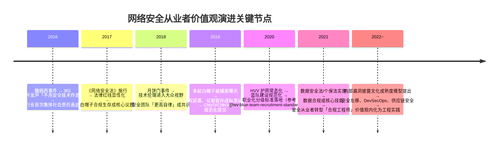

## 概述

网络安全从业者手握「双刃剑」技术能力，其职业伦理与价值观选择直接关乎行业生态健康、用户权益保障与法律红线边界。本页面以 **301在路上** 公众号 2016 年魏则西事件发声为起点，串联「月饼门」（2018）、白帽子被捕案件、内部漏洞披露文化建设等里程碑式案例，梳理安全圈从「技术至上」向「价值观驱动、合规前置、协作共治」演进的脉络，形成可交叉引用、可落地参考的结构化知识体系。

---

## 核心伦理原则

### 不用安全技术作恶
> **来源**：301在路上《安全观点|青年魏则西之死，我想说。》（2016-05-01）

- **核心表述**：「安全技术是一把双刃剑……我们能做的事情就是尽可能不去利用黑色魔法去做危害社会、危害公民的事情。」
- **价值导向**：以「核心价值驱动」替代「金钱价值驱动」，主动拒绝灰产、黑产诱惑。
- **实践映射**：
  - 拒绝为竞价排名欺诈、虚假医疗广告提供技术护航
  - 拒绝参与撞库、凭证填充、数据倒卖等黑灰产链条
  - 在 CTF/实战演练中严守授权范围，不越界、不留后门

### 负责任漏洞披露
- **核心要素**：授权前置 → 闭环修复 → 适度公开 → 权益保护
- **演进路径**：早期「全公开/卖漏洞」→ SRC 激励模式 → 法律合规框架下的协同披露（参考 [[security-practitioner-legal-compliance]]）

### 心理契约与组织忠诚
- **内涵**：安全团队与业务、HR、法务之间的非正式期许契约
- **破裂信号**：「谁提出问题就干掉谁」的反模式（详见 [[internal-vulnerability-disclosure-culture]]）
- **修复路径**：建立「提问题=贡献价值」的正向激励、跨部门协作 SLA、免责通道

---

## 关键案例复盘与价值观节点

### 魏则西事件（2016）—— 行业公开发声的起点
- **背景**：西安电子科大计算机专业毕业生魏则西因轻信搜索引擎竞价排名医疗广告，接受无效治疗离世。
- **301 观点**：
  - 互联网本质是解决信息不对称，**竞价排名违背信任原则**；
  - 安全从业者虽力量有限，但应**「坚持和树立良好的价值观」**，不做「黑暗的帮凶」；
  - 对热血青年黑击涉事网站虽不赞同手段，但**肯定其正义感**。
- **启示**：事件倒逼安全圈从「技术内核圈层」走向「社会责任发声」，推动《网络安全法》立法与搜索引擎广告监管落地。

### 月饼门事件（2018）—— 技术伦理与零容忍文化的冲突
> 详见 [[mooncake-gate-security-ethics-analysis]]

| 维度 | 关键事实 | 价值观张力 |
|------|----------|------------|
| **事件** | 4 名阿里安全工程师编写脚本抢购内部福利月饼，被开除 | 技术能力边界 vs 制度红线 |
| **争议焦点** | 是「顺手牵羊」还是「技术越界测试」？是否属于「责任漏洞披露」？ | 白帽子身份特权 vs 普通员工平等 |
| **行业共识演进** | 早期：「技术无罪、流程过重」 后期：**「拥有超权限者需更高自律」**、**安全团队须以身作则** | 从「技术崇拜」转向「合规先行、榜样担当」 |
| **治理启示** | 内部 SRC/红队规则须明确「自测边界」；HR/法务介入需有安全专业判断参与 | 建立 [[security-team-communication-art]] 跨部门信任机制 |

### 白帽子被捕/法律红线案例—— 合规前置的警钟
> 关联 [[security-practitioner-legal-compliance]]、[[cnvd-vulnerability-submission-certificate-case-study]]

- **典型场景**：
  - 未获书面授权开展渗透测试/漏洞挖掘
  - 越权访问/下载数据证明漏洞存在
  - 通过第三方平台（非厂商官方 SRC）提交漏洞引发管辖争议
- **法律锚点**：《刑法》第 285 条（非法侵入计算机系统罪）、第 286 条（破坏计算机系统罪）、《网络安全法》第 27 条（漏洞报告义务）
- **最佳实践**：
  - **唯一合法路径**：书面授权 → 规则范围内测试 → 官方渠道闭环提交 → 留存证据链
  - CNVD/CNNVD 提交需核验厂商授权函有效性（参考 [[cnvd-vulnerability-submission-certificate-case-study]] 实战全流程）

### 内部漏洞披露文化建设—— 从反模式到健康机制
> 详见 [[internal-vulnerability-disclosure-culture]]

| 阶段 | 现象 | 核心矛盾 | 改进方向 |
|------|------|----------|----------|
| **反模式期** | 「谁提问题谁背锅」、安全被视为「阻碍业务」、HR/法务按通用违纪处理 | 安全价值未被业务语言量化；心理契约单向破裂 | 引入「安全红利」量化模型（阻断损失、合规避罚、品牌护航） |
| **过渡期** | 设立内部 SRC、白帽子激励、匿名上报通道 | 激励不足、流程冗长、信任存量不足 | 简化流程→SLA 承诺→高管背书→定期公示修复率 |
| **成熟期** | **安全左移**、威胁建模前置、红蓝对抗常态化、跨部门复盘文化 | 资源投入大、需持续高层支持 | 纳入 OKR/KPI、建立安全冠军网络、输出行业标杆案例 |

---

## 价值观演进路线图

---

## 实战决策框架：伦理困境时的三步判断法

> 综合 [[security-job-interview-questions]] 面试真题与 [[security-career-development-guide]] 方法论

| 步骤 | 关键问题 | 行动指南 |
|------|----------|----------|
| **1. 法律红线核验** | 是否有书面授权？是否超出授权范围？是否涉及个人数据/国家秘密？ | 无授权即停止；超范围即冻结；涉敏即上报法务/合规 |
| **2. 价值观对齐** | 该行为是否「危害社会/公民」？是否违背「负责任披露」？是否破坏组织心理契约？ | 违背核心原则即拒绝；灰色地带寻求导师/同行研判（参考 [[white-hat-ethics-industry-trust]]） |
| **3. 长期主义复盘** | 短期利益 vs 职业声誉/行业信任/法律风险？能否向家人/后辈解释？ | 选择**可复盘、可传承、可站在阳光下**的路径；记录决策日志沉淀案例库 |

---

## 职业发展中的伦理坐标系

### 面试/晋升高频伦理考察场景
> 来源 [[security-job-interview-questions]]

| 场景 | 考察维度 | 优秀回答关键词 |
|------|----------|----------------|
| 发现公司产品重大漏洞，业务方要求延期修复上线 | 责任担当、沟通艺术、风险量化 | 「风险量化+分级上报+临时缓解方案+书面免责留痕」 |
| 竞争对手挖角并要求带走漏洞库/攻击脚本 | 忠诚度、知识产权、法律底线 | 「拒绝带走任何资产、协助交接、遵守竞业协议」 |
| 灰产团伙高薪招募「安全顾问」实为洗白技术 | 价值观、法律红线、职业操守 | 「直接拒绝、保留证据、必要时向警方/行业协会通报」 |
| 红队演练中意外获取核心数据库权限 | 授权边界、数据最小化、闭环归还 | 「立即停止、截图留证、汇报蓝队/法务、协助清理痕迹」 |

### 创业/转型中的伦理抉择
> 参考 [[security-industry-entrepreneurship-reflections]]、[[security-startup-entrepreneurship-lessons]]

- **四大核心原则**：踏实做事、凝聚力为本、拒绝踩踏上位、理性得舍
- **商业模式红线**：不做漏洞倒卖、不做攻击工具商业化分发、不协助规避合规监管
- **团队文化基因**：招聘即筛选价值观、入职即签署道德准则、复盘即包含伦理维度

---

## 健康与可持续性：伦理实践的物理基础
> 关联 [[security-practitioner-health-wellbeing]]

- **职业倦怠与伦理滑坡关联**：高强度 HVV、长期值守、酒文化应酬 → 判断力下降 → 易触碰红线
- **自我保护清单**：
  - 定期体检、运动介入（每周 ≥ 150 分钟中等强度）
  - 建立「拒绝灰色饭局」的话术库与边界感
  - OPSEC 实践外溢至生活：非智能机备用、高权限 APP 隔离、家人社工风险物理隔离
  - 心理咨询/同伴支持小组常态化

---

## 交叉引用导航

| 主题 | 核心页面 | 关联说明 |
|------|----------|----------|
| **法律合规红线与实务** | [[security-practitioner-legal-compliance]] | 授权规范、电子数据取证、两高一部规定、CNVD 提交实战 |
| **月饼门深度复盘** | [[mooncake-gate-security-ethics-analysis]] | 事件时间线、当事人视角、社区观点、治理反思、301 早期伦理呼吁 |
| **内部漏洞披露文化** | [[internal-vulnerability-disclosure-culture]] | 反模式识别、协作机制建设、心理契约修复、组织变革路径 |
| **白帽子伦理与信任** | [[white-hat-ethics-industry-trust]] | 媒体误读、企业不信任、身份冲突、伦理自律、SRC 协作文化 |
| **职业成长方法论** | [[security-career-development-guide]] | MVGP 计划、方向验证微实验、高质量提问框架、自我驱动力心法 |
| **面试伦理真题库** | [[security-job-interview-questions]] | 13 道非标准化题目：技术伦理、危机公关、忠诚度、薪资抉择 |
| **团队建设与管理** | [[security-leadership-team-management]]、[[security-team-communication-art]] | 信任授权、心理契约、扁平化协作、跨部门沟通艺术、向上管理 |
| **创业伦理反思** | [[security-industry-entrepreneurship-reflections]]、[[security-startup-entrepreneurship-lessons]] | 行业乱象、团队建设、商业竞争伦理、个人成长四大原则 |
| **健康与 OPSEC** | [[security-practitioner-health-wellbeing]] | 职业倦怠预防、酒文化应对、运动建议、安全意识外溢生活实践 |
| **实战授权案例** | [[cnvd-vulnerability-submission-certificate-case-study]]、[[auth-bypass-via-response-manipulation]] | 从资产收集到证书拿证全流程、闭源系统挖掘合规实战 |
| **蓝队职业标准** | [[hvv-blue-team-recruitment-standards]] | HVV 蓝军分级、薪资待遇、招聘流程、应急响应能力模型 |

---

## 结语

网络安全从业者的价值观演进，本质是 **「技术能力」向「社会责任、法律合规、组织协作、可持续发展」四维对齐** 的过程。从魏则西事件的愤怒发声，到月饼门的规则重塑，再到白帽子合规生存的摸索，直至内部披露文化的制度化沉淀——每个节点都在重申同一个核心：**拥有破解黑暗能力的人，更应成为守护光明的标杆**。

> 「你之所以看不到黑暗，是因为有人把黑暗挡在你看不到的地方。当你感受到了无尽的黑暗，更应该做的事情是坚持和树立良好的价值观。」  
> —— 301在路上，2016 年魏则西事件发声稿

---

*本页面持续更新，欢迎通过交叉引用页面补充新案例、新法规、新共识。*

## 来源

- [301在路上-201508-202208_157](../sources/301在路上-201508-202208_157.md)
