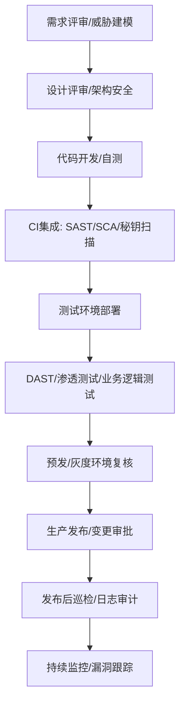

## 概览

本页面沉淀自 **301在路上** 微信公众号系列文章《互联网企业该如何构建安全团队》第四季（安全中期），作者 **smarttang**。文章聚焦 **安全工具平台化建设、数据驱动的汇报体系、上线安全流程与应急响应流程设计、响应时效 SLA 与事件分级标准**，并为后续 **HC（Headcount）规划与安全工作量化** 埋下伏笔。本页面在原文基础上补全结构化知识，并与知识库现有页面建立交叉引用，形成可落地的安全中期建设方法论。

> **系列上下文**：建议先阅读前三季 —— [第一季：成长型互联网企业该如何构建安全团队](http://mp.weixin.qq.com/s?__biz=MzIwMTQ2NzY4NA==&mid=403917916&idx=1&sn=c3931efa25bdae014307d87f535b60ce&scene=21#wechat_redirect)、[第二季：安全初期](http://mp.weixin.qq.com/s?__biz=MzIwMTQ2NzY4NA==&mid=403928789&idx=1&sn=91d5ce1d3f5149e7d421bae226bca1c1&scene=21#wechat_redirect)、[第三季：困惑与突破](http://mp.weixin.qq.com/s?__biz=MzIwMTQ2NzY4NA==&mid=403937859&idx=1&sn=9212b513809d4d16a3a0872575e0fc84&scene=21#wechat_redirect)。  
> **后续关联**：第五季《互联网企业安全团队 HC 规划与工作量化实战方法论》已整理为 [[security-team-hc-planning-work-quantification]]。

---

## 一、 安全工具平台化：从点状工具到汇聚平台

### 演进路径

| 阶段 | 典型产出 | 核心价值 |
|------|----------|----------|
| **基础安全建设期** | 安全基线检测、弱口令扫描、应用安全扫描等点状工具 | 解决「有没有」覆盖问题 |
| **安全中期（平台化）** | 将上述能力**汇聚为私有安全平台**，对内提供统一安全服务入口，对上输出标准化数据报表 | 实现「好不好用」「看不看得见」的质变 |

> **原文金句**：「在这个阶段，笔者假设基础安全已经做的差不多了，且当前最基层的安全已经规划好的时候，可以将一些输出汇聚出来。（上层的领导最喜欢看到的东西，这个时候你应该能够用丰富的数据展现出当前的安全状况，起码让上面有直观的认知。）」

### 平台化关键能力清单

- **资产纳管**：自动发现、CMDB 联动、标签化分级
- **漏洞全生命周期**：扫描 → 去重 → 分级 → 分派 → 复测 → 关闭，打通工单系统
- **基线合规**：基线模版化、周期性巡检、漂移告警
- **威胁检测**：日志审计、流量分析、威胁情报融合
- **数据大屏**：面向不同层级（执行层/管理层/高管层）的差异化视图

关联阅读：[[security-leadership-team-management#组织架构设计与人才梯队建设]]、[[threat-intelligence-service-enterprise-view#甲方对威胁情报服务的真实诉求]]。

---

## 二、 数据驱动汇报体系：用数据说话

### 汇报体系设计原则

| 维度 | 要求 | 说明 |
|------|------|------|
| **受众分层** | 高管看趋势/风险敞口/ROI，管理层看覆盖率/效率/积压，执行层看任务/技术细节 | 一份源数据，多套视图 |
| **阅读时间成本** | 单页 PPT/大屏 30 秒读懂核心结论 | 图表 > 文字，结论前置 |
| **指标体系** | 领先指标（覆盖率、扫描频次、规则更新）+ 滞后指标（漏洞存量、MTTR、事件损失） | 兼顾过程与结果 |
| **产出节奏** | 周报（战术）、月报（战略）、季报/半年报（规划） | 固化模版，自动化生成 |

### 年中/年度 Report 核心章节参考（原文截图要点）

1. **整体安全态势**：资产总量、核心资产占比、暴露面趋势
2. **漏洞管理效能**：新增/存量/关闭趋势、P0-P1 修复及时率、TOP 业务漏洞分布
3. **应急响应战绩**：事件分级统计、平均响应/处置时长、复盘改进落地率
4. **合规与审计**：关键合规项通过率、审计发现整改闭环
5. **平台建设进度**：模块上线率、日均调用量、自动化覆盖率
6. **团队投入产出**：HC 结构、人均产出、培训/认证/对外输出
7. **风险前瞻与资源诉求**：下半年重点风险、需协调资源、HC 缺口测算

> **实战建议**：把「数据报表这块我自认做得还行」变成 **标准化模版 + 定时调度任务**，释放人力做分析而非搬运数据。  
> 关联阅读：[[security-team-communication-art#向上汇报用数据说话]]、[[security-leadership-team-management#绩效考核与激励机制]]。

---

## 三、 上线安全流程设计：左移与最小阻力

### 核心原则

- **需求阶段介入**：安全评审前置至需求评审/设计评审，**审核业务逻辑**，而非仅扫代码
- **分级管控**：按业务分级（P0-P3）差异化设置闸口，避免「一刀切」拖慢业务
- **工具链集成**：将安全能力（SAST/DAST/SCA/秘钥扫描）嵌入 CI/CD，**阻断式/告警式** 可配置
- **最小阻力**：提供「一键接入」「基线模版」「自助复测」，降低业务接入成本

### 标准化上线安全流程（原文配图还原）

> **补全细节**：原文提到「在这图上没有展现出来，还望海涵」——**需求阶段安全介入**是左移的关键，建议在流程图首节点显式标注「安全威胁建模/业务逻辑审核」。

关联阅读：[[internal-vulnerability-disclosure-culture#安全团队与业务协作的健康机制]]、[[ops-security-case-studies-301#案例四某狐-zabbix-默认口令内网渗透]]。

---

## 四、 应急响应流程与 SLA 体系：16 字原则与分级标准

### 整体流程（原文配图还原）

**16 字原则**：**收到、了解、处理、执行、分析、归类、生成、督促**（原文隐含 8 步，合并为 16 字口诀）

### 响应时效 SLA 标准表（原文表格结构化）

| 执行项目 | 响应时长 | 说明 |
|----------|----------|------|
| **收到** | ≈ 5~8 分钟 | 收到具体信息需在 5~8 分钟内响应 |
| **了解** | ≈ 5~10 分钟 | 了解具体信息，排除通信成本，及时掌握事件全貌 |
| **处理** | ≈ 5 分钟 | 处理收集信息，初步判断入侵原因与切入点，快速精准判断 |
| **执行** | ≈ 15 分钟 | 根据收集情况进行技术排查 |
| **分析** | ≈ 15 分钟 | 技术分析攻击手段，思考修复/防御/规避方案 |
| **归类** | ≈ 1 分钟 | 快速归类问题位置，积累响应文档库 |
| **生成** | ≈ 10 分钟 | 文档输出，记录全过程，提出防御规避方案 |
| **督促** | ≈ 30 分钟 | 督促相关人员修复漏洞并反馈 |
| **合计** | **≈ 86~96 分钟** | 从告警到整改督促的基准闭环时长 |

> **实战注**：上表为 **P0 级（最高级）事件** 基准；低级别事件可按比例放宽，但 **「收到/了解」环节不建议放宽**，保证感知时效。

### 安全事件分级标准（原文配图还原）

| 级别 | 定义示例 | 典型特征 | 响应策略 |
|------|----------|----------|----------|
| **P0 致命** | 核心业务中断、核心数据泄露、大面积服务不可用、监管重大违规 | 影响全站/核心链路、涉及用户隐私/资金、媒体曝光风险 | 全员响应、最高优先级、CEO/CTO 可见、外部专家介入 |
| **P1 严重** | 重要业务受损、敏感数据疑似泄露、关键漏洞在野利用 | 影响单业务线、有明确利用链、需跨部门协作 | 核心成员响应、安全负责人牵头、业务配合整改 |
| **P2 一般** | 非核心业务漏洞、内部系统异常、疑似攻击未成功 | 影响范围可控、无实际损失、有修复方案 | 值班人员处理、工单跟踪、定期复盘 |
| **P3 低危** | 信息泄露风险低、边缘资产异常、扫描/探测行为 | 无直接业务影响、仅作记录归档 | 自动化处置/定期巡检、纳入资产台账 |

> **分级依据三要素**：**业务影响范围 × 数据敏感度 × 攻击确定性**。建议在 CMDB 中为每个资产预置「业务等级/数据分级」，事件分级可半自动化计算。

关联阅读：[[redteam-hw-opsec-guidelines#应急响应与日志反取证]]、[[xd-security-incident-response-notes#应急响应标准流程与自动化工具箱]]、[[security-incident-response-webshell-case-study#六阶段标准化流程与实战视角]]。

---

## 五、 从安全中期到 HC 规划：工作量化的前置动作

原文结尾预告：「这个时候你就要开始考虑团队扩展的问题，你需要把所有的安全工作进行完整的量化，将优先级体现出来，并且根据需求提出 hc 的规划方案。」

### 为什么要在「安全中期」做量化？

| 痛点 | 量化带来的破局 |
|------|----------------|
| 预算申请靠拍脑袋，老大不买单 | 用 **存量/增量工作量模型** 算出 HC 缺口，变「我要人」为「业务需要这么多人」 |
| 团队忙碌但产出不可见 | 建立 **人均产出指标**（扫描覆盖率、漏洞闭环率、平台模块交付数），绩效有据 |
| 新人入职无法快速上手 | 将量化拆解为 **标准化 SOP/Playbook**，新人按清单执行即可产出 |
| 跨部门协作扯皮 | 用 **SLA/分级标准** 固化双方责任边界，「流程说话」替代「人情说话」 |

### 工作量化的核心维度（为第五季铺垫）

| 维度 | 量化对象 | 典型指标 |
|------|----------|----------|
| **存量业务** | 历史资产、遗留系统、技术债 | 资产总数、分级分布、漏洞存量、合规缺项、需人工渗透/代码审计的 P0/P1 业务数 |
| **增量业务** | 新上线项目、迭代需求、变更单 | 月均上线数、安全评审介入率、自动化扫描覆盖率、阻断式闸口拦截数 |
| **平台建设** | 工具开发、模块上线、运营迭代 | 模块交付数、日均调用量、自动化替代人工工时、用户满意度 |
| **应急运营** | 告警处理、事件响应、复盘改进 | 告警总量/有效率、MTTD/MTTR、演练场次、复盘落地率 |
| **合规审计** | 监管要求、客户审计、内控自查 | 合规项总数、通过率、整改闭环周期、证据包产出效率 |
| **赋能输出** | 培训、文档、对外分享、工具开源 | 培训场次/人次、文档数、对外演讲/文章、开源贡献 |

> **下一步**：第五季将详细展开 **「如何把上述维度算成 HC 需求」「如何定岗定责定指标」「如何向上争取 HC 的沟通技巧」**，详见 [[security-team-hc-planning-work-quantification]]。

---

## 六、 关键交叉引用导航

| 主题 | 页面 | 核心关联点 |
|------|------|------------|
| 安全团队领导力与管理体系 | [[security-leadership-team-management]] | 组织架构、招聘定级、薪酬体系、人才梯队、绩效考核 |
| 安全团队沟通实战 | [[security-team-communication-art]] | 向上管理、跨部门协作、信任建立、流程推进、数据汇报 |
| 安全从业者职业成长 | [[security-career-development-guide]] | MVGP 计划、面试非技术题、法律红线、高质量提问 |
| HVV/蓝军招聘标准 | [[hvv-blue-team-recruitment-standards]] | 分级标准、薪资待遇、应急响应能力模型 |
| 内部漏洞披露文化 | [[internal-vulnerability-disclosure-culture]] | 月饼门反思、安全与业务/HR/法务协作机制 |
| 运维安全案例库 | [[ops-security-case-studies-301]] | VPN/VPN 漫游、vCenter、.git 泄露、Zabbix 默认口令 |
| 威胁情报甲方视角 | [[threat-intelligence-service-enterprise-view]] | 漏洞通报同质化、资产上下文缺失、定制化情报需求 |
| 白帽伦理与行业信任 | [[white-hat-ethics-industry-trust]] | 媒体误读、企业不信任、SRC 协作文化 |
| 月饼门伦理复盘 | [[mooncake-gate-security-ethics-analysis]] | 技术伦理、零容忍文化、心理契约破裂 |
| 安全从业者健康管理 | [[security-practitioner-health-wellbeing]] | 职业倦怠、酒文化、运动建议、OPSEC 实践 |
| 安全法律合规红线 | [[security-practitioner-legal-compliance]] | 授权测试、漏洞披露、数据保护、电子取证、刑事证据规则 |
| 红队 OPSEC 规范 | [[redteam-hw-opsec-guidelines]] | 环境隔离、工具指纹清洗、上线隐匿、日志反取证 |
| XD安全应急响应笔记 | [[xd-security-incident-response-notes]] | 标准流程、日志分析、自动化工具箱、溯源取证 |
| Webshell 应急响应实战 | [[security-incident-response-webshell-case-study]] | 六阶段流程、11 视角复盘、检查清单 |
| 301在路上文章归档 | [[301-zai-lushang-wechat-archive-201508-202208]] | 系列全景索引、安全团队建设专题、职业成长反思 |

---

## 七、 结语：安全中期的「三张图、两张表、一套流」

| 交付物 | 核心作用 | 面向受众 |
|--------|----------|----------|
| **平台架构图** | 展示工具汇聚全景、数据流向、自动化覆盖边界 | 高管/技术委员会 |
| **上线安全流程图** | 明确安全左移节点、分级闸口、工具链集成位置 | 研发/运维/产品 |
| **应急响应流程图** | 固化 16 字原则、分级分流、督促闭环 | 全员/值班表 |
| **汇报指标体系表** | 统一领先/滞后指标、计算口径、展示频次 | 管理层/高管 |
| **事件分级与 SLA 表** | 量化响应时效、责任边界、升级路径 | 安全团队/业务方/法务 |
| **标准化 Playbook 库** | 将上述流程落地为可执行、可度量、可迁移的操作手册 | 团队全员/新人 |

> **一句话总结**：**安全中期不再是「干活」，而是「建体系、出数据、定流程、算账本」——为 HC 规模化扩张铺好每一块基石。**

---

> **原文链接**：<http://mp.weixin.qq.com/s?__biz=MzIwMTQ2NzY4NA==&mid=403998126&idx=1&sn=a262f680918c716c924b8c97d774f871&chksm=0b0d57e53c7adef313e08d18f5c948a072e9fd0be2df2fa874446d887e1b0141244b3f033916&scene=126&sessionid=1681656782#rd>  
> **作者**：smarttang | **发布平台**：301在路上 | **系列**：互联网企业该如何构建安全团队（第四季·安全中期）

## 来源

- [301在路上-201508-202208_176](../sources/301在路上-201508-202208_176.md)
