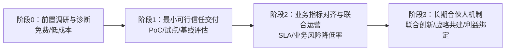

## 概述

本页面沉淀自 301在路上 微信公众号文章《观点：领导不重视信息安全工作，究竟谁的责任？》，系统拆解**甲方执行层**与**乙方服务方**在安全价值传递上的共性失灵模式，并提炼出「安全价值显性化四步法」与「甲乙方共建信任闭环」两套可落地的实操框架。

> **核心前提**：讨论对象为「业务/数据重要」且「决策层具备基本安全意愿」的企业。路边小贩、完全无安全预算的组织不在讨论范围内。

---

## 一、 甲方执行层：为何领导觉得「安全不重要」？

### 核心失灵模式

| 失灵行为 | 典型表现 | 导致后果 |
|---|---|---|
| **隐瞒漏洞/捂盖子** | 发现高危漏洞不上报、私下消化、汇报只报好消息 | 领导误判安全态势良好，认为安全投入性价比低 |
| **不量化产出** | 工作量无度量（如：修复漏洞数、拦截攻击次数、应急响应时长）、无交付物 | 领导无法在绩效/预算会上为安全团队辩护 |
| **价值未传递** | 用技术术语汇报（CVE 编号、攻击链细节），不翻译为业务风险（停机损失、合规罚款、品牌声誉） | 决策层听不懂、不关心、不买单 |

> **301 金句**：「懂企业营业管理的人员不懂 IT、懂 IT 的自然不懂安全，懂安全还要你干嘛？」——**核心矛盾在于“安全核心价值未翻译为业务语言”**。

### 关联案例与反模式

- [[internal-vulnerability-disclosure-culture]]：记录「谁提出问题就干掉谁」的反模式，与「隐瞒漏洞」同源。
- [[security-team-communication-art]]：提供「漏洞捂盖子 vs 风险透出」对比案例，与「安全价值量化交付清单」模板。

---

## 二、 乙方服务方：为何客户不愿为方案买单？

### 核心失灵模式

| 失灵行为 | 典型表现 | 导致后果 |
|---|---|---|
| **不懂业务痛点** | 售前/销售未做业务调研，直接推标品功能清单 | 客户觉得「你根本不懂我」，拒绝深度沟通 |
| **方案价值未落地** | 方案 PPT 只讲技术指标（检出率、误报率），不讲业务收益（降本、增效、合规达标） | 客户无法向老板汇报 ROI，项目搁置 |
| **信任基础未建** | 首次拜访即谈合同，未提供免费诊断、行业对标、同行案例等「前置价值」 | 客户缺乏最小信任门槛，连沟通意愿都没有 |

> **客户原话**：「一个企业/团队连我现阶段的业务痛点都不了解的人，我怎么相信他们的解决方案？」

### 关联视角

- [[threat-intelligence-service-enterprise-view]]：甲方视角吐槽威胁情报服务「通报同质化、缺乏资产上下文、无法指导修复决策」，印证「方案价值未落地」。
- [[security-consultative-selling-career]]：定义「顾问式销售/技术型销售」角色，核心能力即「懂业务需求、销售套路与技术价值转化」。

---

## 三、 安全价值显性化四步法（甲方执行层自救）

> 目标：**把「安全做了什么」翻译成「业务避免了什么损失」**，让领导在汇报季、预算季能直接引用。

| 步骤 | 动作关键词 | 产出物示例 | 关键度量指标 |
|---|---|---|---|
| **1. 资产画像与风险基线** | 梳理核心资产 → 业务影响度分级 | 《核心资产清单与风险基线报告》 | 核心资产覆盖率、高危漏洞密度 |
| **2. 攻击面量化与持续监测** | 资产测绘 → 暴露面收敛趋势 | 月度《攻击面收敛度仪表盘》 | 新增暴露面数量、平均修复周期 (MTTR) |
| **3. 事件响应与损失避免测算** | 复盘实战演练/真实事件 → 估算停机/泄露/罚款成本 | 《年度安全事件损失避免测算表》 | 避免直接经济损失、合规罚款规避额 |
| **4. 定期高管汇报与预算关联** | 季度/半年/年度汇报 → 绑定下一年度预算申请 | 《安全价值交付白皮书》+《下年度预算申请》 | 预算获批率、人员编制 (HC) 增长率 |

> **实操提示**：
> - 汇报模板参考 [[security-team-communication-art]] 中的「安全价值量化交付清单」。
> - HC 规划与工作量化方法见 [[security-team-hc-planning-work-quantification]]。

---

## 四、 甲乙方共建信任闭环（乙方服务方破局）

> 目标：**从「推销产品」转型为「共建安全能力」**，建立最小信任门槛 → 持续交付价值 → 复购/续费/转介绍。

### 四阶段关键动作表

| 阶段 | 乙方核心动作 | 甲方感知价值 | 信任信号 |
|---|---|---|---|
| **0. 前置调研** | 业务痛点访谈、行业对标报告、同行匿名案例分享 | 「懂我的业务、懂我的合规压力」 | 客户主动提供内部文档/介绍关键人 |
| **1. 最小交付** | 免费/低价 PoC、基线评估、快速修复 1-2 个高危漏洞 | 「能落地、能出报告、能过审计」 | 签署试用协议/引入内网环境 |
| **2. 联合运营** | 约定 SLA（响应时间、修复率）、月度联合复盘、业务风险指标联动 | 「安全变成可度量的业务指标」 | 纳入甲方季度 OKR/绩效考核 |
| **3. 战略共建** | 联合建设安全运营中心、共享威胁情报、共同申报行业标杆案例 | 「安全能力内生化、品牌背书」 | 多年框架协议/股权激励/联合营销 |

### 避坑指南（90% 乙方易犯的四大坑）

1. **只谈技术不谈业务** → 引入「业务痛点画布」强制售前填写。
2. **方案即交付** → 承诺「运营期 SLA」，而非「部署即验收」。
3. **单点联系人依赖** → 建立「多层级联系人矩阵」（高管/业务/运维/采购）。
4. **忽视合规与法务红线** → 前置《数据处理协议 DPA》《渗透测试授权书》模板，参考 [[security-practitioner-legal-compliance]]。

---

## 五、 交叉引用导航

| 主题 | 页面 | 关联点 |
|---|---|---|
| 向上汇报与跨部门协作 | [[security-team-communication-art]] | 价值量化模板、吸烟区情报收集、流程推进破局 |
| 团队建设与 HC 规划 | [[security-team-hc-planning-work-quantification]] | 存量/增量业务量化、时间投入估算、向上争取 HC 话术 |
| 领导力与人才梯队 | [[security-leadership-team-management]] | 信任授权、心理契约、扁平化协作、薪酬体系 |
| 内部漏洞披露文化 | [[internal-vulnerability-disclosure-culture]] | 「捂盖子」反模式根因、负责任披露机制建设 |
| 顾问式销售角色定位 | [[security-consultative-selling-career]] | 售前/销售/售后融合、安全项目评估四步法、靠谱客户判断四维度 |
| 甲方视角采购痛点 | [[threat-intelligence-service-enterprise-view]] | 情报服务四大结构性缺失、定制化交付诉求 |
| 法律合规红线 | [[security-practitioner-legal-compliance]] | 授权规范、数据处理合规、漏洞披露最佳实践、电子取证规则 |
| 职业伦理与价值观 | [[security-practitioner-ethics-values]] | 月饼门、魏则西事件、白帽子伦理、技术不作恶 |
| 职业发展与面试非技术题 | [[security-career-development-guide]] / [[security-job-interview-questions]] | 危机公关模拟、忠诚度测试、薪资抉择、MVGP 成长计划 |

---

## 六、 速查卡片：一句话记住核心

| 角色 | 核心动作 | 禁忌 | 一句话口诀 |
|---|---|---|---|
| **甲方执行层** | 持续产出「业务语言」的安全价值报告 | 只报漏洞数、不报损失避免额 | **「不量化不汇报，不翻译不买单」** |
| **乙方服务方** | 先诊断后开方，先信任后签单 | 标品推销、单点联系、忽视合规 | **「不懂痛点不提方案，不建信任不谈合同」** |
| **双方共识** | 建立「风险透出-价值量化-信任跃迁」正向循环 | 零和博弈、甩锅推责、短期利益 | **「安全是业务的护城河，信任是护城河的地基」** |

---

## 七、 变更记录

| 日期 | 版本 | 变更摘要 | 编辑者 |
|---|---|---|---|
| 2025-08-15 | 1.0 | 初始创建：结构化沉淀 301 文章核心观点，提炼两大框架，补全交叉引用 | AI Curator |

---

> **延伸阅读**：原文链接已失效，核心观点已完整内化于本页面。若需对照原文语境，可在微信搜索「301在路上 领导不重视信息安全工作 谁的责任」。

## 来源

- [301在路上-201508-202208_168](../sources/301在路上-201508-202208_168.md)
