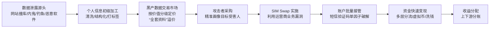

## 概述

2016 年 4 月 11 日，网络安全博主“趣火星”发文披露其遭遇的一起完整 **SIM Swap（补卡攻击/换卡攻击）案例**。攻击者利用中国移动“139 邮箱”短信服务漏洞，拦截 4G 自助换卡验证码，在受害人不知情的情况下完成 SIM 卡劫持，进而通过“短信验证码重置密码”功能，先后攻破支付宝、多张银行卡（中国银行、招商银行等）、网易 163 邮箱、百度钱包等账户，实现资金盗刷。

本案由 **360 天眼实验室** 深度分析并公开披露，是互联网上首例对补卡攻击全链路进行完美复盘的公开案例。攻击链条清晰展示了：**个人信息在黑产链条中预先被获取（姓名、身份证号、银行卡号、银行预留手机号、各类账户密码） → 利用运营商业务漏洞实施 SIM 劫持 → 利用短信验证码单因子认证缺陷批量接管账户 → 资金快速转移变现** 的完整攻击闭环。

## 攻击链路全景复盘

### 阶段一：前置侦察与个人信息获取（黑产链条预置）

攻击者在实施 SIM Swap 前，已掌握受害人以下核心敏感信息：

| 信息类别 | 具体字段 | 可能来源 |
|----------|----------|----------|
| **身份基础信息** | 姓名、身份证号、手机号 | 各类网站数据泄露库、公开渠道、内鬼泄露 |
| **金融账户信息** | 多张银行卡号、开户行、银行预留手机号 | 银行内部泄露、支付平台泄露、黑产买卖 |
| **账户凭证** | 支付宝登录密码、银行网银登录密码、网易邮箱密码、移动官网登录密码 | 撞库攻击、钓鱼网站、恶意软件、弱口令爆破 |
| **通讯录/社交关系** | 可信好友账户（用于资金转移） | 社交工程、通讯录泄露 |

> **关键判断**：文章作者指出“纵观整个事件，受害人被幕后黑手提前做好了背景调查是肯定的”。说明攻击非随机选取，而是基于**精准画像**的定向攻击。

### 阶段二：利用 139 邮箱服务劫持短信验证码

#### 技术原理
- **139 邮箱服务**：中国移动提供的“手机号即邮箱账号”服务，用户可通过发送短信至 `106581390+手机号` 实现邮件收发。
- **短信网关特性**：受害人回复 `10658139013816280086` 的短信，实际上会投递到手机号 `13816280086` 的 139 邮箱中。
- **攻击利用**：攻击者预先注册/控制手机号 `13816280086` 的 139 邮箱，诱导受害人向该号码回复验证码，实现**短信拦截/转发**。

#### 实施步骤
1. **诱导定制业务/停机通知**：攻击者通过伪基站或群发平台向受害人发送“业务定制成功/话费不足停机”类诱导短信，引起受害人注意并降低警惕。
2. **触发 4G 自助换卡流程**：攻击者在移动网上营业厅或 App 发起“4G 自助换卡”业务，系统向受害人原手机号下发 **6 位验证码**。
3. **社会工程学诱导回复**：攻击者伪装客服/系统通知，引导受害人将收到的验证码回复给 `10658139013816280086`（实际为攻击者控制的 139 邮箱）。
4. **验证码拦截与换卡完成**：攻击者在 139 邮箱网页端实时查收验证码，提交至换卡页面，完成 SIM 卡激活。**原 SIM 卡瞬间失效（无服务），受害人误判为停机。**

> **北京移动 10086 事后回应印证**：受害人手机“无服务”正是因 SIM 卡被作废、新卡已激活。

### 阶段三：手机号劫持后的账户接管连环攻击

攻击者掌控手机号（接收所有短信验证码）后，利用“短信验证码重置密码/登录”这一**单因子认证脆弱性**，在极短时间内批量接管账户：

| 目标账户 | 攻击动作 | 结果 |
|----------|----------|------|
| **支付宝** | 短信验证码重置登录/支付密码 → 转移余额/快捷支付盗刷 | 资金被转走 |
| **中国银行、招商银行等多张银行卡** | 短信验证码重置网银登录密码、支付密码 → 大额转账 | 资金被盗刷 |
| **网易 163 邮箱** | 短信验证码重置密码 → 登录邮箱搜集更多凭证/阻断找回通知 | 邮箱被接管 |
| **百度钱包** | 利用已掌握的姓名、身份证、银行卡号、手机号、短信验证码绑定快捷支付 → 盗刷 | 资金损失 |
| **移动官网** | 短信验证码登录/修改服务密码 → 巩固号码控制权 | 彻底锁死受害人 |

> **受害人自救尝试**：受害人发现支付宝推送异常后，尝试将资金转给可信好友，但支付宝账户已被攻击者完全控制，转账失败。后通过好友协助冻结部分银行卡。

### 阶段四：资金变现与痕迹清理

- 资金通过多层转账、快捷支付消费、虚拟货币兑换等方式快速分流洗白。
- 攻击者修改各账户绑定手机号、邮箱、密码，切断受害人找回路径。
- 受害人事后向警方报案，但资金追回难度极大。

## 核心技术剖析

### 邮箱服务被滥用的根因

| 缺陷点 | 说明 |
|--------|------|
| **短信网关双向透传** | `106581390+手机号` 既是发送端也是接收端，用户回复短信直接进入对应手机号的 139 邮箱，无额外验证。 |
| **无绑定关系校验** | 发起换卡业务的账号/身份与接收验证码的手机号/139邮箱无强绑定校验，攻击者可任意指定“接收验证码的 139 邮箱归属手机号”。 |
| **用户认知盲区** | 绝大多数用户不知 139 邮箱短信网关机制，不理解“回复 10658... 号码”即“发送邮件到某手机号邮箱”。 |
| **运营商侧检测缺失** | 短时间内同一手机号触发换卡、验证码被异地/非常用设备 139 邮箱登录查收，未触发风控拦截。 |

### 短信验证码单因子认证的系统性风险

- **支付宝、银行、邮箱、运营商**等核心账户均支持“短信验证码重置密码/登录”，且**无第二因子（如人脸、设备指纹、U盾、支付密码独立验证）强制介入**。
- 一旦手机号被劫持，**等同于掌握了“万能钥匙”**。
- **百度钱包案例**更揭示：攻击者已掌握“姓名+身份证+银行卡号+预留手机号”四要素，仅缺短信验证码，SIM Swap 补齐最后一环即可完成绑定盗刷。

## 黑产链条视角的信息流转

- **“全套资料”（Fullz）**：包含姓名、身份证、手机号、银行卡号、各类密码、甚至人脸照片/视频的完整身份包，在黑市溢价交易，是定向 SIM Swap 攻击的**前置必要条件**。
- **数据“玩烂”后抛售**：文章引用“很多被曝出来的数据库都是在地下产业链中玩烂了，已经很难再榨取出价值后才被抛出的”，揭示**公开泄露库往往是黑产深度利用后的“下脚料”**。

## 防御与缓解建议

### 运营商侧
1. **废弃/重构 139 邮箱短信网关**：禁止验证码类短信通过 139 邮箱收发，或强制要求登录 139 邮箱需双因子认证。
2. **换卡业务强实名/强验证**：
   - 线上自助换卡需**人脸识别+原 SIM 卡在线状态校验**（如通过 SIM 卡签名验证）。
   - 引入**设备指纹、地理位置、行为基线**风控，异地/非常用设备发起换卡强制人工审核/短信+语音双通道验证。
3. **短信上行监控**：监测用户向 `106581390+非本机号码` 回复验证码模式，实时拦截并预警。

### 金融/互联网平台侧
1. **淘汰“仅短信验证码”重置核心凭证**：
   - 重置登录/支付密码**必须**组合：短信验证码 + 人脸识别/设备指纹/原密码/支付密码/U盾/邮箱验证码 等第二因子。
   - **敏感操作（大额转账、修改绑定手机/邮箱）强制多因子认证**。
2. **设备信任体系**：建立“常用设备/可信设备”白名单，非常用设备登录/重置密码触发强风控（人脸、推送确认、延时到账）。
3. **号码变更风险窗口**：检测到手机号近期发生过补卡/过户/停机复机，**冻结短信验证码类敏感操作 24-72 小时**，并通过原绑定邮箱/App 推送/人工外呼双通道确认。

### 用户侧
1. **警惕“突发停机/业务定制”短信**：收到此类短信，**立即拨打官方 10086 核实**，切勿点击链接、回复验证码、拨打短信内电话。
2. **开启“SIM 卡锁/防补卡”服务**：向运营商申请**线下凭身份证办理补卡、禁止线上自助换卡**、设置补卡口令。
3. **关键账户绑定“非手机号”强二因子**：
   - 支付宝/微信：开启**人脸识别、指纹、数字证书、硬件密钥（YubiKey 等）**。
   - 银行：使用 **U盾/动态令牌/手机银行绑定设备指纹**，关闭“短信验证码登录/重置”。
   - 邮箱：绑定 **备用邮箱、Authenticator TOTP、安全密保问题（非公开信息）**。
4. **密码卫生**：**每个核心账户使用唯一强密码**，启用密码管理器，防止撞库。定期在 [Have I Been Pwned](https://haveibeenpwned.com/) 等平台监测泄露。
5. **发现异常即时冻结**：手机突发无服务、收到未操作的验证码/密码修改通知，**第一时间拨打银行/支付宝/运营商官方客服电话挂失冻结**，而非尝试自行转账。

## 交叉引用与延伸阅读

- [[credential-stuffing-password-hygiene]]：撞库攻击与密码复用如何为 SIM Swap 提供“全套资料”前置条件。
- [[social-engineering-attack-techniques]]：诱导受害人回复验证码、伪装客服电话等社会工程学手法在本案中的具体应用。
- [[guiyang-1229-telecom-fraud-case-study]]：2015 年贵州 1.17 亿巨额电信诈骗案，同样涉及冒充公检法、远控软件劫持 U 盾、个人信息精准画像与黑产洗钱链条，可作对比研究。
- [[medical-data-security-breaches]]：医疗数据泄露如何成为黑产获取“姓名+身份证+手机号+病历”等高价值定向欺诈素材的源头。
- [[supply-chain-attack-fundamentals]]：供应链攻击视角下的内鬼泄露、第三方数据外包风险，关联本案中个人信息的上游来源。
- [[301-zai-lushang-wechat-archive-201508-202208]]：本文来源“301在路上”微信公众号归档索引，含更多安全观点、团队建设、职业成长等内容。

## 时间线摘要

| 时间 | 事件节点 |
|------|----------|
| **2016-04-11** | 趣火星发布长微博《中国移动，请你告诉我，为什么一条短信就能骗走我所有的财产？》 |
| **2016-04-11 当日** | 360 天眼实验室发布深度分析文章（本页核心来源） |
| **事后** | 北京移动 10086 回应确认系“自助换卡业务”导致 SIM 卡更换 |
| **长期影响** | 推动运营商收紧自助换卡流程、金融平台强化多因子认证、用户防 SIM Swap 意识觉醒 |

## 结语

本案是 **SIM Swap 攻击在中国的标志性首例公开复盘**，揭示了三大核心教训：

1. **运营商业务设计缺陷（139 邮箱短信网关）可被武器化为短信拦截通道**。
2. **“短信验证码 = 身份证明” 的单因子认证模型在手机号可被劫持前提下彻底失效**。
3. **个人信息在黑产链条中已形成成熟的“采集-加工-交易-利用”工业化分工**，公开泄露库仅是冰山一角。

防御的关键在于**打破单点依赖**：运营商收紧号码所有权变更验证、平台强制多因子认证、用户建立“号码不等于身份”的安全心智。唯有全链路协同，方能将 SIM Swap 攻击成本推高至攻击者无法获利的临界点。

---

> **原文来源**：360 天眼实验室，《一种补卡攻击的套路全分析》，刊载于“301在路上”微信公众号（2016-04-11）。  
> **版权声明**：© 乌云知识库版权所有，未经许可禁止转载。本页面仅供安全研究与防御参考。

## 来源

- [301在路上-201508-202208_170](../sources/301在路上-201508-202208_170.md)
