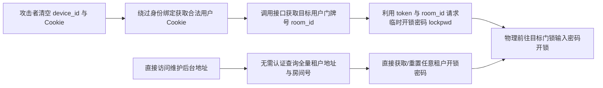

## 概述

本页面记录并分析青客公寓（上海知名白领公寓品牌）智能门锁系统在 2015 年曝出的两个关键安全漏洞：

1. **App 端逻辑漏洞**：通过清空 `device_id` 与 `Cookie` 绕过用户身份绑定，遍历获取任意用户身份证、房间号及临时开锁密码（`lockpwd`）。
2. **维护后台越权访问**：无需登录即可访问维护后台，查询所有租户房间地址并直接获取/重置开锁密码。

两个漏洞形成 **「远程信息收集 → 临时密码获取 → 物理开锁」** 完整攻击链，将虚拟层面的逻辑缺陷直接转化为线下物理入侵能力。案例来自乌云漏洞报告平台（wooyun-2015-0151351、wooyun-2015-0152033），已由厂商修复。

## 攻击链全景



## 核心漏洞详解

### App 端设备指纹绑定逻辑缺陷

#### 根因分析
- 正常流程：App 启动时上报 `device_id`（设备唯一标识）与 `Cookie`（会话凭证），服务端校验二者绑定关系，仅返回当前用户数据。
- **缺陷**：服务端未对「`device_id` 为空 / `Cookie` 为空」的请求进行拦截，反而将其视为「未绑定新设备」，直接返回任意用户的身份信息（身份证号、姓名、手机号）并下发新的合法 `Cookie`。

#### 利用步骤
1. 抓包获取任意接口请求（如 `/api/user/info`）。
2. 将请求头中的 `device_id` 与 `Cookie` 字段置空或删除。
3. 重放请求，服务端返回任意用户的敏感信息及有效 `Cookie`。
4. 使用新 `Cookie` 调用 `/api/room/detail?room_id=xxx` 获取目标房间详细信息。
5. 调用 `/api/lock/temp_pwd`（或同类接口），传入 `token` 与 `room_id`，响应中包含 `lockpwd` 字段 —— 即临时开锁密码。

#### 关键数据字段
| 字段 | 说明 | 来源 |
|------|------|------|
| `device_id` | 客户端设备唯一标识（Android ID / IDFA 等） | App 启动自动上报 |
| `Cookie` | 会话凭证，绑定 `device_id` | 登录后下发 |
| `token` | 业务层访问凭证，随 `Cookie` 下发 | 步骤 3 响应 |
| `room_id` | 房间唯一标识，关联门锁 | 步骤 4 响应 |
| `lockpwd` | 临时开锁密码（数字/字母组合），有效期短 | 步骤 5 响应 |

#### 影响范围
- 青客公寓全量在住租户（上海区域数千间房源）。
- 攻击者可批量遍历 `room_id`，获取所有房间的临时密码，实现「敲两下键盘就给打开」。

---

### 维护后台未授权访问与越权查询

#### 根因分析
- 维护后台独立部署，原设计面向现场维修人员，**完全缺失身份认证与授权模块**。
- 接口直接拼接 SQL 查询，无参数过滤，支持按房间号、手机号、身份证号模糊检索。
- 返回字段包含：`room_address`、`room_number`、`lock_pwd`、`reset_pwd_token` 等核心敏感数据。

#### 利用步骤
1. 通过信息收集（FOFA/ZoomEye/历史漏洞报告）发现后台入口，如 `http://maintain.qike.com` 或内网 IP 段。
2. 直接访问列表页 `/admin/tenant/list`，无重定向至登录页，直接渲染全量租户表格。
3. 点击任意租户「查看详情」或调用 `/admin/lock/pwd?room_id=xxx`，即时获取当前开锁密码。
4. 调用 `/admin/lock/reset` 可重置密码并生成新密码，攻击者可自行设定并物理开锁。

#### 典型响应示例
```json
{
  "code": 200,
  "data": {
    "room_address": "徐汇区漕溪北路xxx弄xx号",
    "room_number": "302",
    "tenant_name": "张三",
    "lock_pwd": "8A3F9K",
    "reset_token": "eyJhbGciOiJIUzI1NiIs..."
  }
}
```

#### 影响范围
- 覆盖青客公寓 **全体租户、全体房间、全时段有效密码**。
- 维修人员离职、密码未轮换、后台未下线均会导致持续暴露。

---

## 修复建议与防御体系

### 身份认证与设备绑定硬化
- **强制双向绑定**：服务端必须校验 `device_id` 与 `Cookie` 同时存在且匹配，拒绝任一为空的请求。
- **设备指纹增强**：引入硬件级指纹（Android SafetyNet / iOS DeviceCheck）、行为指纹（IP、UA、操作习惯），异常登录触发二次验证。
- **临时密码策略**：
  - 一次一密，用后即焚，有效期 ≤ 5 分钟。
  - 密码复杂度 ≥ 8 位字母数字混合，防离线爆破。
  - 关联设备指纹，仅允许申请设备在 5 分钟内使用。

### 后台权限管控
- **零信任准入**：维护后台纳入统一 IAM（Identity and Access Management），强制 SSO + MFA（双因子认证）。
- **最小权限原则**：维修账号仅拥有「查看指定工单房间密码」权限，禁止全量导出、批量重置。
- **操作审计与告警**：所有密码查询/重置操作记录不可篡改审计日志，异常高频访问触发实时告警。

### 物理锁与云端联动安全
- **固件签名验证**：门锁固件升级采用 ECDSA 签名，防止恶意固件植入后门。
- **通道加密**：门锁与云端通信采用 TLS 1.3 + 证书绑定，防中间人篡改下发密码。
- **离线开锁审计**：门锁本地存储最近 200 条开锁记录（加密存储），定期上传云端比对，发现异常离线开锁即告警。

### 安全开发生命周期（SDL）落地
| 阶段 | 关键动作 |
|------|----------|
| 需求/设计 | 威胁建模（STRIDE），识别「物理开锁」作为最高资产保护目标 |
| 编码 | 静态扫描（SAST）规则强制检查：`device_id` 非空校验、后台 RBAC 注解覆盖率 100% |
| 测试 | 专项渗透测试：逻辑越权、横向越权、临时凭证滥用、后台未授权访问 |
| 发布 | 灰度发布 + 熔断机制，监控「临时密码申请/使用比率」异常波动 |
| 运营 | 漏洞应急响应 SLA：P0 级（物理入侵风险）2 小时内修复上线 |

---

## 关联知识与延伸阅读

- [[logic-vulnerability-password-reset-audit]] — 密码重置逻辑漏洞六大模式与代码审计方法论，可对比本案中「临时密码生成/重置」逻辑缺陷。
- [[childrens-smartwatch-security-vulnerabilities]] — 同类 IoT 可穿戴设备授权绕过导致隐私泄露与物理定位风险。
- [[ble-smart-bracelet-protocol-analysis-attack]] — BLE 设备协议逆向与任意指令下发实战，涉及物理设备远程控制攻击面。
- [[openid-connect-acr-amr-2fa-bypass]] — 认证协议层面的降级绕过，对比本案中「清空凭证即绕过」的低级逻辑错误。
- [[medical-system-internal-penetration-case-study]] — 从 Web 越权到内网横向移动的完整渗透链，展示权限控制失效的连锁危害。
- [[badusb-hid-attack-arduino-leonardo]] — 物理接触攻击视角的 HID 注入，对比本案「远程获取密码 → 物理输入」的攻击路径差异。

---

## 时间线与引用来源

| 时间 | 事件 |
|------|------|
| 2015 年左右 | 白帽子发现并上报乌云漏洞平台：wooyun-2015-0151351、wooyun-2015-0152033 |
| 2015 年 | 青客公寓确认漏洞并完成修复 |
| 2016 年后 | 微信公众号「301在路上」等技术社区转载复盘，作为 IoT 智能锁安全典型案例沉淀 |

> **声明**：本页面仅用于安全研究与防御建设，漏洞详情已脱敏处理，严禁用于非授权测试或非法用途。

## 来源

- [301在路上-201508-202208_194](../sources/301在路上-201508-202208_194.md)
