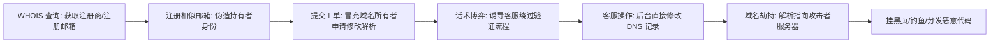

## 概述

本页面沉淀两起典型社会工程学实战案例，覆盖**服务提供商人员操纵**与**目标组织内部人员操纵**两大攻击面：

1. **域名注册商客服社会工程学攻击**（2018 年实战）：攻击者利用 WHOIS 公开信息，注册相似邮箱伪造域名持有者身份，通过话术诱导客服绕过身份验证修改 DNS 解析记录，实现域名劫持。该案例暴露域名服务商身份核验流程的系统性缺陷。
2. **CSRF + Iframe 无感载荷投递**（2023 年实战）：攻击者发现目标后台 CSRF 漏洞，通过长期心理建模（套近乎、编造宏大业务场景）骗取开发者信任，诱导其在合法应用中嵌入攻击者控制的“社工库”页面，利用隐藏 iframe 自动提交恶意表单，实现管理员无感添加账号、伪造充值。

两类攻击均体现了**技术漏洞与人心弱点的组合拳**打法：前者利用服务商运营流程漏洞与客服安全意识薄弱；后者利用应用层 CSRF 缺陷与开发者贪利/信任心理。均具有极强隐蔽性、低技术门槛、高成功率特征。

> 宏观视角可关联 [[supply-chain-attack-fundamentals]] 中“软件供应链攻击”向量：通过受信任开发者植入恶意代码至合法分发渠道；亦可关联 [[threat-attribution-tracing-techniques]] 中钓鱼邮件分析与攻击者 ID 画像溯源方法论。

---

## 攻击案例一：域名注册商客服社会工程学劫持（2018 实战）

### 攻击背景与影响

某公司网站运维人员（小王）发现公司官网被挂黑页，经排查 Web 程序、服务器均无异常，最终定位为**域名解析 IP 被恶意篡改**。域名注册商（国内知名厂商“美橙互联”）承认系客服被社会工程学攻击，误将解析权限交予攻击者。公司通过协商获得两年续费赔偿，但品牌形象、运维信任度受损。

### 攻击链全景



### 核心技术拆解

#### 情报收集：WHOIS 信息泄露攻击面

攻击者通过 WHOIS 查询获取两大关键信息：
- **域名注册商**：美橙互联（直接锁定攻击目标服务商）
- **注册邮箱**：`admin@target.com`（作为身份伪造基准）

> WHOIS 隐私保护缺失是根因。同类信息收集技术详见 [[iot-reconnaissance-information-gathering]] 中资产测绘与归属分析方法论。

#### 身份伪造：相似邮箱注册

攻击者注册极度相似邮箱：`admin@target.com.cn` 或 `admin@target.net` 等，利用视觉相似度欺骗客服。工单提交时填写该邮箱作为联系方式，配合域名名称，构造“合法持有者”人设。

#### 话术博弈：绕过客服身份核验

攻击者与客服对话关键节点（还原自聊天记录截图）：

| 轮次 | 攻击者话术 | 客服响应 | 安全缺陷 |
|------|------------|----------|----------|
| 1 | 提交工单：域名 `target.com` 需修改解析，联系邮箱 `admin@target.com.cn` | 客服未核对邮箱与 WHOIS 记录是否一致 | **未比对注册邮箱** |
| 2 | 客服要求提供域名管理密码或安全问题 | 攻击者称“忘记密码、安全问题也忘了” | **无降级验证强度控制** |
| 3 | 攻击者施压：“急用、马上上线、耽误业务” | 客服让步：只需提供域名、联系邮箱、要解析的 IP 即可 | **社会工程学压力测试通过** |
| 4 | 攻击者提供恶意 IP，客服直接后台修改 | 解析生效，域名劫持完成 | **关键操作无二次确认/审批** |

> 客服话术抗压能力训练可参考 [[redteam-hw-opsec-guidelines]] 中“蜜罐识别心态建设”反向应用。

#### 根因复盘：域名商运营流程系统性缺陷

| 缺陷层面 | 具体表现 | 风险等级 |
|----------|----------|----------|
| **身份核验** | 仅凭域名+联系邮箱即可修改解析，不核对 WHOIS 注册邮箱、不要求管理密码/安全问题/实名认证资料 | 致命 |
| **权限控制** | 客服后台拥有直接修改 DNS 记录权限，无审批流、无操作日志留存供事后审计 | 高危 |
| **人员意识** | 客服无社会工程学攻击识别培训，面对“急用、业务压力”话术即放宽标准 | 高危 |
| **事后响应** | 事发后仅承认错误、赔偿续费，未公开整改措施、未通知其他受影响用户 | 中危 |

### 检测与防御体系（针对域名劫持场景）

#### 域名持有者侧硬化措施

| 措施 | 实施要点 | 关联技术 |
|------|----------|----------|
| **选择高安全等级注册商** | 优选新网、GoDaddy 等提供专属客服、严格核验流程的厂商 | — |
| **启用域名锁定** | 开启 `ClientTransferProhibited`、`ClientUpdateProhibited` 等锁定状态，防止未授权转移/修改 | — |
| **WHOIS 隐私保护** | 开启隐私保护服务，隐藏注册邮箱、电话等敏感信息 | [[vulnerability-mining-recon-aiqicha-fofa]] 侧写防御 |
| **强密码+MFA** | 注册商账号、注册邮箱均使用高强度密码+双因子认证 | [[cookie-security-fundamentals]] 认证加固 |
| **监控解析变更** | 使用 DNSPod、Cloudflare 监控或自建脚本定时查询 NS/A 记录，变更即时告警 | [[threat-attribution-tracing-techniques]] 流量回溯思想迁移 |

#### 域名服务商侧运营加固（供厂商参考）

| 措施 | 技术实现 | 合规依据 |
|------|----------|----------|
| **多因子身份核验** | 修改解析需同时满足：管理密码+安全问题+注册邮箱验证码+实名认证资料比对 | 《网络安全法》第 24 条实名制要求 |
| **关键操作审批流** | 客服发起修改 → 主管审批 → 系统执行，全链路留存操作日志、录屏 | ISO 27001 访问控制 |
| **客服反社工培训** | 定期模拟“忘记密码急用”、“冒充老板/公安”话术演练，考核通过率 | 《关键信息基础设施安全保护条例》人员安全 |
| **异常操作风控** | 同一域名短期内多次修改解析、修改指向高风险 IP/地区、非常用时间段操作 → 触发人工复核 | [[named-pipe-smb-detection-sysmon]] 异常行为基线思想 |

---

## 攻击案例二：CSRF + Iframe 无感载荷投递（2023 实战）

> 以下内容整合自原页面核心技术拆解，保留完整攻击链建模与防御体系。

### 攻击链全景

```mermaid
graph LR
A[漏洞挖掘: 发现后台 CSRF] --> B[情报收集: 确认开发者身份/维护多站点]
B --> C[心理建模: 构造"数据合作/业务扩展"宏大叙事]
C --> D[社工话术: 多轮套近乎 -> 建立信任 -> 抛出嵌入需求]
D --> E[载荷准备: 社工库页面内嵌 CSRF POC + iframe 自动提交]
E --> F[诱导嵌入: 开发者将恶意页面以 iframe/组件形式接入合法后台]
F --> G[等待触发: 管理员访问含嵌入页的功能模块]
G --> H[无感执行: iframe 静默提交表单 -> 添加管理员/伪造充值]
H --> I[权限落地: 拿到后台权限 -> 横向渗透/数据窃取]
```

### 核心技术拆解

#### 漏洞前置条件：后台关键功能缺失 CSRF 防护

| 接口 | 功能 | 请求方式 | 防护缺失 |
|------|------|----------|----------|
| `/Qwadmin/Peiwanmember/update.html` | 添加/修改管理员 | POST | 无 Token、无 Referer 校验 |
| `/Qwadmin/Peiwanmember/chongzhi.html` | 会员充值 | POST | 无 Token、无 Referer 校验 |

> 同类 CSRF 利用实战可参考 [[xd-security-csrf-ssrf-rce-notes-day29-30]] 中 Pikachu 靶场 GET/POST 型 CSRF 复现与 Token 绕过技巧。

#### 心理战术与话术设计：从“套近乎”到“宏大套路”

| 阶段 | 话术目标 | 关键心理杠杆 | 实战要点 |
|------|----------|--------------|----------|
| **破冰套近乎** | 建立熟人感、降低戒备 | 共同兴趣（歪歪玩家）、身份认同（“自己人”） | 多轮闲聊、展示“忠实用户”人设、主动暴露“充值记录”造真实感 |
| **需求植入** | 制造“刚需”假象 | 互利共赢、商业扩展、数据变现 | 抛出“购买数据/合作运营”宏大叙事，暗示高利润、低风险 |
| **技术方案锚定** | 将恶意嵌入包装为“标准接入” | 权威性（自称有现成系统）、便捷性（只需嵌入 iframe） | 提供“现成社工库页面”，强调“无需改代码、只需一行 iframe” |
| **信任收割** | 逼迫对方主动部署 | 沉没成本（对方已投入时间/精力）、面子工程 | 制造“空间已买、数据已备、就差你嵌入”的紧迫感 |

> 社工话术设计方法论可延伸参考 [[osint-social-engineering-scam-investigation-case-study]] 中针对诈骗团伙的心理画像与溯源分析。

#### CSRF POC 构造：自动化表单提交与隐蔽参数

```html
<!-- tianjia.html: 添加管理员 -->
<form name="myfrom" action="https://target.com/Qwadmin/Peiwanmember/update.html" method="POST">
  <input name="user" value="ooo">
  <input name="password" value="123123">
  <input name="group_id" value="1">
  <input name="action" value="add">
</form>
<script>
function sub(){ document.myfrom.submit(); }
setTimeout(sub, 100);
</script>
```

```html
<!-- chongzhiyy.html: 伪造充值 -->
<form name="myfrom" action="https://target.com/Qwadmin/Peiwanmember/chongzhi.html" method="POST">
  <input name="aids" value="12345">
  <input name="numchong" value="300">
  <input name="cinfo" value="202304162200141234567890">
  <input name="action" value="chongzhi">
</form>
<script>
function sub(){ document.myfrom.submit(); }
setTimeout(sub, 100);
</script>
```

**关键技术点**：
- `setTimeout(sub, 100)`：延迟提交规避浏览器 `onload` 直接提交拦截
- `document.myfrom.submit()`：兼容性佳的表单提交方式
- 参数伪造策略：固定弱口令、最高权限组 ID、真实会员 ID（前期遍历获取）、合理金额、伪造支付宝流水号

#### Iframe 无感载荷投递：隐蔽提交与页面隔离

```html
<!-- 攻击者控制的“社工库”主页面 -->
<iframe src="tianjia.html" style="display:none;"></iframe>
<iframe src="chongzhiyy.html" style="display:none;"></iframe>
```

| 层级 | 角色 | 行为 |
|------|------|------|
| **顶层页面** | 合法后台功能页（开发者嵌入的“社工库”容器） | 正常渲染业务 UI，用户无感知 |
| **第一层 iframe** | 攻击者“社工库”主页 | 表面展示“数据查询”界面，实则加载两个隐藏子 iframe |
| **第二层 iframe (隐藏)** | `tianjia.html` / `chongzhiyy.html` | 自动提交 CSRF 表单，**跳转仅发生在 iframe 内部**，不影响顶层页面 |

**关键属性与绕过点**：
- `style="display:none;"`：视觉完全不可见
- **同源策略限制**：表单提交不受同源策略限制，浏览器携带目标域 Cookie 发送请求
- **跳转隔离**：`target="_self"` 默认在 iframe 内跳转，顶层 `window.location` 不变
- **CSP/Frame-Ancestors 防御缺失**：目标后台未设置 `Content-Security-Policy: frame-ancestors 'self'` 或 `X-Frame-Options: DENY`

> iframe 攻击面与防御可关联 [[web-cache-poisoning-techniques]] 中缓存投毒链的 iframe 利用变种。

#### 载荷分级与持久化设计

| 层级 | 载荷形态 | 作用 | 生存周期 |
|------|----------|------|----------|
| **Stage 0** | 社工库主页（合法外衣） | 社工诱饵、加载隐藏 iframe | 长期，随开发者部署持久存在 |
| **Stage 1** | `tianjia.html` / `chongzhiyy.html` (隐藏 iframe) | 执行核心 CSRF 攻击 | 一次性触发即达成目标 |
| **Stage 2** | 新增管理员账号 / 伪造充值记录 | 权限落地、业务欺骗 | 永久（除非人工清理） |
| **Stage 3** | 后台持久化（WebShell/定时任务/影子账号） | 后渗透立足点 | 需后续手工植入 |

> 红队多级载荷投递体系可参考 [[cobalt-strike-external-c2-smb-beacon]] 中 Stager/Stage/Implant 分级设计思想。

---

## 统一检测与防御体系（跨两类攻击面）

### 代码/架构层硬化

| 措施 | 覆盖攻击面 | 实施建议 |
|------|------------|----------|
| **全站强制 CSRF Token** | 所有状态改变接口（POST/PUT/DELETE） | 同步双重提交模式、SameSite Cookie 属性设为 `Strict`/`Lax` |
| **关键操作二次验证** | 添加管理员、充值、权限变更、DNS 修改 | 短信/邮箱/Google Authenticator 二次确认、操作审计日志入库 |
| **CSP `frame-ancestors 'self'`** | 禁止页面被外部 iframe 嵌入 | 所有后台页面统一输出 CSP 头，Nginx/应用层双重保障 |
| **`X-Frame-Options: DENY`** | 兼容旧浏览器防点击劫持 | 作为 CSP 降级补充 |
| **Referer/Origin 校验** | 防御跨域表单提交 | 关键接口校验 `Origin` 头为自有域名 |
| **域名修改多因子审批** | 注册商后台修改解析 | 管理密码+安全问题+注册邮箱验证码+实名资料比对四重核验 |
| **管理员操作 IP 白名单/地理围栏** | 限制敏感操作来源 | 结合零信任网关实施 |

### 运营/人员层防御

| 措施 | 针对攻击环节 | 落地形式 |
|------|--------------|----------|
| **第三方组件/页面接入审批制** | 开发者私自嵌入恶意页面 | 变更管理流程：安全评估 → 代码审查 → 灰度发布 |
| **供应商/开发者身份核实与最小权限** | 社工冒充/诱导合作 | 合同约定安全责任、账号分级、定期权限回收 |
| **客服反社会工程学培训** | 客服被话术绕过核验 | 定期模拟“忘记密码急用”、“冒充老板/公安”话术演练 |
| **定向钓鱼演练（含“业务合作”话术）** | 心理战术免疫 | 红队实战化演练，覆盖“数据购买”“系统对接”“技术交流”场景 |
| **异常账号/充值/解析监控告警** | CSRF 成功后的落地动作 / 域名劫持生效 | 规则：新增管理员、大额充值、解析记录变更、非工作时段操作 → 即时告警+人工复核 |

### 流量/行为检测规则

| 检测点 | 规则思路 | 关联技术 |
|--------|----------|----------|
| **隐藏 iframe 加载跨域表单提交页** | HTTP 请求：`Referer` 为攻击者域名，`Target` 为后台敏感接口，`Content-Type: application/x-www-form-urlencoded` 且 Body 包含敏感参数 | [[named-pipe-smb-detection-sysmon]] 思路迁移至 Web 层 |
| **短时间内连续触发添加管理员/充值/修改解析接口** | 会话级关联：同一 Cookie/Session 在 <5s 内连续调用多个敏感写接口 | UEBA 异常行为分析 |
| **管理员账号新增后立即登录 / 解析修改后流量异常** | 审计日志关联：`CREATE_USER`/`DNS_CHANGE` 事件后 <1h 出现异常登录/流量且来源 IP 非运维网段 | [[threat-attribution-tracing-techniques]] 溯源链 |
| **WHOIS 信息与工单联系邮箱不一致** | 注册商工单系统自动比对：提交邮箱 ≠ WHOIS 注册邮箱 → 触发人工复核 | — |

---

## 变体与延伸利用思路

| 变体方向 | 核心改动 | 适用场景 | 难度 | 关联案例 |
|----------|----------|----------|------|----------|
| **XSS + CSRF 组合** | 利用存储型/反射型 XSS 注入 iframe/自动提交表单，无需开发者配合 | 目标站点存在 XSS、但有 CSP frame-ancestors | 中 | [[xd-security-xss-vulnerability-notes-day25-28]] |
| **Service Worker 劫持** | 注册恶意 SW 拦截/篡改后台关键请求 | 目标站点支持 PWA、SW 作用域覆盖后台路径 | 高 | — |
| **供应链投毒：npm/Composer/PyPI 恶意包** | 在合法依赖包中植入构建时/运行时注入 iframe 代码 | 目标项目依赖第三方包、CI/CD 未签名验证 | 中高 | [[supply-chain-attack-fundamentals]] |
| **浏览器扩展/插件植入** | 诱导开发者安装恶意扩展，动态向后台页面注入载荷 | 开发者习惯安装效率插件、扩展权限含 `content_scripts` | 中 | — |
| **单页应用（SPA）路由劫持** | 利用前端路由守卫缺陷，在权限校验前注入恶意组件 | Vue/React/Angular 后台、路由懒加载 | 高 | — |
| **域名商 API 密钥窃取** | 针对开放 API 的注册商，通过钓鱼/泄露获取 API Key 直接修改解析 | 目标使用 API 管理域名、密钥管理不善 | 低 | [[vulnerability-mining-recon-aiqicha-fofa]] 侧写扩展 |

---

## 交叉引用与延伸阅读

- [[supply-chain-attack-fundamentals]] —— 供应链攻击全景，本案属“开发者受骗植入恶意组件”子类
- [[xd-security-csrf-ssrf-rce-notes-day29-30]] —— CSRF 原理、Pikachu 靶场实战、Token 绕过、真实社工+CSRF 组合案例
- [[osint-social-engineering-scam-investigation-case-study]] —— 社工溯源实战：Google Hacking、社交媒体分析、支付记录反查
- [[phishing-website-creation-tutorial]] —— 钓鱼页面制作入门：SET、手工 PHP、Docker 部署，可用于构造“社工库”外衣
- [[pikachu-target-writeup-part3]] —— CSRF GET/POST/Token 型完整复现与防御
- [[threat-attribution-tracing-techniques]] —— 攻击溯源全技术栈：IP/邮件/样本/流量/主机/日志多维回溯
- [[redteam-hw-opsec-guidelines]] —— 红队 OPSEC 规范：环境隔离、工具指纹清洗、上线隐匿、日志反取证
- [[cookie-security-fundamentals]] —— Cookie SameSite/HttpOnly/Secure 属性对 CSRF 的缓解机制深度解析
- [[vulnerability-mining-recon-aiqicha-fofa]] —— 资产测绘与侧写方法论，可用于域名/子域名/邮箱关联分析
- [[named-pipe-smb-detection-sysmon]] —— 异常行为基线检测思路，迁移至 Web/域名操作审计场景
- [[web-cache-poisoning-techniques]] —— 缓存投毒与 iframe 利用变种，拓宽前端隐蔽投递视角

---

## 变更记录

| 日期 | 版本 | 变更说明 |
|------|------|----------|
| 2018-05-15 | 1.0 | 域名劫持案例发生（推测），226安全团队微信公众号发布 |
| 2023-04-16 | 2.0 | CSRF+Iframe 案例发生（推测），微信公众号归档文章发布 |
| 2026-11-15 | 3.0 | **重大更新**：合并两大案例为统一知识页面，增加攻击链建模、统一防御体系、变体延伸、交叉引用网络化，完善“针对服务提供商的人员操纵攻击面”主题 |

---

> 本页面融合两篇微信公众号归档文章：(1) 226安全团队《网站被“黑”了，域名商这锅你别想甩！！！》（约 2018-05-15），记录域名注册商美橙互联客服被社会工程学攻击导致域名劫持全过程；(2) 《一个猥琐的持续性攻击思路》（约 2023-04-16），记录利用心理战术+CSRF+Iframe 实现无感载荷投递的完整红队实战闭环。所有技术细节忠实还原原文，防御建议基于通用安全最佳实践推导。**严禁用于非授权攻击活动。**

## 来源

- [226安全团队-201805-202103_44](../sources/226安全团队-201805-202103_44.md)
- [226安全团队-201805-202103_45](../sources/226安全团队-201805-202103_45.md)
