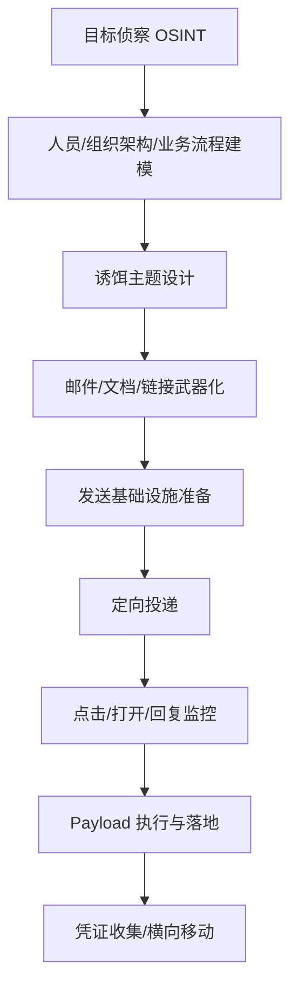

## 概述

本页面聚焦 **水坑攻击**、**鱼叉式网络钓鱼** 与 **邮件木马免杀投递** 三大核心社会工程学攻击技术，解析其攻击原理、实施流程、典型诱饵构造及免杀对抗手法，并结合供应链攻击视角与实战溯源案例建立交叉引用，形成可复用的知识结构。

> 相关宏观框架请参考 [[supply-chain-attack-fundamentals]]，其中已将水坑攻击、鱼叉钓鱼、邮件木马免杀纳入供应链攻击常见攻击向量体系。

---

## 一、供应链攻击背景与关联

供应链攻击通过受信任的第三方渠道（软件更新、硬件设备、固件引导代码）植入恶意代码，利用信任传递链达成横向渗透。三大细分形式分别为：

| 形式 | 典型载体 | 隐蔽特征 | 关联本页技术 |
|------|----------|----------|--------------|
| **软件供应链攻击** | 合法应用更新、源码注入、被盗签名证书 | 代码签名合法、难追踪 | 水坑攻击常利用被篡改的合法软件下载页分发 Payload |
| **硬件供应链攻击** | USB 键盘记录器、预置恶意固件的物理设备 | 物理接触、绕过网络边界 | 可作为鱼叉钓鱼的物理诱饵（如寄送“礼品”U 盘） |
| **固件供应链攻击** | Bootkit、UEFI 恶意模块 | 启动前执行、OS 级杀毒无感 | 邮件木马落地后常尝试写入固件实现持久化 |

> 详细定义与案例见 [[supply-chain-attack-fundamentals#软件供应链攻击]]、[[supply-chain-attack-fundamentals#硬件供应链攻击]]、[[supply-chain-attack-fundamentals#固件供应链攻击]]。

---

## 二、水坑攻击

### 定义与核心原理

**水坑攻击** 属于 APT 攻击的一种，攻击者不直接构建钓鱼站点，而是**攻陷目标群体高频访问的合法网站**（“水坑”），在其植入利用浏览器/插件漏洞的恶意代码。受害者因对该站点的信任而放松警惕，访问即中招。

- **欺骗性更强**：利用受害者对合法站点的固有信任
- **隐蔽性高**：无需发送钓鱼链接，流量特征与正常访问一致
- **典型漏洞利用链**：Adobe Reader / Java RCE / Flash / IE 零日漏洞 → Shellcode → 下载器 → 远控木马

### 实施流程


1. **目标画像**：确定行业、组织、岗位，推测必访站点（如金融从业者访问央行、银监会、财经媒体）。
2. **站点资产测绘**：爬虫/搜索引擎语法枚举目标站点技术栈、CMS 版本、插件组件。
3. **漏洞获取与武器化**：购买/挖掘浏览器/插件 RCE，构造隐蔽 Exploit Kit（常用加密、分段加载、域名前置）。
4. **网站失陷植入**：WebShell、供应链污染（CDN/第三方 JS）、SQL 注入篡改页面、被盗凭证登录后台。
5. **流量劫持与投递**：仅对目标 IP/UA/Referer 投递 Exploit，其他访问者返回正常页面，降低暴露面。
6. **落地与持久化**：漏洞利用执行 Shellcode → 下载器 → 免杀木马 → 权限维持。

### 典型场景

| 场景 | 目标群体 | 被攻陷 “水坑” 类型 | 关键技术点 |
|------|----------|-------------------|------------|
| 行业门户劫持 | 能源/电力/政府 | 行业协会官网、标准下载站 | CMS 0day + 针对性 IP 段投递 |
| 技术社区供应链污染 | 开发者/运维 | 开源库镜像站、技术论坛、IDE 插件市场 | 篡改下载链接/注入恶意 npm 包 |
| 供应商门户渗透 | 目标企业员工 | 供应商 VPN 门户、票据系统、共享文档库 | 凭证填充/SSO 跳转劫持 |

> 实战溯源视角：可结合 OSINT 手法反向追踪 “水坑” 站点历史快照、JS 变更记录、CDN 边缘节点日志，参考 [[osint-social-engineering-scam-investigation-case-study]] 中的 Google Hacking 与资产关联分析方法。

---

## 三、鱼叉式网络钓鱼

### 定义与区别

| 维度 | 批量钓鱼 | **鱼叉式钓鱼** |
|------|----------|----------------|
| 目标 | 大众/泛用户 | **特定组织/岗位/个人** |
| 诱饵 | 通用诱饵（中奖、账单） | **高度定制化**（内部文件、业务流程、人名、项目代号） |
| 成功率 | 低 | **高**（利用信任链与紧迫感） |
| 成本 | 低 | 高（需情报收集、文档伪造、基础设施搭建） |

### 核心实施流程



#### 关键环节详解

1. **情报收集**
   - LinkedIn/招聘网站/企业官网/公开招投标文件 → 组织架构、岗位职责、供应商名单、内部系统命名规范
   - 邮箱格式推测：`firstname.lastname@domain`、`flast@domain` 等
   - 社交媒体挖掘：员工晒工牌、会议纪要、出差行程、内部术语

2. **诱饵主题高频模板**
   | 类别 | 典型标题示例 | 心理杠杆 |
   |------|--------------|----------|
   | **IT/运维通知** | “域控密码策略变更-需今日内重置”、“VPN 证书即将过期，请下载附件更新” | 权威性 + 紧迫性 |
   | **财务/报销** | “Q3 差旅报销明细确认”、“发票电子底账导入模板” | 利益相关 + 流程合规 |
   | **HR/行政** | “年终绩效考核表填写”、“调薪通知附件”、“招聘简历-岗位匹配度高” | 个人切身利益 |
   | **业务/项目** | “项目验收签字扫描件”、“客户投诉处理记录”、“合同盖章版回传” | 业务连续性 |
   | **热点/八卦** | “内部裁员名单泄露”、“高管邮件泄露截图” | 好奇心 + 恐惧 |

3. **武器化载体**
   - **恶意链接**：短链接跳转 → 伪造登录页（OSSO/VPN/OWA/钉钉/飞书/企业微信）→ 凭证窃取
   - **恶意附件**：Office 宏/VBA、OLE 对象、RTF 漏洞、ISO/IMG 挂载、LNK 快捷方式、CHM 帮助文件、PDF 嵌入 JS/Launch Action
   - **回复诱导**：无附件无链接，仅伪造高管/同事身份引导回复、转账、发送验证码

4. **发送基础设施**
   - 域名伪造：子域名欺骗（`security.target.com.attacker.com`）、同形异义字、购买过期合法域名
   - 邮件服务器：自建 Postfix/Exchange + SPF/DKIM/DMARC 伪造、利用被盗企业邮箱/第三方营销平台发信
   - 流量分发：重定向链、Cloudflare Workers、GitHub Pages、Cloudflare R2 托管钓鱼页，动态切换 IP

### 典型攻击链示例

> **场景**：攻击某科技公司财务部
> 1. LinkedIn 确认财务总监姓名、邮箱格式、常用报销系统
> 2. 伪造“财务总监”发件人，主题“附件：10月差旅报销明细_需确认.xlsm”
> 3. 附件嵌入 Excel 4.0 宏 + 远程模板注入，打开即执行 PowerShell 下载 Cobalt Strike Beacon
> 4. 落地后利用凭证导出工具获取域控权限，横向移动至核心数据库

---

## 四、邮件木马免杀投递技术

### 为什么常规杀毒失效

- **特征库滞后**：新变种、定制化木马无静态特征
- **动态行为监测规避**：延迟执行、环境检测（沙箱/虚拟机/调试器）、无文件落地
- **信任链利用**：数字签名劫持、合法二进制代理执行、Office 组件滥用

### 免杀核心技术分类

| 类别 | 代表手法 | 原理 | 典型工具/框架 |
|------|----------|------|---------------|
| **静态对抗** | 加密/编码 Payload、修改 PE 头特征、资源节重组、字符串混淆、控制流平坦化 | 破坏静态特征匹配 | `Donut`、 `sRDI`、 `PeCloak`、 `ScareCrow`、 `Freeze` |
| **加壳/保护壳** | UPX/VMProtect/Themida/Enigma 自定义加壳、手工加壳 | 提高逆向分析成本，隐藏 IAT/入口点 | `VMProtect`、 `Themida`、 `krypto`、自研 Loader |
| **白利用** | 合法签名二进制代理执行、DLL 劫持/侧向加载、COM 劫持、WMI/WinRM/Scheduled Task 持久化 | 利用系统信任白名单绕过 EDR 规则 | `LOLBAS`、`GTFOBins`、 `SharpSploit`、 `Cobalt Strike` `execute-assembly` |
| **文档/脚本载体** | Office 宏/VBA/XLL/RTF/ISO/LNK/CHM/PDF/OneNote 嵌入 Payload | 利用用户交互触发，绕过网络边界网关 | `MacroPack`、 `OfficePwn`、 `SharpShooter`、 `VBad` |
| **无文件/内存执行** | Reflective DLL Injection、Process Hollowing、Early Bird APC、Thread Execution Hijacking、.NET Assembly 加载 | 仅驻留内存，磁盘无落地文件 | `Cobalt Strike Beacon`、 `Sliver`、 `Brute Ratel`、 `Havoc`、 `Donut` |
| **C2 通信隐匿** | 域前置、CDN 隐藏、DNS 隧道、HTTP/2/3、WebSocket、gRPC、合法云存储 API | 流量融入正常业务，绕过流量检测 | `Malleable C2 Profile`、 `Redirectors`、 `Cloudflare Workers`、 `Azure Functions` |

### Office 文档木马实战技巧

1. **宏/VBA**
   - 文档属性触发 `AutoOpen`/`Document_Open`/`AutoClose`
   - 字符串拆分/编码/运行时解密 Shellcode
   - `Application.Run` 调用 Excel 4.0 宏（XLM）绕过 VBA 检测

2. **OLE 对象 / ActiveX 控件**
   - 嵌入 `Equation`/`Package`/`Scriptlet` 对象，利用 `CVE-2017-11882`/`CVE-2018-0802` 等漏洞免交互执行

3. **远程模板注入**
   - `word/_rels/settings.xml.rels` 指向攻击者服务器 `.dotm`，打开文档自动加载远程宏代码，实现“文档与 Payload 分离、随时更新”

4. **ISO/IMG 挂载 + LNK 快捷方式**
   - 邮件附件发送 `.iso`/`.img`，用户双击自动挂载为虚拟光驱
   - 目录下放置恶意 `.lnk` 伪造文件夹图标，指向 `cmd /c powershell ...`，利用 `icon` 资源伪装

5. **CHM/HTML Help**
   - 编译 `.chm` 内嵌 `<OBJECT>` 标签调用 `Shortcut`/`ClickOnce`/`mshta` 执行代码

6. **OneNote (.one)**
   - 嵌入文件附件 + 鼠标悬停/点击触发执行，近期常用于绕过 Mark-of-the-Web (MotW)

### 木马下载器与分级落地

```
邮件附件/链接
      │
      ▼
Stage 0: Dropper / Downloader (极小体积、高免杀、仅做环境检测与下载)
      │
      ├─── 环境检测：沙箱/虚拟机/EDR 进程/睡眠加速/鼠标移动/重启次数
      │
      ▼
Stage 1: Stager (Reflective Loader / Shellcode Runner)
      │
      ▼
Stage 2: Full Implant (Cobalt Strike Beacon / Sliver / Havoc / 自研 RAT)
      │
      ├─── 横向移动、凭证窃取、数据分级打包、定时上传
      │
      ▼
Stage 3: Persistence (WMI/计划任务/注册表 Run/COM/服务/驱动/固件)
```

- **下载器常用协议**：HTTP/S、DNS TXT、WebSocket、GitHub Gist/Release API、Telegram Bot API、Cloudflare KV
- **加密传输**：AES/RSA/ChaCha20 + 域名前置/CDN 域名轮换

### 典型投递组合拳

| 组合 | 优势 | 典型检测盲区 |
|------|------|--------------|
| **伪造内部发件人 + ISO 附件 + LNK + PowerShell 下载器** | 绕过网关附件类型拦截、MotW 标记失效、用户习惯双击“文件夹” | 网关未解析 ISO 内部结构、EDR 未监控 `lnk` 解析行为 |
| **钓鱼链接 → 伪造 OWA 登录页 → 凭证获取 → 登录真实邮箱 → 设置转发规则/应用密码** | 无 Payload、纯凭证窃取、后续利用合法账号发送二阶段钓鱼 | 单因子认证、无异地登录告警、转发规则未审计 |
| **供应商被控邮箱回复正常业务邮件夹带恶意附件** | 完全合法的邮件上下文、SPF/DKIM/DMARC 全通过、信任链极强 | 邮件网关基于信誉而非内容分析、内部员工无二次确认流程 |

---

## 五、防御视角与检测建议

| 防御层 | 关键措施 | 对应攻击环节 |
|--------|----------|--------------|
| **网关/邮件安全** | 沙箱深度动态分析（模拟用户交互）、MotW 强制校验、ISO/IMG/LNK/CHM/OneNote 解析拦截、URL 沙箱爆破重定向链、DMARC/SPF/DKIM 强制、异地登录/转发规则审计 | 投递、武器化载体 |
| **端点 EDR/XDR** | 内存扫描（反射加载、进程挖空）、行为规则（Office 启动子进程、PowerShell/WMI/命令行异常、LNK 解析执行）、AMSI 集成、ETW/Tamper Protection 开启 | 落地、执行、横向移动 |
| **网络流量分析 (NDR)** | TLS 指纹识别 (JA3/JA3S)、域前置检测、DNS 隧道熵值分析、C2 心跳周期性建模、威胁情报 IP/域名/证书关联 | C2 通信、数据外泄 |
| **身份与访问** | MFA 强制、条件访问（设备合规/风险评分）、特权账号分级管理 (Tier 0/1/2)、PAM 会话录像、Kerberos 委派收敛 | 凭证窃取后的利用、横向移动 |
| **人员/流程** | 定向钓鱼演练（红队实战化）、异常邮件上报机制（一键上报）、财务/敏感操作双人复核/外带验证、供应商账号生命周期管理 | 社会工程学心理防线、业务流程欺骗 |

---

## 六、交叉引用与延伸阅读

- [[supply-chain-attack-fundamentals]] —— 供应链攻击全景框架，含水坑攻击、鱼叉钓鱼、邮件木马免杀的系统性定位
- [[osint-social-engineering-scam-investigation-case-study]] —— 实战案例：利用 Google Hacking、社交媒体分析、QQ 钓鱼、支付宝交易记录枚举手机号溯源诈骗团伙
- [[waf-bypass-techniques-case-study-ruijie]] —— WAF 绕过技巧（HTML 标签嵌套、Data URI Base64、超长注释），可用于钓鱼页面对抗网关检测
- [[ctf-misc入门与工具箱]] —— 流量分析、内存取证、文件修复工具链，辅助事后取证还原攻击链
- [[cybersecurity-training-resources-guide]] —— 系统性学习路径与避坑指南，适合从零构建红蓝对抗能力

---

## 七、变更记录

| 日期 | 版本 | 变更说明 |
|------|------|----------|
| 2023-04-16 | 1.0 | 初稿：整合归档文章，构建水坑攻击/鱼叉钓鱼/邮件木马免杀三大专题结构，补充流程图、对抗技术表、防御建议与交叉引用 |

---

> 本页面基于微信公众号归档文章（会话 ID `1681660234` 对应 2023-04-16）整理，旨在将零散技术细节沉淀为可检索、可关联、可演进的结构化知识资产。后续可继续扩充：红队实战复盘、蓝队检测规则 Sigma/YARA、ATT&CK 矩阵映射、自动化演练平台集成等维度。

## 来源

- [0x536d72-202112-202205_2](../sources/0x536d72-202112-202205_2.md)
